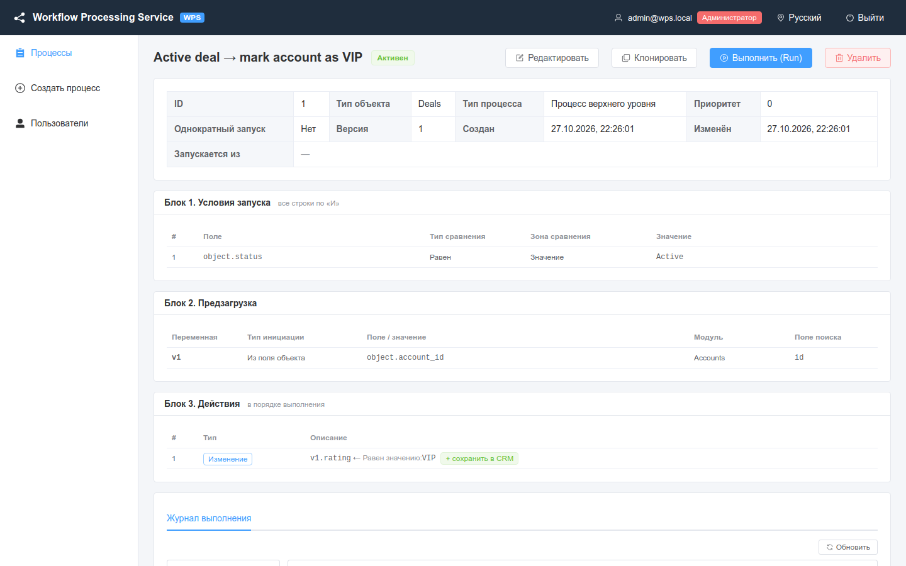
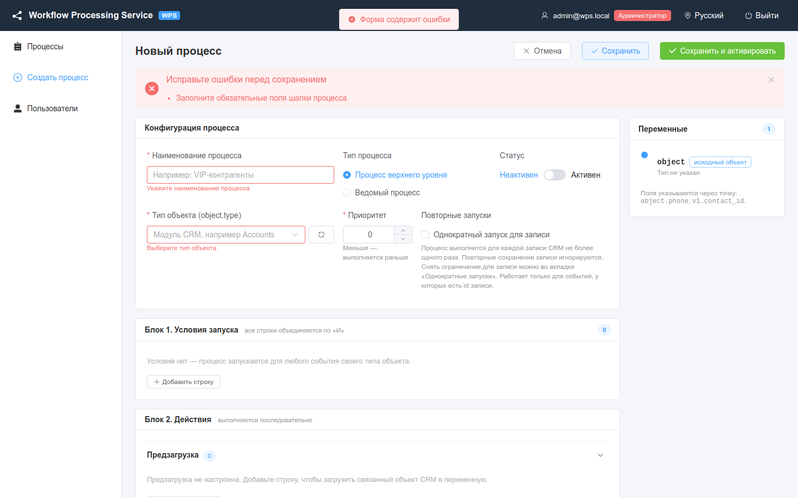

# Процессы

Как находить, создавать, редактировать, клонировать и удалять процессы и что означает каждое поле конфигурации процесса.

<!-- lang-switch -->
[🇬🇧 English](../../en/03-user-guide/processes.md) | 🇷🇺 Русский
<!-- /lang-switch -->

**Процесс** — это правило вида «когда в CRM сохранён объект типа X и условия выполнены, сделать такие-то действия». Он состоит из конфигурации (название, тип, тип объекта, приоритет…), условий запуска и цепочки действий. Условия описаны в разделе [Условия запуска](triggers-and-conditions.md), действия — в разделе [Действия](actions.md).

## Список процессов

Меню **Процессы** (`/processes`).


*Список процессов с фильтрами. Оранжевая метка `1×` — у процессов с однократным запуском для записи.*

Колонки: **ID**, **Название** (ссылка на карточку), **Тип объекта**, **Тип процесса** (**Верхнего уровня** / **Ведомый**), **Активность** (**Активен** / **Неактивен**), **Приоритет**, **Изменён**, **Действия**.

Фильтры над таблицей:

| Фильтр | Что делает |
|---|---|
| **Поиск по названию** | Поиск подстроки в названии процесса |
| **Тип объекта** | Модуль CRM; можно выбрать из списка или ввести любое значение |
| **Тип процесса** | **Верхнего уровня** или **Ведомый** |
| **Активность** | **Активные** или **Неактивные** |
| **Сбросить** | Сбрасывает все фильтры |

Список отсортирован по времени изменения, новые сверху. Кнопка **Обновить** перезагружает его.

Кнопки строки (значки в колонке **Действия**): **Просмотр**, **Редактировать** и **Клонировать** (admin, editor), **Удалить** (только admin).

## Карточка процесса

Нажмите на название процесса, чтобы открыть карточку (`/processes/{id}`).



*Карточка процесса: свойства, условия запуска, предзагрузка и действия в порядке выполнения.*

В карточке:

- свойства: **Тип объекта**, **Тип процесса**, **Приоритет**, **Однократный запуск**, **Версия**, **Создан**, **Изменён**, а у ведомого процесса — **Запускается из** со ссылками на процессы, которые его запускают;
- **Блок 1. Условия запуска**, **Блок 2. Предзагрузка**, **Блок 3. Действия** — таблицы только для чтения;
- у процесса верхнего уровня, запускающего ведомые, — строка **Ведомые процессы:** со ссылками;
- вкладка **Журнал выполнения** (см. [Выполнения и аудит](executions-and-audit.md)), а у процессов с однократным запуском — вкладка **Однократные запуски** (см. [Ручной запуск и сброс однократного запуска](manual-run-and-reset.md)).

Кнопки в заголовке: **Редактировать**, **Клонировать**, **Выполнить (Run)** (admin, editor) и **Удалить** (admin).

Действия, которые настраиваются только через JSON/API, карточка тоже показывает: для изменений с расчётом и шаблоном — целевое поле и выражение, для остальных типов (`delay`, `send_email`, `http_request` и др.) — их конфигурацию в виде JSON.


*Карточка процесса с выражениями: функции списков, `regex_replace`, шаблон с `sys.*` и константой из `config.*`.*

## Создание процесса

1. Нажмите **Создать процесс** в меню или над списком.
2. Заполните блок **Конфигурация процесса** (поля описаны ниже).
3. Добавьте условия в **Блок 1. Условия запуска** — или оставьте его пустым, чтобы процесс запускался на каждое событие своего типа объекта.
4. Настройте **Блок 2. Действия**: **Предзагрузка**, **Изменить объект / переменную**, **Запустить следующий процесс**.
5. Нажмите **Сохранить** (процесс сохраняется как есть; новый процесс по умолчанию **Неактивен**) или **Сохранить и активировать** (процесс сохраняется со **Статусом** **Активен**).

После сохранения появится сообщение **Процесс создан**, и откроется карточка процесса.


*Редактор: конфигурация процесса, условия, действия и панель **Переменные** справа.*

Панель **Переменные** справа показывает все переменные, доступные процессу в этом месте: `object` (**исходный объект**), переменные, **загруженные из CRM** предзагрузкой, и переменные, **созданные в процессе** действиями изменения, с их типом (модулем) и уже использованными полями. Пользуйтесь ею как подсказкой, когда вводите пути вида `object.phone` или `v1.contact_id`.

Если попытаться уйти из редактора с несохранёнными изменениями (метка **не сохранено** рядом с заголовком), WPS спросит **Есть несохранённые изменения. Покинуть страницу?** — **Покинуть** / **Остаться**.

## Поля конфигурации

| Поле | Назначение | Значения | Пример | Ошибки |
|---|---|---|---|---|
| **Наименование процесса** | Название в списках и в аудите | обязательно, до 255 символов | `Active deal → mark account as VIP` | **Укажите наименование процесса**, **Не более 255 символов**; API: `Process name is required`, `Process name is too long (max 255)` |
| **Тип процесса** | **Процесс верхнего уровня** запускается событиями CRM. **Ведомый процесс** запускается только другим процессом через «Запустить следующий процесс» | `is_child`: `false` / `true` | Верхнего уровня | API: `Must be true or false`. Ведомый процесс, который запускают другие процессы, нельзя сделать процессом верхнего уровня: `The process is started by other processes (…) and must stay a child process` |
| **Статус** | **Активен** / **Неактивен**. Неактивный процесс не реагирует на события и пропускается, когда его пытается запустить другой процесс | `is_active` | Активен | API: `Must be true or false` |
| **Тип объекта (object.type)** | Модуль CRM, события которого запускают процесс. Для ведомого процесса — модуль записи, с которой он работает | латиница, цифры, `_`, начинается с буквы. Выберите из списка или введите | `Deals` | **Выберите тип объекта**; API: `Object type (CRM module) is required` |
| **Приоритет** | Порядок среди процессов одного типа объекта: **Меньше — выполняется раньше** | целое число, можно отрицательное, по умолчанию `0` | `10` | **Укажите приоритет**; API: `Priority must be an integer` |
| **Повторные запуски** → **Однократный запуск для записи** | Процесс выполняется для каждой записи CRM не более одного раза; следующие сохранения этой записи игнорируются | `run_once`: `false` / `true` | выключено | API: `Must be true or false` |
| **Запускать при** (только API) | Типы событий CRM, на которые запускается процесс верхнего уровня: создание, изменение, удаление записи. У ведомого процесса игнорируется; ручной запуск его не проверяет | `trigger_on`: массив из `create`, `update`, `delete`; по умолчанию `["create", "update"]`; `[]` — только вручную | `["delete"]` | API: `Must be an array of event types`, `Unknown event type "link" (allowed: create, update, delete)`, `The process runs only on delete: the deleted record cannot be saved` |

### Тип объекта и список модулей

Список модулей приходит из CRM (или из мока) и кэшируется на 5 минут (`DICT_CACHE_TTL`). Если модуль только что добавили в CRM, нажмите кнопку обновления рядом с полем (**Обновить список модулей из CRM**, доступна редакторам и администраторам). После обновления появится сообщение **Список модулей обновлён**. Можно также ввести название модуля, которого нет в списке.

### Приоритет

Когда приходит событие, WPS берёт все **активные процессы верхнего уровня** его типа объекта и выполняет их по очереди в порядке возрастания приоритета (при равном приоритете — по ID). Каждый процесс получает свою копию события; ошибка в одном процессе не останавливает остальные. См. [Условия запуска](triggers-and-conditions.md#когда-запускается-процесс).

### Запускать при (trigger_on)

Поле задаётся через API (в интерфейсе редактора его пока нет). Значение по умолчанию `["create", "update"]` совпадает с прежним
поведением; `PUT` без поля сохраняет текущее значение, поэтому редактор, который о поле не знает, его не сбросит. Подробно — в
[Условиях запуска](triggers-and-conditions.md#тип-события-и-поле-запускать-при-trigger_on), в том числе что происходит при
удалении записи. Список процессов фильтруется параметром `GET /api/processes?trigger_on=delete`.

### Однократный запуск для записи

Когда флаг включён, первое выполнение для записи CRM (модуль + `id` записи) оставляет **отметку**. Следующие события той же записи процесс уже не запускают. Отметка ставится, только если условия выполнены, и остаётся, даже если выполнение завершилось ошибкой. Работает только для событий, у которых есть `id` записи. Отметки показываются и сбрасываются во вкладке **Однократные запуски** — см. [Ручной запуск и сброс однократного запуска](manual-run-and-reset.md).

### Константы процесса

**Константы** — общие значения, объявленные один раз в определении процесса. Все строки процесса читают их как `config.<имя>`; порог, адрес или список меняются в одном месте, а не в каждой строке.

```json
"definition": {
  "constants": {
    "vip_threshold": 100000,
    "manager_email": "sales-head@example.com",
    "open_stages": ["Prospecting", "Qualification"]
  },
  "conditions": [], "preload": [], "actions": []
}
```

| Правило | Значение |
|---|---|
| Имя | латиница, цифры, `_`, не с цифры; до 100 констант |
| Значение | скаляр (`string`, `int`, `float`, `bool`, `null`) или список скаляров; JSON констант не больше 16 КБ |
| Чтение | `config.vip_threshold`, `config.open_stages` — в условиях, выражениях **Расчёт**, шаблонах, фильтрах и `set_variable` |
| Запись | запрещена: `config` — имя только для чтения |
| Секреты | имена с `password`, `secret`, `token`, `api_key` отклоняются — для секретов используйте `secret://имя` (см. [Секреты процессов](../04-operations/security.md#секреты-процессов)) |

Поле задаётся через API (`definition.constants`); отдельного блока в редакторе пока нет. Константы попадают в снимок определения выполнения, поэтому правка констант не меняет уже идущие и ожидающие выполнения. Дочерний процесс видит **свои** константы, а не константы родителя.

Ошибки сохранения (`422`): `Constants must be an object`, `Invalid constant name (letters, digits, "_")`, `Constant must be a scalar or a list of scalars`, `Too many constants (max 100)`, `Constants are too large (max 16 KB)`, `Constant "api_token" looks like a secret; use a secret reference (secret://name)`; неизвестная константа в пути — `Constant "x" is not defined in definition.constants`.

Рядом с `config.*` процессу всегда доступны системные переменные `sys.*` — см. [Системные переменные и константы](change-types-and-expressions.md#системные-переменные-и-константы).

### Структура процесса в API

Процесс — один JSON-объект; редактор строит тот же объект. Поля `POST /api/processes` и `PUT /api/processes/{id}`
(подробно — [Эндпоинты](../06-api-reference/endpoints.md)):

| Поле | Тип | Если не передано | Примечания |
|---|---|---|---|
| `name` | string | — (обязательно) | пробелы по краям обрезаются; до 255 символов |
| `object_type` | string | — (обязательно) | `^[A-Za-z][A-Za-z0-9_]*$`, например `Opportunities` |
| `is_child` | bool | `false` | ведомый процесс запускается только `start_process`; в нём допустимы необъявленные имена переменных (он наследует переменные родителя) |
| `is_active` | bool | **`true`** | редактор присылает `false` для нового процесса; прямой вызов API без поля создаёт **активный** процесс |
| `priority` | integer | `0` | целое или строка из цифр (`"-5"`); меньше — раньше |
| `run_once` | bool | `false` | см. [Однократный запуск для записи](#однократный-запуск-для-записи) |
| `trigger_on` | list | `["create", "update"]` | повторы убираются, порядок приводится к `create, update, delete` |
| `definition.conditions` | список или группа | `[]` | [Условия запуска](triggers-and-conditions.md) |
| `definition.preload` | list | `[]` | строки предзагрузки (выполняются перед действиями) |
| `definition.actions` | list | `[]` | [Действия](actions.md); вложенность блоков (`condition`, `foreach`) — до `PROGRAM_MAX_DEPTH` (по умолчанию 5), иначе `Nesting is too deep (max 5)` |
| `definition.constants` | object | `{}` | [Константы процесса](#константы-процесса) |

Поля ответа только для чтения: `id`, `version`, `created_at`, `updated_at`. В ответе на сохранение может быть
`warnings` — неблокирующие замечания, например `Variable "v2" may be undefined here: it is set only in some branches`.

> **Внимание**
> `PUT` заменяет процесс **целиком**: не переданное поле получает значение по умолчанию (без `is_active` процесс станет
> активным, без `definition` — пустым). Исключение — `trigger_on`: если его нет, сохраняется текущее значение.
> Отправляйте весь объект, полученный из `GET /api/processes/{id}`.

## Редактирование и версии

1. Откройте карточку процесса и нажмите **Редактировать** (или значок редактирования в списке).
2. Внесите изменения и нажмите **Сохранить** или **Сохранить и активировать**.

Каждое сохранение (`PUT`) увеличивает версию на 1, даже если ничего не изменилось; новый процесс и копия начинают с версии 1. Версия видна в заголовке редактора (`#1 · версия 3`) и в сообщении об успехе **Процесс сохранён (версия N)**. Каждое выполнение запоминает версию, с которой оно запускалось (**(версия N)** на странице выполнения), поэтому аудит остаётся понятным и после изменений. Список активных процессов кэшируется до 60 секунд (`PROCESS_CACHE_TTL`), но сохранение сбрасывает кэш, так что изменение применяется к следующему событию.

> **Примечание**
> Уже начатое выполнение доводится до конца с тем определением, с которым оно стартовало.

Где видна версия: `version` процесса, `process_version` выполнения, `sys.process_version` в выражениях и шаблонах.
История старых определений не хранится — только текущее и снимки в идущих или ожидающих выполнениях (ожидающее
выполнение продолжается со своим снимком и после правки процесса).

## Клонирование

**Клонировать** (в списке или в карточке) создаёт копию с названием `<название> (копия)`. Копия:

- **неактивна** — проверьте её и включите явно;
- сохраняет тип, тип объекта, приоритет, флаг однократного запуска, `trigger_on` и всё определение;
- **не** переносит отметки однократного запуска исходного процесса.

Появится сообщение **Создана копия «…»**, и откроется редактор копии.

## Удаление

Удалять процессы может только администратор.

1. Нажмите **Удалить** в карточке или значок удаления в списке.
2. Подтвердите: **Удалить процесс «…»? Действие необратимо.**

Если процесс запускается другими процессами («Запустить следующий процесс»), удаление отклоняется: **Процесс используется другими процессами (start_process) и не может быть удалён** (`409 PROCESS_IN_USE`). Сначала уберите ссылку на него из этих процессов.

Если у процесса есть ожидающие выполнения (`delay`, ожидание события), удаление отклоняется с `409 PROCESS_HAS_WAITING_EXECUTIONS`
и числом ожидающих; `DELETE /api/processes/{id}?force=true` (admin) удаляет процесс и отменяет их (статус **Отменено**,
см. [Выполнения и аудит](executions-and-audit.md)).

Удаление «мягкое»: процесс пропадает из списков и перестаёт выполняться, но его выполнения остаются в аудите.

## Ошибки валидации

WPS проверяет процесс дважды: в браузере перед отправкой и на сервере.



*Сохранение пустой формы: блок **Исправьте ошибки перед сохранением** и подсвеченные обязательные поля.*

**Проверки в браузере.** Блок **Исправьте ошибки перед сохранением** перечисляет проблемы с указанием строки: `Условие 1: …`, `Предзагрузка 1 (v1): …`, `Действие 2: …`, `Запуск процесса 1: …`. Типичные сообщения:

| Сообщение | Как исправить |
|---|---|
| Заполните обязательные поля шапки процесса | Заполните наименование, тип объекта, приоритет |
| укажите поле (object.поле) | Поле условия должно выглядеть как `object.status` или `v1.status` |
| укажите путь поля для сравнения | Для **Из поля объекта/переменной** значение должно быть путём |
| некорректное имя переменной / имя «object» зарезервировано / имя переменной уже используется | Имя переменной предзагрузки: латиница, цифры, `_`; не `object`; уникальное |
| укажите модуль / укажите значение | Строка предзагрузки заполнена не полностью |
| путь должен начинаться с object. | Для **Из поля объекта** путь начинается с `object.` |
| переменная «v1» должна быть объявлена выше | **Из поля переменной** может ссылаться только на переменные из строк выше |
| укажите поле назначения (object.поле или v1.поле) | Цель изменения должна указывать на поле |
| укажите сохраняемую переменную | Строка **Сохранить в CRM** без переменной |
| выберите процесс / процесс не может запускать сам себя | Строка «Запустить следующий процесс» без процесса или со ссылкой на себя |

**Проверки на сервере.** Если сервер отклонил сохранение, появится сообщение **Сервер отклонил сохранение** и блок с серверными сообщениями (`422 VALIDATION_ERROR`, у каждого — путь поля, например `definition.actions[0].value`). Сервер отвечает по-английски. Примеры:

| Сообщение сервера | Что означает |
|---|---|
| `Variable "v9" is not defined at this point` | Путь ссылается на переменную, которая не объявлена до этой строки |
| `Unknown function "foo"` | Неизвестная функция в выражении **Расчёт** |
| `Unknown comparison operator` / `Unknown action type` | Значения нет в справочнике (возможно только через API) |
| `Process 42 not found` / `Process 42 "…" is not a child process` | «Запустить следующий процесс» ссылается на несуществующий или не ведомый процесс |
| `"object" must point to a field, e.g. object.name` | Цель изменения — переменная целиком, а не поле |
| `Definition must be an object`, `Must be an array` (`definition.preload` / `definition.actions`), `Must be an array or a condition group` (`definition.conditions`), `Unknown key "x" (allowed: conditions, preload, actions, constants)` (`definition.x`) | Неверная форма блоков определения или лишний ключ (часто опечатка: `constant` вместо `constants`) |
| `Change type must be one of: set_value, …` | Неизвестный тип изменения |
| `Nesting is too deep (max 5)` | Блоки `condition` / `foreach` вложены глубже `PROGRAM_MAX_DEPTH` |
| `Name "config" is reserved`, `Variable "sys" is read-only` | Имя `object`, `object_before`, `sys` или `config` занято предзагрузкой, `set_variable` или целью изменения |
| `Must be AND or OR` | Неверный `logical_operator` группы условий |
| `The process is started by other processes (…) and must stay a child process` (`is_child`) | Ведомый процесс, который запускают другие, переводится в верхний уровень |

Цикл запуска (А запускает Б, Б запускает А) сообщается как **Обнаружен цикл запуска процессов — процесс не может (косвенно) запускать сам себя** (`422 CYCLE_DETECTED`) с цепочкой процессов.

## См. также

- [Условия запуска](triggers-and-conditions.md)
- [Действия](actions.md)
- [Ведомые процессы](subprocesses.md)
- [Готовые сценарии](recipes.md)
- API: [Эндпоинты](../06-api-reference/endpoints.md)

<!-- footer-nav -->
---

← Назад: [Вход и интерфейс](login-and-ui.md) | [Оглавление](../README.md) | [Условия запуска](triggers-and-conditions.md) Далее →
<!-- /footer-nav -->
