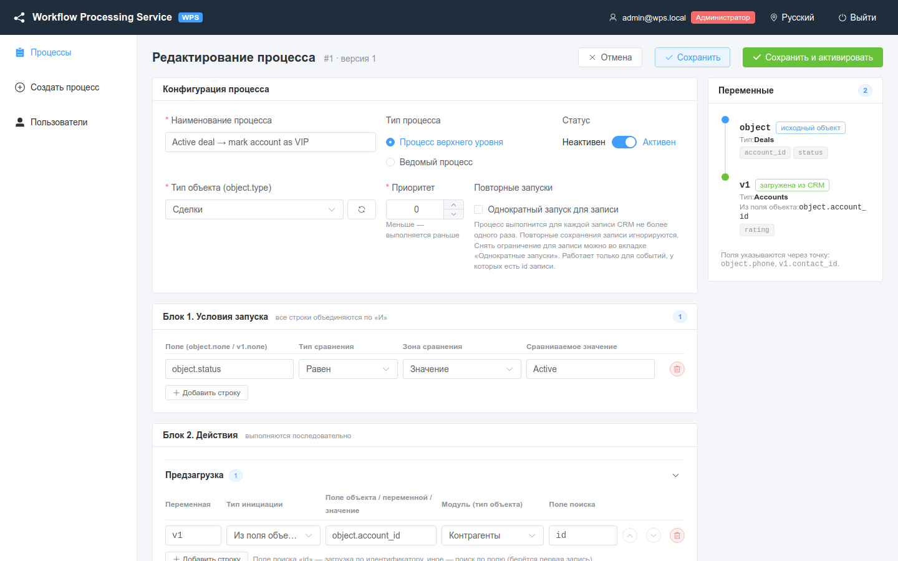
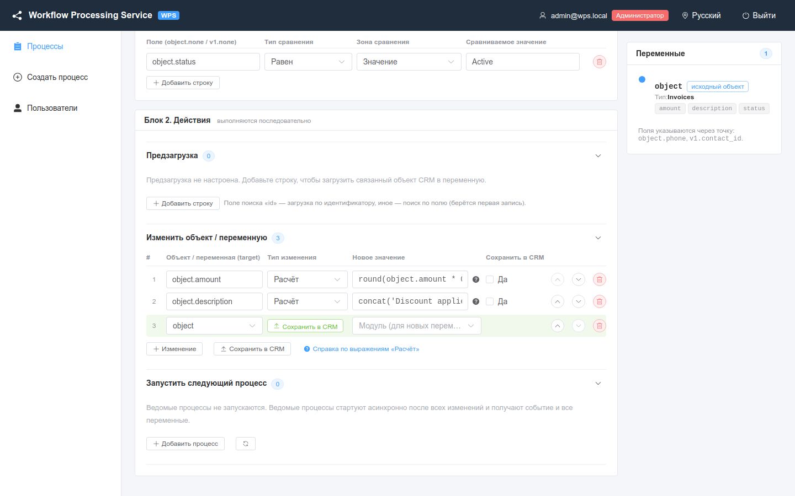
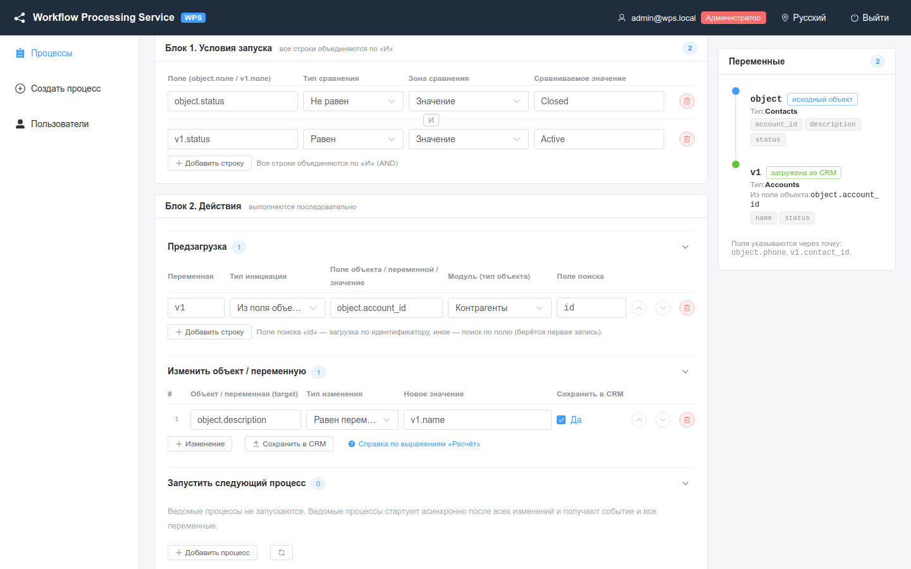
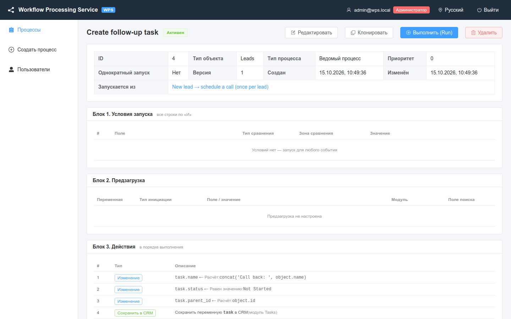
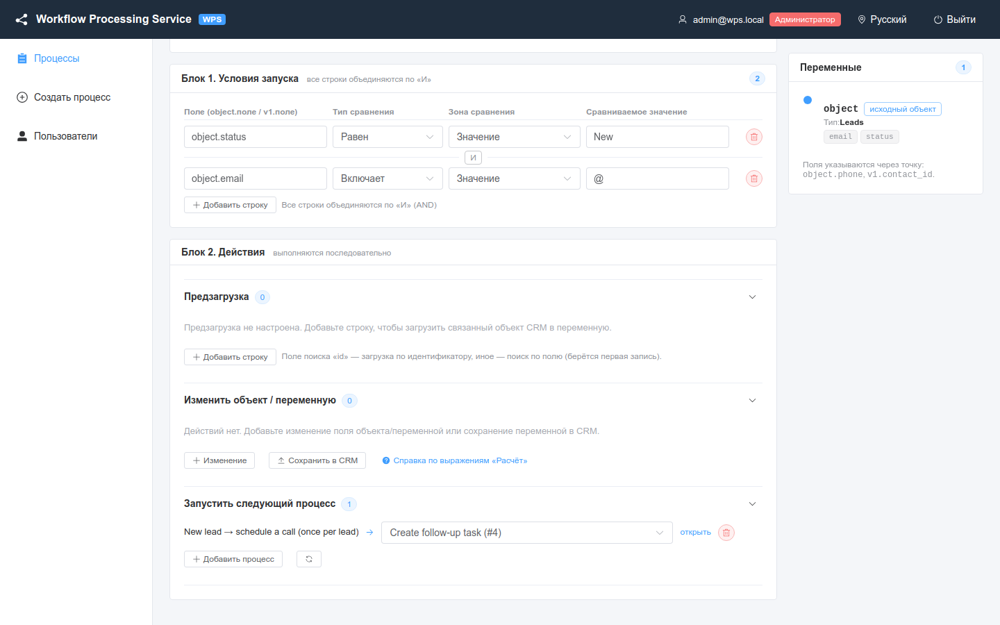
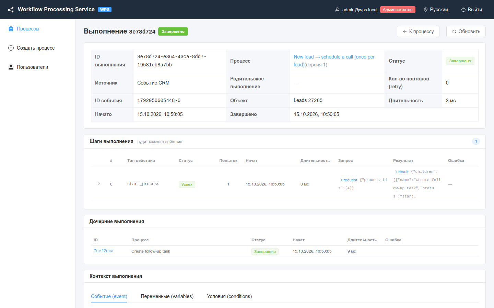

# Готовые сценарии

Восемь готовых сквозных сценариев: что делает каждый процесс, как его настроить, его JSON и как проверить его на моке CRM.

<!-- lang-switch -->
[🇬🇧 English](../../en/03-user-guide/recipes.md) | 🇷🇺 Русский
<!-- /lang-switch -->

Все сценарии проверены на встроенном моке CRM (см. [Быстрый старт](../02-getting-started/quick-start.md)): мок публикует
тестовые события в стрим и эмулирует API CRM, поэтому всё можно попробовать без настоящей CRM.

## Как пользоваться сценарием

- **Настройте процесс в интерфейсе**: **Создать процесс**, заполните поля, как описано, затем **Сохранить и активировать**.
- **Или создайте его через API** по JSON из сценария:

  ```bash
  TOKEN=$(curl -s -X POST http://localhost:9501/api/auth/login -H 'Content-Type: application/json' \
    -d '{"email":"admin@wps.local","password":"admin"}' | python3 -c 'import sys,json;print(json.load(sys.stdin)["data"]["access_token"])')

  curl -s -X POST http://localhost:9501/api/processes -H "Authorization: Bearer $TOKEN" \
    -H 'Content-Type: application/json' -d @recipe.json
  ```

  JSON-файлы сценариев 1–6 лежат в репозитории: `doc/_meta/demo_processes/`.
- **Отправьте тестовое событие** в мок. Используйте `curl -g`, иначе curl воспримет квадратные скобки в `set[status]`
  как шаблон:

  ```bash
  curl -sg "http://localhost:9502/test-event?module=Deals&set[status]=Active"
  ```

  Мок генерирует объект модуля, сохраняет его в моке CRM, подставляет значения из `set[...]` и публикует событие. В
  ответе есть сгенерированный `event` (запомните его `id` и `account_id`).
- **Проверьте результат** в карточке процесса → **Журнал выполнения** и откройте выполнение
  (см. [Выполнения и аудит](executions-and-audit.md)). Записи мока CRM можно прочитать запросом
  `curl -s http://localhost:9502/mock/objects/<Модуль>/<id>`.

> **Примечание**
> Процесс реагирует на событие в течение секунды, но список процессов для типа объекта кешируется на срок до
> `PROCESS_CACHE_TTL` (60 с). При сохранении процесса кеш сбрасывается, поэтому новый процесс подхватывается сразу.

| # | Сценарий | Тип объекта | Что показывает |
|---|---|---|---|
| 1 | [Активная сделка → контрагент VIP](#1-активная-сделка--контрагент-vip) | Deals | условие, предзагрузка по id, **Равен значению** + **Сохранить в CRM** |
| 2 | [Скидка 10 % на счёт](#2-скидка-10--на-счёт) | Invoices | **Расчёт**, функции `round`, `concat`, сохранение объекта события |
| 3 | [Контакт: название контрагента](#3-контакт-название-контрагента) | Contacts | условие на предзагруженную переменную, **Равен переменной** |
| 4 | [Ведомый процесс: задача на перезвон](#4-ведомый-процесс-задача-на-перезвон) | Leads (ведомый) | новая переменная сохраняется как новая запись CRM |
| 5 | [Синхронизация платежа: сбой CRM](#5-синхронизация-платежа-сбой-crm) | Payments | повторы и выполнение с ошибкой |
| 6 | [Новый лид → звонок, один раз на лид](#6-новый-лид--звонок-один-раз-на-лид) | Leads | **Включает**, **Запустить следующий процесс**, **Однократный запуск для записи** |
| 7 | [Заказ: контрагент по ИНН](#7-заказ-контрагент-по-инн) | Orders | предзагрузка по полю, отличному от id |
| 8 | [Обращение: заметка у контакта контрагента](#8-обращение-заметка-у-контакта-контрагента) | Tickets | цепочка предзагрузки **Из поля переменной**, защитное условие |

---

## 1. Активная сделка → контрагент VIP

**Цель.** Когда сделка сохраняется со статусом `Active`, выставить её контрагенту в CRM поле `rating` = `VIP`.

**Настройка в интерфейсе**

1. **Наименование процесса**: `Active deal → mark account as VIP`; **Тип процесса**: **Процесс верхнего уровня**;
   **Тип объекта (object.type)**: `Deals`.
2. **Блок 1. Условия запуска** → **Добавить строку**: `object.status` · **Равен** · **Значение** · `Active`.
3. **Предзагрузка** → **Добавить строку**: переменная `v1`, тип инициации **Из поля объекта**, `object.account_id`,
   модуль `Accounts`, поле поиска `id`.
4. **Изменить объект / переменную** → **Изменение**: `v1.rating`, **Равен значению**, `VIP`, отметьте **Сохранить в CRM**.



*Форма редактирования: конфигурация, одно условие, предзагрузка `v1` и панель переменных.*

**JSON**

```json
{
  "name": "Active deal → mark account as VIP",
  "object_type": "Deals", "is_child": false, "is_active": true, "priority": 0, "run_once": false,
  "definition": {
    "conditions": [
      { "field": "object.status", "operator": "equals", "value_type": "static", "value": "Active" }
    ],
    "preload": [
      { "var": "v1", "source": "object_field", "module": "Accounts", "by_field": "id", "value": "object.account_id" }
    ],
    "actions": [
      { "type": "modify", "target": "v1.rating", "change_type": "set_value", "value": "VIP", "save_to_crm": true }
    ]
  }
}
```

**Проверка**

```bash
curl -sg "http://localhost:9502/test-event?module=Deals&set[status]=Active"   # процесс запустится
curl -sg "http://localhost:9502/test-event?module=Deals&set[status]=Closed"   # процесс не запустится
curl -s  "http://localhost:9502/mock/objects/Accounts/<account_id из события>"   # "rating": "VIP"
```

**Что вы увидите.** По выполнению на каждую сделку `Active` со статусом **Завершено** и двумя шагами: `preload`
(`found: true`, контрагент в `result_data.object`) и `modify` (`old_value: ""`, `new_value: "VIP"` и блок `save` с
`"method": "PUT"`, `"attributes": {"rating": "VIP"}`). Для сделки `Closed` выполнения нет: условия не выполнены.


*Выполнение сценария 1: предзагрузка контрагента, затем изменение с сохранением в CRM.*

---

## 2. Скидка 10 % на счёт

**Цель.** Для счёта со статусом `Active` уменьшить `amount` на 10 %, записать пояснение в `description` и сохранить оба поля.

**Настройка в интерфейсе**

1. **Тип объекта**: `Invoices`; **Приоритет**: `10` (если на один тип объекта реагируют несколько процессов, процесс с
   меньшим значением выполняется раньше).
2. Условие: `object.status` · **Равен** · **Значение** · `Active`.
3. **Изменить объект / переменную**:
   - **Изменение**: `object.amount`, **Расчёт**, `round(object.amount * 0.9, 2)`;
   - **Изменение**: `object.description`, **Расчёт**, `concat('Discount applied, new amount: ', object.amount)`;
   - **Сохранить в CRM** (кнопка под таблицей): переменная `object`.



*Сценарий 2: второе выражение уже использует новое значение `object.amount`, вычисленное первым.*

**JSON**

```json
{
  "name": "Invoice discount 10%",
  "object_type": "Invoices", "is_child": false, "is_active": true, "priority": 10, "run_once": false,
  "definition": {
    "conditions": [
      { "field": "object.status", "operator": "equals", "value_type": "static", "value": "Active" }
    ],
    "preload": [],
    "actions": [
      { "type": "modify", "target": "object.amount", "change_type": "calculate", "value": "round(object.amount * 0.9, 2)", "save_to_crm": false },
      { "type": "modify", "target": "object.description", "change_type": "calculate", "value": "concat('Discount applied, new amount: ', object.amount)", "save_to_crm": false },
      { "type": "save_object", "target": "object" }
    ]
  }
}
```

**Проверка**

```bash
curl -sg "http://localhost:9502/test-event?module=Invoices&set[status]=Active&set[amount]=19500"
```

**Что вы увидите.** Три успешных шага. `modify` #0: `old_value "19500"` → `new_value 17550`; `modify` #1:
`"Discount applied, new amount: 17550"`; `save_object`: `"method": "PUT"`, в `attributes` только два изменённых поля.
Действия выполняются строго по порядку, а несохранённые изменения копятся и уходят в CRM одним запросом.

---

## 3. Контакт: название контрагента

**Цель.** Когда сохраняется контакт не в статусе `Closed`, а его контрагент активен, скопировать название контрагента в
поле `description` контакта.

**Настройка в интерфейсе**

1. **Тип объекта**: `Contacts`.
2. Условия:
   - `object.status` · **Не равен** · **Значение** · `Closed`;
   - `v1.status` · **Равен** · **Значение** · `Active`.
3. **Предзагрузка**: `v1`, **Из поля объекта**, `object.account_id`, `Accounts`, `id`.
4. **Изменение**: `object.description`, **Равен переменной**, `v1.name`, **Сохранить в CRM**.



*Второе условие использует `v1`: панель переменных показывает, что `v1` загружается из CRM.*

**Как это работает.** Условие на переменную включает **ленивую предзагрузку**: WPS сначала проверяет строки по
`object.*` и только если они выполнены, запускает предзагрузку и проверяет остальные строки. Поэтому контакт со
статусом `Closed` не стоит ни одного запроса к CRM.

**JSON**

```json
{
  "name": "Contact: copy account name",
  "object_type": "Contacts", "is_child": false, "is_active": true, "priority": 0, "run_once": false,
  "definition": {
    "conditions": [
      { "field": "object.status", "operator": "not_equals", "value_type": "static", "value": "Closed" },
      { "field": "v1.status", "operator": "equals", "value_type": "static", "value": "Active" }
    ],
    "preload": [
      { "var": "v1", "source": "object_field", "module": "Accounts", "by_field": "id", "value": "object.account_id" }
    ],
    "actions": [
      { "type": "modify", "target": "object.description", "change_type": "set_from_variable", "value": "v1.name", "save_to_crm": true }
    ]
  }
}
```

**Проверка**

```bash
curl -sg "http://localhost:9502/test-event?module=Contacts&set[status]=New"
```

**Что вы увидите.** Шаги `preload` (контрагент) и `modify`: `new_value` — название контрагента,
`save.attributes = {"description": "<название контрагента>"}`. Во вкладке **Условия (conditions)** контекста обе строки
с `result: true`.

---

## 4. Ведомый процесс: задача на перезвон

**Цель.** Переиспользуемый ведомый процесс, который создаёт запись `Tasks` «Call back: <имя лида>», связанную с лидом.
Его запускает сценарий 6.

**Настройка в интерфейсе**

1. **Тип процесса**: **Ведомый процесс**; **Тип объекта**: `Leads`; условий нет.
2. **Изменить объект / переменную**:
   - `task.name`, **Расчёт**, `concat('Call back: ', object.name)`;
   - `task.status`, **Равен значению**, `Not Started`;
   - `task.parent_id`, **Расчёт**, `object.id`;
   - **Сохранить в CRM**: переменная `task`, модуль `Tasks`.

Переменная `task` не загружается предзагрузкой: первое изменение создаёт её как новый объект. Переменная без `id`
сохраняется запросом `POST`, то есть как новая запись CRM, поэтому в строке сохранения нужно указать модуль.

**JSON**

```json
{
  "name": "Create follow-up task",
  "object_type": "Leads", "is_child": true, "is_active": true, "priority": 0, "run_once": false,
  "definition": {
    "conditions": [],
    "preload": [],
    "actions": [
      { "type": "modify", "target": "task.name", "change_type": "calculate", "value": "concat('Call back: ', object.name)", "save_to_crm": false },
      { "type": "modify", "target": "task.status", "change_type": "set_value", "value": "Not Started", "save_to_crm": false },
      { "type": "modify", "target": "task.parent_id", "change_type": "calculate", "value": "object.id", "save_to_crm": false },
      { "type": "save_object", "target": "task", "module": "Tasks" }
    ]
  }
}
```

**Проверка.** Ведомый процесс не реагирует на события: проверьте его через сценарий 6 или запустите вручную из
карточки с объектом `{"id": "1", "module": "Leads", "name": "Test lead"}`.

**Что вы увидите.** Четыре шага; у `save_object` — `"method": "POST"`, `"module": "Tasks"` и `created_id` — id новой
задачи. Источник запуска — **Дочерний**, **Родительское выполнение** ведёт на выполнение сценария 6.



*Сценарий 4: в поле **Запускается из** — родительский процесс.*

---

## 5. Синхронизация платежа: сбой CRM

**Цель.** Показать, что происходит при сбое CRM. Предзагрузка запрашивает контрагента `fail500-demo`, а мок отвечает
HTTP 500 на любой id, начинающийся с `fail500`.

**JSON**

```json
{
  "name": "Payment sync (CRM failure demo)",
  "object_type": "Payments", "is_child": false, "is_active": true, "priority": 0, "run_once": false,
  "definition": {
    "conditions": [],
    "preload": [],
    "actions": [
      { "type": "preload", "var": "v1", "source": "manual", "module": "Accounts", "by_field": "id", "value": "fail500-demo" },
      { "type": "modify", "target": "object.status", "change_type": "set_value", "value": "Synced", "save_to_crm": true }
    ]
  }
}
```

Строка предзагрузки может быть и действием (`"type": "preload"` в `actions`); тип инициации **Ручной ввод** берёт
введённое значение вместо поля.

**Проверка**

```bash
curl -sg "http://localhost:9502/test-event?module=Payments"
```

**Что вы увидите** (примерно через 7 секунд: задержки повторов 1, 2 и 4 с). Статус **Ошибка**,
**Кол-во повторов (retry)** 3, баннер `CRM GET http://mock:9502/api/v8/Accounts/fail500-demo returned HTTP 500`; у шага
`preload` **Попыток** 4 и `recoverable: true`; шаг `modify` **Пропущен**. Во время повторов выполнение находится в
статусе **Повтор**.


*Сценарий 5: три повтора временной ошибки, затем выполнение завершается ошибкой и останавливается.*

---

## 6. Новый лид → звонок, один раз на лид

**Цель.** Для лида со статусом `New` и с e-mail запустить ведомый процесс из сценария 4 — но только один раз на лид,
сколько бы раз лид ни сохраняли.

**Настройка в интерфейсе**

1. **Тип объекта**: `Leads`; отметьте **Однократный запуск для записи**.
2. Условия: `object.status` · **Равен** · `New`; `object.email` · **Включает** · `@`.
3. **Запустить следующий процесс** → **Добавить процесс** → ведомый процесс из сценария 4.



*Сценарий 6: два условия по «И» и ведомый процесс #4.*

**JSON** — `4` здесь id **вашего** ведомого процесса из сценария 4:

```json
{
  "name": "New lead → schedule a call (once per lead)",
  "object_type": "Leads", "is_child": false, "is_active": true, "priority": 0, "run_once": true,
  "definition": {
    "conditions": [
      { "field": "object.status", "operator": "equals", "value_type": "static", "value": "New" },
      { "field": "object.email", "operator": "contains", "value_type": "static", "value": "@" }
    ],
    "preload": [],
    "actions": [
      { "type": "start_process", "process_id": 4 }
    ]
  }
}
```

**Проверка**

```bash
curl -sg "http://localhost:9502/test-event?module=Leads&set[status]=New"        # запустятся родитель и ведомый
curl -sg "http://localhost:9502/test-event?module=Leads&set[status]=Inactive"   # условия не выполнены
```

Затем повторите запуск для того же лида вручную (**Выполнить (Run)**) с `id` лида из первого события:
`{"id": "<id лида>", "module": "Leads", "status": "New", "email": "lead@example.com"}`.

**Что вы увидите.** У выполнения родителя один шаг `start_process` с
`children: [{"process_id": 4, "status": "started"}]` и таблица **Дочерние выполнения**. Ручной повтор отвечает
**Процесс уже выполнялся для этой записи — новый запуск не создан**, а во вкладке **Однократные запуски** у лида
**Заблокировано** = 1. Чтобы разрешить новый запуск, нажмите **Сбросить** (см.
[Ручной запуск и сброс](manual-run-and-reset.md)).



*Сценарий 6: родитель завершился сразу, ведомый процесс выполнился параллельно и создал задачу.*

---

## 7. Заказ: контрагент по ИНН

**Цель.** В заказе есть ИНН покупателя `customer_inn`, а не id контрагента. Найти контрагента по полю `inn`, привязать к
нему заказ и записать в заказ название и телефон покупателя.

**Настройка в интерфейсе**

1. **Тип объекта**: `Orders`.
2. Условие: `object.customer_inn` · **Не равен** · **Значение** · пусто (оставьте значение пустым).
3. **Предзагрузка**: переменная `acc`, **Из поля объекта**, `object.customer_inn`, модуль `Accounts`, поле поиска `inn`.
   Любое поле поиска, кроме `id`, означает поиск по этому полю; если подходит несколько записей, берётся первая.
4. Изменения:
   - `object.account_id`, **Равен переменной**, `acc.id`;
   - `object.description`, **Расчёт**, `concat('Customer: ', acc.name, ', phone ', acc.phone)`;
   - **Сохранить в CRM**: `object`.

**JSON**

```json
{
  "name": "Order: find customer account by INN",
  "object_type": "Orders", "is_child": false, "is_active": true, "priority": 0, "run_once": false,
  "definition": {
    "conditions": [
      { "field": "object.customer_inn", "operator": "not_equals", "value_type": "static", "value": "" }
    ],
    "preload": [
      { "var": "acc", "source": "object_field", "module": "Accounts", "by_field": "inn", "value": "object.customer_inn" }
    ],
    "actions": [
      { "type": "modify", "target": "object.account_id", "change_type": "set_from_variable", "value": "acc.id", "save_to_crm": false },
      { "type": "modify", "target": "object.description", "change_type": "calculate", "value": "concat('Customer: ', acc.name, ', phone ', acc.phone)", "save_to_crm": false },
      { "type": "save_object", "target": "object" }
    ]
  }
}
```

**Проверка.** У контрагентов мока есть поле `inn`. Возьмите id контрагента из любого сгенерированного события,
прочитайте его `inn` и отправьте заказ с этим ИНН:

```bash
curl -s  "http://localhost:9502/mock/objects/Accounts/<account_id>"            # → "inn": "7726436001"
curl -sg "http://localhost:9502/test-event?module=Orders&set[customer_inn]=7726436001"
```

**Что вы увидите.** У шага `preload` — `"strategy": "by_field"`, `"by_field": "inn"`, `lookup_value` равен ИНН, а в
`result_data.object` — найденный контрагент. После `save_object` у заказа в моке CRM `account_id` этого контрагента и
`description` вида `Customer: ПАО "Восток", phone +74954813492`. Заказ без `customer_inn` процесс не запускает:
условие на отсутствующее поле ложно.

---

## 8. Обращение: заметка у контакта контрагента

**Цель.** Когда сохраняется обращение со статусом `New`, найти контакт контрагента из обращения и записать название
обращения в поле `description` контакта — только если такой контакт есть.

**Настройка в интерфейсе**

1. **Тип объекта**: `Tickets`.
2. Условия:
   - `object.status` · **Равен** · `New`;
   - `v2.id` · **Не равен** · **Значение** · пусто — защитное условие, см. ниже.
3. **Предзагрузка**, две строки в таком порядке:
   - `v1`, **Из поля объекта**, `object.account_id`, `Accounts`, `id`;
   - `v2`, **Из поля переменной**, `v1.id`, `Contacts`, поле поиска `account_id`.
4. **Изменение**: `v2.description`, **Расчёт**, `concat('Open ticket: ', object.name, ' (', v1.name, ')')`,
   **Сохранить в CRM**.

Строка **Из поля переменной** может использовать только переменные, объявленные выше неё
(**Переменная «…» должна быть объявлена выше**).

> **Внимание**
> Без защитного условия `v2.id` процесс выполняется и тогда, когда у контрагента нет контакта. Тогда `v2` равна `null`,
> изменение создаёт новый объект `v2`, а **Сохранить в CRM** отправляет его запросом `POST` — в CRM появляется новая,
> почти пустая запись `Contacts`. Всегда защищайте изменения предзагруженной переменной, которая может оказаться пустой,
> условием на неё — или используйте отдельный шаг `save_object` (для пустой переменной он **Пропущен**).

**JSON**

```json
{
  "name": "Ticket: note on the account's contact",
  "object_type": "Tickets", "is_child": false, "is_active": true, "priority": 0, "run_once": false,
  "definition": {
    "conditions": [
      { "field": "object.status", "operator": "equals", "value_type": "static", "value": "New" },
      { "field": "v2.id", "operator": "not_equals", "value_type": "static", "value": "" }
    ],
    "preload": [
      { "var": "v1", "source": "object_field", "module": "Accounts", "by_field": "id", "value": "object.account_id" },
      { "var": "v2", "source": "variable_field", "module": "Contacts", "by_field": "account_id", "value": "v1.id" }
    ],
    "actions": [
      { "type": "modify", "target": "v2.description", "change_type": "calculate", "value": "concat('Open ticket: ', object.name, ' (', v1.name, ')')", "save_to_crm": true }
    ]
  }
}
```

**Проверка.** Контакты мока не привязаны к контрагентам, поэтому создайте контакт через тестовый помощник и отправьте
обращение для этого контрагента:

```bash
curl -s -X PUT http://localhost:9502/mock/objects/Contacts/c-706 -H 'Content-Type: application/json' \
  -d '{"name":"Anna Smirnova","account_id":"706","email":"anna@example.com"}'
curl -sg "http://localhost:9502/test-event?module=Tickets&set[status]=New&set[account_id]=706"   # выполнится
curl -sg "http://localhost:9502/test-event?module=Tickets&set[status]=New"                      # контакта нет → не выполнится
```

(`706` должен быть существующим контрагентом мока: возьмите `account_id` из любого сгенерированного события.)

**Что вы увидите.** Для первого обращения — два шага `preload` (`v2` найден по `account_id`) и шаг `modify` с
`save.method: "PUT"` для `c-706`. Для второго обращения выполнение не создаётся; ручной запуск с тем же объектом
покажет строку `v2.id` с пустым значением в **Фактически** и **Результат** `false`.

---

См. также: [Условия запуска](triggers-and-conditions.md), [Действия](actions.md),
[Типы изменений и выражения](change-types-and-expressions.md), [Ведомые процессы](subprocesses.md).

<!-- footer-nav -->
---

← Назад: [Пользователи и роли](users-and-roles.md) | [Оглавление](../README.md) | [Развёртывание](../04-operations/deployment.md) Далее →
<!-- /footer-nav -->
