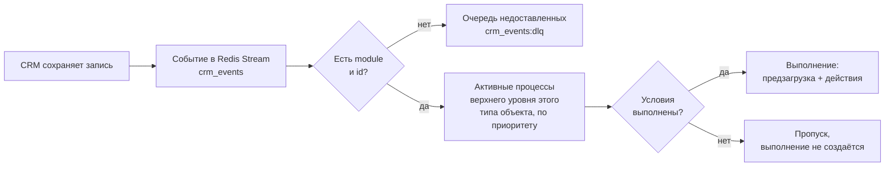

# Условия запуска

Когда WPS запускает процесс и как задавать условия в блоке **Блок 1. Условия запуска**.

<!-- lang-switch -->
[🇬🇧 English](../../en/03-user-guide/triggers-and-conditions.md) | 🇷🇺 Русский
<!-- /lang-switch -->

## Когда запускается процесс



1. CRM сохраняет запись и публикует событие: объект с его полями, модуль (`module` или `object_type`) и `id` записи.
2. Событие без модуля или без `id` не обрабатывается: оно уходит в поток недоставленных сообщений `crm_events:dlq`.
3. WPS выбирает все процессы, которые **активны**, являются **процессами верхнего уровня** (не ведомыми) и у которых **Тип объекта** совпадает с модулем события, например `Deals`.
4. Процессы проверяются по очереди в порядке возрастания **Приоритета** (при равном приоритете — по ID). Каждый процесс получает свою свежую копию события.
5. Если условия процесса выполнены, создаётся выполнение, и запускаются его предзагрузка и действия. Если нет — для этого процесса в аудит ничего не пишется.

Событие, для которого не нашлось ни одного процесса, просто подтверждается. Ведомый процесс никогда не запускается событием напрямую: его запускает другой процесс (см. [Ведомые процессы](subprocesses.md)), и свои условия он проверяет точно так же.

> **Примечание**
> Если включён **Однократный запуск для записи** и у записи уже есть отметка, процесс пропускается, даже когда условия выполнены. См. [Ручной запуск и сброс однократного запуска](manual-run-and-reset.md).

## Блок условий


*Два условия: одно по объекту события, другое по предзагруженной переменной `v1`. Строки объединяются по **И**.*

В каждой строке четыре колонки:

| Колонка | Назначение | Значения | Пример |
|---|---|---|---|
| **Поле (object.поле / v1.поле)** | Что проверяем: поле объекта события или предзагруженной переменной | путь `object.<поле>` или `<переменная>.<поле>` | `object.status`, `v1.rating` |
| **Тип сравнения** | Оператор сравнения | **Равен**, **Не равен**, **Включает**, **Не включает** | **Равен** |
| **Зона сравнения** | Откуда берётся значение справа | **Значение** — фиксированное значение; **Из поля объекта/переменной** — другое поле | **Значение** |
| **Сравниваемое значение** | Фиксированное значение или путь, если выбрано **Из поля объекта/переменной** | текст/число или путь | `Active`, `object.assigned_user_id` |

Кнопка **Добавить строку** добавляет условие, значок корзины удаляет его. Все строки объединяются по **И**: процесс запускается, только если истинна каждая строка.

**Условий нет** — процесс запускается для любого события своего типа объекта.

### Операторы

Перед сравнением обе стороны приводятся к тексту: числа — как записаны (`100`, `0.5`), логические значения — `true`/`false`, пустое значение — пустая строка. Сравнение чувствительно к регистру.

| Оператор (UI) | Код | Истинно, когда | Пример |
|---|---|---|---|
| **Равен** | `equals` | тексты совпадают | `object.status` **Равен** `Active` |
| **Не равен** | `not_equals` | тексты различаются | `object.status` **Не равен** `Closed` |
| **Включает** | `contains` | поле содержит значение как подстроку | `object.email` **Включает** `@` |
| **Не включает** | `not_contains` | поле не содержит подстроку | `object.name` **Не включает** `test` |

> **Внимание**
> **Отсутствующее поле никогда не удовлетворяет условию — при любом операторе.** Если в событии нет поля `nofield`, то `object.nofield` **Не равен** `x` — это **ложь**, а не истина. То же самое, когда отсутствует поле справа (**Из поля объекта/переменной**) и когда предзагруженная переменная не найдена в CRM. Поле, которое есть, но пустое, отсутствующим не считается: оно сравнивается как пустая строка.

Регистр и пробелы важны: `Active` не равен `active` и `Active `. Числа сравниваются как текст: `100` не равно `100.00`.

### Сравнение с другим полем

Выберите в **Зоне сравнения** **Из поля объекта/переменной** и укажите путь в **Сравниваемом значении**:

```json
{ "field": "object.assigned_user_id", "operator": "equals", "value_type": "from_object_field", "value": "v1.assigned_user_id" }
```

Условие истинно, когда у сделки и у загруженного контрагента один и тот же ответственный.

### Условия по предзагруженным переменным (ленивая предзагрузка)

Условие может ссылаться на переменную из блока **Предзагрузка**, например `v1.status`, где `v1` — контрагент сделки. Тогда WPS проверяет условия в два прохода:

1. Сначала проверяются строки, где используется только `object.*`. Если хотя бы одна из них ложна, процесс не запускается, и **из CRM ничего не загружается**.
2. Иначе выполняется блок **Предзагрузка**, и оставшиеся строки проверяются на загруженных данных.

Так дешёвые проверки по событию не тратят запросов к CRM. Если условия выполнены, уже сделанные шаги предзагрузки записываются в аудит как первые шаги выполнения и не повторяются.

Сценарий [Contact: copy account name](recipes.md) устроен именно так: `object.status` **Не равен** `Closed` И `v1.status` **Равен** `Active`.

### Ошибки

| Сообщение | Причина |
|---|---|
| `Условие 1: укажите поле (object.поле)` | Поле пустое или без точки |
| `Условие 1: укажите путь поля для сравнения` | **Из поля объекта/переменной** без пути |
| `Variable "v9" is not defined at this point` (сервер) | Переменная не объявлена в **Предзагрузке** |
| `Unknown comparison operator` (сервер) | Оператора нет в справочнике (только через API) |
| `Must be "static" or "from_object_field"` (сервер) | Неверный `value_type` (только через API) |

## Расширенная форма: группы и OR (только через API)

Редактор строит плоский список, объединённый по И. API принимает и вложенную форму с группами `AND`/`OR`:

```json
{
  "logical_operator": "AND",
  "conditions": [
    { "field": "object.status", "operator": "equals", "value_type": "static", "value": "Active" }
  ],
  "groups": [
    {
      "logical_operator": "OR",
      "conditions": [
        { "field": "object.amount", "operator": "contains", "value_type": "static", "value": "000" },
        { "field": "object.name", "operator": "contains", "value_type": "static", "value": "VIP" }
      ]
    }
  ]
}
```

Это означает: статус `Active` **и** (сумма содержит `000` **или** название содержит `VIP`). Группа OR без строк считается истинной.

Если условия процесса заданы в такой форме, редактор показывает метку **расширенные** и предупреждение **Условия заданы в расширенной форме (группы / OR). Табличный редактор их не поддерживает — они будут сохранены без изменений.** Кнопка **Заменить на табличные условия (И)** преобразует их: простой список по AND без групп сохраняет свои строки, всё остальное заменяется пустым списком. В карточке процесса видно **Условия в расширенной форме (группы / OR)**.

## Как проверить условия

- **Ручной запуск** (**Выполнить (Run)** в карточке процесса) показывает результат каждого условия (поле, ожидаемое и фактическое значение, результат) и не создаёт выполнение, если условия не выполнены. См. [Ручной запуск и сброс однократного запуска](manual-run-and-reset.md).
- У каждого выполнения тот же разбор есть на вкладке **Условия (conditions)** страницы выполнения. См. [Выполнения и аудит](executions-and-audit.md).

<!-- footer-nav -->
---

← Назад: [Процессы](processes.md) | [Оглавление](../README.md) | [Действия](actions.md) Далее →
<!-- /footer-nav -->
