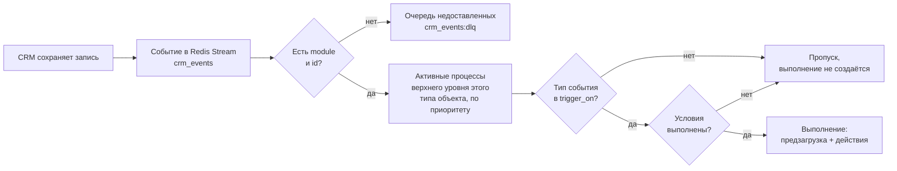

# Условия запуска

Когда WPS запускает процесс и как задавать условия в блоке **Блок 1. Условия запуска**.

<!-- lang-switch -->
[🇬🇧 English](../../en/03-user-guide/triggers-and-conditions.md) | 🇷🇺 Русский
<!-- /lang-switch -->

## Когда запускается процесс



1. CRM сохраняет запись и публикует событие: объект с его полями, модуль (`module` или `object_type`) и `id` записи.
2. Событие без модуля или без `id` не обрабатывается: оно уходит в поток недоставленных сообщений `crm_events:dlq`.
3. WPS выбирает все процессы, которые **активны**, являются **процессами верхнего уровня** (не ведомыми) и у которых **Тип объекта** совпадает с модулем события, например `Deals`. Из них остаются те, чьё поле [«Запускать при»](#тип-события-и-поле-запускать-при-trigger_on) (`trigger_on`) содержит тип события (`create` / `update` / `delete`).
4. Процессы проверяются по очереди в порядке возрастания **Приоритета** (при равном приоритете — по ID). Каждый процесс получает свою свежую копию события.
5. Если условия процесса выполнены, создаётся выполнение, и запускаются его предзагрузка и действия. Если нет — для этого процесса в аудит ничего не пишется.

Событие, для которого не нашлось ни одного процесса, просто подтверждается. Ведомый процесс никогда не запускается событием напрямую: его запускает другой процесс (см. [Ведомые процессы](subprocesses.md)), и свои условия он проверяет точно так же.

> **Примечание**
> Если включён **Однократный запуск для записи** и у записи уже есть отметка, процесс пропускается, даже когда условия выполнены. См. [Ручной запуск и сброс однократного запуска](manual-run-and-reset.md).

### Тип события и поле «Запускать при» (trigger_on)

Каждое событие из CRM имеет тип: `create` — запись создана, `update` — изменена, `delete` — удалена. Поле процесса
`trigger_on` — список типов, на которые процесс запускается:

| `trigger_on` | Когда запускается |
|---|---|
| `["create", "update"]` | **по умолчанию** и у всех процессов, созданных до появления поля: при создании и изменении записи |
| `["create"]`, `["update"]`, `["delete"]`, любые сочетания | только на указанные типы |
| `[]` | событиями из CRM не запускается вообще — только [вручную](manual-run-and-reset.md) (позже — по входящему вебхуку) |

- Фильтр по типу применяется **до условий**: процесс, не подписанный на тип события, не проверяется и в аудит не попадает.
- **Ведомые процессы** запускаются только родителем, `trigger_on` у них игнорируется (поле сохраняется как прислано).
- **Ручной запуск** `trigger_on` не проверяет. Тип события берётся из поля `event_type` объекта в теле запроса, по умолчанию `update`.
- Событие старого плагина без `event_type` считается созданием, если `wps_is_update = "0"`, иначе изменением.
- События связей (`link`, `unlink`) и неизвестные типы подтверждаются без запуска процессов.

Тип события, по которому запущено выполнение, виден в аудите: `context.event_info.event_type`.

#### Процесс при удалении записи

Событие `delete` несёт **последнее сохранённое состояние** записи (`deleted = "1"`), `object_before` у него пустой.

| Что делает процесс на `delete` | Поведение |
|---|---|
| Условия по `object.*` | работают по последнему состоянию записи |
| Предзагрузка по полям `object` (например, контрагент удалённой сделки) | работает: связанные записи не удалены |
| Предзагрузка самой удалённой записи | вернёт `null` (404) — штатное «не найдено» |
| `modify object.*` | разрешено (вычисления в памяти) |
| `save_object` / `save_to_crm` для `object` | шаг **`skipped`**: «Record was deleted in the CRM — nothing to save» |
| Сохранение других переменных, `start_process` и прочие действия | как обычно |

Процесс с `trigger_on: ["delete"]`, который сохраняет `object` (`save_object` с `target: object` или `modify object.*` с
`save_to_crm: true`), не сохраняется: `The process runs only on delete: the deleted record cannot be saved`. Если `delete`
сочетается с другими типами, сохранение `object` разрешено и на удалении просто пропускается.

Пример — задача при удалении сделки с последним состоянием сделки:

```json
{
  "name": "Задача при удалении сделки",
  "object_type": "Opportunities",
  "is_child": false,
  "trigger_on": ["delete"],
  "definition": {
    "actions": [
      { "type": "modify", "target": "task.name", "change_type": "template",
        "value": "Удалена сделка на {{ object.amount | number:0:'':' ' }}" },
      { "type": "modify", "target": "task.description", "change_type": "template",
        "value": "Сделка «{{ object.name }}» удалена; стадия была {{ object.sales_stage }}" },
      { "type": "modify", "target": "task.status", "change_type": "set_value", "value": "Not Started" },
      { "type": "save_object", "target": "task", "module": "Tasks" }
    ]
  }
}
```

## Блок условий


*Два условия: одно по объекту события, другое по предзагруженной переменной `v1`. Строки объединяются по **И**.*

В каждой строке четыре колонки:

| Колонка | Назначение | Значения | Пример |
|---|---|---|---|
| **Поле (object.поле / v1.поле)** | Что проверяем: поле объекта события или предзагруженной переменной | путь `object.<поле>` или `<переменная>.<поле>` | `object.status`, `v1.rating` |
| **Тип сравнения** | Оператор сравнения | **Равен**, **Не равен**, **Включает**, **Не включает**; через API также операторы порядка, пустоты, наличия данных и списков (таблица ниже) | **Равен** |
| **Зона сравнения** | Откуда берётся значение справа | **Значение** — фиксированное значение; **Из поля объекта/переменной** — другое поле; через API ещё `expression` — [выражение](#сравнение-с-выражением) | **Значение** |
| **Сравниваемое значение** | Фиксированное значение или путь, если выбрано **Из поля объекта/переменной** | текст/число или путь | `Active`, `object.assigned_user_id` |

Кнопка **Добавить строку** добавляет условие, значок корзины удаляет его. Все строки объединяются по **И**: процесс запускается, только если истинна каждая строка.

**Условий нет** — процесс запускается для любого события своего типа объекта.

### Операторы

Без поля `cast` обе стороны приводятся к тексту: числа — как записаны (`100`, `0.5`), логические значения — `true`/`false`, пустое значение — пустая строка. Сравнение чувствительно к регистру. Чтобы сравнивать как числа, даты, логические значения или списки, укажите тип — см. [Тип сравнения (cast)](#тип-сравнения-cast).

| Оператор (UI) | Код | Истинно, когда | Допустимые `cast` | Пример |
|---|---|---|---|---|
| **Равен** | `equals` | значения совпадают (для текста — тексты совпадают) | все | `object.status` **Равен** `Active` |
| **Не равен** | `not_equals` | значения различаются | все | `object.status` **Не равен** `Closed` |
| **Включает** | `contains` | поле содержит значение как подстроку; при `cast: list` — список содержит элемент | `string`, `list` | `object.email` **Включает** `@` |
| **Не включает** | `not_contains` | поле не содержит подстроку; при `cast: list` — в списке нет элемента | `string`, `list` | `object.name` **Не включает** `test` |
| **Начинается с** | `starts_with` | текст поля начинается со значения | `string` (или без `cast`) | `object.phone_mobile` **Начинается с** `+7` |
| **Заканчивается на** | `ends_with` | текст поля заканчивается значением | то же | `object.email1` **Заканчивается на** `@gmail.com` |
| **Содержит любое из** | `contains_any` | в списке-поле есть хотя бы один элемент правой части | `list` (**обязателен**) | `object.tags` **Содержит любое из** `["vip", "partner"]` |
| **Содержит все из** | `contains_all` | в списке-поле есть все элементы правой части | то же | `object.products` **Содержит все из** `["CRM", "Интеграция"]` |
| **Не содержит ни одного из** | `contains_none` | в списке-поле нет ни одного элемента правой части | то же | `object.tags` **Не содержит ни одного из** `["spam", "test"]` |
| **Больше** | `greater_than` | поле больше значения | `int`, `decimal`, `date`, `datetime` (**обязателен**) | `object.amount` **Больше** `1 000 000` (`decimal`) |
| **Больше или равно** | `greater_or_equal` | поле больше или равно значению | то же | `object.amount` **Больше или равно** `100` |
| **Меньше** | `less_than` | поле меньше значения | то же | `object.date_closed` **Меньше** `01.01.2027` (`date`) |
| **Меньше или равно** | `less_or_equal` | поле меньше или равно значению | то же | `object.probability` **Меньше или равно** `50` (`int`) |
| **В диапазоне** | `between` | `от ≤ поле ≤ до`, границы включаются; значение — пара `[от, до]` | то же | `object.amount` **В диапазоне** `["10000", "50000"]` (`decimal`) |
| **Вне диапазона** | `not_between` | поле меньше `от` или больше `до` | то же | `object.amount` **Вне диапазона** `["v1.min", "v1.max"]` |
| **Входит в** | `in` | значение равно одному из элементов списка | `string`, `int`, `decimal`, `date` | `object.status` **Входит в** `["New", "Assigned"]` |
| **Не входит в** | `not_in` | значение не равно ни одному элементу списка | то же | `object.lead_source` **Не входит в** `["Other"]` |
| **Пусто** | `is_empty` | поле **есть** и пустое (`null`, пустая строка или пробелы, пустой список) | значение не нужно, `cast` игнорируется | `object.phone_mobile` **Пусто** |
| **Не пусто** | `is_not_empty` | поле **есть** и не пустое | то же | `object.email1` **Не пусто** |
| **Данные отсутствуют** | `is_null` | переменная не найдена, поля нет или значение `null` | то же | `v1.id` **Данные отсутствуют** |
| **Данные есть** | `is_not_null` | поле есть и не `null` (пустая строка — тоже данные) | то же | `v1.id` **Данные есть** |
| **Изменилось** | `changed` | поле изменилось в этом сохранении CRM | все; значение не нужно | `object.assigned_user_id` **Изменилось** |
| **Не изменилось** | `not_changed` | изменения известны, поле не менялось | то же | `object.amount` **Не изменилось** (`decimal`) |
| **Изменилось на** | `changed_to` | изменилось, новое значение равно указанному | все | `object.sales_stage` **Изменилось на** `Closed Won` |
| **Изменилось с** | `changed_from` | изменилось, старое значение равно указанному | все | `object.status` **Изменилось с** `New` |

> **Внимание**
> **Отсутствующее поле никогда не удовлетворяет условию — при любом операторе, кроме `is_null`.** Если в событии нет поля `nofield`, то `object.nofield` **Не равен** `x` — это **ложь**, а не истина. То же самое, когда отсутствует поле справа (**Из поля объекта/переменной**) и когда предзагруженная переменная не найдена в CRM. Поле, которое есть, но пустое, отсутствующим не считается: оно сравнивается как пустая строка.

Регистр и пробелы важны: `Active` не равен `active` и `Active `. Без `cast` числа сравниваются как текст: `100` не равно `100.00` (с `cast: decimal` — равно).

#### Начинается с и заканчивается на

Префикс и суффикс точнее, чем **Включает**: `object.email1` **Заканчивается на** `@gmail.com` не сработает на
`x@gmail.com.evil.ru`, а **Включает** `gmail.com` сработал бы.

```json
{ "field": "object.email1", "operator": "ends_with", "value": "@GMAIL.COM", "cast": "string", "cast_options": { "case_sensitive": false } }
{ "field": "object.phone_mobile", "operator": "starts_with", "value": "+7" }
```

- Тип — только `string` (или без `cast`); другой тип — ошибка сохранения `Operator "starts_with" does not support cast "int" (supported: string)`.
- Регистр учитывается; `cast_options: {"case_sensitive": false}` сравнивает без учёта регистра (кириллица тоже),
  `trim: true` обрезает пробелы с обеих сторон.
- Пустой префикс подходит к любой строке, поэтому статическое значение не может быть пустым или из одних пробелов:
  `Value is required for operator "starts_with"`. Если значение берётся **из поля** и это поле пустое, условие истинно;
  если поля нет — ложно.
- В фильтре «Найти записи», агрегата и `least_busy` операторы уходят в CRM как `like 'x%'` / `like '%x'` (символы `%`,
  `_`, `\` экранируются).

#### Больше и меньше

Операторы порядка работают только с типом: `cast` — `int`, `decimal`, `date` или `datetime`, без него процесс не сохраняется (`Operator "greater_than" requires cast: int, decimal, date or datetime`).

```json
{ "field": "object.amount", "operator": "greater_than", "cast": "decimal", "value_type": "static", "value": "1 000 000" }
{ "field": "object.date_closed", "operator": "less_than", "cast": "date", "value_type": "static", "value": "01.01.2027" }
```

- Отсутствующее поле (слева или справа), пустое значение или значение, которое не приводится к типу, дают **ложь** (при `on_cast_error: "error"` — ошибку, см. [Тип сравнения (cast)](#тип-сравнения-cast)).
- `100` и `100.00` с `cast: decimal` равны: **Больше или равно** — истина, **Больше** — ложь.
- Значение с временем при `cast: date` переводится в часовой пояс `WPS_TIMEZONE` и сравнивается по дню.
- Отрицаний (`not_greater_than`) нет: используйте противоположный оператор.

#### Относительные даты

Статическое значение условия с `cast: date` или `datetime` может быть **относительной датой** — тогда оно вычисляется
в момент проверки, а не хранится датой:

```json
{ "field": "object.end_date", "operator": "less_than", "cast": "date", "value_type": "static", "value": "today+30d" }
{ "field": "object.date_entered", "operator": "greater_or_equal", "cast": "datetime", "value_type": "static", "value": "now-24h" }
{ "field": "object.date_closed", "operator": "between", "cast": "date", "value_type": "static", "value": ["start_of_quarter", "end_of_quarter"] }
```

Грамматика: `якорь (±N единица)*`, до 5 сдвигов, пробелы и регистр не важны (`Today + 30d`).

| Якорь | Значение |
|---|---|
| `now` | текущий момент |
| `today` / `start_of_day`, `yesterday`, `tomorrow` | полночь сегодня / вчера / завтра |
| `end_of_day` | 23:59:59 сегодня |
| `start_of_week`, `end_of_week` | понедельник 00:00:00 / воскресенье 23:59:59 текущей недели |
| `start_of_month`, `end_of_month` | первый день месяца 00:00:00 / последний день 23:59:59 |
| `start_of_quarter`, `end_of_quarter` | начало / конец квартала |
| `start_of_year`, `end_of_year` | 1 января 00:00:00 / 31 декабря 23:59:59 |

Единицы: `min` — минуты, `h` — часы, `d` — дни, `w` — недели, `mo` — месяцы, `y` — годы
(справочник [`GET /api/dictionaries/relative-dates`](../06-api-reference/endpoints.md#get-apidictionariesrelative-dates)).

- Якоря считаются в **`WPS_TIMEZONE`** (по умолчанию UTC): `today` — полночь в этом поясе. Неделя начинается с
  понедельника. `end_of_*` — **последняя секунда** периода, поэтому `less_or_equal end_of_month` включает весь последний
  день.
- `d`, `w`, `mo`, `y` — календарные единицы по местному времени: `today+1mo` 31 января — 28 (29) февраля. `h` и `min`
  — точное время: в ночь перехода на летнее время `now+1d` и `now+24h` различаются на час.
- **Рабочих дней нет** (решение заказчика): `today+10wd` — ошибка `Invalid relative date "today+10wd": unknown unit "wd"
  at position 8 (use min, h, d, w, mo, y)`.
- Конкретная дата начинается с цифры (`2026-12-31`, `31.12.2026`) и относительной не считается. Значение, похожее на
  относительную дату, разбирается при сохранении процесса; ошибка — `422` с позицией (`today+`, `tomorrow++1d`,
  `start_of_decade`, больше 5 сдвигов).
- Значения **из полей** (`from_object_field`) никогда не интерпретируются: текст `today` в поле записи — это просто текст.
- Все относительные даты одной проверки условий считаются от **одного** «сейчас», в том числе при ленивой предзагрузке
  (оба прохода условий).
- Для `between` относительными могут быть обе или одна граница; порядок `от ≤ до` для них проверяется при выполнении.
- В трассе строки — `expected_resolved` (во что превратилось значение), `evaluated_at` (момент проверки) и `timezone`.

#### В диапазоне и вне диапазона

Значение — **пара** `[от, до]`. Обе границы либо статические, либо обе — пути (**Из поля объекта/переменной**), либо
обе — выражения (`value_type: expression`):

```json
{ "field": "object.amount", "operator": "between", "cast": "decimal", "value_type": "static", "value": ["10000", "50000"] }
{ "field": "object.date_closed", "operator": "between", "cast": "date", "value_type": "static", "value": ["01.01.2026", "31.03.2026"] }
{ "field": "object.amount", "operator": "not_between", "cast": "decimal", "value_type": "from_object_field", "value": ["v1.min_limit", "v1.max_limit"] }
```

- `cast` обязателен: `int`, `decimal`, `date` или `datetime`, как у операторов порядка. Поле и обе границы приводятся
  одним типом.
- Границы **включаются**: 50 000 **В диапазоне** `[10000, 50000]` — истина, 50 000,01 — ложь.
- Отсутствующее или пустое поле, отсутствующая или пустая граница, значение, которое не приводится к типу, — **ложь для
  обоих** операторов: «вне диапазона» не значит «данных нет».
- Статические границы проверяются при сохранении: пустая — `Range bound is required`, не приводится — ошибка приведения,
  `от > до` — `Range start must not be greater than range end`. Если перевёрнутый диапазон пришёл из данных (границы из
  полей), условие ложно, а в трассе — предупреждение `range_inverted`: границы не меняются местами молча.
- Граница-путь к переменной предзагрузки запускает ленивую предзагрузку, как и поле слева.
- Смешанные границы (одна статическая, другая из поля) задаются [выражениями](#сравнение-с-выражением):
  `"value_type": "expression", "value": ["1000", "v1.max_limit"]`.
- В фильтре «Найти записи», агрегата и `least_busy` `between` уходит в CRM как `gte` + `lte` (только статические
  границы); `not_between` в фильтрах CRM недоступен — нужен OR, которого в контракте нет.

#### Пусто и наличие данных

У этих четырёх операторов нет правой части: `value` и `value_type` не указываются (иначе `Operator "is_null" does not take a value`), `cast` игнорируется.

```json
{ "field": "object.phone_mobile", "operator": "is_empty" }
{ "field": "v1.id", "operator": "is_null" }
```

| Ситуация | `is_empty` | `is_not_empty` | `is_null` | `is_not_null` |
|---|---|---|---|---|
| Поля нет в объекте | ложь | ложь | **истина** | ложь |
| Предзагруженная переменная не найдена в CRM | ложь | ложь | **истина** | ложь |
| Поле есть, `null` | истина | ложь | истина | ложь |
| Поле есть, `''` (или только пробелы) | истина | ложь | ложь | истина |
| Поле есть, `'0'` или `false` | ложь | истина | ложь | истина |
| Поле есть, пустой список `[]` | истина | ложь | ложь | истина |
| Поле есть, непустое значение | ложь | истина | ложь | истина |

Для пустоты правило «отсутствующее поле не удовлетворяет условию» сохраняется: отсутствие поля не считается ни «пусто», ни «не пусто». Проверить, что данных нет совсем, — задача `is_null` / `is_not_null`. SuiteCRM присылает в событии все хранимые поля, поэтому незаполненное поле приходит пустой строкой: для него `is_empty` — истина, `is_null` — ложь. При ленивой предзагрузке условие по ещё не загруженной переменной сначала «неизвестно», как и у остальных операторов. В трассе у строки есть ключ `found` (найдено ли поле) и `missing: "actual"`, если поля нет.

#### Входит в список

Правая часть `in` / `not_in` — список. Статический список задаётся JSON-массивом; `cast` — тип элементов и поля (`string` по умолчанию, `int`, `decimal`, `date`):

```json
{ "field": "object.status", "operator": "in", "value_type": "static", "value": ["New", "Assigned", "In Process"] }
{ "field": "object.code", "operator": "not_in", "cast": "int", "value_type": "static", "value": [1, 2] }
{ "field": "object.state", "operator": "in", "cast": "string", "cast_options": {"case_sensitive": false, "trim": true},
  "value_type": "static", "value": ["msk", "spb"] }
```

Список из поля — массив, JSON-массив строкой или строка с разделителем; как разбирать строку, задаёт `value_list_options` (`separator`, по умолчанию `,`; `wrapper`, например `^` для мультисписка SuiteCRM):

```json
{ "field": "object.lead_source", "operator": "in", "value_type": "from_object_field", "value": "company.description",
  "value_list_options": { "separator": "," } }
```

| Ситуация | `in` | `not_in` |
|---|---|---|
| Поля слева нет | ложь | ложь |
| Поле пустое, `cast` не `string` | ложь | ложь |
| Поле пустое, `cast: string` | `''` сравнивается с элементами как обычная строка | |
| Поля-списка справа нет / переменная не найдена | ложь | ложь |
| Список из поля пуст | ложь | **истина** |
| Элемент списка из поля не приводится к типу | элемент пропускается, в трассе `cast_error` (при `on_cast_error: "error"` — ошибка) | |

В трассе `expected_cast` — список приведённых элементов. Статический список не может быть пустым и длиннее 500 элементов; элементы — строки или числа, приводимые к `cast`. Для мультисписков (`^a^,^b^` слева) — операторы [мультисписков](#мультисписки) или `contains` с `cast: list`.

#### Мультисписки

SuiteCRM хранит мультисписок строкой `^vip^,^partner^`. С `cast: list` и `cast_options: {"wrapper": "^"}` поле
разбирается в список `[vip, partner]` (разделитель — `separator`, по умолчанию `,`; регистр — `case_sensitive`), и его
можно сравнивать с набором значений:

```json
{ "field": "object.template_ddown_c", "operator": "contains_any", "value": ["vip", "partner"],
  "cast": "list", "cast_options": { "wrapper": "^", "case_sensitive": false } }
{ "field": "object.template_ddown_c", "operator": "contains_none", "value": "^spam^,^test^",
  "cast": "list", "cast_options": { "wrapper": "^" } }
```

- Правая часть — JSON-массив или строка, которая разбирается **так же, как поле** (удобно вставить значение,
  скопированное из CRM: `"^spam^,^test^"`). При **Из поля объекта/переменной** список из поля тоже разбирается по
  `cast_options` поля, если не задан `value_list_options`.
- Это операции над множествами: порядок и повторы не важны. `contains_any` — пересечение не пусто, `contains_all` —
  правая часть целиком входит в поле, `contains_none` — пересечения нет.
- В отличие от `contains` сравниваются **элементы целиком**: `^vipclient^` не содержит `vip`.
- В трассе — `actual_cast`, `expected_cast`, а у `contains_any` / `contains_none` — `matched` (совпавшие элементы).
- Нужен `cast: list` (иначе ошибка сохранения); статическая правая часть — непустой массив или строка, дающая непустой
  список (`List of values must not be empty`).

| Ситуация | `contains_any` | `contains_all` | `contains_none` |
|---|---|---|---|
| Поля нет | ложь | ложь | ложь |
| Поле — пустой список (меток нет) | ложь | ложь | **истина** |
| Правая часть пуста (например, пустое поле справа) | ложь | ложь | ложь |
| Совпал хотя бы один элемент | истина | истина, если совпали все | ложь |

### Тип сравнения (cast)

Тип, к которому приводятся обе стороны перед сравнением, задаётся в самой строке условия. WPS не читает метаданные полей CRM, поэтому один и тот же механизм работает для полей события, предзагруженных записей и переменных процесса.

```json
{
  "field": "object.amount",
  "operator": "equals",
  "cast": "decimal",
  "cast_options": { "scale": 2 },
  "on_cast_error": "false",
  "value_type": "from_object_field",
  "value": "v1.credit_limit"
}
```

| Поле | Значения | По умолчанию |
|---|---|---|
| `cast` | `string`, `int`, `decimal`, `date`, `datetime`, `bool`, `list` | `string` |
| `cast_options` | объект параметров, зависит от типа (таблица ниже) | `{}` |
| `on_cast_error` | `"false"` — условие ложно; `"error"` — ошибка (строгий режим) | `"false"` |

Строка без `cast` работает точно как раньше: текст, регистр учитывается, пробелы не обрезаются. Пока поля задаются через API — табличный редактор их сохраняет без изменений.

| Тип | Как приводится | Параметры `cast_options` | Пример |
|---|---|---|---|
| `string` | текст, как без `cast` | `case_sensitive` (`true`), `trim` (`false`) | `Active` = `active` при `case_sensitive: false` |
| `int` | целое; убираются пробелы (в т. ч. неразрывные) и ведущий `+`; дробная часть из нулей допустима (`100.00` → `100`), ненулевая — ошибка; выход за диапазон — ошибка (используйте `decimal`) | — | `"1 200"` → `1200` |
| `decimal` | десятичное число, сравнение без потерь точности (`bcmath`); пробелы убираются, `,` — десятичный разделитель, если нет `.`; `1,234.56` (оба разделителя) — ошибка; экспонента в строке — ошибка; лишние знаки округляются до `scale` (половина — от нуля) | `scale` (`10`, от 0 до 20) | `"1 234,56"` → `1234.56`; `100` = `100.00` |
| `date` | дата без времени; форматы по умолчанию: `Y-m-d`, `Y-m-d H:i:s`, `Y-m-d H:i`, ISO 8601 (`2026-10-16T10:00:00Z`, со смещением, с микросекундами), `d.m.Y`, `d.m.Y H:i:s`, `d.m.Y H:i`; несуществующая дата (`2026-02-30`), `10/16/2026` и `20261016` без явного формата — ошибка | `format` (строка или список форматов PHP `DateTime::createFromFormat`, заменяет форматы по умолчанию; `U` — Unix-время), `timezone` (пояс значений без смещения, по умолчанию `UTC`) | `"16.10.2026"` → `2026-10-16` |
| `datetime` | дата и время, приводится к UTC, сравнение по моменту времени (с микросекундами); значение только с датой — 00:00 в поясе `timezone` | `format`, `timezone` | `"2026-10-16 10:00:00"` = `"2026-10-16T13:00:00+03:00"` |
| `bool` | регистр не важен; истина: `true`, `1`, `t`, `yes`, `y`, `on`, `да`; ложь: `false`, `0`, `f`, `no`, `n`, `off`, `нет`, пустое значение; другое — ошибка | — | `"on"` = `true` |
| `list` | список строк: массив, JSON-массив строкой или строка с разделителем; элементы обрезаются, пустые отбрасываются; при сравнении `equals` порядок и повторы не важны | `separator` (`,`), `wrapper` (например `^` для мультисписков SuiteCRM `^a^,^b^`), `case_sensitive` (`true`) | `"^vip^,^partner^"` → `[vip, partner]` |

**Даты и часовой пояс.** Значение со временем сначала переводится в часовой пояс бизнес-логики (`WPS_TIMEZONE`, по умолчанию `UTC`, см. [Конфигурация](../04-operations/configuration.md)), затем берётся календарная дата. Значение только с датой не сдвигается. Пример: `"2026-10-16 22:30:00"` (UTC) при `WPS_TIMEZONE=Europe/Moscow` — это дата `2026-10-17`. Даты из CRM приходят в UTC; если значение записано в другом поясе, укажите `cast_options.timezone`.

**Пустые значения.** Для `string` пустое значение — пустая строка (как раньше), для `bool` — `false`. Для остальных типов пустое значение (`null`, строка из пробелов, пустой массив) не сравнивается: условие **ложно**, в трассе — `empty`.

**Ошибка приведения** (`"abc"` как `decimal`):

- `on_cast_error: "false"` (по умолчанию) — условие ложно при любом операторе, в трассе — `cast_error`, в лог пишется предупреждение, растёт метрика `wps_condition_cast_errors_total`;
- `on_cast_error: "error"` (строгий режим):
  - в условиях запуска процесса создаётся выполнение со статусом **Ошибка**, первым шагом записывается `conditions` с трассой и текстом ошибки; событие подтверждается и повторно не доставляется;
  - при ручном запуске ответ `200` с `conditions_met: false`, `error: "CAST_ERROR"` и `error_message`.

**Трасса условия** (ручной запуск, вкладка **Условия** выполнения) дополняется ключами: `cast` и `cast_options` (если тип задан), `actual_cast` / `expected_cast` — приведённые значения, `missing` (`actual` / `expected` — какая сторона отсутствует), `empty` (какая сторона пуста), `cast_error` (`{"side": "actual", "message": "…"}`). Ключи `actual` / `expected` по-прежнему содержат исходные значения.

```json
{ "field": "object.amount", "operator": "equals", "value_type": "static", "value": "100",
  "cast": "decimal", "actual": "100.00", "expected": "100", "actual_cast": "100", "expected_cast": "100", "result": true }
```

Примеры:

```json
{ "field": "object.date_closed", "operator": "equals", "value": "16.10.2026", "cast": "date" }
{ "field": "object.do_not_call", "operator": "equals", "value": "true", "cast": "bool" }
{ "field": "object.status", "operator": "equals", "value": "active", "cast": "string", "cast_options": { "case_sensitive": false } }
{ "field": "object.tags_c", "operator": "contains", "value": "vip", "cast": "list", "cast_options": { "wrapper": "^" } }
```

#### Регистр и пробелы

По умолчанию сравнение строк точное: `Москва` ≠ `москва`, `Москва` ≠ `Москва `. Параметры задаются в `cast_options`
типа `string` (у `list` — `case_sensitive`, элементы списка обрезаются всегда):

```json
{ "field": "object.primary_address_city", "operator": "equals", "value": "Москва",
  "cast": "string", "cast_options": { "case_sensitive": false, "trim": true } }
```

| Параметр | По умолчанию | Действие |
|---|---|---|
| `case_sensitive` | `true` | `false` — регистр не важен: обе стороны приводятся складыванием регистра Unicode (кириллица тоже) |
| `trim` | `false` | `true` — пробелы по краям обеих сторон отбрасываются, включая неразрывный пробел и BOM (встречаются при импорте и копировании) |

- Параметры действуют на **все** строковые и списочные операторы: `equals` / `not_equals`, `contains` / `not_contains`,
  `starts_with` / `ends_with`, `in` / `not_in`, а также `changed`, `changed_to`, `changed_from`: при
  `case_sensitive: false` смена «МОСКВА» → «москва» — **не изменение**.
- Нормализуются обе стороны: и поле, и значение (или второе поле).
- Ограничения: `ё` и `е` — разные буквы, `ß` не превращается в `ss` (`Straße` ≠ `STRASSE`), пробелы внутри строки не
  схлопываются.
- Плоские ключи рядом с `cast` не принимаются: `"case_sensitive": false` в самой строке условия — ошибка сохранения
  `Use "cast_options": {"case_sensitive": ...}` (раньше такой ключ молча игнорировался). Параметр для типа без него —
  `Option "trim" is not supported by cast "int"`.
- В трассе — `cast_options` и нормализованные значения `actual_cast` / `expected_cast` (например, `"москва"`).

### Сравнение с другим полем

Выберите в **Зоне сравнения** **Из поля объекта/переменной** и укажите путь в **Сравниваемом значении**:

```json
{ "field": "object.assigned_user_id", "operator": "equals", "value_type": "from_object_field", "value": "v1.assigned_user_id" }
```

Условие истинно, когда у сделки и у загруженного контрагента один и тот же ответственный.

### Сравнение с выражением

Третий тип значения — `"value_type": "expression"` («Выражение», только через API; редактор сохраняет такие условия без
изменений). Правая часть вычисляется [выражением](change-types-and-expressions.md#расчёт) — с арифметикой, функциями и
полями переменных:

```json
{ "field": "object.amount", "operator": "greater_than", "cast": "decimal",
  "value_type": "expression", "value": "v1.credit_limit * 0.8" }
{ "field": "object.amount", "operator": "between", "cast": "decimal",
  "value_type": "expression", "value": ["v1.plan * 0.9", "v1.plan * 1.1"] }
{ "field": "object.date_closed", "operator": "less_than", "cast": "date",
  "value_type": "expression", "value": "add_days(today(), coalesce(v1.payment_days, 30))" }
{ "field": "object.email1", "operator": "ends_with", "value_type": "expression", "value": "concat('@', lower(v1.domain))" }
```

- Результат приводится **тем же `cast`**, что и поле: `'1 200,50'` с `decimal` — это 1200.5.
- `between` / `not_between` — пара выражений; списочные операторы (`in`, `contains_any`, …) — выражение, которое
  возвращает список или строку (строка разбирается как список).
- Результат `null` — правой части нет, условие ложно (`missing: expected` в трассе); пустая строка — пустое значение
  типа. Подстраховка — `coalesce(v1.limit, 0)`.
- Ошибка вычисления (деление на ноль, неверный аргумент функции) — строка условия **ложна**, в трассе
  `expression_error`, предупреждение в логе `Condition expression failed` и метрика
  `wps_condition_expression_errors_total`. С `"on_cast_error": "error"` — ошибка проверки условий, как при ошибке
  приведения.
- Переменные из выражения участвуют в [ленивой предзагрузке](#условия-по-предзагруженным-переменным-ленивая-предзагрузка):
  пока переменная не загружена, строка «неизвестна».
- Операторы изменения (`changed`, `changed_to`, `changed_from`, `not_changed`) выражения не принимают:
  `Operator "changed_to" does not support value_type "expression"`.
- [Относительные даты](#относительные-даты) (`today+30d`) внутри выражения не распознаются — это текст; используйте
  функции: `add_days(today(), 30)`, `add_hours(now(), -24)`.
- В трассе `expected` — результат выражения, `expected_cast` — после приведения.
- При сохранении проверяются синтаксис и функции, переменные (`Variable "v9" is not defined at this point`), длина
  (до 1000 символов, `Expression is too long (max 1000 characters)`), пустое выражение (`Expression is required`), пара
  для `between`. Неверный тип значения — `Must be "static", "from_object_field" or "expression"`.

### Значения до изменения (object_before)

Плагин CRM контракта 2.0 присылает вместе с сохранением старые значения **изменённых** полей. WPS кладёт их в переменную
`object_before`, доступную во всех процессах (в том числе дочерних) — в условиях, выражениях и шаблонах:

| Путь | Результат |
|---|---|
| `object_before.status` (поле менялось) | старое значение, например `New` |
| `object_before.status` (поле не менялось) | **не найдено**: условие с ним ложно при любом операторе, в выражении — пустая строка |
| `object_before.phone` (поле было пустым) | найдено, значение `null` — это не «не найдено» |
| любое поле при событии старого формата | не найдено: старые значения неизвестны (`object_before` = `null`) |

Отсутствие поля в `object_before` означает «не менялось» **или** «неизвестно» (старый плагин, ручной запуск без `before`).
Значение «до» даже для неизменённого поля: `coalesce(object_before.x, object.x)`.

`object_before` — **только для чтения**: в него нельзя писать (`modify`, `save_object`), имя нельзя занять предзагрузкой.

Пример — запуск только при переходе статуса лида `New → Assigned`, а не при каждом сохранении лида со статусом `Assigned`:

```json
{
  "conditions": [
    { "field": "object_before.status", "operator": "equals", "value_type": "static", "value": "New" },
    { "field": "object.status", "operator": "equals", "value_type": "static", "value": "Assigned" }
  ],
  "actions": [
    { "type": "modify", "target": "object.description", "change_type": "template",
      "value": "Статус: {{ object_before.status }} → {{ object.status }}", "save_to_crm": true }
  ]
}
```

Создание лида (`create`, `object_before` пуст) и сохранение без смены статуса процесс не запускают. Тип события и список
изменённых полей видны в аудите выполнения (`context.event_info`). Чтобы процесс не проверялся на создании вовсе, задайте
`"trigger_on": ["update"]` (см. [Тип события](#тип-события-и-поле-запускать-при-trigger_on)). Короче то же условие записывается
оператором `changed_from` — см. [Условия на изменение поля](#условия-на-изменение-поля).

### Условия на изменение поля

Четыре оператора отвечают на вопрос «что изменилось **в этом сохранении** записи». Им нужен плагин CRM 1.2.0
(контракт 2.0: событие несёт `event_type`, `before`, `changed_fields` — см.
[Как WPS разбирает событие](../04-operations/crm-integration.md#как-wps-разбирает-событие)).

```json
{ "field": "object.sales_stage", "operator": "changed_to", "value_type": "static", "value": "Closed Won" }
{ "field": "object.assigned_user_id", "operator": "changed" }
{ "field": "object.amount", "operator": "changed", "cast": "decimal" }
```

| Оператор | Истинно, когда |
|---|---|
| `changed` | поле есть в `changed_fields` события **и** значения до и после различаются после приведения к `cast` |
| `not_changed` | изменения известны, и поле не `changed` |
| `changed_to X` | `changed` и новое значение равно `X` |
| `changed_from X` | `changed` и старое значение равно `X` |

- `field` — только `object.<поле>`: изменения известны лишь для объекта события.
- `changed` / `not_changed` — без правой части (`value`, `value_type` не указываются). `changed_to` / `changed_from` —
  `value_type` `static` или `from_object_field` и обязательное `value`.
- **Новое значение берётся из события**, а не из переменной `object`: `modify` перед ветвлением результат не меняет, а
  ведомый процесс видит изменения исходного события. Старое значение — `object_before.<поле>`.
- Сравнение — после `cast`, любой тип. Фантомное изменение `1000.00 → 1000` без `cast` — изменение (тексты разные), с
  `cast: decimal` — нет. Multienum `^a^,^b^ → ^b^,^a^` с `cast: list` (`wrapper: "^"`) — не изменение: порядок не важен.
- Пустые значения: оба пустые — не изменилось; пустое ↔ непустое — изменилось. `changed_from ''` — «поле было пустым».
- Ошибка приведения: строка ложна, `cast_error` в трассе (с `on_cast_error: "error"` — выполнение `failed`).

| Ситуация | `changed` | `not_changed` | `changed_to X` | `changed_from X` |
|---|---|---|---|---|
| Событие старого формата, мок без `changed_fields`, ручной запуск без служебных полей | ложь | ложь | ложь | ложь (`change_info: "missing"`) |
| `event_type = create` | истина для непустых полей | ложь для них | новое значение = `X` | ложь (до создания значения не было) |
| `event_type = delete` | ложь | ложь | ложь | ложь (`change_info: "delete"`) |
| Поле в `changed_fields`, но нет в `before` | старое значение считается пустым | | | |

«Не знаем» не равно «не изменилось»: поэтому `not_changed` ложно без сведений об изменениях — иначе процессы с ним
срабатывали бы на каждом событии старого формата. Такие случаи пишутся в лог (`Change operators used but the event has no
change info`, не чаще раза в минуту на процесс и воркер) и в метрику `wps_condition_change_info_missing_total`.

Строка трассы:

```json
{ "field": "object.sales_stage", "operator": "changed_to", "value": "Closed Won",
  "actual": "Closed Won", "before": "Prospecting", "before_cast": "Prospecting", "expected_cast": "Closed Won",
  "changed": true, "event_type": "update", "result": true }
```

Пример — сделка выиграна → задача (повторное сохранение выигранной сделки задачу не дублирует):

```json
{
  "conditions": [
    { "field": "object.sales_stage", "operator": "changed_to", "value_type": "static", "value": "Closed Won" }
  ],
  "actions": [
    { "type": "modify", "target": "task.name", "change_type": "template", "value": "Сделка выиграна: счёт на {{ object.amount | number:0:'':' ' }}" },
    { "type": "modify", "target": "task.description", "change_type": "template", "value": "Стадия: {{ object_before.sales_stage }} → {{ object.sales_stage }}" },
    { "type": "modify", "target": "task.parent_type", "change_type": "set_value", "value": "Opportunities" },
    { "type": "modify", "target": "task.parent_id", "change_type": "set_from_variable", "value": "object.id" },
    { "type": "save_object", "target": "task", "module": "Tasks" }
  ]
}
```

### Условия по предзагруженным переменным (ленивая предзагрузка)

Условие может ссылаться на переменную из блока **Предзагрузка**, например `v1.status`, где `v1` — контрагент сделки. Тогда WPS проверяет условия в два прохода:

1. Сначала проверяются строки, где используется только `object.*`. Если хотя бы одна из них ложна, процесс не запускается, и **из CRM ничего не загружается**.
2. Иначе выполняется блок **Предзагрузка**, и оставшиеся строки проверяются на загруженных данных.

Так дешёвые проверки по событию не тратят запросов к CRM. Если условия выполнены, уже сделанные шаги предзагрузки записываются в аудит как первые шаги выполнения и не повторяются.

Сценарий [Contact: copy account name](recipes.md) устроен именно так: `object.status` **Не равен** `Closed` И `v1.status` **Равен** `Active`.

Подробности:

- В первом проходе строка, которая ссылается на ещё не загруженную переменную (в `field`, в пути `from_object_field`, в
  границе диапазона или внутри `expression`), **неизвестна**. AND с ложной строкой — ложь, OR с истинной строкой —
  истина: тогда ответ известен без CRM. Второй проход начинается, только если результат зависит от неизвестной строки.
- Во втором проходе выполняется **весь** блок предзагрузки (все строки по порядку), а не только нужные условиям переменные.
- `sys.*`, `config.*` и `object_before.*` известны в первом проходе и предзагрузку не запускают.
- Если шаг предзагрузки падает во время ленивой проверки, выполнение всё равно создаётся: упавший шаг записывается, и
  выполнение завершается со статусом **Ошибка** — ошибка не превращается молча в «условия не выполнены».
- Оба прохода используют одно «сейчас» для [относительных дат](#относительные-даты).
- Ручной запуск с `"force": true` пропускает условия целиком; предзагрузка тогда выполняется обычными первыми шагами.
- Переменная предзагрузки, не найденная в CRM, — `null`: строки по ней ложны (кроме `is_null`), см. [Операторы](#операторы).

### Системные переменные и константы в условиях

`sys.*` и `config.*` (см. [Системные переменные и константы](change-types-and-expressions.md#системные-переменные-и-константы))
можно использовать с обеих сторон строки: как `field`, как путь `from_object_field` и внутри выражения.

```json
{ "field": "sys.trigger", "operator": "equals", "value": "manual" }
{ "field": "object.annual_revenue", "operator": "greater_or_equal", "cast": "decimal",
  "value_type": "expression", "value": "config.vip_threshold" }
{ "field": "object.sales_stage", "operator": "in", "value_type": "from_object_field", "value": "config.open_stages" }
```

Проверено ручным запуском с `{"id": "acc-1", "annual_revenue": "150 000"}` и константой `vip_threshold = 100000`:
в трассе `actual_cast: "150000"`, `expected_cast: "100000"`, `result: true`, а `sys.trigger` = `manual`.
Неизвестные имена — ошибки сохранения: `Unknown system variable "sys.foo"; available: sys.execution_id, …`,
`Constant "missing" is not defined in definition.constants`. До создания выполнения `sys.execution_id` и
`sys.started_at` пусты — в условиях их не используйте.

### Ошибки

| Сообщение | Причина |
|---|---|
| `Условие 1: укажите поле (object.поле)` | Поле пустое или без точки |
| `Условие 1: укажите путь поля для сравнения` | **Из поля объекта/переменной** без пути |
| `Variable "v9" is not defined at this point` (сервер) | Переменная не объявлена в **Предзагрузке** |
| `Unknown comparison operator` (сервер) | Оператора нет в справочнике (только через API) |
| `Must be "static", "from_object_field" or "expression"` (сервер) | Неверный `value_type` (только через API) |
| `Must be AND or OR` (сервер, поле `…logical_operator`) | Неверный оператор [группы](#расширенная-форма-группы-и-or-только-через-api) |
| `Condition must be an object` (сервер) | Строка условия — не JSON-объект |
| `Unknown system variable "sys.foo"; available: …`, `Constant "x" is not defined in definition.constants` (сервер) | Неизвестное поле `sys.*` или необъявленная константа |
| `Expression is required`, `Expression is too long (max 1000 characters)`, `Operator "between" expects a pair [from, to]` (сервер) | Ошибки [выражения](#сравнение-с-выражением) в правой части |
| `Range bound is required`, `Range start must not be greater than range end` (сервер) | Неверные статические границы `between` / `not_between` |
| `List of values must not be empty` (сервер) | Пустая правая часть `contains_any` / `contains_all` / `contains_none` |
| `Use "cast_options": {"case_sensitive": ...}` (сервер) | Параметр приведения записан рядом с `cast`, а не в `cast_options` |
| `Value is required for operator "starts_with"` (сервер) | Пустой префикс / суффикс |
| `Unknown cast "money" (allowed: string, int, decimal, date, datetime, bool, list)` (сервер) | Неизвестный `cast` |
| `Operator "contains" does not support cast "decimal" (supported: string, list)` (сервер) | Оператор не работает с этим типом |
| `Value "abc" is not a valid decimal` (сервер, поле `value`) | Статическое значение не приводится к типу |
| `Value is required for cast "decimal"` (сервер) | Пустое статическое значение при типе, отличном от `string` / `bool` |
| `Option "scale" is not supported by cast "string"` (сервер) | Параметр не подходит к типу (`cast_options.<имя>`) |
| `Must be an integer from 0 to 20`, `Must be true or false`, `Unknown timezone "Moscow"`, `Must be a non-empty string or a list of strings`, `Must be a non-empty string up to 5 characters` (сервер) | Неверное значение параметра в `cast_options` |
| `Must be "false" or "error"` (сервер) | Неверный `on_cast_error` |
| `Operator "greater_than" requires cast: int, decimal, date or datetime` (сервер) | У оператора порядка нет `cast` или тип не упорядочиваемый |
| `Operator "is_null" does not take a value` (сервер, поле `value` / `value_type`) | У оператора пустоты или наличия данных указано значение |
| `Operator "in" requires a list of values` (сервер) | Статическое значение `in` / `not_in` — не массив |
| `List must not be empty`, `List is too long (max 500 items)` (сервер) | Пустой или слишком длинный статический список |
| `List item must be a string or a number`, `Empty item is not allowed for cast "int"`, `Value "x1" is not an integer` (сервер, поле `value[k]`) | Неверный элемент списка |
| `Only used with value_type "from_object_field"` (сервер) | `value_list_options` у статического списка |
| `Must be an object`, `Unknown option "x" (allowed: separator, wrapper)` (сервер) | Неверные `value_list_options` |
| `Variable "object_before" is read-only` (сервер) | Запись в `object_before` (`modify.target`, `save_object.target`) |
| `Name "object_before" is reserved` (сервер, поле `preload[k].var`) | Предзагрузка в переменную `object_before` |
| `Variable "sys" is read-only`, `Name "sys" is reserved` (сервер) | Запись или предзагрузка в системную переменную `sys` (`sys.last_error`, `sys.errors_count` — см. [Ошибки шага](actions.md#переменная-sys-последняя-ошибка)) |
| `Must be an array of event types` (сервер, поле `trigger_on`) | `trigger_on` — не массив |
| `Unknown event type "link" (allowed: create, update, delete)` (сервер, поле `trigger_on`) | Неизвестный тип события (повторы убираются молча) |
| `The process runs only on delete: the deleted record cannot be saved` (сервер, поле `actions[k]`) | Процесс только на `delete` сохраняет `object` |
| `Operator "changed" works only with event object fields (object.<field>)` (сервер, поле `field`) | Оператор изменения на поле переменной, а не `object` |
| `Operator "changed" does not take a value` (сервер, поле `value` / `value_type`) | У `changed` / `not_changed` указано значение |
| `Value is required` (сервер, поле `value`) | У `changed_to` / `changed_from` нет значения |

## Расширенная форма: группы и OR (только через API)

Редактор строит плоский список, объединённый по И. API принимает и вложенную форму с группами `AND`/`OR`:

```json
{
  "logical_operator": "AND",
  "conditions": [
    { "field": "object.status", "operator": "equals", "value_type": "static", "value": "Active" }
  ],
  "groups": [
    {
      "logical_operator": "OR",
      "conditions": [
        { "field": "object.amount", "operator": "contains", "value_type": "static", "value": "000" },
        { "field": "object.name", "operator": "contains", "value_type": "static", "value": "VIP" }
      ]
    }
  ]
}
```

Это означает: статус `Active` **и** (сумма содержит `000` **или** название содержит `VIP`).

Правила расширенной формы:

| Правило | Подробности |
|---|---|
| Узел | `{ "logical_operator": "AND" \| "OR", "conditions": [...], "groups": [...] }`; `logical_operator` без учёта регистра, по умолчанию `AND` |
| Вложенность | группу можно положить в `groups` или прямо в `conditions` (объект с `conditions` / `groups` — группа, а не строка); глубина не ограничена |
| Плоский список | `"conditions": [строка, строка]` — то же, что `{ "logical_operator": "AND", "conditions": [строка, строка] }` |
| Пустая группа | истинна и для `AND`, и для `OR`; условий нет совсем — процесс запускается на каждое событие |
| Вычисление | вычисляются все строки (для полной трассы), результат сводится: AND — ложь, если ложна любая строка; OR — истина, если истинна любая |
| Неизвестные строки (ленивая предзагрузка) | см. [ленивую предзагрузку](#условия-по-предзагруженным-переменным-ленивая-предзагрузка): `ложь AND неизвестно` = ложь, `истина OR неизвестно` = истина без загрузки |
| Ошибки | `Must be AND or OR` (поле `definition.conditions…logical_operator`) |

Пример — сделка от 1 000 000 **или** сделка VIP-контрагента (`v1` — предзагруженный контрагент), и только если стадия не
закрыта:

```json
{
  "logical_operator": "AND",
  "conditions": [
    { "field": "object.sales_stage", "operator": "not_in", "value": ["Closed Won", "Closed Lost"] },
    { "logical_operator": "OR", "conditions": [
      { "field": "object.amount", "operator": "greater_or_equal", "cast": "decimal", "value": "1000000" },
      { "field": "v1.rating", "operator": "equals", "value": "VIP" }
    ] }
  ]
}
```

Для закрытой сделки `v1` не загружается (первая строка ложна); для сделки на 2 000 000 — тоже (OR уже истинно); иначе
выполняется предзагрузка, и решает `v1.rating`.

Если условия процесса заданы в такой форме, редактор показывает метку **расширенные** и предупреждение **Условия заданы в расширенной форме (группы / OR). Табличный редактор их не поддерживает — они будут сохранены без изменений.** Кнопка **Заменить на табличные условия (И)** преобразует их: простой список по AND без групп сохраняет свои строки, всё остальное заменяется пустым списком. В карточке процесса видно **Условия в расширенной форме (группы / OR)**.

## Как проверить условия

- **Ручной запуск** (**Выполнить (Run)** в карточке процесса) показывает результат каждого условия (поле, ожидаемое и фактическое значение, результат) и не создаёт выполнение, если условия не выполнены. См. [Ручной запуск и сброс однократного запуска](manual-run-and-reset.md).
- У каждого выполнения тот же разбор есть на вкладке **Условия (conditions)** страницы выполнения. См. [Выполнения и аудит](executions-and-audit.md).

<!-- footer-nav -->
---

← Назад: [Процессы](processes.md) | [Оглавление](../README.md) | [Действия](actions.md) Далее →
<!-- /footer-nav -->
