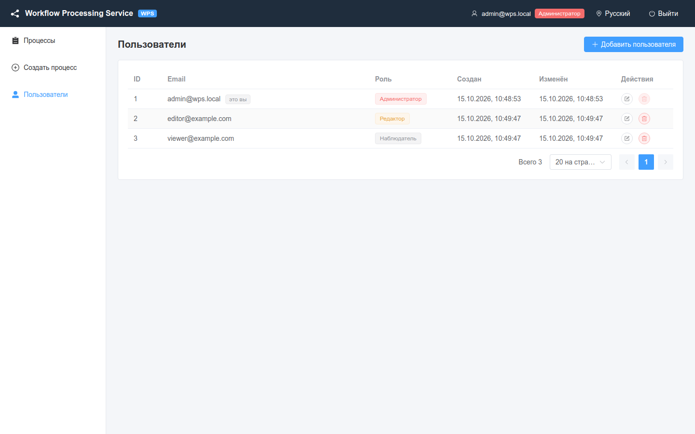

# Пользователи и роли

Кто что может делать в WPS, как администратор управляет пользователями и почему первым делом нужно сменить пароль по умолчанию.

<!-- lang-switch -->
[🇬🇧 English](../../en/03-user-guide/users-and-roles.md) | 🇷🇺 Русский
<!-- /lang-switch -->

## Роли

| Роль | В интерфейсе | Кратко |
|---|---|---|
| `admin` | **Администратор** | полный доступ, управление пользователями |
| `editor` | **Редактор** | создание и редактирование процессов, ручной запуск |
| `viewer` | **Наблюдатель** | только просмотр процессов и аудита |

Что разрешено каждой роли (бэкенд проверяет каждый запрос, интерфейс скрывает недоступное):

| Операция | Администратор | Редактор | Наблюдатель |
|---|:---:|:---:|:---:|
| Просмотр процессов, журнала, страниц выполнения, отметок однократного запуска | ✅ | ✅ | ✅ |
| Создание, редактирование, клонирование процессов | ✅ | ✅ | — |
| Ручной запуск (**Выполнить (Run)**) | ✅ | ✅ | — |
| Сброс отметки однократного запуска | ✅ | ✅ | — |
| Обновление списка модулей CRM (**Обновить список модулей из CRM**) | ✅ | ✅ | — |
| Удаление процесса | ✅ | — | — |
| Управление пользователями (меню **Пользователи**) | ✅ | — | — |

На запрещённый запрос бэкенд отвечает `403 FORBIDDEN`, интерфейс показывает
**Недостаточно прав для выполнения операции**. Страницы, недоступные роли (например, `/users` для редактора или
`/processes/create` для наблюдателя), перенаправляют на список процессов.

> **Примечание**
> Роль хранится в access-токене. Если администратор сменил пользователю роль, новая роль начнёт действовать, когда
> токен пользователя обновится (не позже чем через `JWT_ACCESS_TTL`, по умолчанию 15 минут), или после нового входа.

## Смена пароля администратора по умолчанию

При первом запуске создаётся администратор `admin@wps.local` с паролем `admin`. Смените пароль сразу после первого входа:

1. Войдите как `admin@wps.local`.
2. Откройте **Пользователи**.
3. Нажмите **Редактировать** в строке `admin@wps.local` (с пометкой **это вы**).
4. Введите новый **Пароль** (не менее 6 символов) и нажмите **Сохранить**.

Через API:

```bash
curl -s -X PUT http://localhost:9501/api/users/1 -H "Authorization: Bearer $TOKEN" \
  -H 'Content-Type: application/json' -d '{"password":"a-long-new-password"}'
```

> **Внимание**
> В рабочей среде замените и `JWT_SECRET`: со значением из `docker-compose.yml` подписать токен может кто угодно. См.
> [Безопасность](../04-operations/security.md).

## Управление пользователями

Страница **Пользователи** доступна только администраторам.



*Страница пользователей: администратор (**это вы**), редактор и наблюдатель.*

### Добавить пользователя

1. Нажмите **Добавить пользователя**.
2. В окне **Новый пользователь** заполните **Email**, **Пароль** (не менее 6 символов) и выберите **Роль**.
3. Нажмите **Создать**. Появится сообщение **Пользователь создан**.

### Изменить пользователя

1. Нажмите **Редактировать** в строке пользователя.
2. Измените **Email**, **Роль** или **Пароль**. Чтобы не менять пароль, оставьте поле пустым
   (**Оставьте пустым, чтобы не менять**).
3. Нажмите **Сохранить** (**Пользователь обновлён**).

### Удалить пользователя

1. Нажмите **Удалить** в строке пользователя.
2. Подтвердите **Удалить пользователя …?** (**Пользователь удалён**).

В вашей собственной строке кнопка неактивна (**Нельзя удалить самого себя**).

### Ограничения

| Ситуация | Ошибка | Сообщение в интерфейсе |
|---|---|---|
| Удалить самого себя | `409 CANNOT_DELETE_SELF` | **Нельзя удалить самого себя** |
| Удалить последнего администратора или сменить ему роль | `409 LAST_ADMIN` | **Нельзя удалить или понизить последнего администратора** |
| Email уже занят | `409 EMAIL_EXISTS` | **Пользователь с таким email уже существует** |
| Пароль короче 6 символов | `422 VALIDATION_ERROR` (`password`) | **Не менее 6 символов** |
| Некорректный email | `422 VALIDATION_ERROR` (`email`) | **Некорректный email** |

API никогда не возвращает хеш пароля. Удалённый пользователь не может продлить сессию: refresh-токен отклоняется с
`401 INVALID_TOKEN`.

### API

| Метод | URI | Тело |
|---|---|---|
| GET | `/api/users?page=&per_page=` | — |
| GET | `/api/users/{id}` | — |
| POST | `/api/users` | `{ "email", "password", "role" }` |
| PUT | `/api/users/{id}` | `{ "email"?, "password"?, "role"? }` |
| DELETE | `/api/users/{id}` | — |

```bash
curl -s -X POST http://localhost:9501/api/users -H "Authorization: Bearer $TOKEN" \
  -H 'Content-Type: application/json' -d '{"email":"editor@example.com","password":"editor123","role":"editor"}'
```

См. также: [Вход и интерфейс](login-and-ui.md), [Безопасность](../04-operations/security.md),
[Эндпоинты API](../06-api-reference/endpoints.md).

<!-- footer-nav -->
---

← Назад: [Ручной запуск и сброс однократного запуска](manual-run-and-reset.md) | [Оглавление](../README.md) | [Готовые сценарии](recipes.md) Далее →
<!-- /footer-nav -->
