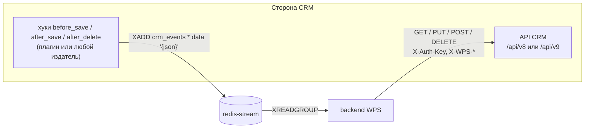

# Интеграция с CRM

Как WPS обменивается данными с CRM в обе стороны: события в стриме и вызовы API CRM; контракт 1.0 и 2.0; мок, SuiteCRM 7 и SuiteCRM 8.

<!-- lang-switch -->
[🇬🇧 English](../../en/04-operations/crm-integration.md) | 🇷🇺 Русский
<!-- /lang-switch -->

## Два направления



1. **CRM → WPS: события.** При сохранении записи CRM добавляет сообщение в Redis Stream `crm_events`.
2. **WPS → CRM: API.** Предзагрузка, `save_object` и `save_to_crm` вызывают небольшой REST API в формате, похожем на JSON:API.

WPS работает с **одной** CRM одновременно — с той, что указана в `CRM_API_BASE_URL`.

Контракт существует в двух версиях. **1.0** — минимальный: чтение по id, поиск по равенству поля, создание, обновление, событие
с новыми значениями записи. **2.0** — расширение без поломки 1.0: фильтр с операторами, сортировка, курсорная пагинация,
выбор полей, подсчёт, удаление, связи с полями связи, событие v2 со старыми значениями и происхождением изменения. Какую версию
реализует CRM, WPS узнаёт из `GET {base}/capabilities` (см. [Возможности и деградация](#возможности-и-деградация)).
Плагины SuiteCRM с версии 1.2.0 и мок реализуют контракт 2.0.

## Формат события (CRM → WPS)

`Wps\Services\EventProcessorService::parse()` принимает сообщения двух видов:

| Вид | Пример | Особенности |
|---|---|---|
| Поле `data` с JSON-объектом | `XADD crm_events * data '{"id":"42","module":"Deals","status":"Active"}'` | Так публикуют мок и плагин SuiteCRM. Значения сохраняют типы JSON |
| Плоские поля | `XADD crm_events * module Deals id 42 status Active` | Все значения — строки |

Обязательные и служебные поля объекта:

| Поле | Обязательно | Назначение |
|---|---|---|
| `module` или `object_type` | да | Модуль CRM = **тип объекта** процесса. По нему выбираются процессы |
| `id` | да | Id сохранённой записи CRM. Используется в путях предзагрузки вида `object.id`, в `save_object` и в отметках однократного запуска |
| `event_id` | нет | Id события для идемпотентности. Если его нет, берётся id сообщения Redis |
| любые другие поля | нет | Доступны как `object.<поле>` в условиях и действиях |

Сообщение без `module`/`object_type`, без `id` или с полем `data`, где не JSON-объект, переносится в стрим недоставленных
сообщений `crm_events:dlq` с причиной и подтверждается. Сообщение для модуля без активных процессов верхнего уровня
подтверждается и учитывается в `wps_events_skipped_total`.

### Публикация событий из любой системы

CRM для WPS может быть любая система, которая умеет писать в Redis. Пример с `redis-cli`:

```bash
redis-cli -h <хост redis-stream> -p 6379 XADD crm_events MAXLEN '~' 100000 '*' \
  data '{"id":"70001","module":"Deals","status":"Active","account_id":"512","event_id":"crm-save-70001-1"}'
```

`MAXLEN ~ 100000` ограничивает размер стрима (плагин SuiteCRM делает так же). WPS подтверждает сообщения, но стрим не обрезает.

> **Примечание**
> Если издатель может повторять отправку, передавайте стабильный `event_id`: два сообщения с одинаковым `event_id` запускают
> каждый процесс только один раз в пределах `IDEMPOTENCY_TTL_HOURS` (см. [Надёжность](reliability.md)).

### Событие версии 2 (контракт 2.0)

Издатель контракта 2.0 добавляет к полям записи (новые значения) служебные поля:

```json
{
  "id": "8f1c…", "module": "Opportunities", "object_type": "Opportunities",
  "event_type": "update",
  "before": { "sales_stage": "Prospecting", "amount": "1000" },
  "changed_fields": ["sales_stage", "amount"],
  "wps_event_version": 2,
  "wps_origin": { "execution_id": "2b0c…", "process_id": 12, "depth": 1 },
  "wps_event": "after_save", "wps_is_update": "1", "wps_user_id": "1", "wps_published_at": "2026-10-20T09:00:00Z",
  "name": "…", "sales_stage": "Closed Won", "amount": "1200"
}
```

| Поле | Значение |
|---|---|
| `event_type` | `create` — запись создана; `update` — изменена; `delete` — удалена (в том числе сохранением с `deleted = 1`). `link` / `unlink` — события связей, по умолчанию не публикуются (`publish_relationship_events`); WPS подтверждает их без запуска процессов (см. ниже). Какие типы запускают процесс — поле процесса [`trigger_on`](../03-user-guide/triggers-and-conditions.md#когда-запускается-процесс) |
| `before` | Старые значения **только изменённых** полей. Для `create` и `delete` — `{}` |
| `changed_fields` | Изменённые поля. Для `create` — все непустые поля. Поля из `ignore_change_fields` (по умолчанию `date_modified`, `modified_user_id`, `date_entered`, `created_by`, `deleted`) не попадают ни сюда, ни в `before`, иначе любое сохранение «меняло» бы `date_modified` |
| `wps_origin` | Есть, только если сохранение сделал WPS: заголовки `X-WPS-*` запроса (см. [ниже](#заголовки-происхождения-x-wps)). Защита от каскадов процессов |
| `wps_event_version` | `2` — маркер формата для диагностики |
| `wps_event`, `wps_is_update`, `wps_user_id`, `wps_published_at` | Поля контракта 1.0, сохранены для совместимости |

Изменения издатель считает после нормализации по типу поля: `1000.000000` и `1000` равны, `NULL` равно `''`, порядок значений
multienum не важен; строки сравниваются как есть (регистр и пробелы значимы). Сохранение без изменений публикуется как `update`
с пустыми `before` и `changed_fields` (настройка `publish_unchanged`).

### Как WPS разбирает событие

`Wps\Events\EventEnvelope` — единый разбор события для стрима и ручного запуска. Служебные поля `event_type`, `before`,
`changed_fields`, `wps_origin` **убираются из записи** и не попадают ни в `object`, ни в `context.event`:

| Куда | Что |
|---|---|
| `object` | Поля записи (новые значения). Поля контракта 1.0 (`wps_event`, `wps_is_update`, `wps_user_id`, `wps_published_at`) и `wps_event_version` остаются — на них могли опираться условия |
| `object_before` | Старые значения изменённых полей (переменная только для чтения, см. [Условия](../03-user-guide/triggers-and-conditions.md#значения-до-изменения-object_before)). `null` — старые значения неизвестны |
| `context.event_info` | `event_type`, `changed_fields` (`null` — неизвестно), `has_before`, `origin` (`wps_origin`), `legacy` (в событии нет `event_type`) |

Правила, когда части полей нет:

| Событие | `object_before` | `changed_fields` |
|---|---|---|
| `before` есть, `changed_fields` нет | `before` | ключи `before` |
| `changed_fields` есть, `before` нет | `null` (значения до неизвестны) | как прислано |
| `event_type: create` без `before` | `{}` | как прислано или `null` |
| `event_type: update`, `before: {}` | `{}` | `[]` — сохранение ничего не изменило |
| нет ни того, ни другого | `null` | `null` |
| нет `event_type` (контракт 1.0) | `null` | `null`, `legacy: true`; тип — `create`, если `wps_is_update = "0"`, иначе `update` |

- `id` и `module` внутри `before` игнорируются; лишние ключи `before`, которых нет в `changed_fields`, сохраняются.
- В плоском формате XADD вложенные значения передаются JSON-строкой: `before '{"status":"New"}'`, `changed_fields '["status"]'`.
- `changed_fields` очищается от повторов, пустых строк и не-строк.
- Служебное поле неверного типа (`before` — строка не-JSON, список, число; `changed_fields` — не список; `wps_origin` с
  нечисловым `depth`) отбрасывается: в лог пишется предупреждение `Invalid service fields in event`,
  растёт метрика `wps_events_malformed_fields_total`. **Событие не уходит в DLQ** — потерять сохранение из-за служебного поля хуже,
  чем потерять только старые значения.
- События без `event_type` учитываются в `wps_events_legacy_format_total` и обрабатываются как раньше: `wps_is_update = "0"` —
  создание, `"1"` или поля нет — изменение.
- Неподдерживаемый `event_type` (`link`, `unlink`, опечатка, пустая строка) — событие **подтверждается без запуска процессов**
  (статус `unsupported_event_type`, лог `info` `Unsupported event_type, no process is started`, метрика
  `wps_events_unsupported_type_total`); в DLQ оно не уходит.
- Процессы модуля фильтруются по [`trigger_on`](../03-user-guide/triggers-and-conditions.md#когда-запускается-процесс) до проверки
  условий. Если процессы модуля есть, но ни один не подписан на этот тип, растёт `wps_events_skipped_by_type_total`.

## Контракт API CRM (WPS → CRM)

Реализован в `Wps\Services\ExternalApiAdapterService` на корутинном HTTP-клиенте Swoole.

| Операция | Запрос | Ожидаемый ответ |
|---|---|---|
| Загрузка по id (предзагрузка, `by_field: id`) | `GET {base}/{module}/{id}` | `200 {"data": {"type", "id", "attributes": {...}}}`; `404` — не найдено (переменная становится `null`) |
| Поиск по полю (предзагрузка, другой `by_field`) — синтаксис 1.0, работает с любым плагином | `GET {base}/{module}?filter[{field}]={value}&size=1` | `200 {"data": [ {...} ]}` — берётся первая запись; пустой список — не найдено |
| Обновление (`save_object`, `save_to_crm`, у записи есть `id`) | `PUT {base}/{module}/{id}` с телом `{"data": {"type", "id", "attributes": {изменённые поля}}}` | `200 {"data": {...}}` |
| Создание (запись без `id`) | `POST {base}/{module}` с телом `{"data": {"type", "attributes": {...}}}` | `201 {"data": {"id", ...}}` — новый id записывается обратно в переменную |
| Справочник модулей | `GET {base}/modules` | список `{value,label}` / `{name,label}` / элементы JSON:API с `id` и `attributes.label` |

`null` в `attributes` очищает поле (плагины WPS для SuiteCRM 7 и 8 начиная с 1.2.0; раньше SugarBean пропускал такое поле при сохранении) —
так работают, например, `date_shift` с `on_missing: null` и `set_value` с `null`.

`{"id", "attributes"}` разворачивается в плоский объект `{id, ...attributes}`. Все запросы отправляются с заголовками `Accept` и
`Content-Type: application/json`.

### `X-Auth-Key`

```text
X-Auth-Key = CRM_API_STATIC_KEY . gmdate("Y.m.d H")
```

Пример: ключ `mySecretKey` в 08:15 UTC 15 октября 2026 года → `mySecretKey2026.10.15 08`. Ключ меняется каждый час; мок и плагин
SuiteCRM принимают и ключ предыдущего часа, чтобы пережить расхождение часов. Синхронизируйте время серверов (NTP).

### Базовый адрес и версия API

`AppConfig::crmUrl()` дописывает к `CRM_API_BASE_URL` суффикс `/api/v8`, **если** адрес уже не заканчивается на `/api/v<N>`:

| `CRM_API_BASE_URL` | Запрос для `Accounts/1` |
|---|---|
| `http://mock:9502` | `http://mock:9502/api/v8/Accounts/1` |
| `http://mock:9502/api/v8` | `http://mock:9502/api/v8/Accounts/1` |
| `http://suitecrm7/api/v9` | `http://suitecrm7/api/v9/Accounts/1` |

### Обработка ошибок

| Ответ CRM | Реакция WPS |
|---|---|
| Нет соединения, таймаут (`CRM_API_TIMEOUT`), сброс соединения, HTTP `5xx` | Восстановимая ошибка: шаг повторяется (`ACTION_RETRY_MAX`) |
| `404` на `GET` | Не найдено: переменная предзагрузки становится `null` |
| `404` на `DELETE` | Записи не было: `delete()` возвращает `false` |
| Другие `4xx` (включая `404` на `PUT`), некорректный JSON | Невосстановимая ошибка: шаг и выполнение сразу завершаются ошибкой |
| Некорректное имя модуля (не `^[A-Za-z][A-Za-z0-9_]*$`) | Невосстановимая ошибка, запрос не отправляется |

## Контракт API 2.0

Расширение контракта 1.0: все запросы 1.0 работают как раньше. Ответы — тот же формат JSON:API, ошибки —
`{"errors": [{"status", "title", "detail"?}]}`.

### Возможности: `GET {base}/capabilities`

```json
{ "data": {
    "contract_version": "2.0",
    "crm": { "name": "SuiteCRM", "version": "8.10.2", "plugin_version": "1.2.0" },
    "features": ["filter_operators", "filter_nin", "sort", "cursor_pagination", "fields", "count", "delete",
                 "relationships", "relationship_fields", "event_v2", "delete_events", "origin_headers"],
    "limits": { "max_page_size": 100, "max_link_batch": 100, "max_in_values": 100 } } }
```

`404` или `405` — CRM реализует контракт 1.0 без возможностей.

### Поиск

```text
GET {base}/Opportunities?filter[account_id][eq]=42
                       &filter[sales_stage][in][]=Prospecting&filter[sales_stage][in][]=Qualification
                       &filter[amount][gte]=1000.5&filter[date_closed][lt]=2026-11-01
                       &filter[description][null]=1
                       &sort=-date_entered&fields=id,name,amount&page[size]=100&page[after]=<курсор>&count=1
```

| Параметр | Семантика |
|---|---|
| `filter[f]=v` | Синтаксис 1.0, то же, что `filter[f][eq]=v` |
| `filter[f][op]=v` | Операторы: `eq`, `neq`, `gt`, `gte`, `lt`, `lte`, `like` (шаблон с `%` и `_`), `in` (массив `[]`, не больше `max_in_values`), `nin` — «нет в списке» (массив `filter[f][nin][]=a&filter[f][nin][]=b`, не больше `max_in_values`; как `neq`, подходят и записи с пустым полем: `NOT IN (…) OR IS NULL`; возможность `filter_nin`), `null` / `notnull` (значение игнорируется; пустая строка считается пустым значением). На одно поле можно несколько операторов (`gte` + `lt`). Все условия объединяются **AND**; OR нет — для «A или B» используйте `in` |
| Пустое значение | `eq ''` — `'' OR NULL`; `neq ''` — значение есть. `neq v` включает записи с пустым полем |
| Формат значений | Как хранит CRM: дата и время — UTC `Y-m-d H:i:s`, дата — `Y-m-d`, логическое — `1`/`0`, число — с точкой. Приводит WPS (`cast`, [Триггеры и условия](../03-user-guide/triggers-and-conditions.md)) |
| `sort` | До 2 полей через запятую, `-` — по убыванию. Последним скрытым ключом всегда добавляется `id` (стабильный порядок). По умолчанию — `date_entered` |
| `page[size]` (синоним `size`) | 1..`max_page_size`, по умолчанию 20 |
| `page[after]` | Непрозрачный курсор из `meta.next_cursor` предыдущей страницы (keyset по ключам сортировки). Курсор другого запроса — `422` |
| `fields` | Поля в ответе; `id` есть всегда |
| `count=1` | Добавляет `meta.total` (отдельный подсчёт; без параметра не считается) |

```json
{ "data": [ { "type": "Opportunities", "id": "8f1c…", "attributes": { "name": "…", "amount": "1200" } } ],
  "meta": { "size": 100, "count": 37, "next_cursor": null, "total": 37 } }
```

`next_cursor = null` — страниц больше нет. Курсор строится по значениям: запись, изменённая во время обхода, может сместиться;
для полного обхода сортируйте по неизменяемым полям (`date_entered`, `id`).

### Удаление: `DELETE {base}/{module}/{id}`

Мягкое удаление. `200 {"meta": {"deleted": true}}`; нет записи или уже удалена — `404`; модуль только для чтения — `405`.
Издатель публикует событие `delete`.

### Связи

| Запрос | Семантика |
|---|---|
| `GET {base}/{module}/{id}/relationships/{link}?page[size]=&page[after]=&fields=` | Связанные записи; у каждой — `meta.relationship` с полями связи (`{"accept_status": "accept", "required": "1"}`). Фильтра и сортировки нет |
| `POST {base}/{module}/{id}/relationships/{link}` `{"data": [{"type": "Users", "id": "1", "meta": {"accept_status": "accept"}}]}` | Связать (не больше `max_link_batch`). Идемпотентно: существующая связь обновляет поля. Ответ `{"meta": {"linked": [...], "updated": [...], "not_found": [...]}}`; несуществующие записи попадают в `not_found`, запрос не падает |
| `DELETE {base}/{module}/{id}/relationships/{link}/{related_id}` | Разорвать связь. Идемпотентно: `{"meta": {"removed": true\|false}}` |

`{link}` — имя поля-связи модуля: `Meetings.users`, `Meetings.contacts`, `Calls.contacts`, `Accounts.contacts`,
`SecurityGroups.users`, `Users.reportees`. Поля связи — дополнительные колонки join-таблицы связи «многие ко многим».
Модули только для чтения (`Users`, `Employees`) разрешают `GET` связей и запрещают изменения (`405`).

### Коды ошибок

| Код | Когда |
|---|---|
| `401` | Неверный `X-Auth-Key` |
| `404` | Модуль, запись или маршрут не найдены |
| `405` | Метод не поддерживается; модуль только для чтения |
| `422` | Неизвестное поле, оператор, ссылка или поле связи; `in` без значений или длиннее лимита; курсор другого запроса; больше 2 полей сортировки |
| `400` | Тело запроса не JSON или не той формы |
| `5xx` | Ошибка CRM; WPS повторяет шаг |

## Возможности и деградация

WPS загружает `GET {base}/capabilities` и кэширует в Redis `crm:capabilities` на `DICT_CACHE_TTL`; кэш сбрасывается вместе со
справочником модулей (`POST /api/dictionaries/modules/refresh`). Текущее состояние показывает
`GET /api/dictionaries/crm-capabilities`. Возможности проверяются во время выполнения, а не при сохранении процесса.

| Функция WPS | Нужная возможность | Со старым плагином (контракт 1.0) |
|---|---|---|
| Предзагрузка по id и по полю, `save_object`, `save_to_crm` | — | Работает |
| Поиск набора записей только по равенству, без сортировки, до 100 записей | — | Работает старым синтаксисом `filter[f]=v&size=N` |
| Поиск с другими операторами, сортировкой, курсором или больше 100 записей | `filter_operators`, `sort`, `cursor_pagination` | Шаг падает с `CRM_CAPABILITY_MISSING` |
| Фильтр «нет в списке» (`not_in` в «Найти записи») | `filter_nin` | `CRM_CAPABILITY_MISSING` (плагин 1.2.0 без `filter_nin` — обновите плагин) |
| Подсчёт (`count` без `field` в агрегате по фильтру) | `count` | `CRM_CAPABILITY_MISSING` |
| Удаление записи | `delete` | `CRM_CAPABILITY_MISSING` |
| Связи (список, связать, разорвать) | `relationships` | `CRM_CAPABILITY_MISSING` |
| Поля связи при связывании | `relationship_fields` | Связь создаётся без полей, в результате шага — предупреждение |
| Старые значения, тип события | `event_v2` (видно по самому событию) | Событие без `event_type` принимается как раньше |
| `wps_origin` в событиях | `origin_headers` | Заголовки `X-WPS-*` отправляются всегда (лишние заголовки безвредны), но в событии `wps_origin` не будет |

`CRM_CAPABILITY_MISSING` — невосстановимая ошибка шага с текстом
`CRM does not support "<feature>" (contract 1.0); update the CRM plugin` и `error_code` в `result_data`.

### Нагрузка на CRM: поиск, агрегаты, массовые изменения

Шаги, которые читают или меняют много записей, работают через этот же API, без отдельных эндпоинтов агрегатов:

- [Агрегат по записям](../03-user-guide/change-types-and-expressions.md#агрегат-по-записям) (`aggregate`): `count` без
  `field` по фильтру — **один** запрос с `count=1` (`meta.total`); остальные функции читают записи страницами по 100
  (`fields=id,<поле>`) и сворачиваются в WPS. Предел — `limit` шага (по умолчанию 1000) и `AGGREGATE_MAX_RECORDS`
  (5000, не больше 50000): записей больше — ошибка шага или частичный результат (`on_limit: partial`). Агрегат по
  всему модулю без фильтра запрещён при сохранении процесса;
- «Найти записи» — до `FIND_RECORDS_MAX` записей (по связи сканируется до `FIND_RECORDS_SCAN_MAX`);
- «Изменить записи списка» — по одному `PUT` на изменённую запись, до `UPDATE_RECORDS_MAX`.

Каждый такой шаг выполняется при **каждом** запуске процесса: частое событие (например, любое сохранение сделки)
с агрегатом по связи на тысячи записей даёт тысячи чтений. Сужайте условия запуска и фильтры, используйте `count` без
`field`, держите `limit` минимально достаточным; число прочитанных записей видно в метрике
`wps_aggregate_records_scanned` ([Мониторинг](monitoring.md)).

### Уведомления в колокольчике (`Alerts`)

Канал `crm_alert` действия [Уведомление](../03-user-guide/actions.md#уведомление) создаёт обычной записью API
(`POST {base}/Alerts`) по записи модуля `Alerts` на каждого получателя — отдельного эндпоинта не нужно. Интерфейс
SuiteCRM опрашивает `index.php?module=Alerts&action=get` и показывает непрочитанные записи пользователя в колокольчике.

| Поле `Alerts` | Значение | SuiteCRM 7 | SuiteCRM 8 |
|---|---|---|---|
| `name` | заголовок (без заголовка — первые 80 символов текста) | да | да |
| `description` | текст | да | да |
| `assigned_user_id` | получатель | да | да |
| `is_read` | `0` | да | да |
| `type` | `info` | да | да |
| `target_module` | модуль записи из `link.record` | да | да |
| `url_redirect` | ссылка на запись (`CRM_RECORD_URL_TEMPLATE`, по умолчанию по профилю) | да | да |
| `date_start`, `snooze`, `status` | время создания UTC, пусто, пусто | нет — плагин отбрасывает (`meta.ignored_attributes`) | да |

Профиль полей — `CRM_ALERT_PROFILE` (`suitecrm8` подходит и для SuiteCRM 7: лишние поля игнорируются); для другой CRM —
`profile: custom` и свои `fields` у канала или свой `module`. Добавлять `Alerts` в `WPS_EVENT_MODULES` плагина **не
нужно**: WPS только пишет уведомления и не реагирует на их события.

### Пользователи и группы (`assign`)

Действие [Назначить ответственного](../03-user-guide/actions.md#назначить-ответственного) читает пользователей через
тот же API:

| Что | Запрос | Поля |
|---|---|---|
| Пул из списка id | `GET {base}/Users?filter[id][in][]=…&fields=id,status,employee_status,is_group,portal_only,reports_to_id` | до 200 id за запрос |
| Пул из группы безопасности | `GET {base}/SecurityGroups/{id}/relationships/users` (возможность `relationships`), страницами; кэш `ASSIGN_POOL_CACHE_TTL` | те же |
| Руководитель (`manager`), проверка активности (`user`) | `GET {base}/Users/{id}` | `reports_to_id`, поля активности |
| Загрузка (`least_busy`) | `GET {base}/{module}?filter[…]&filter[assigned_user_id][eq]=…&count=1` на каждого пользователя (возможность `count`) | `meta.total` |

- Модуль `Users` в API плагина **только для чтения**: запись (`POST`/`PUT`/`DELETE`) отвечает `405 Module Users is
  read-only for the WPS API`. Тестовых пользователей стенд создаёт прямо в БД (`.tehnical/suiteCRM8/scripts/seed_case_users.sh`).
- Активный пользователь: `status = Active`, `employee_status` — `Active` или пусто (`Leave of Absence` исключает), не
  `is_group`, не `portal_only`.
- Группы безопасности SuiteCRM (`SecurityGroups`, модуль «Группы безопасности») — связь `users` через таблицу
  `securitygroups_users`. id группы виден в адресе её карточки в CRM.
- Назначение пишет обычное поле записи (`assigned_user_id`) через `PUT` — `save_to_crm` или отдельный «Сохранить в CRM».

## Заголовки происхождения X-WPS

Каждый запрос WPS к CRM, сделанный внутри выполнения, несёт:

```text
X-WPS-Execution-Id: 2b0c…      UUID выполнения
X-WPS-Process-Id: 12
X-WPS-Depth: 1                 глубина вложенности дочерних процессов
```

Издатель контракта 2.0 добавляет их как `wps_origin` в **каждое** событие, опубликованное во время этого HTTP-запроса, включая
каскадные сохранения других записей из logic hooks. Так WPS видит, что изменение вызвано его же процессом. Значения хранятся в
контексте корутины (`Wps\Crm\CrmCallOrigin`), поэтому параллельные выполнения не путаются.

## Справочник модулей

Списки «Тип объекта» и «Модуль» в UI берутся из `GET /api/dictionaries/modules` и кэшируются в Redis `dict:modules` на
`DICT_CACHE_TTL` (300 с). Источники по порядку:

1. `MOCK_SERVICE_URL/modules` — только если `MOCK_SERVICE_URL` не пустой;
2. `{API CRM}/modules`.

После смены CRM сбросьте кэш кнопкой обновления рядом с полем «Тип объекта» или запросом
`POST /api/dictionaries/modules/refresh`.

## Вариант 1: мок (по умолчанию для разработки)

Сервис `mock` эмулирует оба направления:

- `GET|POST http://localhost:9502/test-event?module=Deals&set[status]=Active&count=1` генерирует событие, сохраняет объект в
  хранилище мок-CRM и публикует его. Из-за квадратных скобок используйте `curl -g`.
- `&event_type=create|update|delete&before[поле]=старое` в `/test-event` — событие контракта 2.0 (`changed_fields` —
  ключи `before`, для `create` — все непустые поля). Без `event_type` и `before` событие публикуется в старом формате (`legacy`) —
  так проверяется обратная совместимость. Пример перехода статуса:
  `curl -g 'http://localhost:9502/test-event?module=Leads&event_type=update&before[status]=New&set[status]=Assigned'`.
- `/api/v8/…` и `/api/v9/…` — один и тот же API контракта 2.0 с проверкой `X-Auth-Key` (`MOCK_CRM_STATIC_KEY`): `capabilities`,
  поиск с операторами, сортировкой, курсором, `fields`, `count`, `DELETE`, связи. Мок без схемы: неизвестных полей и ссылок не
  бывает, числа сравниваются как числа, если обе стороны числовые. Id, начинающиеся с `fail500`, отвечают `500`, а с `slow` —
  через 3 с. Это удобно для проверки повторов и таймаутов.
- `GET|PUT /mock/objects/{module}/{id}` — прочитать или подложить объект без авторизации;
  `GET /mock/relationships/{module}/{id}/{link}`, `PUT …/{related_id}` `{"related_module", "fields"}` — связи.
- Цели для `http_request` (счётчики запросов — в Redis по ключу из заголовка `X-Mock-Key` или `?key=`):
  `ANY /mock/echo[/…]?delay_ms=&status=` — возвращает запрос (метод, путь, query, заголовки, тело, `json`, `count`) и
  `order_id` = `A-{1000+count}`; `GET /mock/echo-last?key=` — последний запрос и число запросов по ключу;
  `GET /mock/status/{code}?retry_after=` — код ответа (с `Retry-After`); `GET /mock/redirect?to=&code=302` — редирект;
  `GET /mock/big?bytes=` — тело заданного размера; `GET /mock/text?charset=windows-1251` — текст не в UTF-8;
  `POST /mock/oauth/token` — client credentials `wps` / `wps-secret` → `access_token` `tok-N`;
  `GET /mock/protected` — `200` с `Authorization: Bearer tok-…`, иначе `401`.
- `GET|PUT /mock/config` `{"contract": "1.0"|"2.0", "publish_on_write": true|false}` — режимы на лету (хранятся в Redis):
  `contract: 1.0` эмулирует старый плагин (`404` на `capabilities`, поиск только по равенству первого ключа, без связей и
  удаления); `publish_on_write` публикует событие v2 (с `before` и `wps_origin` из заголовков `X-WPS-*`) на каждый `POST`, `PUT`,
  `DELETE` через API. Значения по умолчанию — переменные `MOCK_CRM_CONTRACT` (`2.0`) и `MOCK_PUBLISH_ON_WRITE` (`0`).
- `GET /modules` — 15 модулей с русскими названиями; `GET /health`.

Настройки backend для мока:

```bash
CRM_API_BASE_URL=http://mock:9502
CRM_API_STATIC_KEY=mySecretKey     # = MOCK_CRM_STATIC_KEY
MOCK_SERVICE_URL=http://mock:9502
```

Это значения по умолчанию из `docker-compose.yml`, они действуют, если `./.env` их не задаёт.

## Вариант 2: SuiteCRM 7 или SuiteCRM 8

Встроенное API V8 SuiteCRM работает по OAuth2 и в другом формате, поэтому WPS интегрируется через **плагин, установленный в
CRM**. Он поставляется двумя отдельными пакетами рядом с репозиторием, по одному на версию CRM: `../suiteCRM7` (SuiteCRM 7.14)
и `../SuiteCRM8` (SuiteCRM 8.10, ставится в legacy-слой `public/legacy`). В каждом пакете есть пакет Module Loader,
`bin/install.sh` / `bin/uninstall.sh` (CRM на хосте или в Docker-контейнере), `bin/build.sh` (zip для Admin → Module Loader)
и фрагменты конфигурации веб-сервера; установка пошагово описана в его `README.md`.

| Часть | Реализация |
|---|---|
| События | Logic hooks уровня приложения `WpsEventHook`: `before_save` запоминает строку до сохранения, `after_save` и `after_delete` публикуют событие v2 (`XADD crm_events MAXLEN ~ 100000 * data '{json}'` через RESP-клиент на чистом PHP); хуки связей — по настройке. Модули задаются в `WPS_EVENT_MODULES` |
| API для WPS | Custom entry point `wpsApi` + rewrite в веб-сервере `/api/v9/(.*)` → `index.php?entryPoint=wpsApi&wps_path=$1` (в SuiteCRM 8 — `/legacy/index.php?...`) |
| Содержимое события | `id`, `module`, `object_type` и все хранимые поля записи (перечитываются из БД), плюс поля [события v2](#событие-версии-2-контракт-20) |
| Контракт API | 2.0 с версии плагина 1.2.0 (1.1.0 — контракт 1.0). Проверка установленного плагина: `bin/contract_check.sh <url>/api/v9 <ключ> <контейнер redis-stream>` из пакета |
| Если Redis недоступен | Сохранение в CRM проходит; событие теряется и пишется в лог как `[WPS] publish failed` |
| Создание записи | Новой считается запись без `fetched_row`, строки которой ещё нет в БД. SugarBean назначает `id` новой записи до `before_save`, поэтому признак «нет `id`» ненадёжен: до исправления в 1.2.0 создание сделок (Opportunities) публиковалось как `update` без изменений |
| Адрес почты (`email1`) | Основной адрес людей и компаний (Leads, Contacts, Accounts, Users…) хранится в отдельной таблице SuiteCRM; с 1.2.0 плагин отдаёт его как поле `email1` в API и событиях, а `email1` в `attributes` записи сохраняет как основной адрес. Смена адреса попадает в `changed_fields` со старым значением в `before`. Нужен для [`send_email`](../03-user-guide/actions.md#отправить-письмо) на адрес записи. Тело и адреса модуля `Emails` (история писем) тоже лежат отдельно — такие поля плагин пропускает (`meta.ignored_attributes`) |

Готовые docker-стенды чистой CRM лежат в `.tehnical/suiteCRM7` (SuiteCRM 7.14.9, порт 8701) и `.tehnical/suiteCRM8`
(SuiteCRM 8.10.2, порт 8801); плагина в их образах нет, он ставится пакетом. Стенды подключаются к сети WPS `WPS_NETWORK`
(`swoole_worckflow_default`), поэтому сначала запустите WPS:

```bash
cd .tehnical/suiteCRM8          # или suiteCRM7
cp .env.example .env            # задать пароли и WPS_API_STATIC_KEY
docker compose up -d --build
../../../SuiteCRM8/bin/install.sh --docker wps-suitecrm8-web-1 --env-file .env   # или ../../../suiteCRM7/... wps-suitecrm7-web-1
```

Переключите WPS на CRM в корневом `./.env`:

```bash
CRM_API_BASE_URL=http://suitecrm8/api/v9     # или http://suitecrm7/api/v9
CRM_API_STATIC_KEY=<WPS_API_STATIC_KEY из .tehnical/suiteCRM8/.env>
MOCK_SERVICE_URL=                            # пусто: модули берутся из CRM
```

Затем выполните `docker compose up -d --build backend` и `POST /api/dictionaries/modules/refresh`. Чтобы вернуться к моку,
удалите эти три строки. Установка плагина в любую другую CRM описана в `README.md` пакета; полный контракт API и примеры процессов
(`processes/*.processes.json`, импорт через `scripts/wps_processes.php`) описаны в `.tehnical/suiteCRM7/README.md` и
`.tehnical/suiteCRM8/README.md`.

Настройки плагина 1.2.0 (`$sugar_config['wps']`, переменные `WPS_*` для `bin/install.sh`, все необязательные):

| Ключ (переменная) | По умолчанию | Назначение |
|---|---|---|
| `ignore_change_fields` (`WPS_IGNORE_CHANGE_FIELDS`) | `date_modified,modified_user_id,date_entered,created_by,deleted` | Поля, которые не считаются изменениями |
| `publish_unchanged` (`WPS_PUBLISH_UNCHANGED`) | `true` | Публиковать `update` без изменённых полей |
| `publish_delete_events` (`WPS_PUBLISH_DELETE_EVENTS`) | `true` | Хук `after_delete` → событие `delete` |
| `publish_relationship_events` (`WPS_PUBLISH_RELATIONSHIP_EVENTS`) | `false` | События `link` / `unlink` |
| `max_page_size`, `max_link_batch`, `max_in_values` (`WPS_MAX_PAGE_SIZE`, …) | `100` | Лимиты поиска и связей |

> **Внимание**
> Процесс, который сохраняет ту же запись, что его запустила, вызывает новое событие `after_save`, и процесс может запуститься
> снова. Примеры процессов для SuiteCRM используют [однократный запуск для записи](../03-user-guide/manual-run-and-reset.md)
> (`run_once`) и поле-маркер `wps_processed_c`, чтобы разорвать такой цикл. Делайте так же в своих процессах.

## Вариант 3: другая CRM

Подключить можно любую систему, если она (1) публикует события в описанном выше формате и (2) предоставляет описанный выше
контракт API — сама или через небольшой сервис-адаптер. Достаточно контракта 1.0; контракт 2.0 открывает поиск наборов записей,
связи, удаление и условия по изменениям. Подключаемого интерфейса адаптера в backend нет
(`ExternalApiAdapterService` — `final`-класс, который обработчики используют напрямую), поэтому совсем другой API
подключается через такой сервис-мост: см. [Новый адаптер CRM](../07-developer-guide/extending/new-crm-adapter.md).

<!-- footer-nav -->
---

← Назад: [Конфигурация](configuration.md) | [Оглавление](../README.md) | [Мониторинг](monitoring.md) Далее →
<!-- /footer-nav -->
