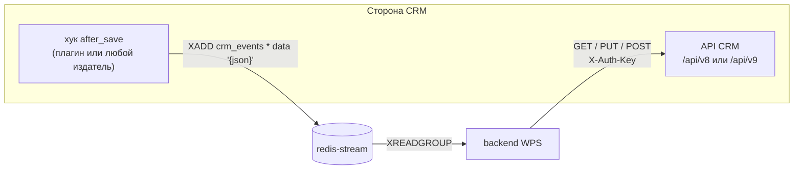

# Интеграция с CRM

Как WPS обменивается данными с CRM в обе стороны: события в стриме и вызовы API CRM; мок, SuiteCRM 7 и SuiteCRM 8.

<!-- lang-switch -->
[🇬🇧 English](../../en/04-operations/crm-integration.md) | 🇷🇺 Русский
<!-- /lang-switch -->

## Два направления



1. **CRM → WPS: события.** При сохранении записи CRM добавляет сообщение в Redis Stream `crm_events`.
2. **WPS → CRM: API.** Предзагрузка, `save_object` и `save_to_crm` вызывают небольшой REST API в формате, похожем на JSON:API.

WPS работает с **одной** CRM одновременно — с той, что указана в `CRM_API_BASE_URL`.

## Формат события (CRM → WPS)

`Wps\Services\EventProcessorService::parse()` принимает сообщения двух видов:

| Вид | Пример | Особенности |
|---|---|---|
| Поле `data` с JSON-объектом | `XADD crm_events * data '{"id":"42","module":"Deals","status":"Active"}'` | Так публикуют мок и плагин SuiteCRM. Значения сохраняют типы JSON |
| Плоские поля | `XADD crm_events * module Deals id 42 status Active` | Все значения — строки |

Обязательные и служебные поля объекта:

| Поле | Обязательно | Назначение |
|---|---|---|
| `module` или `object_type` | да | Модуль CRM = **тип объекта** процесса. По нему выбираются процессы |
| `id` | да | Id сохранённой записи CRM. Используется в путях предзагрузки вида `object.id`, в `save_object` и в отметках однократного запуска |
| `event_id` | нет | Id события для идемпотентности. Если его нет, берётся id сообщения Redis |
| любые другие поля | нет | Доступны как `object.<поле>` в условиях и действиях |

Сообщение без `module`/`object_type`, без `id` или с полем `data`, где не JSON-объект, переносится в стрим недоставленных
сообщений `crm_events:dlq` с причиной и подтверждается. Сообщение для модуля без активных процессов верхнего уровня
подтверждается и учитывается в `wps_events_skipped_total`.

### Публикация событий из любой системы

CRM для WPS может быть любая система, которая умеет писать в Redis. Пример с `redis-cli`:

```bash
redis-cli -h <хост redis-stream> -p 6379 XADD crm_events MAXLEN '~' 100000 '*' \
  data '{"id":"70001","module":"Deals","status":"Active","account_id":"512","event_id":"crm-save-70001-1"}'
```

`MAXLEN ~ 100000` ограничивает размер стрима (плагин SuiteCRM делает так же). WPS подтверждает сообщения, но стрим не обрезает.

> **Примечание**
> Если издатель может повторять отправку, передавайте стабильный `event_id`: два сообщения с одинаковым `event_id` запускают
> каждый процесс только один раз в пределах `IDEMPOTENCY_TTL_HOURS` (см. [Надёжность](reliability.md)).

## Контракт API CRM (WPS → CRM)

Реализован в `Wps\Services\ExternalApiAdapterService` на корутинном HTTP-клиенте Swoole.

| Операция | Запрос | Ожидаемый ответ |
|---|---|---|
| Загрузка по id (предзагрузка, `by_field: id`) | `GET {base}/{module}/{id}` | `200 {"data": {"type", "id", "attributes": {...}}}`; `404` — не найдено (переменная становится `null`) |
| Поиск по полю (предзагрузка, другой `by_field`) | `GET {base}/{module}?filter[{field}]={value}&size=1` | `200 {"data": [ {...} ]}` — берётся первая запись; пустой список — не найдено |
| Обновление (`save_object`, `save_to_crm`, у записи есть `id`) | `PUT {base}/{module}/{id}` с телом `{"data": {"type", "id", "attributes": {изменённые поля}}}` | `200 {"data": {...}}` |
| Создание (запись без `id`) | `POST {base}/{module}` с телом `{"data": {"type", "attributes": {...}}}` | `201 {"data": {"id", ...}}` — новый id записывается обратно в переменную |
| Справочник модулей | `GET {base}/modules` | список `{value,label}` / `{name,label}` / элементы JSON:API с `id` и `attributes.label` |

`{"id", "attributes"}` разворачивается в плоский объект `{id, ...attributes}`. Все запросы отправляются с заголовками `Accept` и
`Content-Type: application/json`.

### `X-Auth-Key`

```text
X-Auth-Key = CRM_API_STATIC_KEY . gmdate("Y.m.d H")
```

Пример: ключ `mySecretKey` в 08:15 UTC 15 октября 2026 года → `mySecretKey2026.10.15 08`. Ключ меняется каждый час; мок и плагин
SuiteCRM принимают и ключ предыдущего часа, чтобы пережить расхождение часов. Синхронизируйте время серверов (NTP).

### Базовый адрес и версия API

`AppConfig::crmUrl()` дописывает к `CRM_API_BASE_URL` суффикс `/api/v8`, **если** адрес уже не заканчивается на `/api/v<N>`:

| `CRM_API_BASE_URL` | Запрос для `Accounts/1` |
|---|---|
| `http://mock:9502` | `http://mock:9502/api/v8/Accounts/1` |
| `http://mock:9502/api/v8` | `http://mock:9502/api/v8/Accounts/1` |
| `http://suitecrm7/api/v9` | `http://suitecrm7/api/v9/Accounts/1` |

### Обработка ошибок

| Ответ CRM | Реакция WPS |
|---|---|
| Нет соединения, таймаут (`CRM_API_TIMEOUT`), сброс соединения, HTTP `5xx` | Восстановимая ошибка: шаг повторяется (`ACTION_RETRY_MAX`) |
| `404` на `GET` | Не найдено: переменная предзагрузки становится `null` |
| Другие `4xx` (включая `404` на `PUT`), некорректный JSON | Невосстановимая ошибка: шаг и выполнение сразу завершаются ошибкой |
| Некорректное имя модуля (не `^[A-Za-z][A-Za-z0-9_]*$`) | Невосстановимая ошибка, запрос не отправляется |

## Справочник модулей

Списки «Тип объекта» и «Модуль» в UI берутся из `GET /api/dictionaries/modules` и кэшируются в Redis `dict:modules` на
`DICT_CACHE_TTL` (300 с). Источники по порядку:

1. `MOCK_SERVICE_URL/modules` — только если `MOCK_SERVICE_URL` не пустой;
2. `{API CRM}/modules`.

После смены CRM сбросьте кэш кнопкой обновления рядом с полем «Тип объекта» или запросом
`POST /api/dictionaries/modules/refresh`.

## Вариант 1: мок (по умолчанию для разработки)

Сервис `mock` эмулирует оба направления:

- `GET|POST http://localhost:9502/test-event?module=Deals&set[status]=Active&count=1` генерирует событие, сохраняет объект в
  хранилище мок-CRM и публикует его. Из-за квадратных скобок используйте `curl -g`.
- `/api/v8/{module}[/{id}]` — эмуляция API CRM v8 с проверкой `X-Auth-Key` (`MOCK_CRM_STATIC_KEY`).
  Id, начинающиеся с `fail500`, отвечают `500`, а с `slow` — через 3 с. Это удобно для проверки повторов и таймаутов.
- `GET|PUT /mock/objects/{module}/{id}` — прочитать или подложить объект без авторизации.
- `GET /modules` — 15 модулей с русскими названиями; `GET /health`.

Настройки backend для мока:

```bash
CRM_API_BASE_URL=http://mock:9502
CRM_API_STATIC_KEY=mySecretKey     # = MOCK_CRM_STATIC_KEY
MOCK_SERVICE_URL=http://mock:9502
```

Это значения по умолчанию из `docker-compose.yml`, они действуют, если `./.env` их не задаёт.

## Вариант 2: SuiteCRM 7 или SuiteCRM 8

Встроенное API V8 SuiteCRM работает по OAuth2 и в другом формате, поэтому WPS интегрируется через **плагин, установленный в
CRM**. Он поставляется двумя отдельными пакетами рядом с репозиторием, по одному на версию CRM: `../suiteCRM7` (SuiteCRM 7.14)
и `../SuiteCRM8` (SuiteCRM 8.10, ставится в legacy-слой `public/legacy`). В каждом пакете есть пакет Module Loader,
`bin/install.sh` / `bin/uninstall.sh` (CRM на хосте или в Docker-контейнере), `bin/build.sh` (zip для Admin → Module Loader)
и фрагменты конфигурации веб-сервера; установка пошагово описана в его `README.md`.

| Часть | Реализация |
|---|---|
| События | Logic hook `after_save` уровня приложения `WpsEventHook`: `XADD crm_events MAXLEN ~ 100000 * data '{json}'` через RESP-клиент на чистом PHP. Модули задаются в `WPS_EVENT_MODULES` |
| API для WPS | Custom entry point `wpsApi` + rewrite в веб-сервере `/api/v9/(.*)` → `index.php?entryPoint=wpsApi&wps_path=$1` (в SuiteCRM 8 — `/legacy/index.php?...`) |
| Содержимое события | `id`, `module`, `object_type` и все хранимые поля записи (перечитываются из БД), плюс `wps_event`, `wps_is_update`, `wps_user_id`, `wps_published_at` |
| Если Redis недоступен | Сохранение в CRM проходит; событие теряется и пишется в лог как `[WPS] publish failed` |

Готовые docker-стенды чистой CRM лежат в `.tehnical/suiteCRM7` (SuiteCRM 7.14.9, порт 8701) и `.tehnical/suiteCRM8`
(SuiteCRM 8.10.2, порт 8801); плагина в их образах нет, он ставится пакетом. Стенды подключаются к сети WPS `WPS_NETWORK`
(`swoole_worckflow_default`), поэтому сначала запустите WPS:

```bash
cd .tehnical/suiteCRM8          # или suiteCRM7
cp .env.example .env            # задать пароли и WPS_API_STATIC_KEY
docker compose up -d --build
../../../SuiteCRM8/bin/install.sh --docker wps-suitecrm8-web-1 --env-file .env   # или ../../../suiteCRM7/... wps-suitecrm7-web-1
```

Переключите WPS на CRM в корневом `./.env`:

```bash
CRM_API_BASE_URL=http://suitecrm8/api/v9     # или http://suitecrm7/api/v9
CRM_API_STATIC_KEY=<WPS_API_STATIC_KEY из .tehnical/suiteCRM8/.env>
MOCK_SERVICE_URL=                            # пусто: модули берутся из CRM
```

Затем выполните `docker compose up -d --build backend` и `POST /api/dictionaries/modules/refresh`. Чтобы вернуться к моку,
удалите эти три строки. Установка плагина в любую другую CRM описана в `README.md` пакета; полный контракт API и примеры процессов
(`processes/*.processes.json`, импорт через `scripts/wps_processes.php`) описаны в `.tehnical/suiteCRM7/README.md` и
`.tehnical/suiteCRM8/README.md`.

> **Внимание**
> Процесс, который сохраняет ту же запись, что его запустила, вызывает новое событие `after_save`, и процесс может запуститься
> снова. Примеры процессов для SuiteCRM используют [однократный запуск для записи](../03-user-guide/manual-run-and-reset.md)
> (`run_once`) и поле-маркер `wps_processed_c`, чтобы разорвать такой цикл. Делайте так же в своих процессах.

## Вариант 3: другая CRM

Подключить можно любую систему, если она (1) публикует события в описанном выше формате и (2) предоставляет описанный выше
контракт API — сама или через небольшой сервис-адаптер. Подключаемого интерфейса адаптера в backend нет
(`ExternalApiAdapterService` — `final`-класс, который обработчики используют напрямую), поэтому совсем другой API
подключается через такой сервис-мост: см. [Новый адаптер CRM](../07-developer-guide/extending/new-crm-adapter.md).

<!-- footer-nav -->
---

← Назад: [Конфигурация](configuration.md) | [Оглавление](../README.md) | [Мониторинг](monitoring.md) Далее →
<!-- /footer-nav -->
