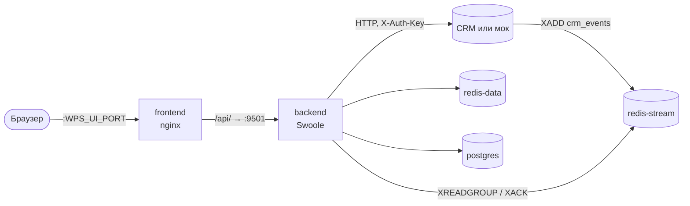

# Развёртывание

Как развернуть, обновить и масштабировать WPS в Docker Compose и что поменять перед запуском в продакшен.

<!-- lang-switch -->
[🇬🇧 English](../../en/04-operations/deployment.md) | 🇷🇺 Русский
<!-- /lang-switch -->

## Сервисы

Весь стек описан в `docker-compose.yml` в корне репозитория. Все сервисы находятся в одной docker-сети
(`<проект>_default`, например `swoole_worckflow_default`) и обращаются друг к другу по имени сервиса.

| Сервис | Образ / сборка | Порт в контейнере | Порт на хосте (переменная, по умолчанию) | Том | Назначение |
|---|---|---|---|---|---|
| `postgres` | `postgres:15-alpine` | 5432 | `WPS_PG_PORT` (5432) | `pgdata` | Процессы, выполнения, аудит шагов, пользователи, отметки однократного запуска |
| `redis-stream` | `redis:7-alpine`, `--appendonly yes` | 6379 | `WPS_REDIS_STREAM_PORT` (6379) | `redis-stream` | Шина событий: стрим `crm_events`, группа `wps_workers`, стрим недоставленных сообщений `crm_events:dlq` |
| `redis-data` | `redis:7-alpine`, `--appendonly yes` | 6379 | `WPS_REDIS_DATA_PORT` (6380) | `redis-data` | Кэши, живое состояние выполнений, блокировки, ключи идемпотентности |
| `backend` | `back/Dockerfile` (`phpswoole/swoole:6.0-php8.3`) | 9501 | `WPS_API_PORT` (9501) | — | REST API, чтение стрима, восстановление выполнений |
| `mock` | `mock/Dockerfile` | 9502 | `WPS_MOCK_PORT` (9502) | — | Генератор событий и эмуляция API CRM (разработка и демо) |
| `frontend` | `front/Dockerfile` (сборка на Node, раздача через nginx) | 80 | `WPS_UI_PORT` (3000) | — | Одностраничный UI; nginx проксирует `/api/` на `backend:9501` |



Backend стартует, когда PostgreSQL прошёл healthcheck (`depends_on: condition: service_healthy`) и оба Redis запущены.
Стрим событий и Redis для данных намеренно разнесены: шиной событий может владеть сторона CRM, а кэши и состояние
выполнений остаются внутри WPS.

> **Примечание**
> В небольшой установке оба Redis можно заменить одним сервером: укажите в `REDIS_STREAM_*` и `REDIS_DATA_*` один хост и
> другой номер базы в `REDIS_DATA_DB`. Ключи не пересекаются: стрим — `crm_events*`, данные — `proc_cache:*`,
> `dict:modules`, `exec:*`, `lock:exec:*`, `idem:*`.

## Первый запуск

```bash
docker compose up -d --build
docker compose ps
curl -s http://localhost:9501/api/health
```

Что происходит при старте backend (`back/docker/entrypoint.sh`):

1. Если в контейнере нет `/srv/back/.env`, он копируется из `.env.example`. Переменные окружения из `docker-compose.yml`
   всегда важнее этого файла (см. [Конфигурация](configuration.md)).
2. `php migrations/migrate.php` ждёт базу (до `DB_WAIT_SECONDS`, 60 с) и применяет новые файлы `migrations/*.sql`
   в порядке имён. Применённые файлы записываются в таблицу `schema_migrations`, поэтому перезапуск безопасен.
3. `php server.php` запускает HTTP-сервер Swoole. Строка лога `[WPS] listening on 0.0.0.0:9501` означает, что API поднялся.

Администратор по умолчанию `admin@wps.local` / `admin` создаётся миграцией `002_seed_admin.sql`.

## Порты

Пользователям нужен только порт UI. Остальное может оставаться внутри docker-сети:

| Порт | Кому нужен |
|---|---|
| UI (`WPS_UI_PORT`) | Пользователям |
| API (`WPS_API_PORT`) | Скриптам и интеграциям, которые вызывают REST API напрямую; Prometheus для `/metrics` |
| `redis-stream` | CRM (она публикует события). Если CRM в той же docker-сети, порт публиковать не нужно |
| `postgres`, `redis-data`, `mock` | В продакшене никому; публикуйте только для отладки |

Порты на хосте меняются в `./.env` (переменные `WPS_*_PORT`). В `.env` этого репозитория UI уже перенесён на 3080, а
PostgreSQL — на 55432: на машине разработчика порты 3000 и 5432 были заняты.

## Обновление

Код backend вшит в образ. После обновления кода пересоберите изменённые сервисы:

```bash
git pull
docker compose up -d --build backend frontend
```

Миграции применяются автоматически при старте backend. Данные хранятся в именованных томах `pgdata`, `redis-stream` и
`redis-data`: `docker compose down` их сохраняет, `docker compose down -v` удаляет.

PHP-фреймворк SwooleApp подключён как обычная composer-зависимость (`sidalex/swoole-app`, версия зафиксирована в
`back/composer.lock`). Как обновить только фреймворк — раздел «Сборка бэкенда» в корневом `README.md`.

## Несколько стендов рядом

Имя проекта Compose изолирует стенды. Так снимались скриншоты документации, не затрагивая основной стенд:

```bash
WPS_UI_PORT=3081 WPS_API_PORT=9511 WPS_MOCK_PORT=9512 WPS_PG_PORT=55433 \
WPS_REDIS_STREAM_PORT=6389 WPS_REDIS_DATA_PORT=6390 \
CRM_API_BASE_URL=http://mock:9502 CRM_API_STATIC_KEY=mySecretKey MOCK_SERVICE_URL=http://mock:9502 \
docker compose -p wpsdoc up -d --build
```

Переменные из командной строки важнее значений в `./.env`.

## Масштабирование

- **Воркеры внутри одного backend.** HTTP-воркеров `SWOOLE_WORKER_NUM` (по умолчанию 2). Циклические задачи работают со
  стратегией `ALL_WORKERS`, поэтому каждый воркер — отдельный потребитель группы `wps_workers` и читает свою часть стрима.
  У каждого воркера свой пул соединений PostgreSQL (`DB_POOL_SIZE`, 16) и пулы Redis. Шаги внутри воркера выполняются в
  корутинах, поэтому медленный ответ CRM не блокирует другие выполнения.
- **Несколько контейнеров backend.** Поддерживается: имя потребителя — `<hostname>-<pid>`, все экземпляры входят в одну
  группу, и Redis распределяет сообщения между ними. Ключи идемпотентности и блокировки выполнений лежат в общем
  `redis-data`, поэтому сообщение, повторно доставленное другому экземпляру, не выполнится дважды
  (см. [Надёжность](reliability.md)). Для API поставьте экземпляры за балансировщик; UI нужен только прокси `/api/`.
- **Метрики** хранятся в общей памяти одного процесса backend и обнуляются при перезапуске. При нескольких экземплярах
  собирайте метрики с каждого.

```bash
docker compose up -d --scale backend=2   # сначала уберите фиксированный порт backend на хосте, иначе порты конфликтуют
```

> **Внимание**
> При `--scale` проброс `ports: "9501:9501"` у backend конфликтует. Уберите проброс порта (UI обращается к backend по
> docker-сети) или поставьте перед экземплярами reverse proxy.

## Чек-лист для продакшена

- [ ] Задайте длинный случайный `JWT_SECRET` в `docker-compose.yml` (значение `change-me-in-production-…` из репозитория публично).
- [ ] Войдите и смените пароль `admin@wps.local` или создайте своего администратора и удалите стандартного.
- [ ] Смените `POSTGRES_PASSWORD` / `DB_POSTGRES_PASSWORD` (по умолчанию `secret`).
- [ ] Укажите в `CORS_ALLOW_ORIGIN` адрес UI вместо `*`, если API доступен с других адресов.
- [ ] Направьте `CRM_API_BASE_URL` / `CRM_API_STATIC_KEY` на настоящую CRM, очистите `MOCK_SERVICE_URL` и не запускайте сервис `mock`.
- [ ] Публикуйте только порт UI (и порт API, если он нужен интеграциям); PostgreSQL и Redis держите внутри сети или закройте паролями (`REDIS_*_PASSWORD`).
- [ ] Оставьте `APP_DEBUG=false`: при `true` клиентам возвращаются тексты внутренних ошибок.
- [ ] Настройте резервное копирование тома `pgdata`. В томах Redis только кратковременное состояние и кэши, но в `redis-stream` лежат ещё не обработанные события.
- [ ] Собирайте `/metrics` и настройте оповещение, если `/api/health` отвечает `503` (см. [Мониторинг](monitoring.md)).
- [ ] Проверьте раздел [Безопасность](security.md).

<!-- footer-nav -->
---

← Назад: [Готовые сценарии](../03-user-guide/recipes.md) | [Оглавление](../README.md) | [Конфигурация](configuration.md) Далее →
<!-- /footer-nav -->
