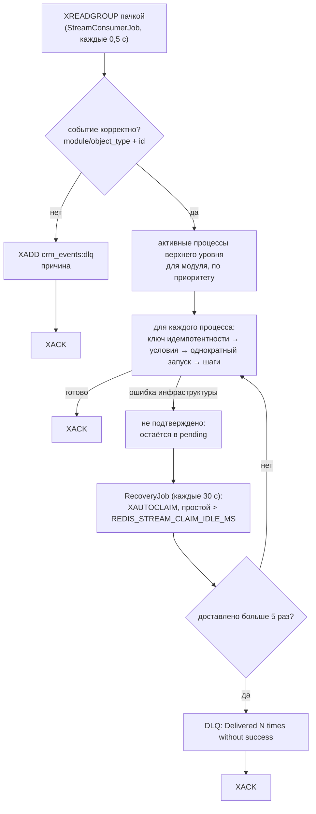

# Надёжность

Как WPS защищается от потери и дублирования работы: гарантии доставки, идемпотентность, повторы, восстановление после сбоев и однократный запуск для записи.

<!-- lang-switch -->
[🇬🇧 English](../../en/04-operations/reliability.md) | 🇷🇺 Русский
<!-- /lang-switch -->

## Доставка: at-least-once (хотя бы один раз)

WPS читает стрим `crm_events` как группа потребителей `wps_workers` (`XREADGROUP`). Сообщение подтверждается (`XACK`)
**только после полной обработки**: каждый подходящий процесс запущен и доведён до конца (или пропущен).
Ведомые процессы и ручные запуски к сообщению не относятся: они работают в собственных корутинах.



- Событие без подходящих процессов подтверждается (учитывается в `wps_events_skipped_total`).
- Ошибка **шага** — не ошибка инфраструктуры: выполнение получает статус `failed`, сообщение подтверждается.
- Исключение, вышедшее за пределы обработки сообщения (недоступна база или Redis, падение воркера), оставляет его в
  **pending**. `RecoveryJob` через `XAUTOCLAIM` забирает сообщения, простоявшие дольше `REDIS_STREAM_CLAIM_IDLE_MS` (5 мин).
  После более чем **5** доставок сообщение уходит в `crm_events:dlq` и подтверждается (защита от «ядовитых» сообщений).
- Новая группа создаётся с id `0`, поэтому обрабатываются и события, опубликованные до первого запуска WPS.

## Идемпотентность: без двойных запусков при повторной доставке

At-least-once означает, что сообщение может прийти дважды. Перед каждым запуском процесса по событию берётся ключ Redis

```text
idem:<event_id>:<process_id>   SET NX, TTL IDEMPOTENCY_TTL_HOURS (24 ч)
```

- Ключ взят — обычный запуск; в ключ записывается id выполнения (или `skipped`, если условия не выполнены).
- Ключ уже есть со значением `skipped` — делать нечего (`duplicate`).
- Ключ уже есть с id выполнения — незавершённое выполнение **продолжается** из состояния в Redis, завершённое игнорируется;
  если состояние потеряно, выполнение помечается ошибочным, а процесс запускается заново.

`event_id` — это поле `event_id` события, если оно есть, иначе id сообщения в стриме. Издатель, который может отправить одно
сохранение дважды, должен передавать стабильный `event_id`.

Ведомые процессы используют ключ `idem:<id родительского выполнения>.<номер шага>:<id ведомого процесса>`, поэтому шаг
родителя, повторённый после восстановления, не запустит второй экземпляр ведомого процесса.

## Повторы шага

Каждый шаг (строка предзагрузки или действие) выполняется с повторами:

| Ошибка | Примеры | Поведение |
|---|---|---|
| **Восстановимая** | Таймаут CRM, нет соединения, HTTP `5xx` от CRM, `RedisException`, потеря соединения с БД, `RecoverableException` из своего действия | До `ACTION_RETRY_MAX` (3) повторов. Пока идёт ожидание, статус выполнения — `retrying` |
| **Невосстановимая** | `4xx` от CRM, некорректный JSON от CRM, неверный модуль, неизвестная функция в выражении, ведомый процесс не найден, превышена глубина, `NonRecoverableException` | Сразу ошибка |

Задержка перед повтором номер *n* (с 1):

```text
delay_ms = ACTION_RETRY_BASE_DELAY_MS × ACTION_RETRY_BACKOFF^(n−1)
         = 1000 мс, 2000 мс, 4000 мс со значениями по умолчанию
```

Со значениями по умолчанию шаг делает не больше 4 попыток и ждёт в сумме 7 с — ровно это показывает демо-процесс
«Payment sync (CRM failure demo)» (`attempts: 4`, `retry_count: 3`, длительность ≈ 7 с). Перед каждым повтором контекст
выполнения возвращается в состояние до неудачной попытки, поэтому недовыполненный шаг не оставляет частичных изменений в переменных.

Когда шаг окончательно завершился ошибкой, оставшиеся шаги записываются как `skipped` («Not executed: a previous step failed»),
выполнение получает статус `failed` с текстом ошибки, а снимок контекста сохраняется.

> **Внимание**
> Повтор повторяет весь шаг. Если CRM применила `PUT`/`POST`, но ответ потерялся (таймаут), запрос уйдёт ещё раз. `PUT` по своей
> природе идемпотентен, а `POST` (создание новой записи) может создать дубликат.

## Восстановление прерванных выполнений

Пока выполнение идёт, его состояние хранится в Redis для данных:

| Ключ | TTL | Содержимое |
|---|---|---|
| `exec:<uuid>` | `EXECUTION_TTL_HOURS` (24 ч) во время работы, `EXECUTION_FINISHED_TTL_SECONDS` (1 ч) после завершения | статус, `current_step`, число повторов, событие, переменные, изменённые поля, снимок definition процесса, трассировка условий |
| `lock:exec:<uuid>` | `EXECUTION_LOCK_TTL` (30 с), продлевается перед каждой попыткой | токен воркера, который выполняет процесс |

После каждого шага прогресс (`current_step` и контекст) записывается в Redis, а сам шаг — в PostgreSQL. Если воркер упал,
`RecoveryJob` (каждые 30 с, первый запуск через 15 с после старта) находит незавершённые выполнения, начатые раньше чем
`RECOVERY_STALE_SECONDS` (300 с) назад:

- состояние в Redis есть и блокировка истекла — выполнение **продолжается с `current_step`** по сохранённой версии
  definition (процесс за это время могли изменить). Шаг, который выполнялся в момент сбоя, выполняется ещё раз;
- состояния в Redis нет — выполнение помечается `failed` с текстом «Execution context expired or lost; it could not be resumed».

Так восстанавливаются и ручные запуски, и ведомые процессы, у которых нет сообщения в стриме для повторной доставки.

## Однократный запуск для записи

Флаг процесса `run_once` гарантирует, что процесс запустится для записи CRM (`object_type` + `id`) не больше одного раза,
независимо от источника (`stream`, `child`, `manual`) и числа сохранений. Это основная защита от циклов, когда процесс
сохраняет ту же запись, которая его запустила.

- Отметка — строка в `process_object_runs` (первичный ключ: процесс + тип объекта + id объекта). Она вставляется атомарно в момент
  старта и только если условия выполнены. Два параллельных события по одной записи не могут оба запустить процесс.
- Заблокированный запуск не создаёт выполнения; он увеличивает `blocked_count` отметки и метрику `wps_run_once_skipped_total`.
- Отметка остаётся и после выполнения со статусом `failed`. `force: true` при ручном запуске пропускает условия, но не отметку.
- Снять отметку можно в UI (вкладка «Однократные запуски») или запросом `DELETE /api/processes/{id}/runs/{object_type}/{object_id}`.
- Без `id` флаг не применяется (`wps_run_once_no_id_total`); события стрима без `id` и так отклоняются в DLQ.

Подробно для пользователей: [Ручной запуск и сброс](../03-user-guide/manual-run-and-reset.md).

## Другие защиты

| Защита | Где |
|---|---|
| Циклы запуска (А → Б → А) отклоняются при сохранении | `422 CYCLE_DETECTED` |
| Вложенность ведомых процессов ограничена | `MAX_CHILD_DEPTH` (10), шаг завершается ошибкой «Maximum child process depth (10) exceeded» |
| Процесс не может запустить сам себя; запускать можно только ведомые процессы | проверка при сохранении |
| Процесс, на который ссылается `start_process`, нельзя удалить | `409 PROCESS_IN_USE` |
| Процессы удаляются мягко | выполнения сохраняют корректную ссылку (`processes.deleted_at`) |
| Выполнения хранят `process_version` и снимок definition | изменение процесса не влияет на уже идущие выполнения |
| При недоступности кэша процессов они читаются из PostgreSQL | `ProcessResolverService` |

## Что не гарантируется

- **Порядок** событий: воркеры обрабатывают сообщения параллельно, два сохранения одной записи могут обрабатываться одновременно.
- **Ровно один эффект в CRM** (см. предупреждение о повторах).
- **События, потерянные до попадания в стрим**: если CRM не смогла опубликовать событие (например, Redis недоступен), плагин
  SuiteCRM пишет ошибку в лог, а сохранение проходит без события; outbox не реализован.
- **Сохранность Redis**: оба экземпляра работают с `appendonly yes`; потеря `redis-data` означает потерю живого состояния
  (идущие выполнения будут помечены ошибочными) и ключей идемпотентности.

<!-- footer-nav -->
---

← Назад: [Мониторинг](monitoring.md) | [Оглавление](../README.md) | [Безопасность](security.md) Далее →
<!-- /footer-nav -->
