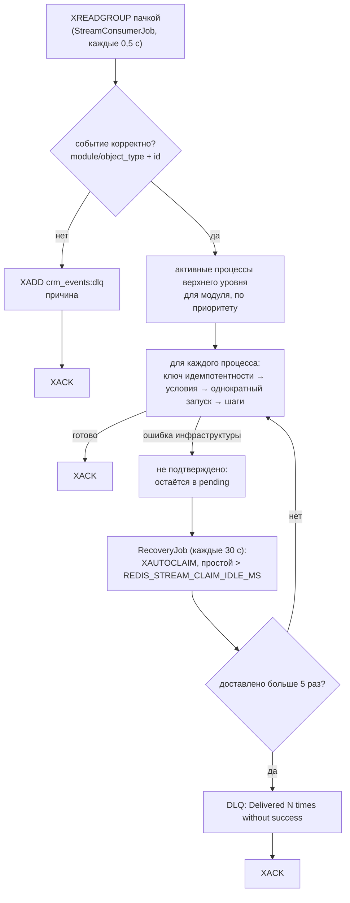

# Надёжность

Как WPS защищается от потери и дублирования работы: гарантии доставки, идемпотентность, повторы, восстановление после сбоев и однократный запуск для записи.

<!-- lang-switch -->
[🇬🇧 English](../../en/04-operations/reliability.md) | 🇷🇺 Русский
<!-- /lang-switch -->

## Доставка: at-least-once (хотя бы один раз)

WPS читает стрим `crm_events` как группа потребителей `wps_workers` (`XREADGROUP`). Сообщение подтверждается (`XACK`)
**только после полной обработки**: каждый подходящий процесс запущен и доведён до конца (или пропущен).
Ведомые процессы и ручные запуски к сообщению не относятся: они работают в собственных корутинах.



- Событие без подходящих процессов подтверждается (учитывается в `wps_events_skipped_total`).
- Ошибка **шага** — не ошибка инфраструктуры: выполнение получает статус `failed`, сообщение подтверждается.
- Исключение, вышедшее за пределы обработки сообщения (недоступна база или Redis, падение воркера), оставляет его в
  **pending**. `RecoveryJob` через `XAUTOCLAIM` забирает сообщения, простоявшие дольше `REDIS_STREAM_CLAIM_IDLE_MS` (5 мин).
  После более чем **5** доставок сообщение уходит в `crm_events:dlq` и подтверждается (защита от «ядовитых» сообщений).
- Новая группа создаётся с id `0`, поэтому обрабатываются и события, опубликованные до первого запуска WPS.

## Идемпотентность: без двойных запусков при повторной доставке

At-least-once означает, что сообщение может прийти дважды. Перед каждым запуском процесса по событию берётся ключ Redis

```text
idem:<event_id>:<process_id>   SET NX, TTL IDEMPOTENCY_TTL_HOURS (24 ч)
```

- Ключ взят — обычный запуск; в ключ записывается id выполнения (или `skipped`, если условия не выполнены).
- Ключ уже есть со значением `skipped` — делать нечего (`duplicate`).
- Ключ уже есть с id выполнения — незавершённое выполнение **продолжается** из состояния в Redis, завершённое игнорируется;
  если состояние потеряно, выполнение помечается ошибочным, а процесс запускается заново.

`event_id` — это поле `event_id` события, если оно есть, иначе id сообщения в стриме. Издатель, который может отправить одно
сохранение дважды, должен передавать стабильный `event_id`.

Ведомые процессы используют ключ `idem:<id родительского выполнения>.<номер шага>:<id ведомого процесса>`, поэтому шаг
родителя, повторённый после восстановления, не запустит второй экземпляр ведомого процесса.

## Повторы шага

Каждый шаг (строка предзагрузки или действие) выполняется с повторами. Ошибка сначала **классифицируется**: получает
код и признак «временная» (класс `transient`):

| Ошибка | Код | Временная |
|---|---|---|
| Таймаут CRM / обрыв соединения | `TIMEOUT` / `TRANSPORT` | да |
| HTTP `5xx`, `408`, `425`, `429` от CRM | `HTTP_<статус>` | да |
| Прочие HTTP `4xx`, некорректный JSON от CRM | `HTTP_<статус>` | нет |
| `RedisException`, потеря соединения с БД | `REDIS`, `DATABASE` | да |
| `RecoverableException` из своего действия | `TRANSIENT` (или свой `error_code` из `details`) | да |
| `NonRecoverableException` из своего действия | `ERROR` (или свой `error_code`) | нет |
| Ошибка конфигурации (неверный модуль, неизвестная функция …) | `CONFIG` | нет, **никогда не повторяется** |
| Плагин CRM не поддерживает возможность | `CRM_CAPABILITY_MISSING` | нет, никогда не повторяется |
| Неизвестный исход побочного эффекта (`at_most_once`) | `UNKNOWN_OUTCOME` | нет, никогда не повторяется |
| Любая другая ошибка PHP | `INTERNAL` | нет |

По умолчанию повторяются временные ошибки: до `ACTION_RETRY_MAX` (3) повторов, пока идёт ожидание, статус выполнения —
`retrying`. Профиль `retry` шага меняет число попыток, задержки и классы повторяемых ошибок (`retry_on`: `transient`,
`5xx`, `4xx`, `any`, конкретные коды) — см. [Действия → Ошибки шага](../03-user-guide/actions.md#ошибки-шага-on_error-и-повторы).

Задержка перед повтором после неудачной попытки номер *n* (с 1):

```text
d = min(max_delay, base_delay × backoff^(n−1))       — 1000, 2000, 4000 мс со значениями по умолчанию
jitter: none  → d
        full  → случайное в [0, d]                    (по умолчанию, ACTION_RETRY_JITTER=full)
        equal → d/2 + случайное в [0, d/2]
Retry-After (429 / 503, respect_retry_after) → d = max(d, min(Retry-After, max_delay))
```

Джиттер по умолчанию (`full`) разносит повторы разных выполнений во времени, чтобы после сбоя CRM они не приходили
«волной»; вернуть прежнее поведение без разброса — `ACTION_RETRY_JITTER=none`. Заголовок `Retry-After` CRM читается
в секундах или как HTTP-дата.

Со значениями по умолчанию шаг делает не больше 4 попыток и ждёт в сумме не больше 7 с — это показывает демо-процесс
«Payment sync (CRM failure demo)» (`attempts: 4`, `retry_count: 3`).

**Длинные задержки.** Задержка не длиннее `WAIT_INLINE_MAX_SECONDS` (5 с) выполняется внутри воркера: сон в
корутине, блокировка выполнения продлевается каждые 5 с. Задержка длиннее **паркует** выполнение: статус `waiting`,
`wait_reason = retry`, в аудите шаг временно в статусе `waiting` с `result_data.retry = {attempt, next_at, error}`.
Воркер освобождается, а после срока шаг выполняется снова тем же номером записи аудита, и счёт попыток продолжается
(см. [Ожидающие выполнения](#ожидающие-выполнения)). Перед каждым повтором контекст
выполнения возвращается в состояние до неудачной попытки, поэтому недовыполненный шаг не оставляет частичных изменений в переменных.

Когда шаг окончательно завершился ошибкой, дальше действует его `on_error`. По умолчанию (`stop`) оставшиеся шаги
записываются как `skipped` («Not executed: a previous step failed»), выполнение получает статус `failed` с текстом
ошибки, а снимок контекста сохраняется. С `continue` / `goto` ошибка считается обработанной: в аудите шага `handled`,
в выполнении растёт `handled_errors`, метрика `wps_step_errors_handled_total`.

> **Внимание**
> Повтор повторяет весь шаг. Если CRM применила `PUT`/`POST`, но ответ потерялся (таймаут), запрос уйдёт ещё раз. `PUT` по своей
> природе идемпотентен, а `POST` (создание новой записи) может создать дубликат.

## Восстановление прерванных выполнений

Пока выполнение идёт, его состояние хранится в Redis для данных:

| Ключ | TTL | Содержимое |
|---|---|---|
| `exec:<uuid>` | `EXECUTION_TTL_HOURS` (24 ч) во время работы, `EXECUTION_FINISHED_TTL_SECONDS` (1 ч) после завершения | статус, `current_step`, число повторов, событие, переменные, изменённые поля, снимок definition процесса, трассировка условий |
| `exec:<uuid>:loop:<pc>` | как у `exec:<uuid>` | снимок элементов цикла `foreach` (список пишется один раз в начале цикла, удаляется при выходе из него) |
| `lock:exec:<uuid>` | `EXECUTION_LOCK_TTL` (30 с), продлевается перед каждой попыткой | токен воркера, который выполняет процесс |

После каждого шага прогресс (`current_step` и контекст) записывается в Redis, а сам шаг — в PostgreSQL. Если воркер упал,
`RecoveryJob` (каждые 30 с, первый запуск через 15 с после старта) находит незавершённые выполнения, начатые раньше чем
`RECOVERY_STALE_SECONDS` (300 с) назад:

- состояние в Redis есть и блокировка истекла — выполнение **продолжается с `current_step`** по сохранённой версии
  definition (процесс за это время могли изменить). Шаг, который выполнялся в момент сбоя, выполняется ещё раз; внутри
  цикла `foreach` — с того же элемента и по тому же снимку элементов (снимок потерян — `failed` «Loop items snapshot is
  lost; the execution cannot be resumed»);
- состояния в Redis нет — выполнение помечается `failed` с текстом «Execution context expired or lost; it could not be resumed».

Так восстанавливаются и ручные запуски, и ведомые процессы, у которых нет сообщения в стриме для повторной доставки.
Ожидающие выполнения (`waiting`) `RecoveryJob` не трогает — их продолжает `WaitResumeJob`.

## Ожидающие выполнения

Шаг может приостановить выполнение надолго: пауза [`delay`](../03-user-guide/actions.md#пауза-delay) или длинная задержка
повтора. Такое выполнение **паркуется**: оно не занимает воркер и не хранится в Redis.

1. Шаг возвращает «ждать до `due_at`». Движок пишет шаг в аудит со статусом `waiting` и сохраняет прогресс так, чтобы
   после пробуждения продолжить с этого же шага.
2. В одной транзакции PostgreSQL: строка в `execution_waits` (полный снимок состояния `exec:<uuid>`, срок, причина) и
   `executions.status = 'waiting'` с проверкой «статус ещё `running`/`retrying`» (compare-and-set). Если выполнение
   успели отменить или завершить — парковки нет, выполнение просто останавливается.
3. Только **после коммита** ключ `exec:<uuid>` удаляется из Redis и блокировка снимается. Падение между этими шагами
   безопасно: выполнение в статусе `waiting`, `RecoveryJob` его не возьмёт, а при пробуждении Redis перезапишется.

Пробуждение — циклическая задача `WaitResumeJob` в каждом воркере (раз в `WAIT_POLL_INTERVAL_MS`, первая через 5 с
после старта):

- забирает до `WAIT_BATCH` наступивших ожиданий одним запросом `UPDATE … WHERE … FOR UPDATE SKIP LOCKED` с **арендой**
  на `WAIT_LEASE_SECONDS` — воркеры не ждут друг друга и не берут одну строку дважды;
- для каждой строки в отдельной корутине: `executions` `waiting → running` (compare-and-set; не вышло — выполнение
  отменено, строка удаляется), состояние возвращается в Redis, берётся блокировка `lock:exec:<uuid>`, строка
  `execution_waits` удаляется, выполнение продолжается;
- шаг паузы дописывается обработчиком (`waited_seconds`, опоздание) и получает итоговый статус в той же записи аудита;
  для повтора шаг выполняется снова;
- ошибка до удаления строки: аренда истечёт, следующая итерация попробует снова; после `WAIT_MAX_ATTEMPTS` (10) попыток
  выполнение завершается `failed` «Could not resume waiting execution: …».

Итог: при нескольких воркерах и нескольких контейнерах backend одно ожидание продолжается **ровно один раз**
(compare-and-set статуса + блокировка выполнения). Все сравнения времени идут по часам PostgreSQL (`now()`), расхождение
часов воркеров не влияет.

**Перезапуск и потеря Redis.** Пока выполнение ждёт, его состояние только в PostgreSQL: перезапуск контейнера, `SIGKILL`
воркера и даже очистка Redis данных ничего не теряют. Это проверено в кейсе SuiteCRM 8 задачи 7.2: бэкенд убит
(`docker compose kill -s KILL backend`) посреди паузы и запущен снова — выполнение продолжилось и записало результат в CRM.
Если воркер упал уже **после** пробуждения, выполнение в статусе `running` с состоянием в Redis подхватывает обычный
`RecoveryJob`; критерий «начато раньше `RECOVERY_STALE_SECONDS`» у долго ждавшего выполнения выполняется сразу, а
одновременную работу двух воркеров исключает блокировка `lock:exec`.

**Ограничения.** Снимок состояния больше `WAIT_STATE_MAX_BYTES` (1 МБ) парковать нельзя — шаг завершается ошибкой
«Execution state is too large to wait». Изменение процесса на ожидающие выполнения не влияет: они продолжают снимок
definition своей версии. Деактивация процесса их тоже не останавливает. Удалить процесс с ожидающими выполнениями можно
только с `?force=true` (admin) — они отменяются (`cancelled`, «Process deleted»).

## Побочные эффекты и повторы

Шаг выполняется **как минимум один раз**: если воркер упал посреди шага, после восстановления шаг выполняется заново.
Для записи в CRM это безопасно (`PUT` тех же полей), для письма, вебхука или уведомления — нет: повтор означает второе
письмо клиенту или второй заказ во внешней системе. Поэтому действия с внешними эффектами (`send_email`, `http_request`,
[`notify`](../03-user-guide/actions.md#уведомление) — по записи на каждую доставку) проводят каждый внешний вызов через **журнал побочных эффектов**
(таблица `step_side_effects`).

**Как работает журнал.** Перед вызовом пишется запись `started`, после успешного вызова — `done` с ответом
(секреты замаскированы), после окончательной ошибки — `failed`. Восстановимая ошибка (таймаут, `5xx`, обрыв) оставляет
`started`: внешняя система могла выполнить запрос. Когда шаг выполняется повторно:

| Состояние записи | Что происходит |
|---|---|
| нет записи | вызов, запись `started` → `done` / `failed` |
| `done` | внешняя система **не вызывается**, шаг возвращает сохранённый ответ (`result_data.replayed: true`) |
| `failed` | вызов повторяется: прошлая ошибка была окончательной, эффекта не было |
| `started` той же попытки | обычный повтор внутри шага (`ACTION_RETRY_MAX`) |
| `started` чужой попытки (след упавшего воркера) | **исход неизвестен** → по политике `delivery` |

Попытки различаются по `attempt_token`: шаг получает новый токен один раз перед циклом повторов, поэтому повтор внутри
шага не путается со следом упавшего воркера.

**Ключи.** Ключ эффекта — позиция вызова в программе процесса: `{pc}`, внутри циклов `{pc}@{iteration}`, для нескольких
вызовов в одном шаге — `{pc}@{iteration}#{sub}`. Он не меняется после сбоя (выполнение использует свой снимок
определения). Внешний ключ идемпотентности `{execution_id}:{effect_key}` передаётся наружу: заголовок `Idempotency-Key`
для HTTP и `Message-ID: <…@WPS_MAIL_MESSAGE_ID_DOMAIN>` для писем. Если внешняя система учитывает ключ, даже повтор
безопасен.

**Политика `delivery`** (поле шага, допустимо только у действий с внешними эффектами):

| Значение | Неизвестный исход | По умолчанию |
|---|---|---|
| `at_most_once` — не более одного раза | шаг завершается ошибкой `UNKNOWN_OUTCOME`, внешняя система не вызывается | `send_email`, `notify`, `http_request` с `POST`/`PATCH` |
| `at_least_once` — не менее одного раза | вызов повторяется с тем же ключом идемпотентности | `http_request` с `GET`/`HEAD`/`PUT`/`DELETE` |

Для `at_most_once` таймаут или обрыв **после** отправки запроса тоже считается неизвестным исходом сразу, без повторов;
ошибка **до** отправки (нет соединения, DNS) безопасна и повторяется как обычно.

**`http_request` и журнал.** Ответ `done` сохраняется в журнале в том виде, в каком попадает в переменную (секреты
замаскированы), поэтому повтор шага восстанавливает переменную без нового запроса. Коды `408`, `425`, `429`, `503`
означают, что сервер запрос не обработал, — их повторять безопасно (с учётом `Retry-After`). А `500`, `502`, `504` и
обрыв после отправки могут означать, что запрос **уже выполнен**: при `at_most_once` без ключа идемпотентности такой шаг
не повторяется и завершается `UNKNOWN_OUTCOME`. Чтобы такие запросы повторялись автоматически, есть два пути:

- внешняя система дедуплицирует запросы по `Idempotency-Key` — оставьте `idempotency_header` по умолчанию (для
  `POST`/`PATCH` он отправляется), тогда `5xx` и обрывы повторяются с тем же ключом;
- запрос безопасно выполнить дважды — задайте шагу `delivery: at_least_once`.

Кейс `.tehnical/suiteCRM8/processes/cases/4.2-http-request.json` проверяет это на стенде: воркер убивается посреди
запроса к медленной системе, после восстановления шаг завершается `UNKNOWN_OUTCOME`, а внешняя система получает запрос
ровно один раз.

**Что делать оператору при `UNKNOWN_OUTCOME`.** В аудите шага `status = failed`, `result_data.error_code =
UNKNOWN_OUTCOME`, в `result_data.details` — ключ эффекта и время начала вызова. Сверьте с внешней системой (пришло ли
письмо, создан ли заказ). Повторить шаг вручную позволит задача 7.3 (оператор снимает «неизвестный исход»), обработать
ошибку в процессе — `on_error` (задача 7.1). Записи журнала выполнения видны через
`GET /api/executions/{id}/side-effects`.

**Хранение.** Записи удаляются вместе с выполнением (каскадно) и раз в час — старше `SIDE_EFFECTS_RETENTION_DAYS`
(30 дней; очистку делает `RecoveryJob`, один воркер за час благодаря ключу Redis `side_effects:purge`).
В тестовом прогоне (dry-run, задача 7.6) журнал не используется и внешние вызовы не выполняются.

## Однократный запуск для записи

Флаг процесса `run_once` гарантирует, что процесс запустится для записи CRM (`object_type` + `id`) не больше одного раза,
независимо от источника (`stream`, `child`, `manual`) и числа сохранений. Это основная защита от циклов, когда процесс
сохраняет ту же запись, которая его запустила.

- Отметка — строка в `process_object_runs` (первичный ключ: процесс + тип объекта + id объекта). Она вставляется атомарно в момент
  старта и только если условия выполнены. Два параллельных события по одной записи не могут оба запустить процесс.
- Заблокированный запуск не создаёт выполнения; он увеличивает `blocked_count` отметки и метрику `wps_run_once_skipped_total`.
- Отметка остаётся и после выполнения со статусом `failed`. `force: true` при ручном запуске пропускает условия, но не отметку.
- Снять отметку можно в UI (вкладка «Однократные запуски») или запросом `DELETE /api/processes/{id}/runs/{object_type}/{object_id}`.
- Без `id` флаг не применяется (`wps_run_once_no_id_total`); события стрима без `id` и так отклоняются в DLQ.

Подробно для пользователей: [Ручной запуск и сброс](../03-user-guide/manual-run-and-reset.md).

## Другие защиты

| Защита | Где |
|---|---|
| Циклы запуска (А → Б → А) отклоняются при сохранении | `422 CYCLE_DETECTED` |
| Вложенность ведомых процессов ограничена | `MAX_CHILD_DEPTH` (10), шаг завершается ошибкой «Maximum child process depth (10) exceeded» |
| Процесс не может запустить сам себя; запускать можно только ведомые процессы | проверка при сохранении |
| Процесс, на который ссылается `start_process`, нельзя удалить | `409 PROCESS_IN_USE` |
| Процессы удаляются мягко | выполнения сохраняют корректную ссылку (`processes.deleted_at`) |
| Выполнения хранят `process_version` и снимок definition | изменение процесса не влияет на уже идущие выполнения |
| При недоступности кэша процессов они читаются из PostgreSQL | `ProcessResolverService` |

## Что не гарантируется

- **Порядок** событий: воркеры обрабатывают сообщения параллельно, два сохранения одной записи могут обрабатываться одновременно.
- **Ровно один эффект в CRM** (см. предупреждение о повторах). Для писем и вебхуков действует журнал побочных эффектов
  (см. [выше](#побочные-эффекты-и-повторы)): при неизвестном исходе `at_most_once` предпочитает ошибку повтору.
- **События, потерянные до попадания в стрим**: если CRM не смогла опубликовать событие (например, Redis недоступен), плагин
  SuiteCRM пишет ошибку в лог, а сохранение проходит без события; outbox не реализован.
- **Сохранность Redis**: оба экземпляра работают с `appendonly yes`; потеря `redis-data` означает потерю живого состояния
  (идущие выполнения будут помечены ошибочными) и ключей идемпотентности.

<!-- footer-nav -->
---

← Назад: [Мониторинг](monitoring.md) | [Оглавление](../README.md) | [Безопасность](security.md) Далее →
<!-- /footer-nav -->
