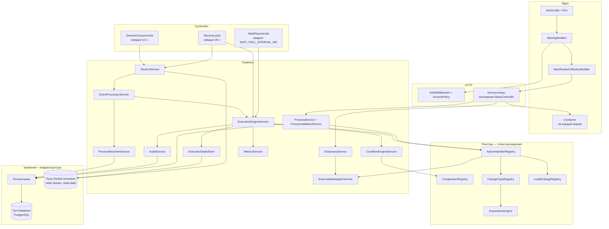
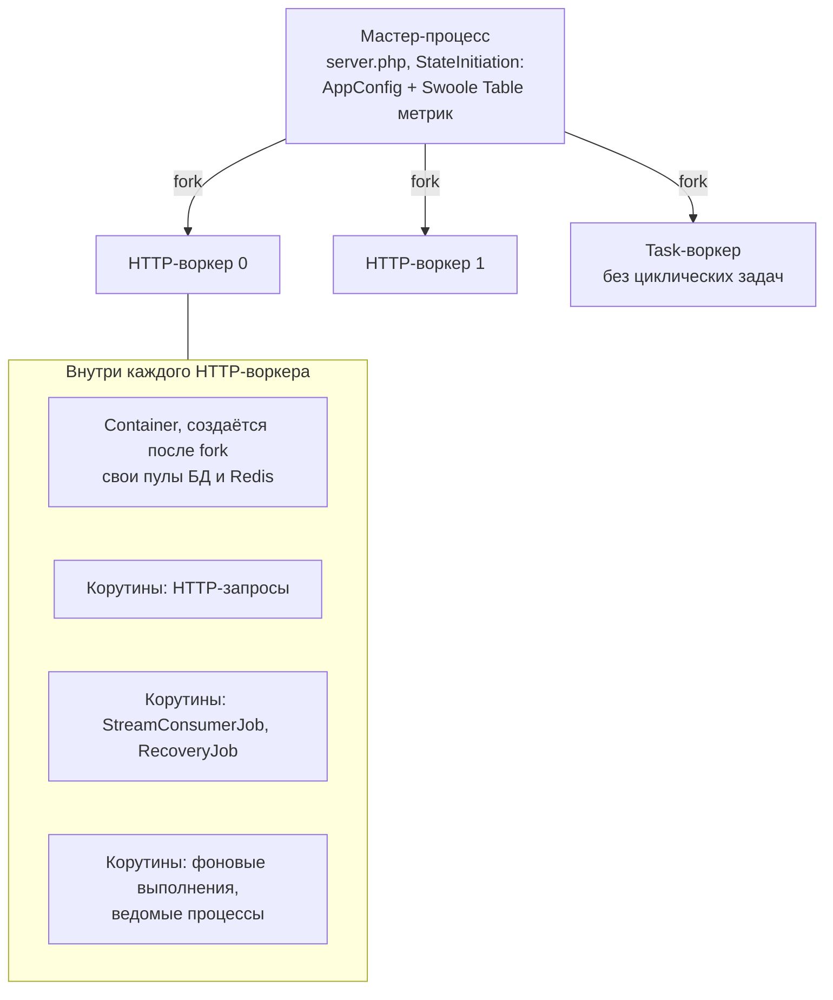
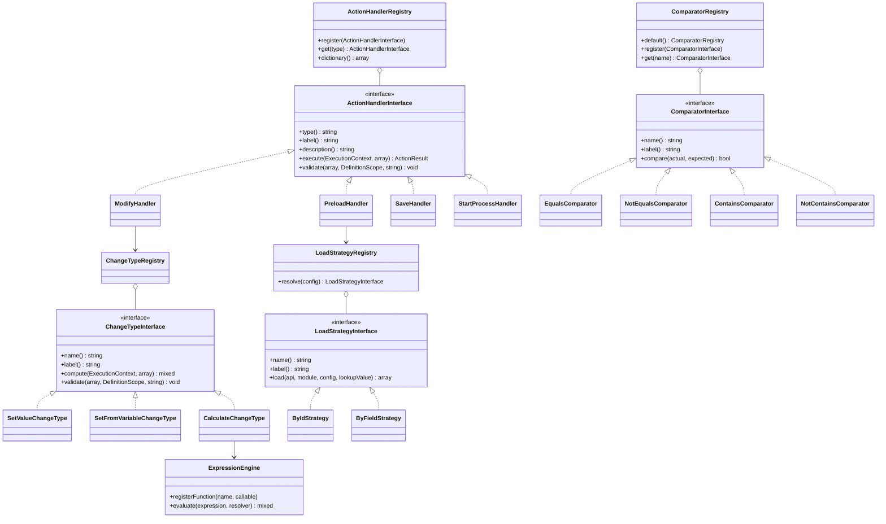

# Архитектура backend

Как устроен backend на PHP/Swoole: слои, компоненты, модель процессов и точки расширения.

<!-- lang-switch -->
[🇬🇧 English](../../en/05-architecture/backend.md) | 🇷🇺 Русский
<!-- /lang-switch -->

## Слои

| Слой | Пространство имён / файл | Назначение |
|---|---|---|
| Запуск | `back/server.php`, `Wps\Kernel\Env` | Читает `.env` (настоящие переменные окружения важнее), переносит переменные в `config/config.json`, включает `SWOOLE_HOOK_ALL`, запускает сервер |
| Ядро | `Wps\Kernel\WpsApplication`, `WpsRoutesCollectionBuilder`, `Container` | Диспетчеризация запросов, точное сопоставление маршрутов, CORS preflight, JSON-ответы 404/500; контейнер сервисов воркера |
| HTTP | `Wps\Controllers\*`, `BaseController`, `Wps\Http\*` | Один класс контроллера на эндпоинт, конверт ответа, `ApiException` |
| Безопасность | `Wps\Middleware\AuthMiddleware`, `Wps\Auth\AccessPolicy`, `JwtService` | Проверка JWT и правила ролей для каждого маршрута |
| Сервисы | `Wps\Services\*` | Обработка событий, проверка условий, движок выполнения, валидация, адаптер CRM, справочники, метрики |
| Реестры расширений | `Wps\Actions`, `Wps\Comparators`, `Wps\Actions\ChangeTypes`, `Wps\LoadStrategies`, `Wps\Program\Blocks`, `Wps\Notify\Channels`, `Wps\Expression` | Подключаемые типы действий, операторы, типы изменений, стратегии загрузки, блоки, каналы уведомлений, функции выражений |
| Фоновые задачи | `Wps\CyclicJobs\StreamConsumerJob`, `RecoveryJob`, `WaitResumeJob` | Чтение стрима (0,5 с); восстановление неподтверждённых сообщений и прерванных выполнений, очистка журнала побочных эффектов (30 с, первый запуск через 15 с); пробуждение ожидающих выполнений (`WAIT_POLL_INTERVAL_MS`, первый запуск через 5 с) |
| Хранение | `Wps\Persistence\*Repository`, `Process` | SQL-доступ к PostgreSQL |
| Инфраструктура | `Wps\Infrastructure\Database`, `RedisConnection` | Корутинные пулы соединений (PDO pgsql, phpredis) |
| Общее состояние | `Wps\State\StateInitiation`, `WpsState` | `AppConfig` и общая таблица метрик, создаются один раз в мастер-процессе |

### Каталоги `back/src`

| Каталог | Содержимое |
|---|---|
| `Kernel/` | `Container` (сборка всех сервисов и реестров), `Env`, `WpsApplication`, `WpsRoutesCollectionBuilder` |
| `Config/`, `State/` | `AppConfig` (все переменные окружения с границами), `StateInitiation` / `WpsState` (общее состояние мастер-процесса) |
| `Controllers/` | REST-эндпоинты (атрибут `#[Route]`), справочники — `Controllers/Dictionaries/` (23 эндпоинта `/api/dictionaries/*`) |
| `Auth/`, `Middleware/`, `Http/` | JWT, `AccessPolicy`, `AuthMiddleware`, `ApiException`, `JsonResponder` |
| `Http/Outbound/` | Исходящий HTTP `http_request` и мессенджеров: `OutboundHttpClient`, `EgressGuard` (SSRF), `CidrList`, `JsonPathExtractor`, `Auth/OAuth2TokenProvider` |
| `Services/` | Движок, условия, стрим, события, процессы, валидация (`Validation/DefinitionScope`), ошибки (`Errors/`), назначение (`Assign/`), `WaitService`, `MetricsService`, адаптер CRM |
| `Program/` | Компилятор и интерпретатор плоской программы, блоки, циклы |
| `Actions/` | Обработчики действий, `ChangeTypes/` (типы изменения), `Support/RelatedIdsResolver` |
| `Comparators/`, `Types/` | Операторы условий; `TypeCaster`, `CastOptions`, `RelativeDate` |
| `Expression/` | `ExpressionLexer` / `Parser` / `Engine`, `Decimal`, `SafeRegex`, функции `Functions/{Text,Number,Logic,Date,List,Type}Functions` |
| `Template/` | `TemplateEngine`, парсер, `TemplateValidator`, `EscapeMode`, `MissingPolicy` |
| `Crm/` | `CrmFilter`, `FilterTranslator`, `FilterRulesValidator`, `CrmPage`, `CrmCapabilities*`, `CrmCallOrigin` |
| `Events/`, `Context/` | `EventEnvelope`; `ExecutionContext`, `EventInfo` |
| `Mail/` | `MailerFactory` (symfony/mailer), `MailRateLimiter`, получатели, классификация ошибок SMTP |
| `Notify/` | `ChannelRegistry`, каналы `crm_alert`, `telegram`, `slack`, `teams`, `RecordLinks` |
| `Secrets/` | `SecretCipher` (XChaCha20-Poly1305), `SecretService`, `SecretResolver`, `SecretMasker`, `SecretUsageScanner` |
| `SideEffects/` | `SideEffectLedger`, `DeliveryPolicy`, `UnknownOutcomeException` |
| `Time/` | `Clock` (`SystemClock`, `FrozenClock`), `DateMath`, `Duration` |
| `Persistence/` | Репозитории PostgreSQL, `Process` (нормализация определения) |
| `Infrastructure/` | Пулы `Database` (PDO pgsql) и `RedisConnection` |
| `CyclicJobs/` | `StreamConsumerJob`, `RecoveryJob`, `WaitResumeJob` |
| `Support/` | `Logger` (JSON-строки), `JsonPath`, `Transliterator`, `Uuid`, `Json` |
| `Exceptions/` | `RecoverableException`, `NonRecoverableException`, `ConfigurationException`, `CrmApiException` … |

## Компоненты

В бизнес-логику ведут два входа: HTTP-запросы (интерфейс и клиенты API) и циклические задачи, которые читают стрим
событий. Оба получают сервисы из `Wps\Kernel\Container` — ленивого локатора, который создаёт каждый сервис один раз на
воркер. Движок выполнения не знает ни одного конкретного действия: он запрашивает у `ActionHandlerRegistry` обработчик
по `type` шага, а обработчики пользуются остальными реестрами. С PostgreSQL и Redis работают только репозитории и два
класса соединений.

### Путь запроса

1. Swoole вызывает `WpsApplication::execute()`. На запрос `OPTIONS` сразу отдаётся ответ CORS preflight.
2. `WpsRoutesCollectionBuilder` ищет контроллер, шаблон `#[Route]` которого содержит **столько же сегментов URI**
   (штатный механизм SwooleApp сравнивает только длину шаблона, и `/api/processes/5` попал бы в `/api/processes`).
   Совпадения нет — `404 NOT_FOUND` в JSON-конверте.
3. `BaseController::getMiddlewares()` ставит впереди глобальные middleware из `config.json` (`AuthMiddleware`).
   Middleware получает роли через `AccessPolicy::rolesFor(method, path)`, проверяет Bearer JWT и кладёт пользователя
   в `AuthContext`.
4. `BaseController::execute()` вызывает `handle()`; `ApiException` превращается в конверт ошибки, любое другое
   исключение — в `500 INTERNAL_ERROR` (текст ошибки виден только при `APP_DEBUG=true`).

## Модель процессов Swoole

- В `config.json` заданы `worker_num: 2` и `task_worker_num: 1` (переменные `SWOOLE_WORKER_NUM`,
  `SWOOLE_TASK_WORKER_NUM`). Циклические задачи работают со стратегией `ALL_WORKERS`: каждый HTTP-воркер запускает
  свой `StreamConsumerJob` и является отдельным потребителем (`{hostname}-{pid}`) группы `wps_workers`. Task-воркер
  циклические задачи не запускает.
- `StateInitiation` выполняется один раз в мастер-процессе до fork: `Swoole\Table` (общие метрики) нужно создать
  раньше, чем появятся воркеры. Так же разделяется разобранный `AppConfig`.
- `Container::get()` сравнивает текущий pid с тем, в котором контейнер был создан, поэтому каждый воркер строит свои
  сервисы и свои пулы соединений (`DB_POOL_SIZE` — 16 соединений PDO, 32 соединения с redis-data, 8 — с redis-stream).
- `SWOOLE_HOOK_ALL` делает PDO, phpredis, сокеты и `sleep` неблокирующими внутри корутин. Медленный вызов CRM или
  пауза перед повтором (`Coroutine::sleep`) приостанавливают только свою корутину; воркер продолжает обслуживать
  HTTP-запросы и другие события.
- Ручной запуск и каждый ведомый процесс выполняются в своей корутине (`Coroutine::create`), их завершения никто не ждёт.

## Точки расширения

Каждая точка расширения — это интерфейс, набор встроенных реализаций и реестр, где ключом служит код из определения
процесса (`type`, `operator`, `change_type`, `strategy`). Реестры заполняются в `Container` (`actions()`,
`comparators()`, `changeTypes()`, `loadStrategies()`, `expressions()`), а эндпоинты справочников
(`/api/dictionaries/*`) читают их, поэтому зарегистрированная реализация сама появляется в списках интерфейса. После
добавления сервис нужно перезапустить (ответы заказчика №25, №26). Пошаговые инструкции — в руководстве разработчика,
например [Новый тип действия](../07-developer-guide/extending/new-action-type.md) и
[Новый оператор сравнения](../07-developer-guide/extending/new-comparator.md).

| Точка расширения | Интерфейс | Встроенные | Где регистрируется |
|---|---|---|---|
| Тип действия | `ActionHandlerInterface` | `preload`, `modify`, `save_object`, `set_variable`, `find_records`, `update_records`, `delay`, `send_email`, `http_request`, `assign`, `notify`, `link_records`, `unlink_records`, `start_process` (14) | `Container::actions()` |
| Блок | `BlockTypeInterface` | `condition`, `foreach`, `stop_process` | `Container::blocks()` (`BlockTypeRegistry`) |
| Оператор сравнения | `ComparatorInterface` | 25: `equals`, `not_equals`, `greater_than`, `greater_or_equal`, `less_than`, `less_or_equal`, `between`, `not_between`, `in`, `not_in`, `contains`, `not_contains`, `starts_with`, `ends_with`, `contains_any`, `contains_all`, `contains_none`, `is_empty`, `is_not_empty`, `is_null`, `is_not_null`, `changed`, `not_changed`, `changed_to`, `changed_from` | `ComparatorRegistry::default()` |
| Тип изменения | `ChangeTypeInterface` | 13: `set_value`, `set_from_variable`, `calculate`, `template`, `date_shift`, `increment`, `decrement`, `clear`, `append`, `prepend`, `remove`, `map`, `aggregate` | `Container::changeTypes()` |
| Стратегия загрузки | `LoadStrategyInterface` | `by_id`, `by_field` | `LoadStrategyRegistry::default()` |
| Канал уведомления | `ChannelInterface` | `crm_alert`, `telegram`, `slack`, `teams` | `Container::notifyChannels()` (`ChannelRegistry`) |
| Функция выражения | `callable` + описание для справочника | 121 функция в группах `string` (35), `number` (14), `logic` (5), `date` (32), `list` (18), `type` (17); те же функции — фильтры шаблонов (плюс `raw`) | `ExpressionEngine::registerFunction()`: встроенные, `DateFunctions::register()`, `TypeFunctions::register()` в `Container::expressions()` |

Диаграмма классов выше показывает устройство на примере исходных реализаций; полный текущий список отдают справочники
`GET /api/dictionaries/action-types`, `operators`, `change-types`, `notify-channels`, `functions`, `template-filters`.

## Ошибки

Исключение, брошенное во время выполнения шага, определяет дальнейшие действия движка:

| Класс | Смысл | Поведение движка |
|---|---|---|
| `RecoverableException` | Временный сбой (таймаут CRM, 5xx, сеть) | Повтор с экспоненциальной паузой |
| `CrmApiException` | HTTP-ошибка CRM; восстановимая для транспортных ошибок и 5xx, иначе нет | Зависит от флага |
| `NonRecoverableException` | Постоянная ошибка (неверный модуль, 4xx от CRM, предел вложенности) | Шаг `failed`, выполнение `failed` |
| `ConfigurationException` | Неверная настройка (неизвестный тип, плохой путь) | Как невосстановимая |
| `RedisException`, ошибки соединения PDO | Потеряно соединение с инфраструктурой | Считается восстановимой |

Подробности — в разделе [Движок выполнения](execution-engine.md).

<!-- footer-nav -->
---

← Назад: [Обзор архитектуры](overview.md) | [Оглавление](../README.md) | [Поток событий](event-flow.md) Далее →
<!-- /footer-nav -->
