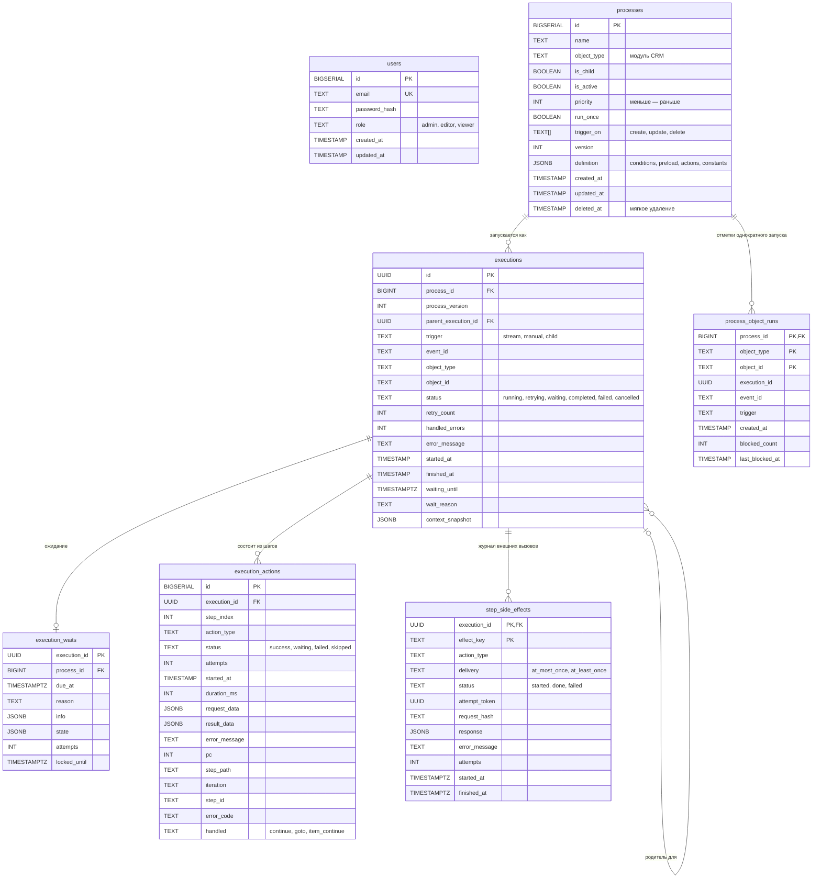
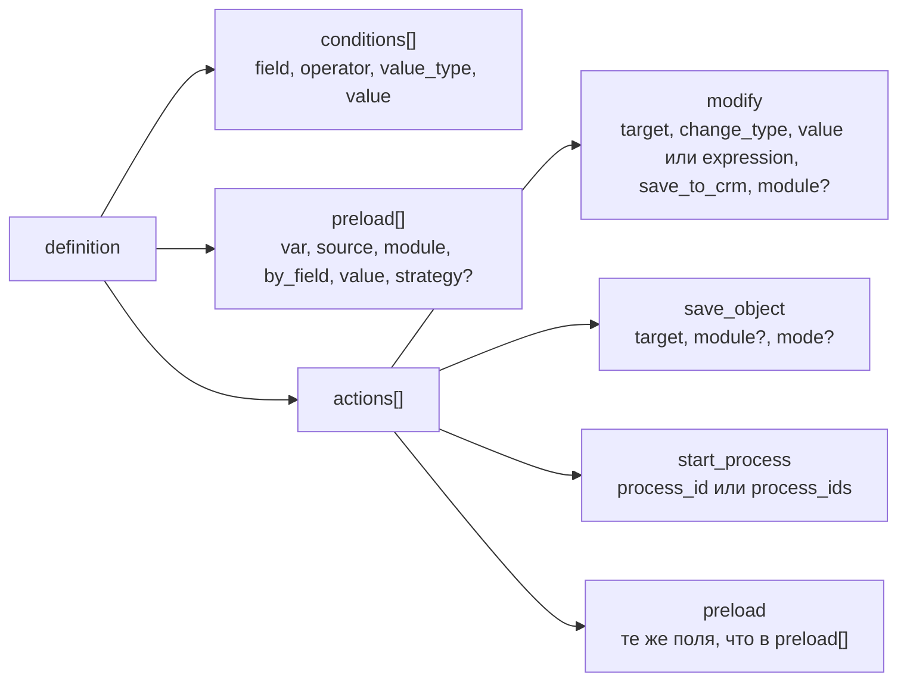

# Модель данных

Таблицы PostgreSQL, структура определения процесса и ключи Redis, которые использует WPS.

<!-- lang-switch -->
[🇬🇧 English](../../en/05-architecture/data-model.md) | 🇷🇺 Русский
<!-- /lang-switch -->

Схему создают миграции из `back/migrations/` (`001_create_tables.sql` … `010_reserved_names_check.sql`, список и порядок применения — [Развёртывание → Миграции](../04-operations/deployment.md#миграции)).
`back/docker/entrypoint.sh` применяет их через `migrations/migrate.php` при каждом старте backend. Все столбцы
`TIMESTAMP` хранятся в UTC.

## ER-диаграмма



Таблица `users` не связана с остальными: аудит не хранит, кто изменил процесс. У процесса много выполнений; у
выполнения — по строке на каждый шаг и, возможно, родительское выполнение (ведомые процессы). В `process_object_runs`
не больше одной отметки на пару «процесс + запись CRM». Её столбец `execution_id` намеренно без внешнего ключа: отметка
записывается раньше, чем появляется строка в `executions`.

## Таблицы

### `schema_migrations`

Служебная таблица `migrate.php` (создаётся им самим, не миграцией): `version TEXT PRIMARY KEY` — имя файла без `.sql`,
`applied_at TIMESTAMP` — когда применён. Строка появляется в той же транзакции, что и сама миграция.

### `users`

| Столбец | Описание |
|---|---|
| `id` | Первичный ключ |
| `email` | Логин, уникальный |
| `password_hash` | `password_hash()` (bcrypt); API его никогда не отдаёт |
| `role` | `admin`, `editor` или `viewer` (ограничение CHECK) |
| `created_at`, `updated_at` | Время создания и изменения |

Миграция `002_seed_admin.sql` создаёт пользователя `admin@wps.local` с паролем `admin`.

### `processes`

| Столбец | Описание |
|---|---|
| `id` | Первичный ключ, используется в `start_process.process_id` |
| `name` | Название, до 255 символов |
| `object_type` | Модуль CRM, к которому относится процесс (`Accounts`, `Leads`, …). Для процесса верхнего уровня по нему подбираются события |
| `is_child` | `true` — процесс запускается только действием `start_process` другого процесса и никогда напрямую событием |
| `is_active` | Неактивные процессы не попадают в подбор и пропускаются в `start_process` |
| `priority` | Порядок среди процессов верхнего уровня одного типа объекта, по возрастанию |
| `run_once` | Запускать не больше одного раза для записи CRM (миграция `003`) |
| `trigger_on` | `TEXT[] NOT NULL DEFAULT ARRAY['create','update']`, `CHECK (trigger_on <@ ARRAY['create','update','delete'])` — типы событий CRM, на которые запускается процесс (миграция `007_trigger_on.sql`). Фильтр по нему выполняется в PHP среди процессов модуля, индекса нет. См. [Тип события](../03-user-guide/triggers-and-conditions.md#тип-события-и-поле-запускать-при-trigger_on) |
| `version` | Увеличивается при каждом изменении; выполнение хранит версию, с которой работало |
| `definition` | JSONB, см. ниже |
| `deleted_at` | Мягкое удаление: строка остаётся, чтобы старые выполнения продолжали на неё ссылаться |

Индексы: `object_type`, частичные индексы по `is_child = false` и `is_active = true` и индекс для подбора процессов
`(object_type, priority) WHERE deleted_at IS NULL AND is_active AND NOT is_child`.

### `executions`

| Столбец | Описание |
|---|---|
| `id` | UUID, создаётся движком |
| `process_id`, `process_version` | Процесс и версия его определения |
| `parent_execution_id` | Выполнение, которое запустило это через `start_process`; `ON DELETE SET NULL` |
| `trigger` | `stream` (событие CRM), `manual` (ручной запуск), `child` (запущено другим процессом) |
| `event_id` | `event_id` объекта, id сообщения стрима или `manual-{uuid}` |
| `object_type`, `object_id` | Модуль и `id` объекта события |
| `status` | `running`, `retrying`, `waiting`, `completed`, `failed`, `cancelled` |
| `retry_count` | Число повторов по всем шагам |
| `handled_errors` | Число ошибок шагов, обработанных `on_error` (`continue` / `goto`) или циклом с `on_item_error: continue`; выполнение при этом может быть `completed` |
| `error_message` | Ошибка упавшего шага |
| `started_at`, `finished_at` | `finished_at` равен `NULL`, пока выполнение не завершено |
| `waiting_until`, `wait_reason` | `TIMESTAMPTZ` и `TEXT`: срок и причина (`delay`, `retry`) ожидания; заполнены, пока выполнение в статусе `waiting` |
| `context_snapshot` | Итоговый `{event, variables, meta, conditions}`; `{lost: true}` у выполнения, которое не удалось восстановить |

Индексы: `process_id`, `event_id`, `status`, `started_at DESC`, `parent_execution_id`, частичный
`idx_executions_waiting (waiting_until) WHERE status = 'waiting'`.

### `execution_actions`

| Столбец | Описание |
|---|---|
| `execution_id`, `step_index` | Уникальная пара; `step_index` — порядковый номер записи аудита (`seq`). Для линейного процесса совпадает с номером шага: 0 — первая строка предзагрузки или первое действие |
| `action_type` | `preload`, `modify`, `save_object`, `start_process` или собственный тип |
| `status` | `success`, `waiting`, `failed`, `skipped` |
| `attempts` | 1 + число повторов; 0 у шага, пропущенного из-за ошибки предыдущего |
| `started_at`, `duration_ms` | Время, включая паузы между повторами |
| `request_data` | Что шаг сделал или отправил (у упавшего шага — его настройка) |
| `result_data` | Что получил: старое и новое значение, найденный объект, ответ CRM, `error_class`, `recoverable` |
| `error_message` | Текст ошибки |
| `pc` | Номер инструкции в программе выполнения ([Движок выполнения](execution-engine.md#программа-и-инструкции)) |
| `step_path` | Место шага в дереве определения: `preload[0]`, `actions[2]`, `actions[1].branches[0].actions[0]`, `actions[1].else[0]` |
| `iteration` | Номер итерации цикла `foreach` с нуля, во вложенных циклах — индексы через `/` (`"2/0"`), пусто вне циклов |
| `step_id` | Пользовательский `id` шага, если задан |
| `error_code` | Код классифицированной ошибки упавшего шага (`HTTP_503`, `TIMEOUT`, `CONFIG`, `UNKNOWN_OUTCOME` …) |
| `handled` | `NULL` (ошибка остановила выполнение), `continue` или `goto` — как ошибку обработал `on_error`; `item_continue` — цикл с `on_item_error: continue` перешёл к следующему элементу |

Миграция `008_step_error_handling.sql` добавила `executions.handled_errors`, `execution_actions.error_code` и
`execution_actions.handled` ([Действия → Ошибки шага](../03-user-guide/actions.md#ошибки-шага-on_error-и-повторы)).

Миграция `004_program_audit.sql` добавила `pc`, `step_path`, `iteration`, `step_id` и заполнила `pc = step_index` для
существующих строк (они от линейных процессов); индекс `(execution_id, pc)`.

Строки удаляются вместе с выполнением (`ON DELETE CASCADE`).

### `process_object_runs`

| Столбец | Описание |
|---|---|
| `process_id`, `object_type`, `object_id` | Первичный ключ: одна отметка на процесс и запись CRM |
| `execution_id` | Первое (блокирующее) выполнение |
| `event_id`, `trigger` | Откуда пришёл первый запуск |
| `created_at` | Когда поставлена отметка |
| `blocked_count`, `last_blocked_at` | Сколько последующих запусков заблокировано и когда был последний |

Индексы: `(object_type, object_id)`, `(process_id, created_at DESC)`. Отметка снимается запросом
`DELETE /api/processes/{id}/runs/{object_type}/{object_id}`.

### `secrets`

Секреты внешних действий (см. [Безопасность → Секреты процессов](../04-operations/security.md#секреты-процессов)).

| Столбец | Описание |
|---|---|
| `id` | Первичный ключ |
| `name` | Уникальное имя для ссылок `secret://name` |
| `kind` | Вид: `generic`, `smtp_dsn`, `basic_auth`, `bearer`, `api_key`, `oauth2_client`, `webhook_url`, `telegram_bot` |
| `description` | Описание |
| `ciphertext`, `nonce` | Зашифрованное значение (JSON строки или объекта) и nonce, base64; XChaCha20-Poly1305, ассоциированные данные `wps-secret\|name\|version` |
| `kek_id` | Каким ключом зашифровано (первые 8 hex `sha256(ключ)`) — для ротации |
| `version` | Растёт при каждой смене значения (входит в ассоциированные данные) |
| `mask` | Готовая маска для списка (строка или JSON-объект для составных видов) |
| `allowed_hosts` | `JSONB`, хосты, на которые секрет можно отправлять |
| `created_by`, `updated_by` | Пользователи (`ON DELETE SET NULL`) |
| `created_at`, `updated_at`, `last_used_at` | `TIMESTAMPTZ`; `last_used_at` обновляется не чаще раза в 5 минут на воркер |

### `step_side_effects`

Журнал внешних вызовов (письма, вебхуки, уведомления), чтобы шаг, повторённый после сбоя воркера, не отправил их второй
раз (см. [Надёжность → Побочные эффекты и повторы](../04-operations/reliability.md#побочные-эффекты-и-повторы)).
Миграция `006_side_effects.sql`.

| Столбец | Описание |
|---|---|
| `execution_id`, `effect_key` | Первичный ключ. `effect_key` — позиция вызова в программе: `{pc}`, `{pc}@{iteration}` в циклах, `#{sub}` для нескольких вызовов в шаге |
| `action_type` | Тип действия, сделавшего вызов |
| `delivery` | `at_most_once` или `at_least_once` |
| `status` | `started` (до вызова или исход неизвестен), `done` (ответ сохранён), `failed` (окончательная ошибка) |
| `attempt_token` | Попытка шага, записавшая строку: отличает повтор внутри шага от следа упавшего воркера |
| `request_hash` | `sha256` отправленного запроса (сам запрос не хранится) |
| `response` | Ответ внешней системы, секреты замаскированы |
| `error_message` | Текст окончательной ошибки |
| `attempts` | Сколько раз вызов начинался |
| `started_at`, `finished_at` | `TIMESTAMPTZ`; индекс по `started_at` для очистки |

Строки удаляются вместе с выполнением (`ON DELETE CASCADE`) и раз в час — старше `SIDE_EFFECTS_RETENTION_DAYS`.

### `execution_waits`

Ожидающие выполнения ([Движок выполнения → Ожидание](execution-engine.md#ожидание-и-пробуждение-waitresumejob)):
пока выполнение ждёт, его состояние лежит здесь, а не в Redis. Миграция `009_execution_waits.sql`.

| Столбец | Описание |
|---|---|
| `execution_id` | Первичный ключ, `REFERENCES executions(id) ON DELETE CASCADE` — одна строка на выполнение |
| `process_id` | `BIGINT NOT NULL REFERENCES processes(id)` — для проверки при удалении процесса |
| `due_at` | `TIMESTAMPTZ` — когда разбудить |
| `reason` | `delay` (пауза) или `retry` (длинная задержка повтора) |
| `info` | `JSONB`: `pc`, `seq`, `mode` (`after_wait`, `retry`), `parked_at`, `attempts` и данные действия для `resume()` |
| `state` | `JSONB` — полный снимок `exec:{uuid}` (не больше `WAIT_STATE_MAX_BYTES`); при ожидании внутри цикла `foreach` — ещё `loop_items`: содержимое снимков элементов `exec:{uuid}:loop:{pc}` |
| `attempts` | Сколько раз выполнение пытались разбудить (`WAIT_MAX_ATTEMPTS`) |
| `locked_until`, `locked_by` | Аренда воркера, взявшего строку (`WAIT_LEASE_SECONDS`) |
| `last_error` | Ошибка последней неудачной попытки |
| `created_at` | Когда выполнение припарковано |

Индексы: `idx_execution_waits_due (due_at)`, `idx_execution_waits_process (process_id)`. Строка удаляется при
пробуждении, при отмене (`DELETE /api/processes/{id}?force=true`) и вместе с выполнением.

## Определение процесса (`processes.definition`)



```json
{
  "conditions": [
    { "field": "object.status", "operator": "equals", "value_type": "static", "value": "Active" }
  ],
  "preload": [
    { "var": "v1", "source": "object_field", "module": "Accounts", "by_field": "id", "value": "object.account_id" }
  ],
  "actions": [
    { "type": "modify", "target": "v1.rating", "change_type": "set_value", "value": "VIP", "save_to_crm": true },
    { "type": "save_object", "target": "object" },
    { "type": "start_process", "process_id": 4 }
  ]
}
```

- `conditions` — плоский список, строки объединяются по И. Движок принимает и дерево
  `{ "logical_operator": "AND" | "OR", "conditions": [...], "groups": [...] }` — задел для ИЛИ и скобок (ответ
  заказчика №8); текущий интерфейс его не редактирует.
- Строки `preload` выполняются до действий; `preload` может встречаться и внутри `actions`.
- `Process::normalizeDefinition()` всегда возвращает ключи `conditions`, `preload`, `actions` и `constants`, поэтому
  отсутствующий блок — пустой список (объект). Другие ключи верхнего уровня валидатор отклоняет (`422 Unknown key "x"`), чтобы опечатка не теряла данные молча; список допустимых — `Process::DEFINITION_KEYS`.
- `constants` (задача 5.2.9) — объект констант процесса `{имя: значение}`: только скаляры и списки скаляров, до 100 штук
  и 16 КБ, имена — как у переменных; читаются в выражениях, шаблонах и условиях как `config.<имя>` (только чтение).
  Секреты в константах не хранятся: имя, похожее на секрет (`password`, `token` …), отклоняется.
- Зарезервированные имена переменных (`ExecutionContext::RESERVED`): `object` (объект события), `object_before`
  (старые значения, только чтение), `sys` (системные значения выполнения, только чтение), `config` (константы, только
  чтение). Объявить переменную с таким именем (`preload.var`, `set_variable`, `find_records.var`, `foreach.as`) нельзя —
  `Name "sys" is reserved`. Какие процессы использовали эти имена до 5.2.9, показывает миграция 010.
- `trigger_on`, `run_once`, `priority`, `is_child`, `is_active` — колонки `processes`, а не ключи `definition`.
- Колонка `definition` имеет тип `jsonb`: PostgreSQL **не сохраняет порядок ключей объектов** (сначала идут короткие
  ключи), порядок элементов массивов сохраняется. Там, где порядок важен, формат использует списки: `actions`,
  `branches`, `fields` действия `set_variable` (объект `fields` допустим только для независимых полей — иначе
  предупреждение). Ключи JSON-тела `http_request` могут уйти в другом порядке — для JSON это не важно.

Значение каждого поля описано в руководстве пользователя: [Условия](../03-user-guide/triggers-and-conditions.md),
[Действия](../03-user-guide/actions.md), [Типы изменений и выражения](../03-user-guide/change-types-and-expressions.md).

## Ключи Redis

**redis-data** (кэш и состояние):

| Ключ | Тип | Содержимое | TTL |
|---|---|---|---|
| `proc_cache:{object_type}` | String (JSON) | Активные процессы верхнего уровня этого типа, по приоритету | `PROCESS_CACHE_TTL` (60 с); удаляется при сохранении процесса этого типа |
| `dict:modules` | String (JSON) | Справочник модулей из CRM | `DICT_CACHE_TTL` (300 с); `POST /api/dictionaries/modules/refresh` загружает заново |
| `exec:{uuid}` | Hash | Живой контекст выполнения | 24 ч во время выполнения, 1 ч после завершения |
| `lock:exec:{uuid}` | String | Токен воркера, который ведёт выполнение | `EXECUTION_LOCK_TTL` (30 с) |
| `idem:{event_id}:{process_id}` | String | id выполнения или `skipped` | `IDEMPOTENCY_TTL_HOURS` (24 ч) |
| `idem:{parent_execution_id}.{step}:{child_id}` | String | То же для ведомого процесса | 24 ч |
| `exec:{uuid}:loop:{pc}` | List | Снимок элементов цикла `foreach` | как у `exec:{uuid}` |
| `crm:capabilities` | String (JSON) | Возможности CRM из `GET {base}/capabilities` | `DICT_CACHE_TTL` |
| `side_effects:purge` | String | Отметка ежечасной очистки журнала побочных эффектов | 1 ч |
| `mail:rate:{hash транспорта}:{минута}`, `mail:rcpt:{sha1 адреса}:{час}` | String (счётчик) | Лимиты `MAILER_RATE_PER_MINUTE` и `MAILER_RATE_PER_RECIPIENT_HOUR` | 120 с / 2 ч |
| `oauth:token:{sha1}`, `oauth:token:{sha1}:lock` | String | Токен OAuth2 для `http_request` и блокировка его получения | `expires_in` (не меньше 30 с) / 15 с |
| `assign:rr:{queue_key}` | String | Последний назначенный в очереди `round_robin` | без TTL |
| `assign:last:{queue_key}:{user}` | String | Время последнего назначения (`least_busy`) | 30 дней |
| `assign:decided:{execution}:{pc}:{iteration}` | String (JSON) | Решение шага `assign` для повторов | сутки |
| `assign:pool:{sha1}` | String (JSON) | Состав группы безопасности | `ASSIGN_POOL_CACHE_TTL` |

**redis-stream** (шина событий):

| Ключ | Тип | Содержимое |
|---|---|---|
| `crm_events` (`REDIS_STREAM_NAME`) | Stream | События CRM; группа потребителей `wps_workers` (`REDIS_STREAM_CONSUMER_GROUP`) |
| `crm_events:dlq` | Stream | Некорректные и «отравленные» сообщения: `original_id`, `reason`, `fields`, `at`; обрезается примерно до 10 000 записей |
| `mock_crm:{module}` | Hash | Объекты мок-CRM (только если используется контейнер `mock`) |
| `mock_crm_rel:{module}:{id}:{link}` | Hash | Связи мок-CRM с полями связи |
| `mock:echo:*`, `mock:notify*`, `mock:oauth:issued` | разные | Счётчики и последние запросы тестовых эндпоинтов мока |

<!-- footer-nav -->
---

← Назад: [Движок выполнения](execution-engine.md) | [Оглавление](../README.md) | [Архитектура frontend](frontend.md) Далее →
<!-- /footer-nav -->
