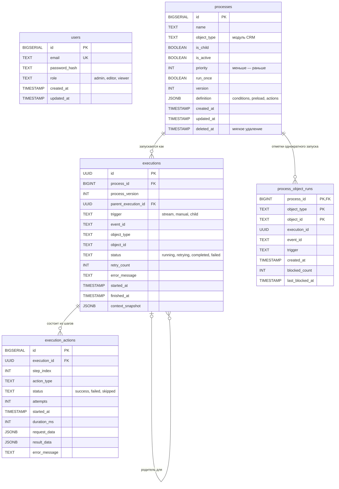
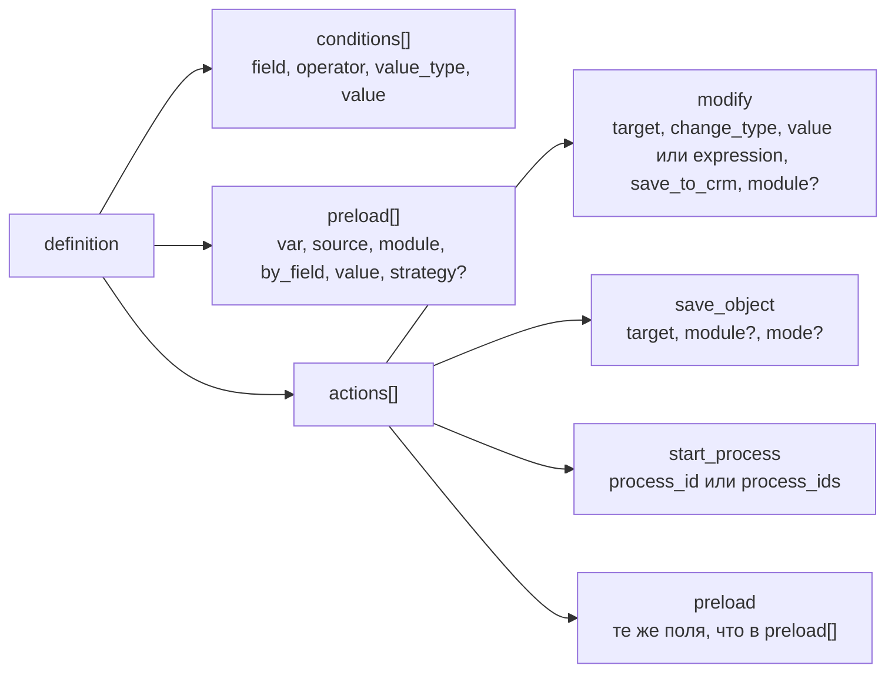

# Модель данных

Таблицы PostgreSQL, структура определения процесса и ключи Redis, которые использует WPS.

<!-- lang-switch -->
[🇬🇧 English](../../en/05-architecture/data-model.md) | 🇷🇺 Русский
<!-- /lang-switch -->

Схему создают миграции из `back/migrations/` (`001_create_tables.sql`, `002_seed_admin.sql`, `003_run_once.sql`).
`back/docker/entrypoint.sh` применяет их через `migrations/migrate.php` при каждом старте backend. Все столбцы
`TIMESTAMP` хранятся в UTC.

## ER-диаграмма



Таблица `users` не связана с остальными: аудит не хранит, кто изменил процесс. У процесса много выполнений; у
выполнения — по строке на каждый шаг и, возможно, родительское выполнение (ведомые процессы). В `process_object_runs`
не больше одной отметки на пару «процесс + запись CRM». Её столбец `execution_id` намеренно без внешнего ключа: отметка
записывается раньше, чем появляется строка в `executions`.

## Таблицы

### `users`

| Столбец | Описание |
|---|---|
| `id` | Первичный ключ |
| `email` | Логин, уникальный |
| `password_hash` | `password_hash()` (bcrypt); API его никогда не отдаёт |
| `role` | `admin`, `editor` или `viewer` (ограничение CHECK) |
| `created_at`, `updated_at` | Время создания и изменения |

Миграция `002_seed_admin.sql` создаёт пользователя `admin@wps.local` с паролем `admin`.

### `processes`

| Столбец | Описание |
|---|---|
| `id` | Первичный ключ, используется в `start_process.process_id` |
| `name` | Название, до 255 символов |
| `object_type` | Модуль CRM, к которому относится процесс (`Accounts`, `Leads`, …). Для процесса верхнего уровня по нему подбираются события |
| `is_child` | `true` — процесс запускается только действием `start_process` другого процесса и никогда напрямую событием |
| `is_active` | Неактивные процессы не попадают в подбор и пропускаются в `start_process` |
| `priority` | Порядок среди процессов верхнего уровня одного типа объекта, по возрастанию |
| `run_once` | Запускать не больше одного раза для записи CRM (миграция `003`) |
| `version` | Увеличивается при каждом изменении; выполнение хранит версию, с которой работало |
| `definition` | JSONB, см. ниже |
| `deleted_at` | Мягкое удаление: строка остаётся, чтобы старые выполнения продолжали на неё ссылаться |

Индексы: `object_type`, частичные индексы по `is_child = false` и `is_active = true` и индекс для подбора процессов
`(object_type, priority) WHERE deleted_at IS NULL AND is_active AND NOT is_child`.

### `executions`

| Столбец | Описание |
|---|---|
| `id` | UUID, создаётся движком |
| `process_id`, `process_version` | Процесс и версия его определения |
| `parent_execution_id` | Выполнение, которое запустило это через `start_process`; `ON DELETE SET NULL` |
| `trigger` | `stream` (событие CRM), `manual` (ручной запуск), `child` (запущено другим процессом) |
| `event_id` | `event_id` объекта, id сообщения стрима или `manual-{uuid}` |
| `object_type`, `object_id` | Модуль и `id` объекта события |
| `status` | `running`, `retrying`, `completed`, `failed` |
| `retry_count` | Число повторов по всем шагам |
| `error_message` | Ошибка упавшего шага |
| `started_at`, `finished_at` | `finished_at` равен `NULL`, пока выполнение не завершено |
| `context_snapshot` | Итоговый `{event, variables, meta, conditions}`; `{lost: true}` у выполнения, которое не удалось восстановить |

Индексы: `process_id`, `event_id`, `status`, `started_at DESC`, `parent_execution_id`.

### `execution_actions`

| Столбец | Описание |
|---|---|
| `execution_id`, `step_index` | Уникальная пара; индекс 0 — первая строка предзагрузки или первое действие |
| `action_type` | `preload`, `modify`, `save_object`, `start_process` или собственный тип |
| `status` | `success`, `failed`, `skipped` |
| `attempts` | 1 + число повторов; 0 у шага, пропущенного из-за ошибки предыдущего |
| `started_at`, `duration_ms` | Время, включая паузы между повторами |
| `request_data` | Что шаг сделал или отправил (у упавшего шага — его настройка) |
| `result_data` | Что получил: старое и новое значение, найденный объект, ответ CRM, `error_class`, `recoverable` |
| `error_message` | Текст ошибки |

Строки удаляются вместе с выполнением (`ON DELETE CASCADE`).

### `process_object_runs`

| Столбец | Описание |
|---|---|
| `process_id`, `object_type`, `object_id` | Первичный ключ: одна отметка на процесс и запись CRM |
| `execution_id` | Первое (блокирующее) выполнение |
| `event_id`, `trigger` | Откуда пришёл первый запуск |
| `created_at` | Когда поставлена отметка |
| `blocked_count`, `last_blocked_at` | Сколько последующих запусков заблокировано и когда был последний |

Индексы: `(object_type, object_id)`, `(process_id, created_at DESC)`. Отметка снимается запросом
`DELETE /api/processes/{id}/runs/{object_type}/{object_id}`.

## Определение процесса (`processes.definition`)



```json
{
  "conditions": [
    { "field": "object.status", "operator": "equals", "value_type": "static", "value": "Active" }
  ],
  "preload": [
    { "var": "v1", "source": "object_field", "module": "Accounts", "by_field": "id", "value": "object.account_id" }
  ],
  "actions": [
    { "type": "modify", "target": "v1.rating", "change_type": "set_value", "value": "VIP", "save_to_crm": true },
    { "type": "save_object", "target": "object" },
    { "type": "start_process", "process_id": 4 }
  ]
}
```

- `conditions` — плоский список, строки объединяются по И. Движок принимает и дерево
  `{ "logical_operator": "AND" | "OR", "conditions": [...], "groups": [...] }` — задел для ИЛИ и скобок (ответ
  заказчика №8); текущий интерфейс его не редактирует.
- Строки `preload` выполняются до действий; `preload` может встречаться и внутри `actions`.
- `Process::normalizeDefinition()` всегда возвращает все три ключа, поэтому отсутствующий блок — пустой список.

Значение каждого поля описано в руководстве пользователя: [Условия](../03-user-guide/triggers-and-conditions.md),
[Действия](../03-user-guide/actions.md), [Типы изменений и выражения](../03-user-guide/change-types-and-expressions.md).

## Ключи Redis

**redis-data** (кэш и состояние):

| Ключ | Тип | Содержимое | TTL |
|---|---|---|---|
| `proc_cache:{object_type}` | String (JSON) | Активные процессы верхнего уровня этого типа, по приоритету | `PROCESS_CACHE_TTL` (60 с); удаляется при сохранении процесса этого типа |
| `dict:modules` | String (JSON) | Справочник модулей из CRM | `DICT_CACHE_TTL` (300 с); `POST /api/dictionaries/modules/refresh` загружает заново |
| `exec:{uuid}` | Hash | Живой контекст выполнения | 24 ч во время выполнения, 1 ч после завершения |
| `lock:exec:{uuid}` | String | Токен воркера, который ведёт выполнение | `EXECUTION_LOCK_TTL` (30 с) |
| `idem:{event_id}:{process_id}` | String | id выполнения или `skipped` | `IDEMPOTENCY_TTL_HOURS` (24 ч) |
| `idem:{parent_execution_id}.{step}:{child_id}` | String | То же для ведомого процесса | 24 ч |

**redis-stream** (шина событий):

| Ключ | Тип | Содержимое |
|---|---|---|
| `crm_events` (`REDIS_STREAM_NAME`) | Stream | События CRM; группа потребителей `wps_workers` (`REDIS_STREAM_CONSUMER_GROUP`) |
| `crm_events:dlq` | Stream | Некорректные и «отравленные» сообщения: `original_id`, `reason`, `fields`, `at`; обрезается примерно до 10 000 записей |
| `mock_crm:{module}` | Hash | Объекты мок-CRM (только если используется контейнер `mock`) |

<!-- footer-nav -->
---

← Назад: [Движок выполнения](execution-engine.md) | [Оглавление](../README.md) | [Архитектура frontend](frontend.md) Далее →
<!-- /footer-nav -->
