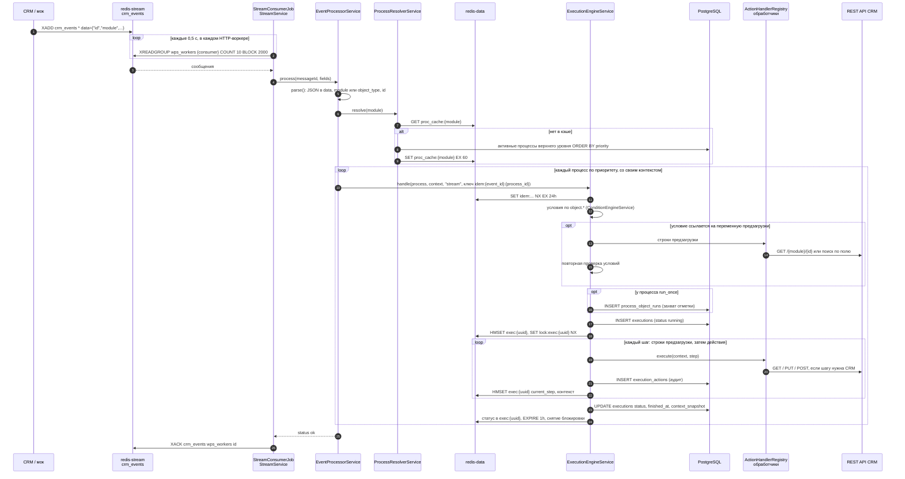
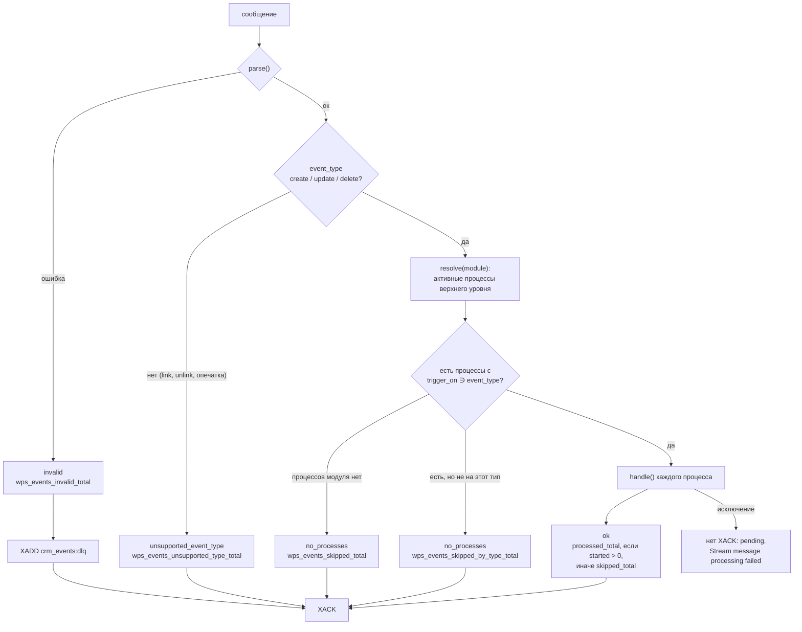
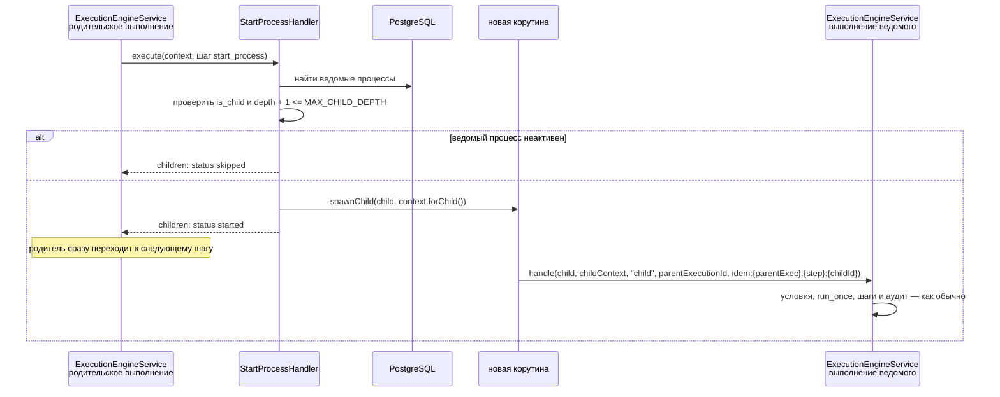
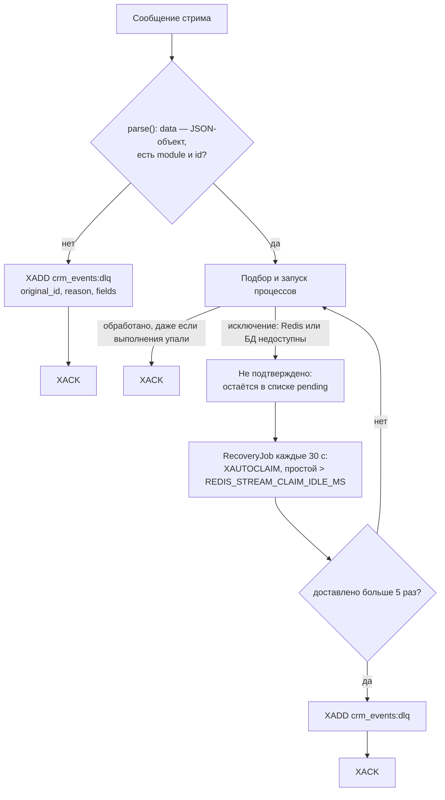

# Поток событий

Путь одного события CRM: от сохранения записи до Redis Stream, выполнения подходящих процессов, аудита и подтверждения сообщения.

<!-- lang-switch -->
[🇬🇧 English](../../en/05-architecture/event-flow.md) | 🇷🇺 Русский
<!-- /lang-switch -->

## Основной поток

1. CRM публикует весь сохранённый объект (ответ заказчика №2). Плагин SuiteCRM делает это в logic hook `after_save`,
   мок — по запросу `/test-event`. Принимаются два формата: поле `data` с JSON-объектом или поля объекта напрямую.
2. Каждый HTTP-воркер — потребитель группы `wps_workers`; Redis отдаёт каждое сообщение только одному потребителю.
3. `EventProcessorService::parse()` требует `module` (или `object_type`) и `id`. `event_id` берётся из объекта,
   если он там есть, иначе используется id сообщения стрима.
4. `ProcessResolverService` возвращает активные, не удалённые процессы **верхнего уровня** этого типа объекта,
   отсортированные по `priority` по возрастанию. Список кэшируется на `PROCESS_CACHE_TTL` секунд и сбрасывается при
   сохранении процесса. Затем `EventProcessorService` оставляет процессы, у которых `trigger_on` содержит тип события
   (`Process::triggersOn()`; ключ кэша от типа не зависит). Событие с неподдерживаемым `event_type` (`link`, `unlink`)
   подтверждается сразу со статусом `unsupported_event_type`. Лог `Event handled` (debug) пишет `processes_total` и
   `processes_matched`.
5. Для каждого процесса движок строит собственный `ExecutionContext` из события и вызывает `handle()` — подробности в
   разделе [Движок выполнения](execution-engine.md). Если условия процесса не выполнены, выполнение не создаётся,
   остаётся только ключ идемпотентности со значением `skipped`.
6. Сообщение подтверждается после обработки всех процессов — и тогда, когда ни один процесс не подошёл (ответ №23).

### Итог обработки сообщения

`EventProcessorService::process()` возвращает статус, по которому `StreamService::handle()` решает судьбу сообщения:

| Статус | Когда | Сообщение |
|---|---|---|
| `invalid` | Нет `module`/`object_type` или `id`; `data` — не JSON-объект | В DLQ, подтверждается |
| `unsupported_event_type` | `event_type` не `create`/`update`/`delete` | Подтверждается без запуска процессов |
| `no_processes` | У модуля нет активных процессов верхнего уровня или ни один не подписан на тип события | Подтверждается |
| `ok` | Процессы запущены (или пропущены условиями, `run_once`, идемпотентностью); `started` — сколько выполнений создано | Подтверждается |
| — (исключение) | Недоступны Redis / PostgreSQL, ошибка вне выполнения | Остаётся в pending, через `REDIS_STREAM_CLAIM_IDLE_MS` забирается `XAUTOCLAIM` |

`trigger_on` фильтрует только события **стрима**. Ручной запуск (`POST /api/processes/{id}/run`) и `start_process`
запускают процесс независимо от `trigger_on`; тип события ручного запуска берётся из объекта (`event_type`, иначе
`update`, а при `wps_is_update = "0"` — `create`) и виден в `sys.event_type`.

### Конверт события и сведения о событии

`EventProcessorService::parse()` превращает сообщение в `Wps\Events\EventEnvelope` — неизменяемый конверт, общий для стрима
и ручного запуска (будущий вебхук 6.5 использует его же):

| Поле конверта | Что содержит |
|---|---|
| `module`, `object` | модуль и запись **без** служебных ключей `event_type`, `before`, `changed_fields`, `wps_origin` |
| `eventType` | `create` / `update` / `delete`; без `event_type` в событии — `create` при `wps_is_update = "0"`, иначе `update` |
| `unsupportedType` | `event_type` не из `create`, `update`, `delete` — процессы не запускаются |
| `before` | старые значения изменённых полей; `null` — неизвестны, `[]` — известно, что их нет |
| `changedFields` | список изменённых полей; `null` — неизвестно |
| `origin` | `wps_origin` (`execution_id`, `process_id`, `depth`) — для защиты от каскадов (7.5) |
| `legacy` | в событии нет `event_type` (издатель контракта 1.0) |
| `warnings` | отброшенные служебные поля неверного типа — пишутся в лог, считаются в `wps_events_malformed_fields_total` |

Правила вывода недостающих полей — в [Интеграции с CRM](../04-operations/crm-integration.md#как-wps-разбирает-событие).

`ExecutionContext::fromEnvelope()` строит контекст процесса:

- переменная `object` — запись конверта, `object_before` — `before` (метаданные `source: event_before`); `object_before`
  **только для чтения**: `set()`, `setVariable()`, `setClean()`, `setModule()` бросают `ConfigurationException`, а валидатор
  отклоняет такие цели при сохранении процесса (`DefinitionScope::checkWritePath()`, предзагрузка, `save_object`);
- `ExecutionContext::$eventInfo` — неизменяемый `Wps\Context\EventInfo` (`eventType`, `changedFields`, `hasBefore`, `origin`,
  `legacy`, метод `isChanged(field)`: `true` / `false` / `null` — неизвестно). Его используют операторы изменения (3.3),
  системные переменные (5.2.9) и защита от каскадов (7.5).

`event_info` сериализуется вместе с контекстом: в Redis-состоянии выполнения (поле `event_info` хеша, поэтому переживает
`resume()` после падения воркера) и в `executions.context_snapshot`. `forChild()` передаёт ведомому процессу и `object_before`,
и `event_info`. Состояние, сохранённое до 6.1, восстанавливается с `EventInfo` по умолчанию (`legacy: true`).

## Ведомые процессы

Шаг `start_process` завершается, как только ведомые процессы запущены, и никогда их не ждёт (ответ №13). Ведомый
процесс получает копию события родителя и **все** переменные, глубина вложенности увеличивается на единицу (ответ №20).
Ключ идемпотентности включает родительское выполнение и номер шага, поэтому шаг родителя, повторённый после сбоя, не
запустит тот же ведомый процесс дважды. Выполнение ведомого процесса хранит `parent_execution_id` — по нему интерфейс
строит таблицу «Дочерние выполнения».

## Некорректные события и сбои

Упавшее **выполнение** (например, CRM вернула HTTP 500 после всех повторов) — нормальный исход: оно записано в аудит, а
сообщение подтверждается. Неподтверждённым сообщение остаётся только при **инфраструктурной** ошибке, которая помешала
обработке, — тогда оно будет доставлено ещё раз. Это гарантия «хотя бы один раз» (at-least-once, ответ №22). Повторная
доставка безопасна, потому что каждый запуск процесса защищён ключом идемпотентности `idem:{event_id}:{process_id}`.
Сообщения, которые не удалось разобрать, и сообщения, доставленные больше пяти раз, попадают в стрим недоставленных
сообщений `crm_events:dlq` (он обрезается примерно до 10 000 записей).

## Ручной запуск

`POST /api/processes/{id}/run` входит в движок иначе: `ExecutionEngineService::runManual()` проверяет условия
синхронно (или пропускает их при `force: true`), учитывает `run_once`, создаёт выполнение и запускает шаги в фоновой
корутине. HTTP-ответ с `execution_id` приходит сразу; дальше интерфейс опрашивает `GET /api/executions/{id}`, который,
пока выполнение идёт, отдаёт живой контекст из Redis. См. [Ручной запуск и сброс](../03-user-guide/manual-run-and-reset.md).

<!-- footer-nav -->
---

← Назад: [Архитектура backend](backend.md) | [Оглавление](../README.md) | [Движок выполнения](execution-engine.md) Далее →
<!-- /footer-nav -->
