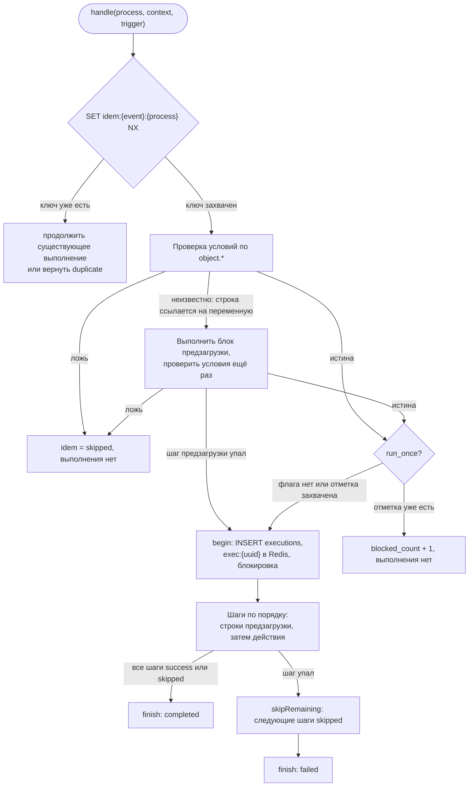
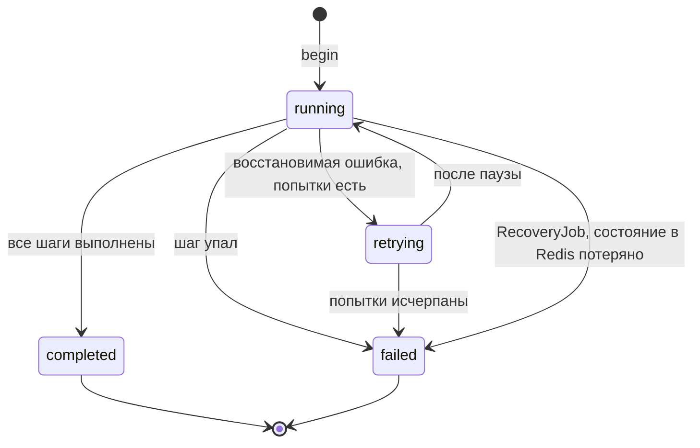
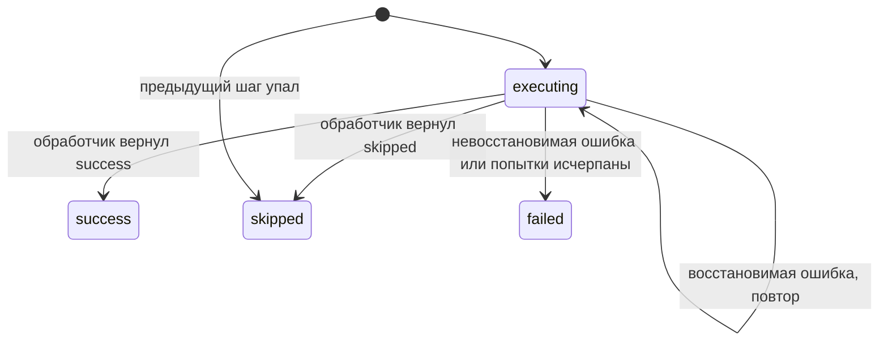
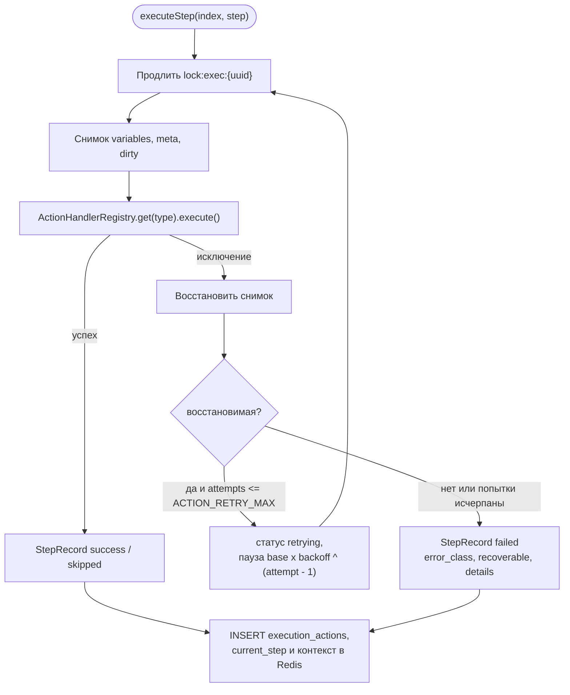
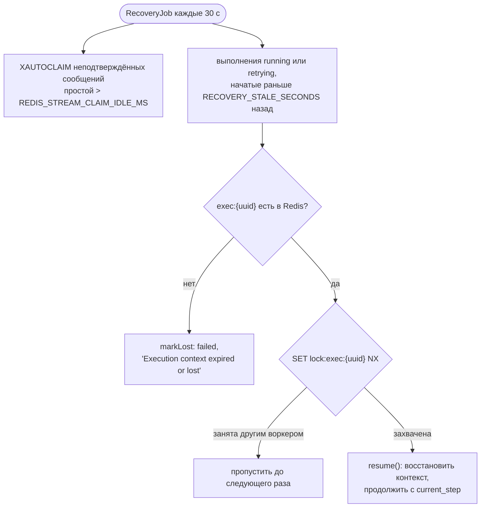

# Движок выполнения

Как `ExecutionEngineService` выполняет один процесс для одного события: контекст выполнения, статусы, повторы, идемпотентность и восстановление после сбоя.

<!-- lang-switch -->
[🇬🇧 English](../../en/05-architecture/execution-engine.md) | 🇷🇺 Русский
<!-- /lang-switch -->

## Контекст выполнения

`Wps\Context\ExecutionContext` — память одного выполнения. Каждый шаг читает из неё и пишет в неё.

| Часть | Содержимое |
|---|---|
| `eventId` | `event_id` события (или id сообщения стрима; `manual-{uuid}` для ручного запуска) |
| `event` | Исходный объект из события, не меняется |
| `variables` | `object` (рабочая копия объекта события) и переменные, созданные предзагрузкой или действием `modify` (`v1`, `task`, …). Значение — ассоциативный массив или `null` («загружали, но в CRM не нашли») |
| `meta` | Для каждой переменной: `module` CRM и источник `source` (`event`, `preload`, `created`) |
| `dirty` | Для каждой переменной: поля, изменённые в памяти и ещё не сохранённые в CRM — `save_object` отправляет только их (если не указан `mode: "full"`) |
| `depth` | Уровень вложенности ведомых процессов, ограничен `MAX_CHILD_DEPTH` |

Поля адресуются путями `<переменная>.<поле>`: `object.status`, `v1.rating`, `task.name`. Путь без поля (`v1`)
обозначает переменную целиком и допустим только там, где ожидается объект (`save_object.target`). Для неплоских
объектов работают и вложенные пути, например `v1.address.city`. Путь к отсутствующей переменной или полю даёт
«не найдено»: условие с ним ложно (ответ заказчика №10), выражение получает пустую строку. Запись в переменную,
которой ещё нет, создаёт её как новый объект с источником `created`; при последующем сохранении для неё отправляется
`POST`, а новый `id` записывается в переменную.

Ведомый процесс получает `forChild()`: то же событие и переменные, пустой набор `dirty` и `depth + 1`.

## Жизненный цикл выполнения

- Условия проверяются в два прохода (**ленивая предзагрузка**). Сначала проверяются строки по `object.*`, без обращений
  к CRM. Если результат зависит от строки, которая ссылается на переменную предзагрузки, выполняется блок `preload`, и
  условия проверяются заново. Выполненные здесь шаги предзагрузки записываются как первые шаги выполнения и повторно не
  выполняются.
- Если шаг предзагрузки падает во время проверки условий, выполнение всё равно создаётся и сразу завершается со
  статусом `failed` — так проблема видна в аудите.
- Отметка `run_once` захватывается, только когда условия выполнены, и до записи строки выполнения. Если записать
  выполнение не удалось, отметка снимается.
- Шаги — это `Process::steps()`: все строки `definition.preload` (как `type: preload`), за ними `definition.actions`.
  Они выполняются строго друг за другом (ответ №13).
- `finish()` записывает в PostgreSQL статус, счётчик повторов и итоговый `context_snapshot` (событие, переменные, meta,
  трассировку условий), а хеш в Redis оставляет на `EXECUTION_FINISHED_TTL_SECONDS` (1 ч).

## Статусы выполнения

| Статус | Смысл | В интерфейсе (`front/src/utils/format.ts`) |
|---|---|---|
| `running` | Шаги выполняются | синий, обновляется в реальном времени |
| `retrying` | Шаг упал с восстановимой ошибкой и ждёт следующей попытки | оранжевый, обновляется в реальном времени |
| `completed` | Все шаги завершились со статусом `success` или `skipped` | зелёный |
| `failed` | Шаг упал, или выполнение потеряно и не может быть продолжено | красный |

## Статусы шагов

| Статус | Когда |
|---|---|
| `success` | Обработчик отработал штатно |
| `skipped` | Обработчик решил, что делать нечего (`save_object` для пустой переменной или без изменённых полей), либо предыдущий шаг упал и этот не выполнялся |
| `failed` | Ошибка невосстановимая или все повторы использованы |

Неактивный ведомый процесс не делает шаг `start_process` пропущенным: шаг получает `success`, а ведомый процесс
указывается со `status: skipped` в `result_data.children`.

Каждый шаг — одна строка в `execution_actions` с полями `attempts`, `duration_ms`, `request_data` (что шаг отправил),
`result_data` (что получил: старое и новое значение, ответ CRM, класс ошибки) и `error_message`.

## Выполнение шага, повторы и ошибки

- **Восстановимые**: `RecoverableException`, `CrmApiException` при транспортных ошибках (нет соединения, таймаут,
  сброс) и HTTP ≥ 500, `RedisException`, ошибки соединения PDO.
- **Невосстановимые**: `NonRecoverableException`, `ConfigurationException`, `CrmApiException` при HTTP 4xx (кроме
  404 на `GET` — это «не найдено», результат `null`) и любые другие исключения.
- Со значениями по умолчанию (`ACTION_RETRY_MAX=3`, `ACTION_RETRY_BASE_DELAY_MS=1000`, `ACTION_RETRY_BACKOFF=2`) шаг
  пробуется 4 раза с паузами 1, 2 и 4 с. На демонстрационном скриншоте упавшего выполнения видно именно это:
  4 попытки примерно за 7 с.
- Перед каждым повтором восстанавливается снимок, поэтому неидемпотентное изменение вроде `x = x * 2` не применится
  дважды.

## Восстановление после сбоя

Контекст и `current_step` записываются в Redis после каждого шага, поэтому выполнение, прерванное падением воркера,
продолжается с того шага, на котором остановилось (ответы №14, №22). Блокировка `lock:exec:{uuid}` (TTL
`EXECUTION_LOCK_TTL`, 30 с, продлевается перед каждой попыткой) гарантирует, что выполнением занимается только один
воркер. Выполнения, запущенные сообщением стрима, дополнительно восстанавливаются при повторной доставке самого
сообщения: `handle()` находит ключ идемпотентности и вызывает `resume()` вместо нового запуска процесса. У ручных и
ведомых выполнений сообщения стрима нет, их восстанавливает только `RecoveryJob`.

## Ключи Redis, которые использует движок

Все ключи хранятся в **redis-data**.

| Ключ | Тип | Содержимое | TTL |
|---|---|---|---|
| `exec:{uuid}` | Hash | `status`, `current_step`, `retry_count`, `trigger`, `parent_execution_id`, `process`, `definition`, `conditions`, `event`, `variables`, `meta`, `dirty`, `depth`, `started_at`, `finished_at` | `EXECUTION_TTL_HOURS` (24 ч) во время выполнения, `EXECUTION_FINISHED_TTL_SECONDS` (1 ч) после завершения |
| `lock:exec:{uuid}` | String | токен владельца | `EXECUTION_LOCK_TTL` (30 с), продлевается на каждом шаге |
| `idem:{event_id}:{process_id}` | String | id выполнения или `skipped` | `IDEMPOTENCY_TTL_HOURS` (24 ч) |
| `idem:{parent_execution_id}.{step}:{child_id}` | String | то же для ведомых процессов | `IDEMPOTENCY_TTL_HOURS` |

См. также [Модель данных](data-model.md) — таблицы PostgreSQL — и [Надёжность](../04-operations/reliability.md) —
эксплуатационная сторона.

<!-- footer-nav -->
---

← Назад: [Поток событий](event-flow.md) | [Оглавление](../README.md) | [Модель данных](data-model.md) Далее →
<!-- /footer-nav -->
