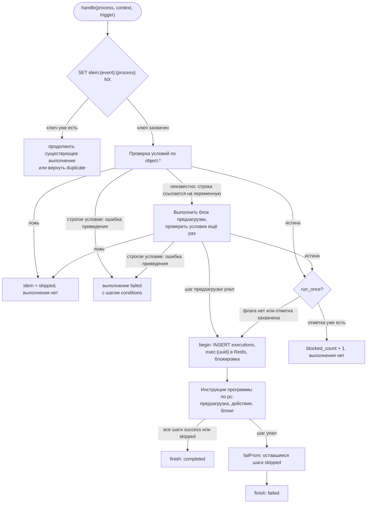
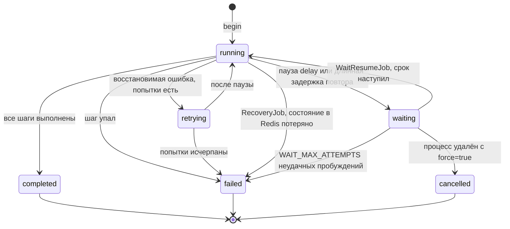
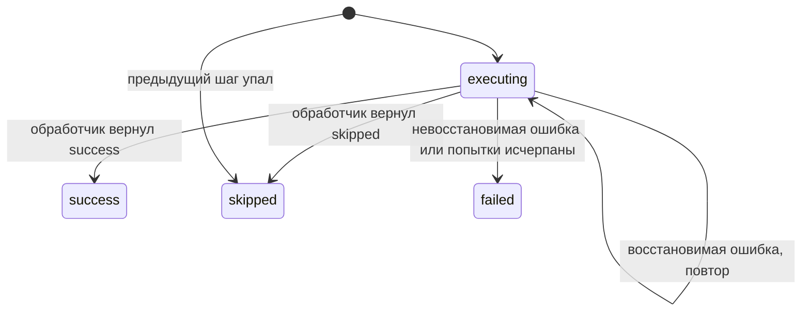
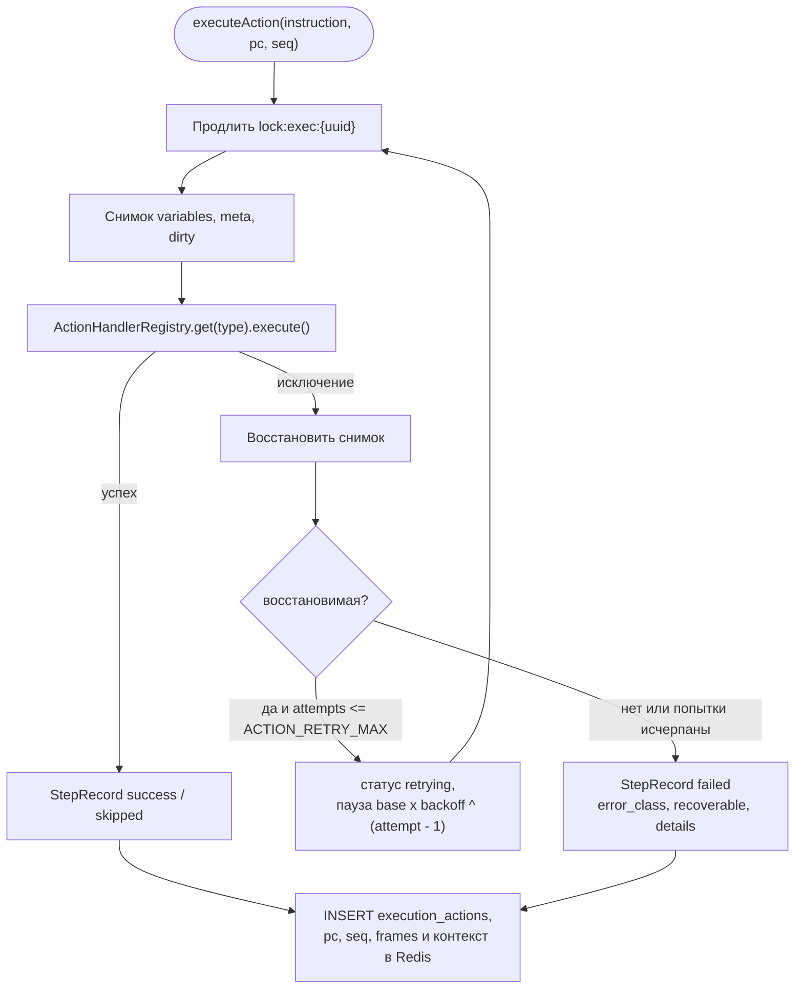
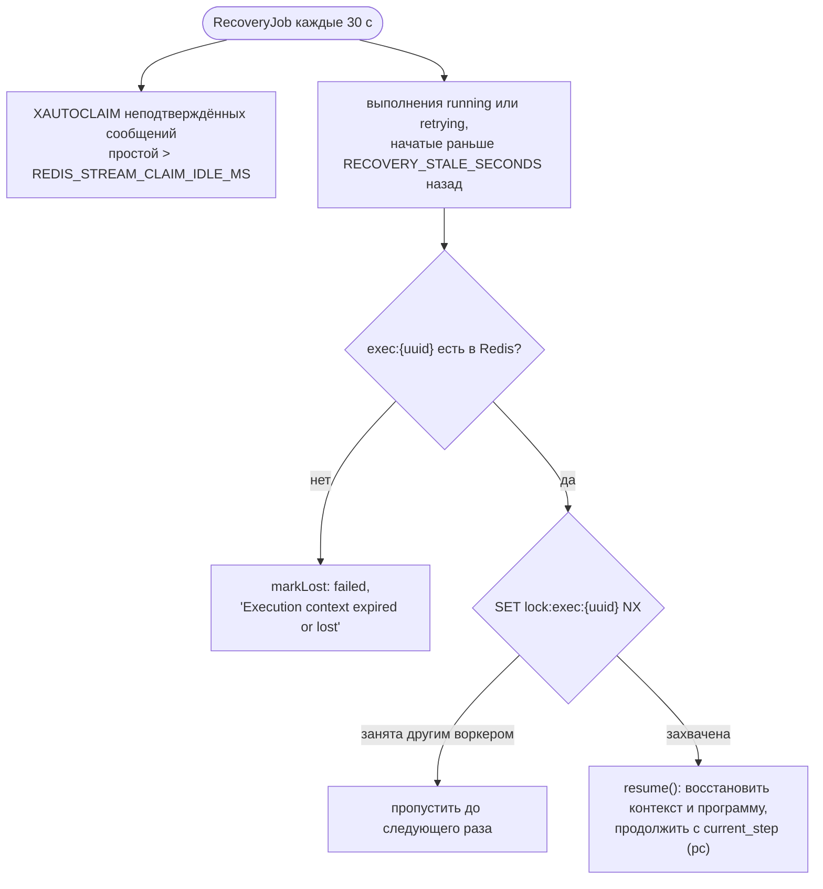
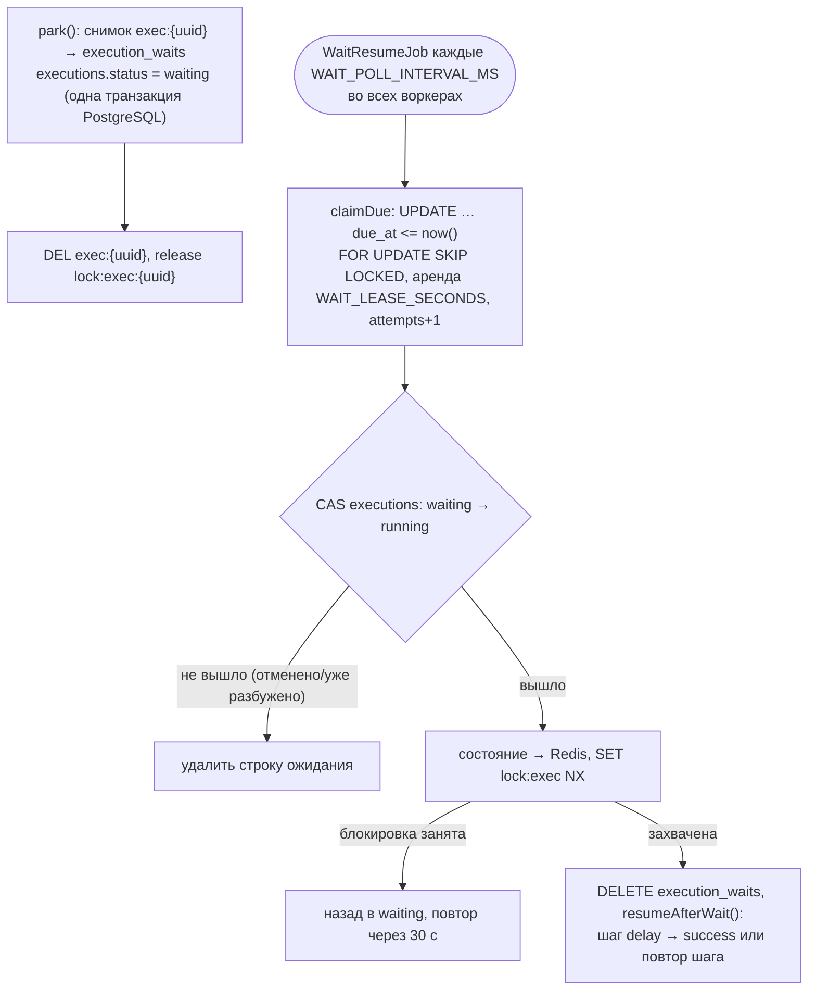

# Движок выполнения

Как `ExecutionEngineService` выполняет один процесс для одного события: контекст выполнения, статусы, повторы, идемпотентность и восстановление после сбоя.

<!-- lang-switch -->
[🇬🇧 English](../../en/05-architecture/execution-engine.md) | 🇷🇺 Русский
<!-- /lang-switch -->

## Контекст выполнения

`Wps\Context\ExecutionContext` — память одного выполнения. Каждый шаг читает из неё и пишет в неё.

| Часть | Содержимое |
|---|---|
| `eventId` | `event_id` события (или id сообщения стрима; `manual-{uuid}` для ручного запуска) |
| `event` | Исходный объект из события, не меняется |
| `variables` | `object` (рабочая копия объекта события) и переменные, созданные предзагрузкой или действием `modify` (`v1`, `task`, …). Значение — ассоциативный массив или `null` («загружали, но в CRM не нашли») |
| `meta` | Для каждой переменной: `module` CRM и источник `source` (`event`, `preload`, `created`) |
| `dirty` | Для каждой переменной: поля, изменённые в памяти и ещё не сохранённые в CRM — `save_object` отправляет только их (если не указан `mode: "full"`) |
| `depth` | Уровень вложенности ведомых процессов, ограничен `MAX_CHILD_DEPTH` |

Поля адресуются путями `<переменная>.<поле>`: `object.status`, `v1.rating`, `task.name`. Путь без поля (`v1`)
обозначает переменную целиком и допустим только там, где ожидается объект (`save_object.target`). Для неплоских
объектов работают и вложенные пути, например `v1.address.city`. Путь к отсутствующей переменной или полю даёт
«не найдено»: условие с ним ложно (ответ заказчика №10), выражение получает пустую строку. Запись в переменную,
которой ещё нет, создаёт её как новый объект с источником `created`; при последующем сохранении для неё отправляется
`POST`, а новый `id` записывается в переменную.

Ведомый процесс получает `forChild()`: то же событие и переменные, пустой набор `dirty` и `depth + 1`.

## Жизненный цикл выполнения



- Условия проверяются в два прохода (**ленивая предзагрузка**). Сначала проверяются строки по `object.*`, без обращений
  к CRM. Если результат зависит от строки, которая ссылается на переменную предзагрузки, выполняется блок `preload`, и
  условия проверяются заново. Выполненные здесь шаги предзагрузки записываются как первые шаги выполнения и повторно не
  выполняются.
- Если шаг предзагрузки падает во время проверки условий, выполнение всё равно создаётся и сразу завершается со
  статусом `failed` — так проблема видна в аудите.
- Строка условия вычисляется так (`ConditionEngineService::evaluateLeaf`):
  1. `cast`, `cast_options` → `CastOptions` (ошибка конфигурации — `ConfigurationException`);
  2. строка ссылается на ещё не загруженную переменную → «неизвестно» (ленивая предзагрузка);
  3. разрешаются пути обеих сторон; отсутствующее поле → строка ложна, в трассе `missing` (ответ №10);
  4. обе стороны приводятся `TypeCaster`: левая — по `CastOptions`, правая — по `expectedCast()` компаратора;
  5. пустая сторона (для типов, кроме `string` / `bool`) → ложь, в трассе `empty`;
  6. ошибка приведения → ложь, в трассе `cast_error`, предупреждение в лог и метрика `wps_condition_cast_errors_total`;
     при `on_cast_error: "error"` — исключение `ConditionCastException`;
  7. компаратор сравнивает приведённые значения.
- `ConditionCastException` в условиях запуска перехватывает `prepare()` (`PreparedRun::$castError`). Для события из
  потока или дочернего процесса `handle()` создаёт выполнение, записывает уже выполненные шаги ленивой предзагрузки и шаг
  `conditions` со статусом `failed` (трасса и текст ошибки) и завершает выполнение как `failed`; ключ идемпотентности
  указывает на это выполнение, так что событие подтверждается и повторно не обрабатывается. Ручной запуск возвращает
  `error: "CAST_ERROR"` без создания выполнения.
- Отметка `run_once` захватывается, только когда условия выполнены, и до записи строки выполнения. Если записать
  выполнение не удалось, отметка снимается.
- Определение компилируется в **плоскую программу** (см. [ниже](#программа-и-инструкции)): строки
  `definition.preload` (как `type: preload`), за ними `definition.actions`, а блоки (`condition`) превращаются в
  переходы. Инструкции выполняются строго друг за другом (ответ №13).
- `finish()` записывает в PostgreSQL статус, счётчик повторов и итоговый `context_snapshot` (событие, переменные, meta,
  трассировку условий), а хеш в Redis оставляет на `EXECUTION_FINISHED_TTL_SECONDS` (1 ч).

## Программа и инструкции

Перед выполнением дерево определения компилируется в плоский список инструкций с переходами
(`Wps\Program\ProgramCompiler`, задача 0.1). Курсор выполнения — одно целое число `pc`, поэтому восстановление после
падения устроено так же, как для линейного процесса.

Определение с блоком `condition`:

```json
{ "preload": [ { "var": "acc", "source": "object_field", "value": "object.account_id", "module": "Accounts" } ],
  "actions": [
    { "type": "modify", "target": "object.description", "change_type": "set_value", "value": "x" },
    { "type": "condition", "id": "big_deal",
      "branches": [ { "conditions": [ { "field": "object.amount", "operator": "equals", "cast": "decimal", "value": "1000" } ],
                      "actions": [ { "type": "modify", "target": "object.priority", "change_type": "set_value", "value": "High" } ] } ],
      "else": [ { "type": "modify", "target": "object.priority", "change_type": "set_value", "value": "Normal" } ] },
    { "type": "save_object", "target": "object" } ] }
```

компилируется в программу:

| pc | op | Параметры | path |
|---|---|---|---|
| 0 | `action` | `preload acc` | `preload[0]` |
| 1 | `action` | `modify object.description` | `actions[0]` |
| 2 | `branch` | ветка 0 → pc 3, иначе → pc 5, конец → pc 6 | `actions[1]` (`id = big_deal`) |
| 3 | `action` | `modify object.priority = High` | `actions[1].branches[0].actions[0]` |
| 4 | `jump` | → pc 6 | `actions[1].branches[0]` |
| 5 | `action` | `modify object.priority = Normal` | `actions[1].else[0]` |
| 6 | `action` | `save_object object` | `actions[2]` |

Набор инструкций (`Wps\Program\Instruction`, выполняет `Wps\Program\Interpreter`):

| op | Что делает | Запись в аудите |
|---|---|---|
| `action` | Выполняет шаг через `ActionHandlerRegistry` с повторами, затем `pc + 1` | Одна запись (как раньше) |
| `branch` | Проверяет условия веток по порядку; первая истинная → её начало, ни одной → `else` (или конец блока) | Одна запись `condition`: `result_data.selected` и трассы проверенных веток |
| `jump` | Переход на `target` | Нет |
| `jump_if_false` | Ложные условия → `target`, иначе `pc + 1` (простая форма для фильтров) | Нет |
| `halt` | Завершает выполнение со статусом `completed` или `failed` | Одна запись `stop_process` |
| `loop_begin` | Начало цикла `foreach` (`LoopRunner`): вычисляет источник, сохраняет снимок элементов, кладёт фрейм в `frames`, выставляет первый подходящий под `where` элемент → `pc + 1`; пустой список → конец цикла | Одна запись `foreach` |
| `loop_next` | Конец тела: следующий подходящий элемент → начало тела; элементы кончились → фрейм снимается, переход за цикл | Перезаписывает запись `foreach` итогами (`seq` не растёт) |

Программа заканчивается, когда `pc` равен числу инструкций — выполнение `completed`. Компиляция детерминирована и
кешируется по хешу определения; блоки регистрируются в `BlockTypeRegistry` (см.
[Новый тип блока](../07-developer-guide/extending/new-block-type.md)).

**Состояние и аудит.**

- `current_step` в `exec:{uuid}` — это `pc` следующей инструкции; `seq` — номер следующей записи аудита (он же
  `step_index` в `execution_actions`); `frames` — стек фреймов циклов; `instructions_executed` — счётчик
  инструкций; `program_hash` — хеш скомпилированной программы.
- Служебные инструкции (`jump`, `jump_if_false`) в аудит не пишутся, поэтому `seq` и `pc` у процесса с блоками
  расходятся. У каждой записи есть `pc`, `step_path`, `iteration`, `step_id`.
- **Совместимость.** Линейный процесс без блоков компилируется один в один в прежний список шагов:
  `seq == pc == прежний step_index`. Выполнение, начатое до обновления (в хеше нет `seq`), восстанавливается с
  `seq = current_step`.
- Шаги ленивой предзагрузки — первые инструкции программы (`pc = seq = 0..n-1`).
- Выполнение компилирует программу из **своего снимка** `definition` в Redis, поэтому правка процесса не влияет на
  уже идущие выполнения. Если при восстановлении хеш программы не совпал с `program_hash` (изменился компилятор между
  релизами), выполнение завершается `failed` с причиной `Program changed after an upgrade; the execution cannot be
  resumed safely`, метрика `wps_program_resume_mismatch_total`.

**Пропущенные шаги.** Когда инструкция падает (или `halt` останавливает процесс), `failFrom()` пишет `skipped` для
следующих элементов её списка и всех объемлющих списков вплоть до верхнего уровня (`Program::remainingAfter()`;
`preload` и `actions` — одна последовательность верхнего уровня). Невыбранные ветки и вложенные списки следующих
блоков в аудит не попадают.

**Циклы `foreach`** (`Wps\Program\LoopRunner`, задача 4.11). Блок компилируется в `loop_begin`, тело и `loop_next`;
`where` проверяет сам цикл, когда ищет следующий элемент (отсеянные элементы только считаются).

- **Фрейм** в `frames` (стек, внутренний цикл последним): `begin`, `next`, `end` (pc), `as`, `loop_var`, `module`,
  `items_key`, `index`, `count`, `audit_seq` (номер записи `foreach`), `started_at`, `stats` (счётчики итогов),
  `where_traces`, `on_item_error`. `ExecutionContext::$iteration` = индексы фреймов через `/` — пишется в
  `execution_actions.iteration`; при восстановлении вычисляется из `frames`.
- **Снимок элементов** — отдельный Redis-список `exec:{uuid}:loop:{pc}` (`LoopItemsStore`, `RPUSH` один раз, TTL как у
  `exec:{uuid}`); элемент читается `LINDEX` при входе в итерацию. В хэше выполнения — только фрейм и текущий элемент,
  поэтому хэш не растёт с размером списка, а после падения воркера цикл идёт по тому же набору. Снимок потерян —
  `Loop items snapshot is lost; the execution cannot be resumed`.
- **Переменные цикла**: элемент — источник `loop` (копия, сохраняется `save_object`), данные итерации — `loop_info`
  (только чтение: `set()` и `CrmObjectSaver` отказывают). После цикла обе удаляются (`unsetVariable`).
- **Итоговая запись.** `loop_begin` пишет запись `foreach` с номером `audit_seq`; при выходе из цикла (`loop_next`,
  ошибка, `goto`, `stop_process`) `LoopRunner::close()` перезаписывает её итогами — `InstructionOutcome::$overwrite`,
  `seq` не увеличивается.
- **Ошибка в теле** (`on_error` шага — `stop`): `LoopRunner::itemError()` ищет ближайший цикл с
  `on_item_error: continue`; внутренние циклы закрываются со статусом `failed`, шаг получает `handled = item_continue`,
  ошибка — в `sys.last_error`, переход на `loop_next` этого цикла (итерация не засчитывается в `processed`). Такого
  цикла нет — `closeLoops('failed')` и обычный `failFrom()`. `goto` закрывает циклы с `left_by: goto`, `halt` — с
  `stopped: true`; `finish()` закрывает оставшиеся фреймы и удаляет снимки.
- **Ожидание внутри цикла.** `WaitService::park()` кладёт содержимое снимков всех фреймов в `execution_waits.state`
  (`loop_items`) и удаляет ключи из Redis; при пробуждении снимки восстанавливаются до продолжения.

**Лимит.** Больше `EXECUTION_MAX_INSTRUCTIONS` (5000) инструкций в одном выполнении — выполнение `failed` с
`LIMIT_EXCEEDED` (защита от бесконечных переходов). Глубина вложенности блоков — `PROGRAM_MAX_DEPTH` (5).

## Статусы выполнения



| Статус | Смысл | В интерфейсе (`front/src/utils/format.ts`) |
|---|---|---|
| `running` | Шаги выполняются | синий, обновляется в реальном времени |
| `retrying` | Шаг упал с восстановимой ошибкой и ждёт следующей попытки | оранжевый, обновляется в реальном времени |
| `waiting` | Выполнение припарковано до срока `waiting_until`: состояние лежит в PostgreSQL (`execution_waits`), воркер и Redis не заняты | фиолетовый, «Ожидает» |
| `cancelled` | Ожидающее выполнение отменено удалением процесса (`DELETE /api/processes/{id}?force=true`) | серый, «Отменено» |
| `completed` | Все шаги завершились со статусом `success` или `skipped` | зелёный |
| `failed` | Шаг упал, или выполнение потеряно и не может быть продолжено | красный |

## Статусы шагов



| Статус | Когда |
|---|---|
| `success` | Обработчик отработал штатно |
| `waiting` | Шаг (пауза `delay`) ждёт срока; после пробуждения становится `success` с `waited_seconds` в `result_data` |
| `skipped` | Обработчик решил, что делать нечего (`save_object` для пустой переменной или без изменённых полей), либо предыдущий шаг упал (или процесс остановлен) и этот не выполнялся |
| `failed` | Ошибка невосстановимая или все повторы использованы |

Неактивный ведомый процесс не делает шаг `start_process` пропущенным: шаг получает `success`, а ведомый процесс
указывается со `status: skipped` в `result_data.children`.

Каждый шаг — одна строка в `execution_actions` с полями `attempts`, `duration_ms`, `request_data` (что шаг отправил),
`result_data` (что получил: старое и новое значение, ответ CRM, класс ошибки), `error_message` и положением в
программе: `pc`, `step_path`, `iteration`, `step_id`.

## Выполнение шага, повторы и ошибки



- **Восстановимые**: `RecoverableException`, `CrmApiException` при транспортных ошибках (нет соединения, таймаут,
  сброс) и HTTP ≥ 500, `RedisException`, ошибки соединения PDO.
- **Невосстановимые**: `NonRecoverableException`, `ConfigurationException`, `CrmApiException` при HTTP 4xx (кроме
  404 на `GET` — это «не найдено», результат `null`) и любые другие исключения.
- Со значениями по умолчанию (`ACTION_RETRY_MAX=3`, `ACTION_RETRY_BASE_DELAY_MS=1000`, `ACTION_RETRY_BACKOFF=2`) шаг
  пробуется 4 раза с паузами 1, 2 и 4 с. На демонстрационном скриншоте упавшего выполнения видно именно это:
  4 попытки примерно за 7 с.
- Перед каждым повтором восстанавливается снимок, поэтому неидемпотентное изменение вроде `x = x * 2` не применится
  дважды.
- Перед циклом попыток шаг получает `attempt_token` (один на все повторы шага) и свежий маскер секретов
  `$context->secretMasker`. `request`, `result`, текст и `details` ошибки проходят через маскер до записи в аудит; код
  ошибки из `details` (например `UNKNOWN_OUTCOME`) копируется в `result_data.error_code`.
- Внешние вызовы действий (`send_email`, `http_request`, `notify`) идут через журнал побочных эффектов
  `step_side_effects`: `started` до вызова, `done` / `failed` после. Если шаг повторяется после сбоя воркера, запись
  `done` возвращает сохранённый ответ без вызова (`replayed: true`), а чужая запись `started` при `delivery:
  at_most_once` даёт ошибку `UNKNOWN_OUTCOME` вместо повторной отправки
  ([Надёжность](../04-operations/reliability.md#побочные-эффекты-и-повторы)).

## Шаблоны (TemplateEngine)

`Wps\Template\TemplateEngine` подставляет значения в текст `{{ path | фильтр:арг }}`, `{{= выражение }}`. Его использует
тип изменения `template` ([Шаблон](../03-user-guide/change-types-and-expressions.md#шаблон)), а дальше — действия,
которые формируют текст (письмо, HTTP-запрос, уведомление). Фильтр `x | f:a:b` — это вызов функции выражений
`f(x, a, b)` через `ExpressionEngine::call()`, поэтому у шаблонов и выражений одни правила приведения и один набор
функций. Разобранный шаблон кэшируется (до 1000 записей, кэш сбрасывается целиком), как AST выражений.

**Экранирование выбирает потребитель шаблона (поле), а не автор** — `EscapeMode`:

| Режим | Где | Правило для подстановки |
|---|---|---|
| `text` | `modify`, тема письма, текст уведомления | значение как есть |
| `header` | заголовки HTTP и письма | CR/LF заменяются пробелом, в `RenderResult::$warnings` пишется предупреждение (защита от header injection) |
| `html` | HTML-тело письма | `htmlspecialchars(ENT_QUOTES \| ENT_SUBSTITUTE)`; фильтр `nl2br` сначала экранирует значение, потом вставляет `<br>`; фильтр `raw` отключает экранирование, только если потребитель разрешил его (`TemplateValidator::validate(..., allowRaw: true)`) |
| `url` | URL HTTP-запроса | `rawurlencode`; подстановки допустимы только в пути и query — в схеме, хосте и порту их запрещает валидатор (SSRF) |
| `json` | тело HTTP-запроса | `renderStructure()`: строки-листья документа — шаблоны; лист, состоящий из одной подстановки, сохраняет тип значения (число, список, объект) |

Отсутствующее значение (`resolve()` вернул «не найдено») обрабатывается по `MissingPolicy`: `empty` (пустая строка,
путь в `RenderResult::$missing`), `error` (`NonRecoverableException`), `keep` (тег остаётся в тексте). Ошибки
подстановки во время выполнения считает метрика `wps_template_render_errors_total`. Сохранение процесса проверяет
шаблон через `TemplateValidator`: синтаксис, фильтры и их арность, объявленность путей, `raw`, хост URL.

Тип изменения `template` возвращает список отсутствующих путей в `result_data.missing` шага через необязательный
интерфейс `ReportsDetails::computeWithDetails()`. `ModifyHandler` вызывает его вместо `compute()`. Интерфейс
намеренно без состояния: один экземпляр типа изменения обслуживает конкурентные выполнения (корутины), поэтому
детали возвращаются вместе со значением, а не хранятся в объекте.

## Восстановление после сбоя



Контекст, `current_step` (`pc`), `seq` и `frames` записываются в Redis после каждой инструкции, поэтому выполнение,
прерванное падением воркера, продолжается с той инструкции, на которой остановилось (ответы №14, №22), в том числе
внутри ветки и внутри цикла (с того же элемента — по `frames` и снимку элементов). Прерванный шаг выполняется повторно с тем же `seq`: запись аудита перезаписывается. Блокировка `lock:exec:{uuid}` (TTL
`EXECUTION_LOCK_TTL`, 30 с, продлевается перед каждой попыткой) гарантирует, что выполнением занимается только один
воркер. Выполнения, запущенные сообщением стрима, дополнительно восстанавливаются при повторной доставке самого
сообщения: `handle()` находит ключ идемпотентности и вызывает `resume()` вместо нового запуска процесса. У ручных и
ведомых выполнений сообщения стрима нет, их восстанавливает только `RecoveryJob`.

Ожидающие выполнения (`waiting`) `RecoveryJob` не трогает: их ключа в Redis нет намеренно.

## Ожидание и пробуждение (WaitResumeJob)

Обработчик, которому нужно ждать дольше `WAIT_INLINE_MAX_SECONDS` (5 с), возвращает `ActionResult::wait()` (пауза
`delay`), а длинная задержка повтора паркуется движком сам (`wait_reason: retry`).



- Ожидание внутри цикла `foreach`: снимки элементов открытых циклов переносятся в `state.loop_items` и
  восстанавливаются в Redis при пробуждении.
- Снимок больше `WAIT_STATE_MAX_BYTES` не паркуется: шаг падает с `Execution state is too large to wait (N bytes, limit M)`.
- `info` строки ожидания: `pc`, `seq`, `mode` (`after_wait` или `retry`), `parked_at`, `attempts`. В режиме `retry`
  шаг выполняется снова с тем же `step_index`, счёт попыток продолжается.
- Неудачное пробуждение пишет `Resume attempt failed` и ждёт истечения аренды; после `WAIT_MAX_ATTEMPTS` (10) выполнение
  становится `failed` с `Could not resume waiting execution: …`.
- Критерий `RecoveryJob` остался по `started_at`: разбуженное выполнение защищено блокировкой `lock:exec:{uuid}`, а
  упавшее после пробуждения `RecoveryJob` подхватывает сразу.
- Метрики: `wps_executions_parked_total`, `wps_executions_woken_total`, `wps_wait_resume_failed_total`,
  `wps_wait_lateness_seconds`, `wps_executions_waiting` ([Мониторинг](../04-operations/monitoring.md)).

## Ключи Redis, которые использует движок

Все ключи хранятся в **redis-data**.

| Ключ | Тип | Содержимое | TTL |
|---|---|---|---|
| `exec:{uuid}` | Hash | `status`, `current_step` (`pc`), `seq`, `frames`, `instructions_executed`, `program_hash`, `retry_count`, `trigger`, `parent_execution_id`, `process`, `definition`, `conditions`, `event`, `variables`, `meta`, `dirty`, `depth`, `started_at`, `finished_at` | `EXECUTION_TTL_HOURS` (24 ч) во время выполнения, `EXECUTION_FINISHED_TTL_SECONDS` (1 ч) после завершения |
| `exec:{uuid}:loop:{pc}` | List | снимок элементов цикла `foreach`, начавшегося на `pc` (JSON-элементы) | как у `exec:{uuid}`; удаляется при выходе из цикла и при завершении выполнения |
| `lock:exec:{uuid}` | String | токен владельца | `EXECUTION_LOCK_TTL` (30 с), продлевается на каждом шаге |
| `idem:{event_id}:{process_id}` | String | id выполнения или `skipped` | `IDEMPOTENCY_TTL_HOURS` (24 ч) |
| `idem:{parent_execution_id}.{seq}:{child_id}` | String | то же для ведомых процессов (`seq` — номер записи аудита шага `start_process`) | `IDEMPOTENCY_TTL_HOURS` |

См. также [Модель данных](data-model.md) — таблицы PostgreSQL — и [Надёжность](../04-operations/reliability.md) —
эксплуатационная сторона.

<!-- footer-nav -->
---

← Назад: [Поток событий](event-flow.md) | [Оглавление](../README.md) | [Модель данных](data-model.md) Далее →
<!-- /footer-nav -->
