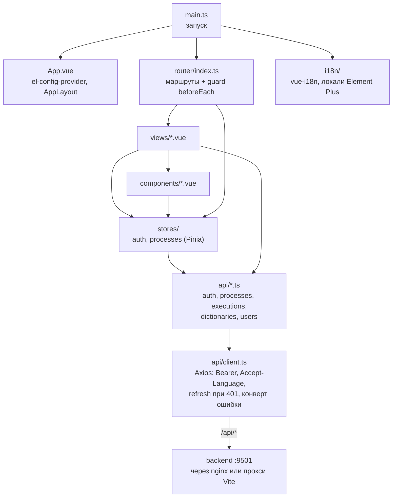
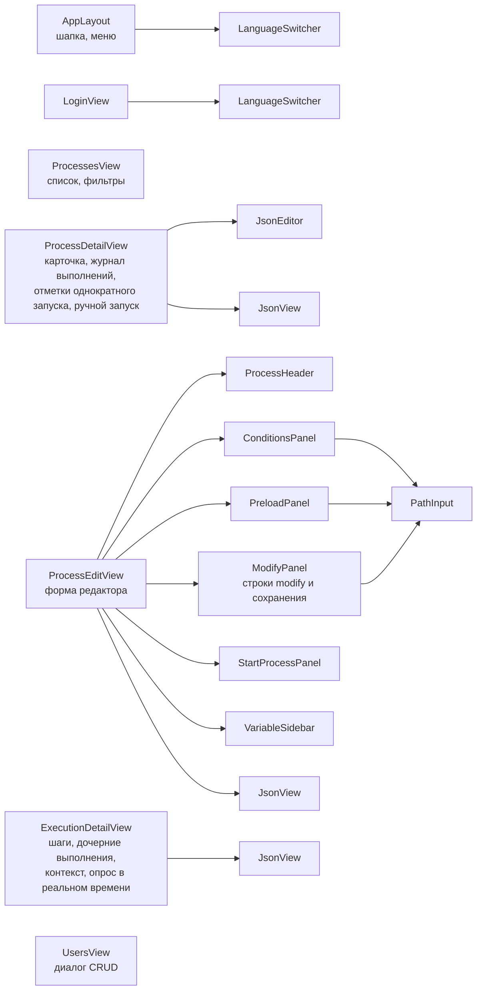
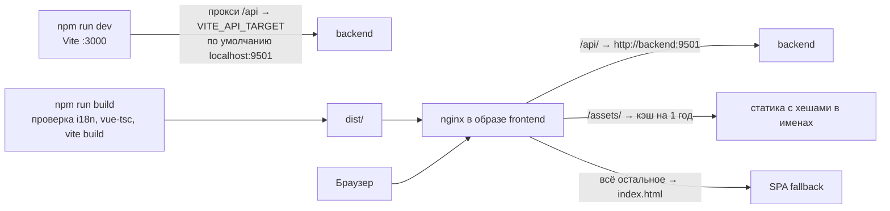

# Архитектура frontend

Устройство одностраничного приложения на Vue 3: запуск, маршрутизация и проверка доступа, состояние, клиент API, локализация и доставка через nginx.

<!-- lang-switch -->
[🇬🇧 English](../../en/05-architecture/frontend.md) | 🇷🇺 Русский
<!-- /lang-switch -->

## Обзор

`main.ts` подключает Pinia, vue-i18n, роутер и Element Plus, регистрирует иконки Element Plus, задаёт клиенту API
обработчик «сессия истекла» и загружает язык **до** первого рендера (`setLocale(detectLocale())`), чтобы тексты не
мигали. Представления обращаются к backend только через модули `src/api/`, которые используют один экземпляр Axios.
Общие типы лежат в `src/types/index.ts`.

## Маршрутизация и доступ

| Путь | Представление | Роли |
|---|---|---|
| `/login` | `LoginView.vue` | публичный |
| `/processes` | `ProcessesView.vue` | все |
| `/processes/create` | `ProcessEditView.vue` | admin, editor |
| `/processes/:id` | `ProcessDetailView.vue` | все |
| `/processes/:id/edit` | `ProcessEditView.vue` | admin, editor |
| `/executions/:id` | `ExecutionDetailView.vue` | все |
| `/users` | `UsersView.vue` | admin |

Глобальный guard `beforeEach` инициализирует хранилище авторизации, отправляет неавторизованных пользователей на
`/login?redirect=…`, загружает текущего пользователя (`GET /api/auth/me`), если известен только токен, и
перенаправляет на `/processes`, если роль не подходит под `meta.roles`. Заголовок страницы берётся из `meta.titleKey`
(ключ перевода) и обновляется при смене языка. Проверки в интерфейсе нужны только для удобства — те же правила backend
проверяет в `AccessPolicy`.

## Представления и компоненты

Редактор раскладывает `definition.actions` по панелям: `formFromProcess()` в `utils/processForm.ts` распределяет
действия по типам, а `definitionFromForm()` собирает их обратно. Форма правит **поверх исходного JSON**: каждая строка
хранит исходный объект (`_raw`), и при сохранении поля формы накладываются на него, а `sourceDefinition` сохраняет
ключи определения, которых в форме нет (`constants` …). Поэтому необязательные ключи, заданные через API
(`save_object.mode`, `preload.strategy`, `id`, `on_error`, `retry`, `cast` …), не теряются; при смене оператора или
типа изменения из `_raw` переносится только белый список ключей. Строки `start_process` помнят, после какой строки
стояли (`_afterKey`), и возвращаются на своё место; новые идут в конец. Действия неизвестных редактору типов,
`modify` со сложными типами изменения и `start_process` с `process_ids` становятся строками `passthrough` и сохраняются
без изменений; дерево условий и списки условий, которые таблица не может показать, — тоже (`conditionsRaw`).
Тесты на «открыл и сохранил — без изменений» — `src/utils/__tests__/processForm.spec.ts` (`npm test`, vitest).
`VariableSidebar` показывает переменные, доступные в каждой точке процесса (объект события, переменные предзагрузки,
переменные, созданные `modify`), с их полями — для этого используется `utils/variables.ts`. `ExecutionDetailView`
опрашивает выполнение, пока его статус `running` или `retrying`. Для подсказки путей полей `ConditionsPanel`,
`PreloadPanel` и `ModifyPanel` используют компонент `PathInput`.

### Что редактор формы не покрывает

Визуальный редактор появился раньше большинства действий движка и редактирует только часть определения:

| Часть определения | В редакторе формы |
|---|---|
| `conditions` (плоский список), `preload`, `modify`, `save_object`, `start_process`, заголовок процесса | редактируются |
| Остальные действия и блоки: `set_variable`, `find_records`, `update_records`, `delay`, `send_email`, `http_request`, `assign`, `notify`, `link_records`, `unlink_records`, `condition`, `foreach`, `stop_process` | сохраняются без изменений (строка `passthrough`); правятся через JSON процесса или API |
| Дерево условий с `logical_operator` | сохраняется как есть |
| `trigger_on`, `run_once` | `run_once` — в форме; `trigger_on` в форме нет, при сохранении backend оставляет прежнее значение |
| `definition.constants` (константы `config.*`, задача 5.2.9) | не показываются, при сохранении остаются без изменений (`sourceDefinition`) |

Статусы выполнений и шагов окрашиваются по `utils/format.ts`: выполнение `running` — синий, `retrying` — оранжевый,
`waiting` и `cancelled` — серый (`info`), `completed` — зелёный, `failed` — красный; шаг `waiting` — оранжевый.
`ExecutionDetailView` опрашивает только `running` и `retrying`; ожидающее выполнение обновляется вручную.

## Состояние

| Хранилище | Содержимое |
|---|---|
| `auth` | `accessToken`, `refreshToken` (хранятся в `localStorage` как `wps_access_token`, `wps_refresh_token`), `user`, вычисляемые `role`, `isAdmin`, `canEdit`; `login()`, `refresh()`, `fetchMe()`, `logout()`, `hasRole()` |
| `processes` | Список процессов с пагинацией и фильтрами, загрузка одного процесса, `saveProcess()`; реэкспорт функций формы `emptyForm()`, `formFromProcess()`, `definitionFromForm()`, `payloadFromForm()` из `utils/processForm.ts` |

Остальные данные (выполнения, справочники, пользователи) представления загружают напрямую через `src/api/`.

## Клиент API

`src/api/client.ts` создаёт экземпляр Axios с `baseURL: '/api'` и таймаутом 30 с:

- перехватчик запроса добавляет `Authorization: Bearer <access token>` (кроме `/auth/login` и `/auth/refresh`) и
  `Accept-Language` с текущим языком интерфейса;
- при ответе `401` перехватчик один раз вызывает `POST /api/auth/refresh` — параллельные запросы ждут того же
  обновления — и повторяет исходный запрос; если обновить токен не удалось, пользователь выходит из системы и попадает
  на `/login` с `redirect` обратно;
- ошибки приводятся к `ApiRequestError { status, code, message, details }` из конверта backend (`NETWORK_ERROR`, если
  ответа нет) и показываются через `ElMessage`, если запрос не помечен как `silent`.

## Локализация

| Часть | Где |
|---|---|
| Сообщения | `src/locales/ru.json` (эталон и запасной язык), `src/locales/en.json` |
| Настройка, `setLocale()`, `detectLocale()` | `src/i18n/index.ts` |
| Поддерживаемые языки | `src/i18n/locales.ts` (`SUPPORTED_LOCALES`, `LOCALE_META`) |
| Локали Element Plus | `src/i18n/element-plus.ts`, применяются через `el-config-provider` в `App.vue` |
| Проверка | `scripts/i18n-check.mjs` (`npm run i18n:check`, входит в `npm run build`) |

Язык выбирается так: `?lang=` → `localStorage['wps_locale']` → языки браузера → `ru`. Русский входит в основной бандл,
остальные языки загружаются отдельными чанками. Подписи справочников backend (операторы, типы изменений, источники
предзагрузки) интерфейс переводит по их `value` (ключи `dict.*`); названия модулей показываются так, как их отдаёт CRM.
Как добавить язык: [Новый язык](../07-developer-guide/extending/new-language.md).

## Сборка и доставка

При разработке Vite отдаёт приложение на порту 3000 и проксирует `/api` на backend. В Docker образ собирает `dist/` и
отдаёт его через nginx (`front/nginx.conf`): `/api/` проксируется на `backend:9501` с таймаутом чтения 60 с и лимитом
тела 10 МБ, файлы `/assets/` кэшируются на год, а любой другой путь отдаёт `index.html`, чтобы глубокие ссылки
обрабатывал роутер.

<!-- footer-nav -->
---

← Назад: [Модель данных](data-model.md) | [Оглавление](../README.md) | [Архитектурные решения](decisions.md) Далее →
<!-- /footer-nav -->
