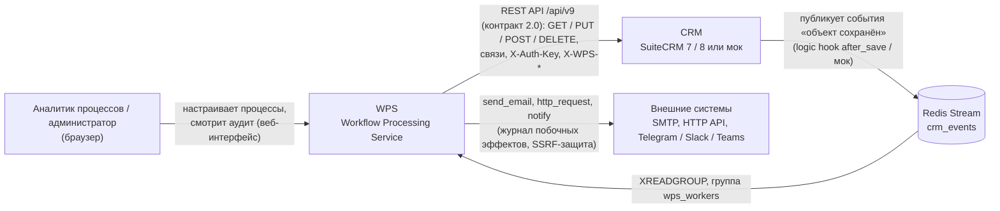
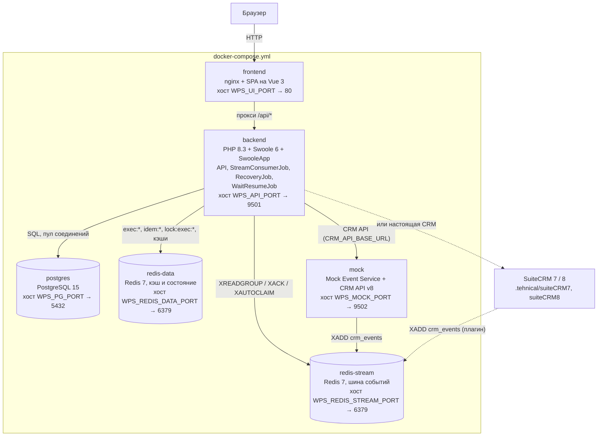

# Обзор архитектуры

Общая картина WPS: окружающие системы, контейнеры, из которых состоит сервис, и стек технологий.

<!-- lang-switch -->
[🇬🇧 English](../../en/05-architecture/overview.md) | 🇷🇺 Русский
<!-- /lang-switch -->

## Контекст системы (C4, уровень 1)

Владелец данных — CRM. Она не вызывает WPS напрямую: каждое сохранение записи публикуется в Redis Stream
`crm_events`, а WPS читает этот стрим как группа потребителей. Когда процессу нужны дополнительные данные или нужно
записать изменение обратно, WPS обращается к REST API CRM (формат SuiteCRM API v8, аутентификация динамическим ключом
`X-Auth-Key`). Люди работают только с веб-интерфейсом: настраивают процессы и просматривают аудит выполнений.

Кроме CRM, процессы обращаются к внешним системам: почта (`send_email`, SMTP через `symfony/mailer`), произвольные
HTTP API (`http_request`, проверка адресов `EgressGuard`) и мессенджеры (`notify`: Telegram, Slack, Teams; колокольчик
CRM — через API CRM). Учётные данные для них хранятся в зашифрованном хранилище секретов WPS. Контракт API CRM 2.0
(плагины SuiteCRM 1.2.0, мок) описан в [Интеграции с CRM](../04-operations/crm-integration.md).

## Контейнеры (C4, уровень 2)

| Контейнер | Назначение | Данные |
|---|---|---|
| `frontend` | Отдаёт собранное SPA, проксирует `/api/` на `backend:9501`, для остальных путей отдаёт `index.html` | — |
| `backend` | REST API для интерфейса, потребитель стрима, движок выполнения, восстановление | — (без состояния: оно лежит в PostgreSQL и redis-data) |
| `postgres` | Консистентное хранилище | пользователи, процессы, выполнения, аудит шагов, отметки однократного запуска, секреты (зашифрованные), журнал побочных эффектов, ожидающие выполнения |
| `mailpit` | Тестовый SMTP стенда (`MAILER_DSN=smtp://mailpit:1025`), веб-интерфейс писем на `WPS_MAILPIT_PORT` | письма стенда (в памяти) |
| `redis-stream` | Шина событий между CRM и WPS | стрим `crm_events`, группа `wps_workers`, стрим недоставленных сообщений `crm_events:dlq` |
| `redis-data` | Быстрое временное состояние, отдельно от шины (ответ заказчика №4) | контекст выполнения `exec:{uuid}`, блокировки, ключи идемпотентности, кэши процессов и модулей |
| `mock` | CRM для разработки: генерирует события и эмулирует CRM API v8 | объекты мок-CRM (в redis-stream) |

С базами данных работает только backend. Несколько воркеров backend читают стрим параллельно как отдельные потребители
одной группы, поэтому одно событие в каждый момент обрабатывает ровно один воркер. Контейнер `mock` выполняет обе роли
CRM — публикует события и отвечает по REST API, — так что вся система работает без SuiteCRM. Настоящая SuiteCRM 7/8
подключается сменой `CRM_API_BASE_URL` (см. [Интеграция с CRM](../04-operations/crm-integration.md)).

## Стек технологий

| Уровень | Технология | Где |
|---|---|---|
| HTTP-сервер, конкурентность | PHP 8.3, Swoole 6 (корутины, `SWOOLE_HOOK_ALL`) | `back/Dockerfile`, `back/server.php` |
| Фреймворк приложения | SwooleApp (`sidalex/swoole-app` ^0.3.0, Packagist) | `back/composer.json`, `back/config/config.json` |
| Хранилище | PostgreSQL 15 (JSONB для определений процессов) | `back/migrations/*.sql` |
| Шина событий | Redis 7 Streams с группой потребителей | `back/src/Services/StreamService.php` |
| Кэш и состояние выполнений | Redis 7 (отдельный экземпляр) | `back/src/Services/ExecutionStateStore.php` |
| Аутентификация | JWT (access + refresh), роли admin / editor / viewer | `back/src/Auth/` |
| Метрики | Текстовый формат Prometheus, общая `Swoole\Table` | `back/src/Services/MetricsService.php` |
| Интерфейс | Vue 3.5, TypeScript, Vite 5, Element Plus, Pinia, Vue Router, Axios, vue-i18n | `front/` |
| Доставка интерфейса | nginx | `front/nginx.conf` |
| Почта | `symfony/mailer` (SMTP), Mailpit на стенде | `back/src/Mail/` |
| Точные числа | `bcmath` (`decimal`), `intl` (`format_date_locale`) | `back/Dockerfile` |
| JSONPath | адаптер `Wps\Support\JsonPath` (RFC 9535) | `back/src/Support/JsonPath.php` |
| Тесты | PHPUnit (стадия `test` образа), интеграционный `tests/IntegrationTest.php`, кейсы SuiteCRM 8 | `back/tests/`, `.tehnical/suiteCRM8/processes/cases/` |
| CRM | SuiteCRM 7 / 8 с плагином WPS или мок на PHP | `.tehnical/`, `mock/` |

## Что читать дальше

- [Backend](backend.md) — слои, компоненты и модель процессов Swoole.
- [Поток событий](event-flow.md) — что происходит с одним событием CRM от стрима до аудита.
- [Движок выполнения](execution-engine.md) — контекст, статусы, повторы и восстановление.
- [Модель данных](data-model.md) — таблицы и ключи Redis.
- [Frontend](frontend.md) — устройство SPA.
- [Архитектурные решения](decisions.md) — почему всё устроено именно так.

<!-- footer-nav -->
---

← Назад: [Решение проблем](../04-operations/troubleshooting.md) | [Оглавление](../README.md) | [Архитектура backend](backend.md) Далее →
<!-- /footer-nav -->
