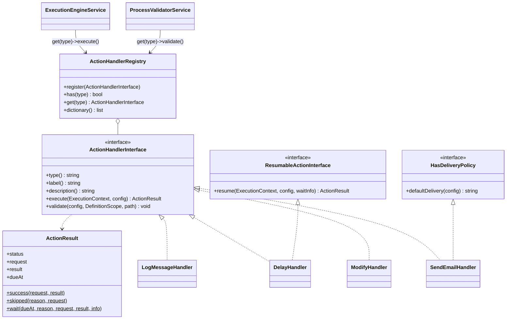

# Новый тип действия

Как добавить в определение процесса новый вид шага — на учебном примере действия `log_message` («Записать в журнал»).

<!-- lang-switch -->
[🇬🇧 English](../../../en/07-developer-guide/extending/new-action-type.md) | 🇷🇺 Русский
<!-- /lang-switch -->

## 1. Когда это нужно

Действия — это шаги процесса. Встроенные (`back/src/Actions/`, справочник `GET /api/dictionaries/action-types`):
`preload`, `modify`, `save_object`, `set_variable`, `find_records`, `update_records`, `link_records` / `unlink_records`,
`delay`, `send_email`, `http_request`, `notify`, `assign`, `start_process`; блоки `condition`, `foreach`,
`stop_process` устроены иначе ([Новый тип блока](new-block-type.md)). Новый тип нужен, когда процесс должен сделать
то, что ни одно из них не умеет: вызвать собственный API, записать в очередь, залогировать бизнес-сообщение. Для
вебхуков и мессенджеров сначала посмотрите на `http_request` и [каналы `notify`](new-notify-channel.md). Если нужен только новый способ *вычислить значение*, напишите [тип изменения](new-change-type.md);
если новый способ *загрузить объект* — [стратегию загрузки](new-load-strategy.md).

## 2. Как это устроено



Интерфейс `Wps\Actions\ActionHandlerInterface` (`back/src/Actions/ActionHandlerInterface.php`):

| Метод | Назначение |
|---|---|
| `type(): string` | код действия в определении (`"log_message"`); уникален среди действий **и** блоков |
| `label(): string`, `description(): string` | подпись и описание для `GET /api/dictionaries/action-types` (`"kind": "action"`) |
| `execute(ExecutionContext $context, array $actionConfig): ActionResult` | выполнение шага |
| `validate(array $actionConfig, DefinitionScope $scope, string $path): void` | статическая проверка при сохранении процесса |

Необязательные интерфейсы: `ResumableActionInterface` (ждущее действие, [ниже](#ждущее-действие-парковка)) и
`Wps\SideEffects\HasDeliveryPolicy` (внешние побочные эффекты, [ниже](#внешние-вызовы-и-журнал-побочных-эффектов)).
`ActionResult` — `final` с `readonly`-полями `status` (`success` / `skipped` / `failed` / `waiting`), `request`,
`result`, `dueAt`, `waitReason`, `waitInfo` и фабриками `success()`, `skipped()`, `wait()`.

- Шаг в `definition.actions[]` — это JSON-объект с ключом `"type"`; все остальные ключи — конфигурация обработчика.
  Общие ключи шага (`id`, `name`, `on_error`, `retry`, а для `HasDeliveryPolicy` — `delivery`) проверяет и обрабатывает
  движок; обработчик их получает, но разбирать не должен.
- **При сохранении** `ProcessValidatorService` обходит определение в порядке выполнения и вызывает `validate($config, $scope, $path)`.
  Проблемы сообщаются через `$scope->error("{$path}.field", 'message')` и превращаются в `422 VALIDATION_ERROR` с
  `details[].field = "definition.actions[N].field"`. Пути, которые вы читаете, проверяйте через `$scope->checkReadPath()`
  (переменная к этому моменту уже должна существовать); переменные, которые вы создаёте, объявляйте через
  `$scope->declare()` / `checkWritePath()`.
- **При выполнении** `ExecutionEngineService::executeStep()` вызывает `execute($context, $config)`:
  - данные процесса читаются и пишутся через `ExecutionContext` (`get('object.phone')`, `set('v1.rating', 'VIP')`,
    `getVariable()`, `setVariable()`, `executionId`, `processId`, `stepIndex`);
  - возвращается `ActionResult::success($request, $result)` или `ActionResult::skipped($reason)`. `$request` и `$result`
    прогоняются через маскер секретов шага и записываются в аудит (`execution_actions.request_data` / `result_data`),
    их видно в UI и в `GET /api/executions/{id}`. Кладите туда то, что поможет разобраться с выполнением, но не
    огромные ответы: аудит хранится в PostgreSQL;
  - при временном сбое бросайте `RecoverableException` — движок восстановит снимок контекста (`restoreState()`) и
    повторит шаг (`ACTION_RETRY_MAX` раз с экспоненциальной задержкой `ACTION_RETRY_BASE_DELAY_MS` ×
    `ACTION_RETRY_BACKOFF`, параметры шага `retry` их переопределяют; долгая задержка паркует выполнение); при
    постоянном сбое — `NonRecoverableException` / `ConfigurationException`: шаг `failed`, дальше решает `on_error`
    шага (по умолчанию выполнение `failed`, оставшиеся шаги — `skipped`);
  - класс ошибки определяет `Services/Errors/ErrorClassifier`: в `details` исключения можно передать `error_code`
    (попадает в `error_code` записи аудита и `sys.last_error.code`), `http_status` и `retry_after_seconds` (задержка
    следующего повтора).
- `GET /api/dictionaries/action-types` возвращает `type`, `label`, `description` каждого зарегистрированного обработчика.
- Обработчики создаются в `Wps\Kernel\Container::actions()` **один раз на воркер** и обслуживают все корутины:
  через конструктор им можно передать любой сервис (адаптер CRM, логгер, движок выражений, репозитории), но хранить
  в полях состояние вызова нельзя — всё, что относится к выполнению, живёт в `ExecutionContext`, а то, что должно
  пережить повтор, — в Redis (так `AssignHandler` запоминает выбранного пользователя на шаг).

## 3. Пошагово

| Файл | Что сделать |
|---|---|
| `back/src/Actions/LogMessageHandler.php` | **новый** — обработчик |
| `back/src/Kernel/Container.php` | регистрация в `actions()` |
| `back/tests/Unit/Actions/LogMessageHandlerTest.php` | **новый** — юнит-тест |
| `back/tests/IntegrationTest.php` | блок `[log_message]` (или общий шаблон `testExtensions()` из [6](#6-тест)) |
| `front/src/views/ProcessDetailView.vue`, `front/src/locales/*.json` | подпись типа (или полноценный редактор) |
| `doc/{ru,en}/03-user-guide/actions.md`, `back/API.md` | описание действия |

### 3.1 Обработчик — `back/src/Actions/LogMessageHandler.php`

Действие вычисляет выражение в стиле `calculate` и пишет результат в лог сервиса и в аудит шага:
`{ "type": "log_message", "message": "concat('Deal ', object.id, ' processed')", "level": "info" }`.

```php
<?php

declare(strict_types=1);

namespace Wps\Actions;

use Psr\Log\LoggerInterface;
use Wps\Context\ExecutionContext;
use Wps\Exceptions\ConfigurationException;
use Wps\Exceptions\NonRecoverableException;
use Wps\Expression\ExpressionEngine;
use Wps\Services\Validation\DefinitionScope;

/**
 * Writes a message to the service log and to the step audit.
 * "message" is a calculate-style expression: "concat('Deal ', object.id, ' processed')".
 */
final class LogMessageHandler implements ActionHandlerInterface
{
    public const LEVELS = ['debug', 'info', 'notice', 'warning', 'error'];
    private const MAX_LENGTH = 2000;

    public function __construct(
        private readonly ExpressionEngine $expressions,
        private readonly LoggerInterface $logger,
    ) {
    }

    public function type(): string
    {
        return 'log_message';
    }

    public function label(): string
    {
        return 'Записать в журнал';
    }

    public function description(): string
    {
        return 'Вычисляет выражение и пишет результат в лог сервиса и в аудит шага';
    }

    public function execute(ExecutionContext $context, array $actionConfig): ActionResult
    {
        $expression = (string)($actionConfig['message'] ?? '');
        $level = (string)($actionConfig['level'] ?? 'info');
        if ($expression === '' || !in_array($level, self::LEVELS, true)) {
            // the validator rejects it on save; a definition saved before the rule may still carry it
            throw new ConfigurationException('log_message: message is required and level must be one of ' . implode(', ', self::LEVELS));
        }
        $message = ExpressionEngine::toString(
            $this->expressions->evaluate($expression, static fn (string $path) => $context->get($path)),
        );
        if (mb_strlen($message) > self::MAX_LENGTH) {
            throw new NonRecoverableException('log_message: the message is longer than ' . self::MAX_LENGTH . ' characters');
        }
        $this->logger->log($level, $message, [
            'execution_id' => $context->executionId,
            'process_id' => $context->processId,
            'step' => $context->stepIndex,
        ]);
        return ActionResult::success(['message' => $expression, 'level' => $level], ['logged' => $message]);
    }

    public function validate(array $actionConfig, DefinitionScope $scope, string $path): void
    {
        $message = $actionConfig['message'] ?? null;
        if (!is_string($message) || trim($message) === '') {
            $scope->error("{$path}.message", 'Message expression is required');
        } else {
            try {
                foreach ($this->expressions->paths($message) as $ref) {
                    $scope->checkReadPath($ref, "{$path}.message");
                }
            } catch (ConfigurationException $e) {
                $scope->error("{$path}.message", $e->getMessage());
            }
        }
        if (array_key_exists('level', $actionConfig) && !in_array($actionConfig['level'], self::LEVELS, true)) {
            $scope->error("{$path}.level", 'Level must be one of: ' . implode(', ', self::LEVELS));
        }
    }
}
```

### 3.2 Регистрация — `back/src/Kernel/Container.php`

```php
use Wps\Actions\LogMessageHandler;

public function actions(): ActionHandlerRegistry
{
    return $this->share(ActionHandlerRegistry::class, function () {
        $saver = new CrmObjectSaver($this->crm());
        $registry = new ActionHandlerRegistry();
        $registry->register(new PreloadHandler($this->crm(), $this->loadStrategies()));
        $registry->register(new ModifyHandler($this->changeTypes(), $saver));
        $registry->register(new SaveHandler($saver));
        // … set_variable, find_records, update_records, delay, send_email, http_request, assign, notify, link / unlink …
        $registry->register(new StartProcessHandler(
            $this->processes(),
            fn (): ExecutionEngineService => $this->engine(),
            $this->config()->maxChildDepth,
        ));
        $registry->register(new LogMessageHandler($this->expressions(), $this->logger()));
        return $registry;
    });
}
```

> **Внимание**
> Не вызывайте `$this->engine()` прямо в конструкторе обработчика: сам движок зависит от реестра действий.
> Передайте замыкание, как это сделано для `StartProcessHandler`. Тип не должен совпадать с типом блока:
> `Container::blocks()` бросает `LogicException`, если имя занято обоими. Повторный `register()` с тем же `type()`
> молча заменяет встроенное действие.

### 3.3 Пересборка и использование

```bash
docker compose up -d --build backend
```

```json
{
  "name": "Deal log", "object_type": "Deals", "is_child": false,
  "definition": {
    "conditions": [], "preload": [],
    "actions": [ { "type": "log_message", "message": "concat('Deal ', object.id, ' ', object.status)" } ]
  }
}
```

Каждый выполненный шаг пишет одну строку в лог (JSON-формат `Wps\Support\Logger`), например для сообщения
`concat('ext ', object.id, ' ', acc.name)`:

```json
{"timestamp":"2026-10-15T08:06:27.619Z","level":"info","message":"ext e1 INN Company","context":{"execution_id":"38839d14-…","process_id":13,"step":3},"pid":14}
```

## 4. Валидация и ошибки

| Ситуация | Что делать | Результат |
|---|---|---|
| Конфигурация отсутствует или неверна | `$scope->error()` в `validate()` | `422`, `details[].field = definition.actions[N].<key>` |
| Чтение переменной, которой ещё нет | `$scope->checkReadPath($path, $field)` | `Variable "v9" is not defined at this point` |
| Действие создаёт переменную | `$scope->declare('name', 'created')` или `checkWritePath()` | следующие шаги могут её использовать |
| Действие кладёт список записей (только чтение) | `$scope->declare('name', ExecutionContext::SOURCE_LIST)`; при выполнении `setVariable($name, $value, $module, ExecutionContext::SOURCE_LIST)` | `modify` / `save_object` по ней отклоняются, `set()` бросает `ConfigurationException` (так делает `FindRecordsHandler`) |
| Действию нужна переменная только на время вычисления (текущая запись) | при валидации — `$scope->declare($var, ExecutionContext::SOURCE_LOOP)` перед проверкой параметров и `$scope->undeclare($var)` после; при выполнении — `$context->withTemporaryVariable($var, $record, $module, fn () => …)` | переменная удаляется и при исключении; так делает `UpdateRecordsHandler` для `item` |
| Внешняя система временно недоступна | `throw new RecoverableException('…')` | повторы, статус `retrying`, затем `failed` |
| Постоянный сбой (4xx, плохие данные) | `throw new NonRecoverableException('…', ['response' => …])` | шаг `failed`, подробности в `result_data.details` |
| Делать нечего | `return ActionResult::skipped('reason')` | шаг `skipped`, выполнение продолжается |

Перед повтором движок восстанавливает снимок контекста, поэтому `execute()` может менять контекст до того, как упадёт.
Внешние побочные эффекты не откатываются — проводите их через журнал побочных эффектов (см.
[ниже](#внешние-вызовы-и-журнал-побочных-эффектов)) или делайте идемпотентными.

В ведомых процессах область видимости создаётся с `inheritsVariables: true`, поэтому там `checkReadPath()` принимает
неизвестные переменные.

### Поля, принимающие секрет

Если действию нужны учётные данные (токен, пароль, DSN), объявите поле, в котором автор процесса указывает ссылку
`secret://name` или `secret://name.field`, и разрешайте её в `execute()` через `SecretResolver`
(`Container::secretResolver()`, передайте его в конструктор обработчика):

```php
$token = $this->secrets->resolve($actionConfig['auth']['token'], $context->secretMasker); // string|array
$hosts = $this->secrets->allowedHosts($actionConfig['auth']['token']);                      // [] = любые хосты
$kind = $this->secrets->kind($actionConfig['auth']['token']);                               // 'bearer', 'basic_auth', …
```

- `resolve()` расшифровывает значение (кэш в памяти воркера, `SECRETS_CACHE_TTL`) и регистрирует его и производные формы
  в маскере шага `$context->secretMasker`. Движок прогоняет `request`, `result`, текст и `details` ошибки шага через этот
  маскер перед записью в аудит, поэтому значение заменяется на `***` автоматически. Не кладите значение секрета в
  переменные процесса и в логи без маскера.
- Нет секрета или поля — `NonRecoverableException` (`Secret "x" not found`, `Secret "x" has no field "y"`).
- При сохранении процесса валидатор сам проверяет, что секрет существует, и отклоняет ссылки в полях данных
  (`value`, `expression`, `field`, `target`, `template`, `subject`, `body`, `text`, `html`) и в условиях. Поэтому поле
  учётных данных не называйте так, как поля данных. Если действие ожидает определённые виды секретов, проверьте
  `kind()` в `execute()` и завершите шаг понятной ошибкой.
- Если секрет уходит во внешнюю систему, проверьте хост запроса по `allowedHosts()`.

### Текстовые поля и шаблоны

Если поле действия — текст с подстановками (тема и тело письма, URL, заголовки, тело запроса), не собирайте его сами:
используйте `TemplateEngine` (`Container::templates()`) и проверяйте его при сохранении через `TemplateValidator`
(`Container::templateValidator()`). Режим экранирования `EscapeMode` выбирает действие по назначению поля:

```php
use Wps\Template\EscapeMode;
use Wps\Template\MissingPolicy;

// validate()
$this->templateValidator->validate($config['subject'] ?? null, $scope, "{$path}.subject", EscapeMode::Header);
$this->templateValidator->validate($config['html'] ?? null, $scope, "{$path}.html", EscapeMode::Html, allowRaw: false);
$this->templateValidator->validate($config['url'] ?? null, $scope, "{$path}.url", EscapeMode::Url);   // хост фиксирован
$this->templateValidator->validate($config['body'] ?? null, $scope, "{$path}.body", EscapeMode::Json); // массив-документ

// execute()
$resolve = static fn (string $p) => $context->resolve($p);
$subject = $this->templates->render($config['subject'], $resolve, EscapeMode::Header)->value;
$to = $this->templates->render($config['to'], $resolve, EscapeMode::Text, MissingPolicy::Error)->value;
$body = $this->templates->renderStructure($config['body'], $resolve)->value; // числа остаются числами
```

- `text` — как есть; `header` — CR/LF удаляются (+ предупреждение в `RenderResult::$warnings`); `html` —
  `htmlspecialchars`, фильтр `raw` допустим, только если вы передали `allowRaw: true` для доверенного поля; `url` —
  `rawurlencode` и запрет подстановок в схеме, хосте и порту; `json` — `renderStructure()`.
- Для получателей и URL используйте `MissingPolicy::Error`: пустой адрес не должен уходить молча.
- `RenderResult::$missing` и `$warnings` положите в `result` шага, чтобы они были видны в аудите.

### Внешние вызовы и журнал побочных эффектов

Шаг выполняется «как минимум один раз»: после падения воркера он повторяется целиком. Если действие отправляет
что-то во внешнюю систему (письмо, вебхук, уведомление), проведите вызов через `SideEffectLedger`
(`Container::sideEffects()`), иначе повтор отправит его второй раз. Подробно о модели —
[Надёжность](../../04-operations/reliability.md#побочные-эффекты-и-повторы).

Полный пример — действие `push_to_erp`, которое отправляет JSON-документ в ERP (`back/src/Actions/PushToErpHandler.php`;
класс и тест ниже прогнаны на текущем коде):

```php
<?php

declare(strict_types=1);

namespace Wps\Actions;

use Wps\Context\ExecutionContext;
use Wps\Exceptions\NonRecoverableException;
use Wps\Exceptions\RecoverableException;
use Wps\Http\Outbound\HttpRequestException;
use Wps\Http\Outbound\OutboundHttpClient;
use Wps\Secrets\SecretReference;
use Wps\Secrets\SecretResolver;
use Wps\Services\Validation\DefinitionScope;
use Wps\SideEffects\DeliveryPolicy;
use Wps\SideEffects\HasDeliveryPolicy;
use Wps\SideEffects\SideEffectLedger;
use Wps\SideEffects\UnknownOutcomeException;
use Wps\Template\EscapeMode;
use Wps\Template\TemplateEngine;
use Wps\Template\TemplateValidator;

/**
 * Sends a JSON document to the ERP: { "type": "push_to_erp", "token": "secret://erp", "body": {"deal": "{{ object.id }}"} }.
 * The call goes through the side effect journal: a repeated step does not create a second ERP document.
 */
final class PushToErpHandler implements ActionHandlerInterface, HasDeliveryPolicy
{
    public function __construct(
        private readonly OutboundHttpClient $http,
        private readonly SideEffectLedger $ledger,
        private readonly SecretResolver $secrets,
        private readonly TemplateEngine $templates,
        private readonly TemplateValidator $templateValidator,
        private readonly string $erpUrl,
    ) {
    }

    public function type(): string
    {
        return 'push_to_erp';
    }

    public function label(): string
    {
        return 'Отправить в ERP';
    }

    public function description(): string
    {
        return 'Отправляет JSON-документ в ERP; повтор шага не создаёт дубль';
    }

    public function defaultDelivery(array $config): string
    {
        // a repeated POST may create a duplicate → "at most once" by default
        return DeliveryPolicy::AT_MOST_ONCE;
    }

    public function execute(ExecutionContext $context, array $actionConfig): ActionResult
    {
        $delivery = DeliveryPolicy::resolve($actionConfig['delivery'] ?? null, $this->defaultDelivery($actionConfig));
        $rendered = $this->templates->renderStructure($actionConfig['body'] ?? [], static fn (string $path) => $context->resolve($path));
        $body = $rendered->value;
        $request = ['url' => $this->erpUrl, 'body' => $body];                 // what goes out (no secrets)
        $effectKey = $this->ledger->effectKey($context);

        $out = $this->ledger->run($context, $this->type(), '', $delivery, $request,
            function (string $idempotencyKey) use ($context, $actionConfig, $body, $delivery, $effectKey): array {
                // resolved only when really sending: the value is registered in the step masker and never reaches the audit
                $token = (string)$this->secrets->resolve((string)$actionConfig['token'], $context->secretMasker);
                try {
                    $response = $this->http->send('POST', $this->erpUrl, [
                        'Content-Type' => 'application/json',
                        'Authorization' => "Bearer {$token}",
                        'Idempotency-Key' => $idempotencyKey,
                    ], (string)json_encode($body, JSON_UNESCAPED_UNICODE | JSON_UNESCAPED_SLASHES), 15.0);
                } catch (HttpRequestException $e) {
                    if ($e->sent() && $delivery === DeliveryPolicy::AT_MOST_ONCE) {
                        // a timeout after sending: the ERP may have the document
                        throw UnknownOutcomeException::forEffect($effectKey, null, 'push_to_erp: ' . $e->getMessage());
                    }
                    throw $e; // not sent (DNS, connection refused): recoverable, the step is retried
                }
                $status = $response->status;
                $details = ['http_status' => $status, 'error_code' => "HTTP_{$status}", 'response' => mb_substr($response->body, 0, 1000)];
                if (in_array($status, [408, 425, 429, 503], true)) {
                    throw new RecoverableException("push_to_erp: ERP returned HTTP {$status}", $details); // not processed
                }
                if ($status >= 500) {
                    if ($delivery === DeliveryPolicy::AT_MOST_ONCE) {
                        throw UnknownOutcomeException::forEffect($effectKey, null, "push_to_erp: ERP returned HTTP {$status}");
                    }
                    throw new RecoverableException("push_to_erp: ERP returned HTTP {$status}", $details);
                }
                if ($status >= 400) {
                    throw new NonRecoverableException("push_to_erp: ERP returned HTTP {$status}", $details);
                }
                $decoded = json_decode($response->body, true);
                return ['status' => $status, 'erp_id' => is_array($decoded) ? (string)($decoded['id'] ?? '') : ''];
            });

        return ActionResult::success($request, $out['response'] + [
            'idempotency_key' => $out['idempotency_key'],
            'replayed' => $out['replayed'],
        ] + ($rendered->missing !== [] ? ['missing' => $rendered->missing] : []));
    }

    public function validate(array $actionConfig, DefinitionScope $scope, string $path): void
    {
        $token = $actionConfig['token'] ?? null;
        if (!is_string($token) || SecretReference::parse($token) === null) {
            // the existence of the secret is checked by ProcessValidatorService itself
            $scope->error("{$path}.token", 'Token must be a secret reference (secret://name)');
        }
        $body = $actionConfig['body'] ?? null;
        if (!is_array($body) || $body === []) {
            $scope->error("{$path}.body", 'Body must be a non-empty JSON object');
        } else {
            $this->templateValidator->validate($body, $scope, "{$path}.body", EscapeMode::Json);
        }
    }
}
```

Регистрация — в `Container::actions()`; адрес ERP — новая настройка в `AppConfig` (например, `ERP_API_URL` с
описанием в `back/.env.example`):

```php
$registry->register(new PushToErpHandler($this->outboundHttp(), $this->sideEffects(), $this->secretResolver(),
    $this->templates(), $this->templateValidator(), $this->config()->erpApiUrl));
```

- `OutboundHttpClient` (`Container::outboundHttp()`) — общий исходящий HTTP-клиент: защита от SSRF (`EgressGuard`,
  `HTTP_ALLOW_HOSTS` / `HTTP_DENY_HOSTS` / приватные сети), TLS, лимит ответа. `send()` бросает `HttpRequestException`
  с `sent()` — дошёл ли запрос до сервера, `status()` и `error_code` (`HTTP_<код>`, `TIMEOUT`, `TRANSPORT`).
- Классификация ответов повторяет `http_request` и `notify` (`HttpChannelSupport::check()`): 408/425/429/503 — сервер
  запрос не обработал, повтор безопасен; 500/502/504 и обрыв после отправки — исход неизвестен: при `at_most_once` —
  `UnknownOutcomeException`, при `at_least_once` — повтор; остальные 4xx — окончательная ошибка.

Юнит-тест (`back/tests/Unit/Actions/PushToErpHandlerTest.php`) проверяет повтор после падения воркера и тестовый
прогон без сети — `InMemorySideEffectStore` уже есть в `back/tests/Unit/Support/`:

```php
<?php

declare(strict_types=1);

namespace Wps\Tests\Unit\Actions;

use PHPUnit\Framework\TestCase;
use Wps\Actions\PushToErpHandler;
use Wps\Context\ExecutionContext;
use Wps\Expression\ExpressionEngine;
use Wps\Http\Outbound\OutboundHttpClient;
use Wps\Secrets\SecretResolver;
use Wps\Services\Validation\DefinitionScope;
use Wps\SideEffects\DeliveryPolicy;
use Wps\SideEffects\SideEffectLedger;
use Wps\Template\TemplateEngine;
use Wps\Template\TemplateValidator;
use Wps\Tests\Unit\Support\InMemorySideEffectStore;

final class PushToErpHandlerTest extends TestCase
{
    private const STEP = ['type' => 'push_to_erp', 'token' => 'secret://erp', 'body' => ['deal' => '{{ object.id }}', 'amount' => '{{ object.amount }}']];

    private SideEffectLedger $ledger;

    protected function setUp(): void
    {
        $this->ledger = new SideEffectLedger(new InMemorySideEffectStore());
    }

    private function handler(): PushToErpHandler
    {
        $templates = new TemplateEngine(new ExpressionEngine());
        // final classes without a network: they must not be called in these tests
        $http = (new \ReflectionClass(OutboundHttpClient::class))->newInstanceWithoutConstructor();
        $secrets = (new \ReflectionClass(SecretResolver::class))->newInstanceWithoutConstructor();
        return new PushToErpHandler($http, $this->ledger, $secrets, $templates, new TemplateValidator($templates), 'https://erp.example.com/api/deals');
    }

    private static function context(): ExecutionContext
    {
        $context = ExecutionContext::fromEvent('event-1', ['id' => 'd1', 'amount' => 1500], 'Deals');
        $context->executionId = 'exec-1';
        $context->pc = 4;
        $context->attemptToken = 'attempt-1';
        return $context;
    }

    public function testRepeatedStepReplaysTheJournal(): void
    {
        $context = self::context();
        // the first attempt reached the ERP and was journaled; the worker died before the step was recorded
        $this->ledger->run($context, 'push_to_erp', '', DeliveryPolicy::AT_MOST_ONCE, [], static fn (string $key) => ['status' => 201, 'erp_id' => 'E-7']);
        $context->attemptToken = 'attempt-after-crash';

        $result = $this->handler()->execute($context, self::STEP);

        self::assertSame(['url' => 'https://erp.example.com/api/deals', 'body' => ['deal' => 'd1', 'amount' => 1500]], $result->request, 'a single substitution keeps the type');
        self::assertSame(['status' => 201, 'erp_id' => 'E-7', 'idempotency_key' => 'exec-1:4', 'replayed' => true], $result->result);
    }

    public function testDryRunDoesNotSend(): void
    {
        $context = self::context();
        $context->dryRun = true;
        $result = $this->handler()->execute($context, self::STEP);
        self::assertSame(['dry_run' => true, 'idempotency_key' => 'exec-1:4', 'replayed' => false], $result->result);
    }

    public function testValidate(): void
    {
        $scope = new DefinitionScope();
        $this->handler()->validate(['token' => 'plain-token', 'body' => ['deal' => '{{ v9.id }}']], $scope, 'definition.actions[0]');
        self::assertSame([
            'definition.actions[0].token' => 'Token must be a secret reference (secret://name)',
            'definition.actions[0].body' => 'Variable "v9" is not defined at this point',
        ], array_column($scope->errors(), 'message', 'field'));
    }
}
```

- `run()` пишет в журнал `started` до вызова, `done` с ответом после успеха (через маскер секретов шага), `failed` после
  невосстановимой ошибки; восстановимая ошибка и `UnknownOutcomeException` оставляют `started`.
- Повтор после `done` не вызывает замыкание и возвращает сохранённый ответ (`replayed: true`); чужой `started` при
  `at_most_once` — `UnknownOutcomeException` (`error_code: UNKNOWN_OUTCOME` в `result_data` шага).
- Несколько внешних вызовов в одном шаге (письмо каждому получателю, два канала уведомления) различайте параметром
  `$sub` — стабильным идентификатором вызова (`'0'`, `'1'`, `'slack'`): ключ эффекта станет `{pc}@{iteration}#{sub}`.
- Внешний ключ `$idempotencyKey` = `{execution_id}:{effect_key}`; для `Message-ID` писем используйте домен
  `AppConfig::$mailMessageIdDomain` (`WPS_MAIL_MESSAGE_ID_DOMAIN`).
- В тестовом прогоне (`$context->dryRun`) замыкание не вызывается, журнал не трогается, `response = ['dry_run' => true]`.
- Поле `delivery` разрешено только у действий, реализующих `HasDeliveryPolicy`: валидатор сам проверяет значение
  (`Delivery must be "at_most_once" or "at_least_once"`) и отклоняет его у остальных действий
  (`Action "modify" does not support "delivery"`).

### Ждущее действие (парковка)

Действие, которому нужно ждать долго (ответ внешней системы, срок), не должно спать в корутине: верните
`ActionResult::wait()`, и движок припаркует выполнение — снимок состояния уйдёт в `execution_waits`, воркер освободится,
а `WaitResumeJob` продолжит выполнение после срока, в том числе после перезапуска
([Движок выполнения → Ожидание](../../05-architecture/execution-engine.md#ожидание-и-пробуждение-waitresumejob)).
Шаг на время ожидания получает статус `waiting`.

```php
use Wps\Actions\ResumableActionInterface;
use Wps\Time\Clock;

final class WaitForApprovalHandler implements ActionHandlerInterface, ResumableActionInterface
{
    public function __construct(private readonly Clock $clock /* Container::clock() */)
    {
    }

    // … type(), label(), description(), validate() — as in LogMessageHandler …

    public function execute(ExecutionContext $context, array $actionConfig): ActionResult
    {
        $id = (string)$context->get('object.id');
        $dueAt = $this->clock->now()->modify('+1 day');
        // ActionResult::wait($dueAt, $reason, $request, $result, $info)
        return ActionResult::wait($dueAt, 'approval', ['ticket' => $id], [], ['ticket' => $id]);
    }

    public function resume(ExecutionContext $context, array $actionConfig, array $waitInfo): ActionResult
    {
        // $waitInfo — $info из wait() + due_at, parked_at
        return ActionResult::success(['ticket' => $waitInfo['ticket']], ['approved' => $this->check($waitInfo['ticket'])]);
    }

    private function check(string $ticket): bool
    {
        return true; // ask the external system
    }
}
```

- `$reason` попадает в `executions.wait_reason` и `wait.reason` API; `$info` — в `execution_waits.info` и в `resume()`.
  Держите его маленьким и сериализуемым.
- Без `ResumableActionInterface` шаг после пробуждения просто становится `success` с `request`/`result` из `wait()`.
- `resume()` может вернуть `success`, `skipped` или бросить исключение — дальше работают обычные `on_error` и повторы.
- Короткие паузы (до `WAIT_INLINE_MAX_SECONDS`) дешевле выполнить в корутине (`Coroutine::sleep`), как это делает
  `DelayHandler`.
- `WAITING` допустим только там, где есть выполнение: в `prepare()`, при вычислении условий и в тестовом прогоне без
  `handle` шаг падает с `This step cannot wait here (condition evaluation or a test run)`.
- Снимок больше `WAIT_STATE_MAX_BYTES` не паркуется: `Execution state is too large to wait (N bytes, limit M)`.

## 5. UI и переводы

В редакторе процесса есть панели только для встроенных типов. Любой другой тип действия обрабатывается как **passthrough**
(`front/src/utils/processForm.ts → formFromProcess()`): он показывается в блоке «Изменить объект / переменную» строкой
только для чтения со своим JSON (`ModifyPanel.vue`, подсказка `modify.passthroughHint`: «Это действие не редактируется
в табличном редакторе и будет сохранено без изменений») и сохраняется без изменений. Значит, новое действие можно создать
через API (`POST`/`PUT /api/processes`) или импортом JSON, а редакторы по-прежнему могут править остальной процесс в UI.

Чтобы в карточке процесса была понятная подпись, добавьте тип в `actionTypeLabel()` в
`front/src/views/ProcessDetailView.vue` и переведите его в обеих локалях:

```ts
// front/src/views/ProcessDetailView.vue
function actionTypeLabel(type: string): string {
  const keys: Record<string, string> = {
    modify: 'processDetail.actionType.modify',
    save_object: 'processDetail.actionType.saveObject',
    start_process: 'processDetail.actionType.startProcess',
    preload: 'processDetail.actionType.preload',
    log_message: 'processDetail.actionType.logMessage',
  }
  return keys[type] ? t(keys[type]) : type
}
```

```json
// front/src/locales/en.json → processDetail.actionType
"logMessage": "Write to log"
// front/src/locales/ru.json → processDetail.actionType
"logMessage": "Запись в журнал"
```

Чтобы действие можно было редактировать, добавьте тип строки в `ModifyRow` (`front/src/types/index.ts`), ветку в
`formFromProcess()`/`definitionFromForm()` и ветку редактора в `ModifyPanel.vue` (или новую панель в
`ProcessEditView.vue`); все тексты — в `locales/*.json`.

## 6. Тест

### 6.1 Юнит-тест — `back/tests/Unit/Actions/LogMessageHandlerTest.php`

По образцу `SetVariableTest`: выполнение с настоящим `ExpressionEngine` и логгером-шпионом (`Psr\Log\AbstractLogger`),
ошибка выполнения и проверка при сохранении через `DefinitionScope`.

```php
<?php

declare(strict_types=1);

namespace Wps\Tests\Unit\Actions;

use PHPUnit\Framework\TestCase;
use Psr\Log\AbstractLogger;
use Wps\Actions\ActionResult;
use Wps\Actions\LogMessageHandler;
use Wps\Context\ExecutionContext;
use Wps\Exceptions\NonRecoverableException;
use Wps\Expression\ExpressionEngine;
use Wps\Services\Validation\DefinitionScope;

final class LogMessageHandlerTest extends TestCase
{
    /** @var list<array{0: string, 1: string, 2: array<string, mixed>}> */
    private array $records = [];

    private function handler(): LogMessageHandler
    {
        $records = &$this->records;
        $logger = new class ($records) extends AbstractLogger {
            public function __construct(private array &$records)
            {
            }

            public function log($level, string|\Stringable $message, array $context = []): void
            {
                $this->records[] = [(string)$level, (string)$message, $context];
            }
        };
        return new LogMessageHandler(new ExpressionEngine(), $logger);
    }

    public function testExecute(): void
    {
        $context = ExecutionContext::fromEvent('e1', ['id' => 'd1', 'status' => 'Won'], 'Deals');
        $context->executionId = 'exec-1';
        $context->processId = 7;
        $context->stepIndex = 2;

        $result = $this->handler()->execute($context, [
            'type' => 'log_message', 'message' => "concat('Deal ', object.id, ' ', object.status)", 'level' => 'notice',
        ]);

        self::assertSame(ActionResult::SUCCESS, $result->status);
        self::assertSame(['message' => "concat('Deal ', object.id, ' ', object.status)", 'level' => 'notice'], $result->request);
        self::assertSame(['logged' => 'Deal d1 Won'], $result->result);
        self::assertSame([['notice', 'Deal d1 Won', ['execution_id' => 'exec-1', 'process_id' => 7, 'step' => 2]]], $this->records);
    }

    public function testRuntimeErrorIsNotRecoverable(): void
    {
        $context = ExecutionContext::fromEvent('e1', ['id' => 'd1', 'name' => 'x'], 'Deals');
        $this->expectException(NonRecoverableException::class);
        $this->handler()->execute($context, ['message' => 'object.name * 2']); // "x" is not a number
    }

    public function testValidate(): void
    {
        $scope = new DefinitionScope();
        $handler = $this->handler();
        $handler->validate([], $scope, 'definition.actions[0]');
        $handler->validate(['message' => "concat(v9.name, '!')", 'level' => 'loud'], $scope, 'definition.actions[1]');
        $handler->validate(['message' => "concat(object.name, ')"], $scope, 'definition.actions[2]');
        $handler->validate(['message' => 'upper(object.name)', 'level' => 'debug'], $scope, 'definition.actions[3]');

        self::assertSame([
            'definition.actions[0].message' => 'Message expression is required',
            'definition.actions[1].message' => 'Variable "v9" is not defined at this point',
            'definition.actions[1].level' => 'Level must be one of: debug, info, notice, warning, error',
            'definition.actions[2].message' => 'Unterminated string starting at position 20',
        ], array_column($scope->errors(), 'message', 'field'));
    }
}
```

Класс и тест прогнаны на текущем коде (`OK`). Обработчики с внешними зависимостями тестируйте так же: зависимости —
через конструктор, сеть — через фейки (`NotifyTest` — фейковый канал и `SideEffectLedger` над хранилищем в памяти;
`ExternalApiAdapterService` — `final`, в юнит-тестах его создают `newInstanceWithoutConstructor()` и не вызывают, а
обращения к CRM проверяют интеграционно на моке). Запуск — [Тестирование](../testing.md#юнит-тесты-бэкенда).

### 6.2 Интеграционный тест: общий шаблон `testExtensions()`

Группа ниже — **шаблон** для проверки всех учебных расширений этого раздела вместе: оператор `matches_regex`, блок
`unless`, тип изменения `append_note`, стратегия загрузки `by_id_or_field`, функция `mask`, действие `log_message`,
эндпоинт `/api/dictionaries/function-categories`. В `back/tests/IntegrationTest.php` её нет: добавьте метод и вызов
`$this->testExtensions();` в `run()` после `testRunOnce()` вместе с теми расширениями, которые вы реализовали
(проверки для нереализованных уберите). Для одного расширения достаточно своего блока, как в разделах «Тест» других
страниц.

```php
private function testExtensions(): void
{
    echo "[extensions]\n";
    $this->test('Function categories dictionary lists date', function () {
        $res = $this->request('GET', '/api/dictionaries/function-categories', token: $this->viewerToken, expectedStatus: 200);
        $this->assertTrue(in_array('date', array_column($res['data'], 'value'), true));
    });
    $this->test('Dictionaries contain the new entries', function () {
        $changeTypes = $this->request('GET', '/api/dictionaries/change-types', token: $this->adminToken)['data'];
        $this->assertTrue(in_array('append_note', array_column($changeTypes, 'value'), true));
        $actionTypes = array_column($this->request('GET', '/api/dictionaries/action-types', token: $this->adminToken)['data'], 'kind', 'value');
        $this->assertEquals('action', $actionTypes['log_message'] ?? null);
        $this->assertEquals('block', $actionTypes['unless'] ?? null);
        $operators = array_column($this->request('GET', '/api/dictionaries/operators', token: $this->adminToken)['data'], 'value');
        $this->assertTrue(in_array('matches_regex', $operators, true));
    });
    $this->test('log_message without a message is rejected', function () {
        $res = $this->request('POST', '/api/processes', [
            'name' => 'TEST ext invalid', 'object_type' => 'TestExt', 'is_child' => false,
            'definition' => ['actions' => [['type' => 'log_message', 'level' => 'loud']]],
        ], $this->adminToken, 422);
        $fields = array_column($res['error']['details'], 'field');
        $this->assertTrue(in_array('definition.actions[0].message', $fields, true));
        $this->assertTrue(in_array('definition.actions[0].level', $fields, true));
    });

    $inn = (string)random_int(1000000000, 9999999999);
    $this->test('Seed an account with an INN in the mock CRM', function () use ($inn) {
        $raw = $this->raw('PUT', "/mock/objects/Accounts/{$this->accountId}-inn", ['name' => 'INN Company', 'inn' => $inn], base: $this->crmUrl);
        $this->assertEquals(200, $raw['status']);
    });
    $this->test('Create a process that uses all extensions', function () use ($inn) {
        $res = $this->request('POST', '/api/processes', [
            'name' => 'TEST ext all', 'object_type' => 'TestExt', 'is_child' => false,
            'definition' => [
                'conditions' => [['field' => 'object.phone', 'operator' => 'matches_regex', 'value_type' => 'static', 'value' => '^\\+7\\d{10}$']],
                'preload' => [['var' => 'acc', 'source' => 'manual', 'module' => 'Accounts', 'strategy' => 'by_id_or_field', 'by_field' => 'inn', 'value' => $inn]],
                'actions' => [
                    ['type' => 'modify', 'target' => 'object.note', 'change_type' => 'append_note', 'value' => 'checked', 'separator' => ' | '],
                    ['type' => 'modify', 'target' => 'object.phone_masked', 'change_type' => 'calculate', 'value' => 'mask(object.phone, 4)'],
                    ['type' => 'unless', 'conditions' => [['field' => 'object.nickname', 'operator' => 'is_not_empty']],
                        'actions' => [['type' => 'modify', 'target' => 'object.label', 'change_type' => 'set_value', 'value' => 'no nickname']]],
                    ['type' => 'log_message', 'message' => "concat('ext ', object.id, ' ', acc.name)"],
                ],
            ],
        ], $this->adminToken, 201);
        $this->createdProcesses['ext'] = $res['data']['id'];
    });
    $this->test('matches_regex: a non-matching phone does not start the process', function () {
        $id = $this->createdProcesses['ext'] ?? $this->skip('ext process not created');
        $res = $this->request('POST', "/api/processes/{$id}/run", ['object' => ['id' => 'e0', 'phone' => '+1555']], $this->adminToken, 200);
        $this->assertFalse($res['data']['conditions_met']);
    });
    $this->test('All extensions work in one execution', function () {
        $id = $this->createdProcesses['ext'] ?? $this->skip('ext process not created');
        $res = $this->request('POST', "/api/processes/{$id}/run", ['object' => [
            'id' => 'e1', 'phone' => '+79990000000', 'note' => 'start', 'nickname' => '',
        ]], $this->adminToken, 201);
        $execution = $this->waitForExecution($res['data']['execution_id']);
        $this->assertEquals('completed', $execution['status'], (string)($execution['error_message'] ?? ''));
        $object = $execution['context']['variables']['object'];
        $this->assertEquals('start | checked', $object['note']);
        $this->assertEquals('********0000', $object['phone_masked']);
        $this->assertEquals('no nickname', $object['label']);
        $this->assertEquals('INN Company', $execution['context']['variables']['acc']['name']);
        $last = $execution['actions'][count($execution['actions']) - 1];
        $this->assertEquals('log_message', $last['action_type']);
        $this->assertEquals('ext e1 INN Company', $last['result_data']['logged']);
    });
}
```

В PHP-строке в одинарных кавычках `\\` даёт один обратный слэш: значение условия — `^\+7\d{10}$`. Ручной запуск
отвечает `201` с `execution_id`, если условия выполнены, и `200` с `conditions_met: false`, если нет. Запуск
интеграционных тестов на моке — [Тестирование](../testing.md). Шаблон собран по API текущего кода, но целиком не
прогонялся: расширений в репозитории нет.

## 7. Типичные ошибки

| Ошибка | Последствие | Как правильно |
|---|---|---|
| Состояние вызова в полях обработчика | обработчик общий для корутин воркера — данные одного выполнения попадают в другое | всё про выполнение — в `ExecutionContext` / Redis |
| Внешний вызов без `SideEffectLedger` | повтор шага (временная ошибка, падение воркера) отправляет дубль | `ledger->run()` + `HasDeliveryPolicy` |
| Нестабильный `$sub` (время, случайность, номер попытки) | журнал не узнаёт доставленный эффект; ключ — `{pc}@{iteration}#{sub}` | `$sub` из данных шага (индекс получателя, id записи) |
| `RecoverableException` на ошибку данных | бесполезные повторы и задержка | `NonRecoverableException` |
| Секрет в `request`/`result`, в переменных процесса или в логе | утечка в аудит и UI | `SecretResolver::resolve(…, $context->secretMasker)`, не класть значение в контекст |
| Проверка только в `execute()` | процесс сохраняется с ошибкой, падает при первом событии | `validate()` с путём поля |
| Новая переменная не объявлена в `validate()` | следующие шаги не сохраняются: `Variable "x" is not defined at this point` | `$scope->declare()` / `checkWritePath()` |
| Порядок ключей объекта в конфигурации | `processes.definition` — `jsonb`, порядок ключей объекта не сохраняется | упорядоченное — списком (как `fields` у `set_variable`) |
| `sleep()` / `Coroutine::sleep()` на минуты | воркер занят, ожидание теряется при перезапуске | `ActionResult::wait()` (парковка) |
| Большие ответы в `result` | раздувание `execution_actions` | только нужные поля, обрезка длинного текста |

## 8. Чек-лист готовности

- [ ] `final`-обработчик в `back/src/Actions/`, `declare(strict_types=1)`, уникальный (среди действий и блоков) `type()` в `snake_case`, `label()` и `description()`
- [ ] В полях обработчика нет состояния вызова; внешние вызовы — через `SideEffectLedger` + `HasDeliveryPolicy`, секреты — через `SecretResolver`
- [ ] `validate()` сообщает о каждой статической проблеме с путём поля; читаемые пути проверены, создаваемые переменные объявлены
- [ ] `execute()` возвращает `ActionResult` с полезными `request`/`result` для аудита; при сбоях — правильный класс исключения
- [ ] Зарегистрирован в `Container::actions()`
- [ ] Подпись в `actionTypeLabel()` + `processDetail.actionType.*` в обеих локалях (или полноценный редактор)
- [ ] Юнит-тест в `back/tests/Unit/Actions/` и интеграционный блок (вызов в `run()`), тесты зелёные, `npm run build` проходит
- [ ] Действие описано в разделе [Действия](../../03-user-guide/actions.md) (en + ru) и в `back/API.md`

<!-- footer-nav -->
---

← Назад: [Тестирование](../testing.md) | [Оглавление](../../README.md) | [Новый тип блока](new-block-type.md) Далее →
<!-- /footer-nav -->
