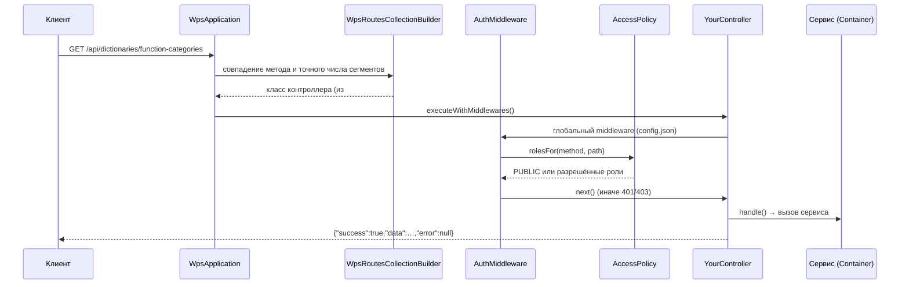

# Новый эндпоинт API

Как добавить REST-эндпоинт — на учебном примере `GET /api/dictionaries/function-categories`.

<!-- lang-switch -->
[🇬🇧 English](../../../en/07-developer-guide/extending/new-api-endpoint.md) | 🇷🇺 Русский
<!-- /lang-switch -->

> `function-categories` — учебный эндпоинт, в WPS его нет. Настоящий справочник функций выражений —
> [`GET /api/dictionaries/functions`](../../06-api-reference/endpoints.md#get-apidictionariesfunctions)
> (`FunctionsController`), пример построен на тех же данных.

## 1. Когда это нужно

Когда UI или внешней системе нужны данные или операция, которых API пока не даёт: новый справочник, отчёт,
административная операция. Эндпоинты тонкие — разбор запроса, проверка входных данных и ответ; бизнес-логика живёт в
сервисе в `back/src/Services/` (его можно покрыть юнит-тестом и переиспользовать).

Готовые образцы в коде:

| Что нужно | Образец |
|---|---|
| Справочник из реестра | `Controllers/Dictionaries/ActionTypesController.php`, `OperatorsController.php`, `NotifyChannelsController.php` |
| Справочник с дополнительными данными в `meta` | `Controllers/Dictionaries/FunctionsController.php` (`ok($functions, 200, ['operators' => …])`) |
| Статический справочник с подписями | `Controllers/Dictionaries/SystemVariablesController.php` |
| Список с фильтрами и страницами | `Controllers/Processes/ListProcessesController.php` |
| Операция над ресурсом по `{id}` | `Controllers/Processes/CloneProcessController.php` (`201`), `RunProcessController.php` |
| Нестандартный статус ответа | `Controllers/Health/HealthController.php` (`503` при деградации) |
| Проверка тела через валидатор действия | `Controllers/Notify/NotifyTestController.php` |

## 2. Как это устроено



- **Обнаружение.** SwooleApp сканирует пространство имён из `controllers` в `back/config/config.json`
  (`"Wps\\Controllers"`, включая вложенные) и регистрирует каждый класс с атрибутом
  `#[Route(uri: …, method: …)]` (`Sidalex\SwooleApp\Classes\Controllers\Route`). Один класс — один метод и один URI;
  никакой список править не нужно, достаточно положить файл и пересобрать образ.
- **Сопоставление.** `Wps\Kernel\WpsRoutesCollectionBuilder` сравнивает метод без учёта регистра и требует того же числа
  сегментов URI, что и в шаблоне; `{id}` совпадает с одним **непустым** сегментом и доступен как
  `$this->intParam('id')` / `$this->param('id')`. Завершающий слэш допускается (`/api/processes/` = `/api/processes`).
  Строка запроса в сопоставлении не участвует.
- **Доступ.** Глобальный middleware `Wps\Middleware\AuthMiddleware` (`globalMiddlewares` в `config.json`) спрашивает
  `Wps\Auth\AccessPolicy::rolesFor($method, $path)` (путь без завершающего слэша). `PUBLIC` — пропускает без токена;
  иначе требует заголовок `Authorization: Bearer <access JWT>` (`401 UNAUTHORIZED`), проверяет роль из токена
  (`403 FORBIDDEN`) и кладёт пользователя в `Wps\Http\AuthContext` — его возвращает `$this->user()`.
- **Ответ.** `BaseController::execute()` — `final`, оборачивает `handle()`: `ApiException` → конверт ошибки с её
  статусом, кодом и `details`; любое другое исключение → запись в лог и `500 INTERNAL_ERROR` (текст сообщения — только
  при `APP_DEBUG=true`). Конверт формирует `Wps\Http\JsonResponder`:

  ```json
  {"success": true,  "data": …,   "error": null, "meta": {…}}
  {"success": false, "data": null, "error": {"code": "VALIDATION_ERROR", "message": "Validation failed", "details": […]}}
  ```

  `meta` есть только если его передали третьим аргументом `ok()`; `details` — только если они есть у исключения.
- **Жизненный цикл.** Объект контроллера создаётся на каждый запрос (`request`, `response`, `uri_params` в
  конструкторе), поэтому поля контроллера можно использовать в пределах запроса. Сервисы из `Container` — общие для
  всех корутин воркера: в их полях нельзя хранить данные конкретного запроса.

## 3. Пошагово

| Файл | Изменение |
|---|---|
| `back/src/Services/FunctionCatalogService.php` | **новый** — логика эндпоинта |
| `back/src/Kernel/Container.php` | метод-фабрика сервиса |
| `back/src/Controllers/Dictionaries/FunctionCategoriesController.php` | **новый** — контроллер |
| `back/src/Auth/AccessPolicy.php` | правило доступа, если умолчание не подходит |
| `back/tests/Unit/Services/FunctionCatalogServiceTest.php` | **новый** — юнит-тест сервиса |
| `back/tests/IntegrationTest.php` | проверки HTTP: успех, `401`, `403` |
| `back/API.md`, `doc/{ru,en}/06-api-reference/endpoints.md` | описание эндпоинта |
| `front/src/api/*.ts`, `front/src/types/index.ts` | клиентская функция и типы (если эндпоинт нужен UI) |

### 3.1 Сервис — `back/src/Services/FunctionCatalogService.php`

```php
<?php

declare(strict_types=1);

namespace Wps\Services;

use Wps\Expression\ExpressionEngine;

/**
 * Categories of the expression functions with the number of functions in each (UI help, reference).
 */
final class FunctionCatalogService
{
    public function __construct(private readonly ExpressionEngine $expressions)
    {
    }

    /**
     * @return list<array{value: string, label: string, count: int}>
     */
    public function categories(): array
    {
        $counts = [];
        foreach ($this->expressions->functionSpecs() as $spec) {
            $counts[$spec->category] = ($counts[$spec->category] ?? 0) + 1;
        }
        ksort($counts);
        $items = [];
        foreach ($counts as $category => $count) {
            $items[] = ['value' => $category, 'label' => $category, 'count' => $count];
        }
        return $items;
    }
}
```

Сервис не хранит состояния между вызовами — его безопасно делить между корутинами.

### 3.2 Регистрация сервиса — `back/src/Kernel/Container.php`

```php
use Wps\Services\FunctionCatalogService;

public function functionCatalog(): FunctionCatalogService
{
    return $this->share(FunctionCatalogService::class, fn () => new FunctionCatalogService($this->expressions()));
}
```

`share($id, $factory)` создаёт объект при первом обращении и дальше возвращает тот же экземпляр в пределах воркера
(контейнер свой у каждого воркера — `Container::get()` пересоздаёт его после `fork`). Зависимости берите из других
методов контейнера (`expressions()`, `processes()`, `crm()`, `config()`, `metrics()`, `logger()` …), а не создавайте
заново — иначе появятся лишние пулы соединений.

> Для совсем простого эндпоинта (справочник из одного реестра) сервис не обязателен: `ActionTypesController`
> обращается к `$this->container()->actions()->dictionary()` напрямую.

### 3.3 Контроллер — `back/src/Controllers/Dictionaries/FunctionCategoriesController.php`

```php
<?php

declare(strict_types=1);

namespace Wps\Controllers\Dictionaries;

use Sidalex\SwooleApp\Classes\Controllers\Route;
use Swoole\Http\Response;
use Wps\Controllers\BaseController;

/**
 * Categories of the expression functions (GET /api/dictionaries/function-categories).
 */
#[Route(uri: '/api/dictionaries/function-categories', method: 'GET')]
final class FunctionCategoriesController extends BaseController
{
    protected function handle(): Response
    {
        return $this->ok($this->container()->functionCatalog()->categories());
    }
}
```

Правило доступа не нужно: `GET /api/*` по умолчанию открыт всем аутентифицированным ролям (`admin`, `editor`,
`viewer`).

### 3.4 Пересборка и вызов

```bash
docker compose up -d --build backend
TOKEN=$(curl -s -X POST http://localhost:9501/api/auth/login -H 'Content-Type: application/json' \
  -d '{"email":"admin@wps.local","password":"admin"}' | python3 -c 'import sys,json;print(json.load(sys.stdin)["data"]["access_token"])')
curl -s http://localhost:9501/api/dictionaries/function-categories -H "Authorization: Bearer $TOKEN"
```

Ответ при встроенном наборе функций (числа — на момент написания; функция из [Функций выражений](expression-functions.md),
например `mask`, увеличит счётчик своей категории):

```json
{"success":true,"data":[{"value":"date","label":"date","count":32},{"value":"list","label":"list","count":18},{"value":"logic","label":"logic","count":5},{"value":"number","label":"number","count":14},{"value":"string","label":"string","count":35},{"value":"type","label":"type","count":17}],"error":null}
```

Без токена — `401 {"success":false,"data":null,"error":{"code":"UNAUTHORIZED","message":"Authentication required"}}`.

### 3.5 Инструменты `BaseController`

| Метод | Что делает | Ошибки |
|---|---|---|
| `handle(): Response` | ваш код; единственный абстрактный метод | — |
| `ok(mixed $data, int $status = 200, ?array $meta = null)` | конверт успеха; `meta` — третий аргумент | — |
| `body(): array` | JSON-тело как массив; пустое тело → `[]` | `400 BAD_REQUEST` — тело не JSON-объект (в том числе битый JSON) |
| `query(string $key, ?string $default = null): ?string` | параметр строки запроса; пустая строка и массив (`?a[]=1`) → `$default` | — |
| `queryBool(string $key): ?bool` | `true`/`1` → `true`, `false`/`0` → `false`, иначе `null` | — |
| `pagination(int $defaultPerPage = 20, int $maxPerPage = 1000): array` | `[$page, $perPage]` из `page`, `per_page` (с ограничением) | — |
| `meta(int $page, int $perPage, int $total): array` | `{page, per_page, total}` для `ok(..., 200, $meta)` | — |
| `intParam(string $name): int` | числовой параметр URI (`{id}`) | `404 NOT_FOUND` `Invalid id` — не цифры или длиннее 18 знаков |
| `param(string $name): string` | строковый параметр URI (`''`, если нет) | — |
| `user(): array` | `{id, email, role}` вызывающего | `401 UNAUTHORIZED` на публичном маршруте |
| `container(): Container` | сервисы (`processService()`, `executions()`, `crm()`, `metrics()`, …) | — |

Постраничный список (как `ListProcessesController`):

```php
[$page, $perPage] = $this->pagination();
[$items, $total] = $this->container()->processes()->paginate(['search' => $this->query('search')], $page, $perPage);
return $this->ok(array_map(static fn (Process $p) => $p->toArray(), $items), 200, $this->meta($page, $perPage, $total));
```

### 3.6 Эндпоинт на запись

```php
<?php

declare(strict_types=1);

namespace Wps\Controllers\Processes;

use Sidalex\SwooleApp\Classes\Controllers\Route;
use Swoole\Http\Response;
use Wps\Controllers\BaseController;
use Wps\Http\ApiException;

/**
 * Archives a process with a reason (illustration: ProcessService has no archive() method).
 */
#[Route(uri: '/api/processes/{id}/archive', method: 'POST')]
final class ArchiveProcessController extends BaseController
{
    protected function handle(): Response
    {
        $id = $this->intParam('id');                        // 404 NOT_FOUND "Invalid id" for "abc"
        $body = $this->body();                              // 400 BAD_REQUEST when the body is not a JSON object
        $reason = $body['reason'] ?? null;
        if (!is_string($reason) || trim($reason) === '' || mb_strlen($reason) > 255) {
            throw ApiException::validation([['field' => 'reason', 'message' => 'Reason is required (up to 255 characters)']]);
        }
        $process = $this->container()->processService()->get($id); // 404 PROCESS_NOT_FOUND
        if (!$process->isActive) {
            throw ApiException::conflict('PROCESS_ALREADY_ARCHIVED', "Process {$id} is already inactive");
        }
        $user = $this->user();                              // {id, email, role} from the JWT
        // $this->container()->processService()->archive($id, $reason, $user['id']);
        return $this->ok(['id' => $id, 'archived' => true, 'by' => $user['email']]);
    }
}
```

`archive` — только иллюстрация, такого метода сервиса в WPS нет. Для `POST`, создающего ресурс, верните `201`
(`$this->ok($data, 201)`, как `CloneProcessController`). Без отдельного правила `POST` на этот путь разрешён `admin` и
`editor`; если операция только для администраторов — добавьте правило ([4.2](#42-правила-доступа-accesspolicy)).

## 4. Валидация и ошибки

### 4.1 `ApiException`

`Wps\Http\ApiException(int $status, string $errorCode, string $message, mixed $details = null)` и фабрики:

| Фабрика | Статус | `error.code` | Когда |
|---|---|---|---|
| `badRequest(string $message, mixed $details = null)` | `400` | `BAD_REQUEST` | запрос нельзя разобрать |
| `unauthorized(string $message = 'Authentication required', string $code = 'UNAUTHORIZED')` | `401` | `UNAUTHORIZED` или свой | нет / неверная аутентификация |
| `forbidden(string $message = 'Insufficient permissions')` | `403` | `FORBIDDEN` | роль не позволяет |
| `notFound(string $code, string $message)` | `404` | ваш код (`PROCESS_NOT_FOUND`, `EXECUTION_NOT_FOUND`) | ресурса нет |
| `conflict(string $code, string $message, mixed $details = null)` | `409` | ваш код (`PROCESS_IN_USE`, `CYCLE_DETECTED`) | состояние не позволяет операцию |
| `validation(array $errors, string $message = 'Validation failed')` | `422` | `VALIDATION_ERROR` | ошибки полей: `details = [{field, message}, …]` |

- Сообщения и коды — на английском (`UPPER_SNAKE_CASE` для кода), как в остальном API; переводит их фронтенд
  ([5](#5-ui-и-переводы)).
- Собирайте **все** ошибки полей в один `validation([...])`, а не бросайте на первой: UI покажет их списком.
- Для проверки определения процесса не пишите свой разбор — используйте `ProcessValidatorService` / `DefinitionScope`
  (пример — `NotifyTestController`: валидирует шаг через `validate()` обработчика и отдаёт `422`, переписав пути полей).
- Не бросайте `ApiException` из сервисов, которые вызывает движок выполнения (там нужны `RecoverableException` /
  `NonRecoverableException`); в сервисах, обслуживающих только API (`ProcessService`), — можно.
- Непойманное исключение превращается в `500 INTERNAL_ERROR`, а его текст попадает в лог (`Request failed`); в ответ —
  только при `APP_DEBUG=true`. Не полагайтесь на это для ожидаемых ошибок.

### 4.2 Правила доступа (`AccessPolicy`)

`Wps\Auth\AccessPolicy::RULES` — список `[метод, регулярное выражение пути, роли]`, проверяется по порядку,
**побеждает первое совпадение**. Текущие правила:

```php
private const RULES = [
    ['*', '#^/api/health$#', self::PUBLIC],
    ['*', '#^/metrics$#', self::PUBLIC],
    ['POST', '#^/api/auth/(login|refresh)$#', self::PUBLIC],
    ['*', '#^/api/users(/.*)?$#', self::ADMIN],
    ['GET', '#^/api/secrets(/[^/]+)?$#', self::EDITORS],
    ['*', '#^/api/secrets(/.*)?$#', self::ADMIN],
    ['*', '#^/api/mail(/.*)?$#', self::ADMIN],
    ['GET', '#^/api/dictionaries/mail-transports$#', self::EDITORS],
    ['DELETE', '#^/api/processes/[^/]+/runs/[^/]+/[^/]+$#', self::EDITORS],
    ['DELETE', '#^/api/processes/[^/]+$#', self::ADMIN],
    ['POST', '#^/api/processes$#', self::EDITORS],
    ['PUT', '#^/api/processes/[^/]+$#', self::EDITORS],
    ['POST', '#^/api/processes/[^/]+/(clone|run)$#', self::EDITORS],
    ['POST', '#^/api/dictionaries/modules/refresh$#', self::EDITORS],
    ['GET', '#^/api/.*$#', self::ALL],
];
```

Если ни одно правило не совпало: `GET` → все роли (`ALL`), остальные методы → `EDITORS` (`admin`, `editor`).

- Конкретное правило ставьте **перед** общим (`['GET', '#^/api/.*$#', self::ALL]` поймает любой GET):

  ```php
  ['POST', '#^/api/processes/[^/]+/archive$#', self::ADMIN],
  ```

- Эндпоинт, который отдаёт чувствительные данные (имена секретов, адреса, токены), закройте правилом **для GET**:
  по умолчанию его увидит `viewer` (так закрыты `/api/secrets` и `/api/dictionaries/mail-transports`).
- Публичные эндпоинты (без токена) перечисляются с `self::PUBLIC`, как `/api/health` и `/metrics`; в них `user()`
  бросает `401`.
- `AccessPolicy` проверяет только маршрут. Проверки «на уровне записи» (например, «нельзя удалить последнего
  администратора») делайте в сервисе.

### 4.3 Документация

Опишите эндпоинт (метод, URI, роль, параметры, тело, ответ, коды ошибок) в `back/API.md` и в
[Эндпоинтах API](../../06-api-reference/endpoints.md) (en + ru); новое правило доступа — в
[Безопасности](../../04-operations/security.md).

## 5. UI и переводы

Добавьте функцию в подходящий модуль `front/src/api/` (или в новый), а типы — в `front/src/types/index.ts`:

```ts
// front/src/types/index.ts
export interface FunctionCategory extends DictionaryItem {
  count: number
}
```

```ts
// front/src/api/reference.ts (новый модуль)
import { apiGet } from './client'
import type { FunctionCategory } from '@/types'

export const referenceApi = {
  /** Categories of the expression functions */
  functionCategories(): Promise<FunctionCategory[]> {
    return apiGet<FunctionCategory[]>('/dictionaries/function-categories')
  },
}
```

- `apiGet<T>(url, params?, config?)`, `apiGetPage<T>` (отдаёт `{items, meta}` для ответов с `meta`), `apiPost`,
  `apiPostWithStatus`, `apiPut`, `apiDelete` из `api/client.ts` добавляют префикс `/api`, токен и `Accept-Language`,
  обновляют токен при `401`, разворачивают `data` и при ошибке показывают сообщение (`ElMessage`). `{ silent: true }`
  в `config` отключает сообщение — если страница показывает ошибку сама.
- **Справочник**, который используют редакторы, удобнее добавить в `front/src/api/dictionaries.ts`: функция
  `cached(url)` кэширует ответ на время сессии, `withFallback(url, FALLBACK.xxx)` подставляет значения по умолчанию,
  если эндпоинт недоступен:

  ```ts
  export const dictionariesApi = {
    // …
    functionCategories: () => withFallback('/dictionaries/function-categories', []),
  }
  ```

  Подписи справочников переводятся на клиенте: `localizeDict(kind, items)` (`utils/format.ts`) берёт ключ
  `dict.<kind>.<value>`, если он есть, и `label` с сервера иначе. Новый вид справочника добавьте в тип `DictKind` и
  ключи `dict.<kind>.*` — в обе локали.
- **Коды ошибок.** `apiErrorTitle()` (`utils/errors.ts`) показывает перевод `errors.<CODE>`, если ключ есть, иначе
  сообщение сервера; `details` выводятся строками `field: message`. Для нового кода (`PROCESS_ALREADY_ARCHIVED`)
  добавьте `errors.PROCESS_ALREADY_ARCHIVED` в `ru.json` и `en.json`.

Страница, использующая эндпоинт, разобрана в примере [Новый экран UI](new-ui-screen.md).

## 6. Тест

### 6.1 Юнит-тест сервиса — `back/tests/Unit/Services/FunctionCatalogServiceTest.php`

Контроллеры юнит-тестами не покрываются (им нужен Swoole-запрос); логика проверяется на уровне сервиса:

```php
<?php

declare(strict_types=1);

namespace Wps\Tests\Unit\Services;

use PHPUnit\Framework\TestCase;
use Wps\Expression\ExpressionEngine;
use Wps\Expression\FunctionSpec;
use Wps\Services\FunctionCatalogService;

final class FunctionCatalogServiceTest extends TestCase
{
    public function testCategoriesAreCountedAndSorted(): void
    {
        $engine = new ExpressionEngine(); // without the container: no date / type functions
        $engine->registerFunction('mask', static fn (mixed $s, mixed $keep = 4): string => (string)$s,
            new FunctionSpec('mask', 1, 2, 'string', 'mask(s[, keep])', 'Masks all but the last characters'));
        $items = (new FunctionCatalogService($engine))->categories();

        $values = array_column($items, 'value');
        $sorted = $values;
        sort($sorted);
        self::assertSame($sorted, $values, 'sorted by category');
        $counts = array_column($items, 'count', 'value');
        self::assertSame(5, $counts['logic']);
        self::assertSame(36, $counts['string'], '35 built-in + mask');
        self::assertArrayNotHasKey('date', $counts, 'date functions are registered by Container::expressions()');
    }
}
```

Запуск — `docker run --rm wps-backend-test --testsuite unit` ([Тестирование](../testing.md#юнит-тесты-бэкенда)).
Пример проверен с текущим кодом (`OK (1 test, 4 assertions)`); числа функций изменятся вместе с набором функций.

### 6.2 Интеграционная проверка — `back/tests/IntegrationTest.php`

Новый метод-группа и его вызов в списке `run()`:

```php
private function testFunctionCategories(): void
{
    echo "[function categories]\n";
    $this->test('Function categories dictionary lists date', function () {
        $res = $this->request('GET', '/api/dictionaries/function-categories', token: $this->viewerToken, expectedStatus: 200);
        $this->assertTrue(in_array('date', array_column($res['data'], 'value'), true));
    });
    $this->test('Function categories dictionary requires a token', function () {
        $res = $this->request('GET', '/api/dictionaries/function-categories', expectedStatus: 401);
        $this->assertEquals('UNAUTHORIZED', $res['error']['code']);
    });
}
```

`request($method, $path, $body = null, $token = null, $expectedStatus = 200)` сам сравнивает статус и возвращает
разобранный JSON (в том числе конверт ошибки). Для эндпоинтов на запись проверьте также запрещённую роль
(`viewer` → `403 FORBIDDEN`, как в `testAuthMiddleware()`), `422` с полями в `error.details` и `404` для
несуществующего `{id}`. Первая проверка повторена в шаблоне общей группы `testExtensions()`
([Новый тип действия → Тест](new-action-type.md#6-тест)).

## 7. Типичные ошибки

- **Состояние запроса в сервисе.** Сервисы из `Container` общие для корутин: поле вроде `$this->currentUser`
  перепутает пользователей параллельных запросов. Передавайте данные запроса параметрами.
- **Конфликт маршрутов.** Шаблон `/api/processes/{id}` совпадает и с `/api/processes/export` (одинаковое число
  сегментов). Не заводите фиксированный сегмент там, где у другого маршрута с тем же методом стоит `{id}`.
- **Чувствительный GET.** Без своего правила любой `GET /api/*` доступен `viewer`.
- **Правило после общего.** Правило, поставленное после `['GET', '#^/api/.*$#', …]`, никогда не сработает.
- **Массивы в строке запроса.** `query()` возвращает только строки; `?ids[]=1&ids[]=2` читайте из
  `$this->request->get` сами.
- **Текст исключения в ответе.** Не перехватывайте `\Throwable`, чтобы вернуть `$e->getMessage()` клиенту, — в нём могут
  быть SQL или адреса; для ожидаемых ошибок бросайте `ApiException`.
- **Кириллица в API.** Сообщения API — на английском; подписи справочников (`label`) — как в соседних справочниках
  (сейчас на русском), а перевод — через `dict.*` во фронтенде.

## 8. Чек-лист готовности

- [ ] `final`-контроллер в `back/src/Controllers/<Area>/`, `declare(strict_types=1)`, `#[Route]`, наследует `BaseController`, логика — в сервисе
- [ ] Сервис без состояния запроса, зарегистрирован через `share()` в `Container`
- [ ] Правило доступа в `AccessPolicy`, если поведение по умолчанию не подходит (и стоит перед общими)
- [ ] Ошибки через `ApiException` с документированными кодами; ошибки полей — одним `validation()`
- [ ] Юнит-тест сервиса и интеграционные проверки (успех, `401`, `403`, `422`, `404`) добавлены, вызов группы — в `run()`
- [ ] Обновлены `back/API.md` и [Эндпоинты API](../../06-api-reference/endpoints.md) (en + ru)
- [ ] Функция API и типы во фронтенде (+ тексты `errors.*` и `dict.*` в обеих локалях)

<!-- footer-nav -->
---

← Назад: [Функции выражений](expression-functions.md) | [Оглавление](../../README.md) | [Новый адаптер CRM](new-crm-adapter.md) Далее →
<!-- /footer-nav -->
