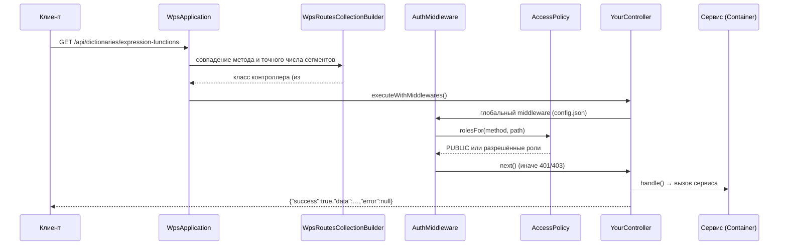

# Новый эндпоинт API

Как добавить REST-эндпоинт — на проверенном примере `GET /api/dictionaries/expression-functions`.

<!-- lang-switch -->
[🇬🇧 English](../../../en/07-developer-guide/extending/new-api-endpoint.md) | 🇷🇺 Русский
<!-- /lang-switch -->

## 1. Когда это нужно

Когда UI или внешней системе нужны данные или операция, которых API пока не даёт: новый справочник, отчёт,
административная операция. Эндпоинты тонкие — бизнес-логика живёт в сервисе в `back/src/Services/`.

## 2. Как это устроено



- **Обнаружение.** SwooleApp сканирует пространство имён `Wps\Controllers` из `back/config/config.json` (включая
  вложенные) и регистрирует каждый класс с атрибутом `#[Route(uri: …, method: …)]`. Никакой список править не нужно.
- **Сопоставление.** `WpsRoutesCollectionBuilder` требует того же числа сегментов URI, что и в шаблоне; `{id}` совпадает
  с одним непустым сегментом и доступен как `$this->intParam('id')` / `$this->param('id')`. Завершающий слэш допускается.
- **Доступ.** `Wps\Middleware\AuthMiddleware` (глобальный) проверяет JWT и спрашивает `Wps\Auth\AccessPolicy::rolesFor()`.
  Правила — регулярные выражения, проверяются по порядку; для всего, что не указано: `GET /api/*` → все
  аутентифицированные роли, остальные методы → `admin` и `editor`.
- **Ответ.** `BaseController::execute()` оборачивает `handle()`: `ApiException` → конверт ошибки с её статусом и кодом;
  любое другое исключение → `500 INTERNAL_ERROR` (текст сообщения — только при `APP_DEBUG=true`).

## 3. Пошагово

### 3.1 Контроллер — `back/src/Controllers/Dictionaries/ExpressionFunctionsController.php`

```php
<?php

declare(strict_types=1);

namespace Wps\Controllers\Dictionaries;

use Sidalex\SwooleApp\Classes\Controllers\Route;
use Swoole\Http\Response;
use Wps\Controllers\BaseController;

/**
 * Names of the functions available in "calculate" expressions (for the UI help).
 */
#[Route(uri: '/api/dictionaries/expression-functions', method: 'GET')]
final class ExpressionFunctionsController extends BaseController
{
    protected function handle(): Response
    {
        $names = $this->container()->expressions()->functionNames();
        sort($names);
        return $this->ok(array_map(static fn (string $name) => ['value' => $name, 'label' => $name], $names));
    }
}
```

### 3.2 Пересборка и вызов

```bash
docker compose up -d --build backend
TOKEN=$(curl -s -X POST http://localhost:9501/api/auth/login -H 'Content-Type: application/json' \
  -d '{"email":"admin@wps.local","password":"admin"}' | python3 -c 'import sys,json;print(json.load(sys.stdin)["data"]["access_token"])')
curl -s http://localhost:9501/api/dictionaries/expression-functions -H "Authorization: Bearer $TOKEN"
```

Проверенный ответ (с функцией `coalesce` из [Функций выражений](expression-functions.md)):

```json
{"success":true,"data":[{"value":"abs","label":"abs"},{"value":"coalesce","label":"coalesce"},{"value":"concat","label":"concat"},{"value":"len","label":"len"},{"value":"lower","label":"lower"},{"value":"max","label":"max"},{"value":"min","label":"min"},{"value":"round","label":"round"},{"value":"substr","label":"substr"},{"value":"trim","label":"trim"},{"value":"upper","label":"upper"}],"error":null}
```

### 3.3 Инструменты `BaseController`

| Метод | Назначение |
|---|---|
| `$this->body()` | JSON-тело как массив (`400 BAD_REQUEST`, если это не объект) |
| `$this->query('key', default)`, `queryBool('key')` | строка запроса |
| `[$page, $perPage] = $this->pagination(20, 1000)` + `$this->meta($page, $perPage, $total)` | постраничный вывод; meta передаётся третьим аргументом `ok()` |
| `$this->intParam('id')`, `$this->param('name')` | параметры URI (`404 NOT_FOUND` для нечислового id) |
| `$this->user()` | `{id, email, role}` вызывающего |
| `$this->ok($data, 201)` | конверт успеха со статусом |
| `$this->container()` | сервисы (`processService()`, `executions()`, `crm()`, `metrics()`, …) |

Пример эндпоинта на запись:

```php
#[Route(uri: '/api/processes/{id}/archive', method: 'POST')]
final class ArchiveProcessController extends BaseController
{
    protected function handle(): Response
    {
        $process = $this->container()->processService()->get($this->intParam('id')); // 404 PROCESS_NOT_FOUND
        // … call a service method that does the work …
        return $this->ok(['archived' => true, 'id' => $process->id]);
    }
}
```

(`archive` — только иллюстрация, такого метода сервиса в WPS нет.)

## 4. Валидация и ошибки

- Бросайте `ApiException::validation([['field' => 'name', 'message' => '…']])` → `422 VALIDATION_ERROR`,
  `ApiException::notFound('XXX_NOT_FOUND', '…')`, `ApiException::conflict('XXX', '…', $details)`,
  `ApiException::badRequest('…')`, `ApiException::forbidden()`.
- Добавьте правило в `AccessPolicy::RULES`, если поведение по умолчанию (GET — всем, запись — редакторам) не подходит.
  Конкретные правила ставьте **перед** общими — побеждает первое совпадение:

```php
['POST', '#^/api/processes/[^/]+/archive$#', self::ADMIN],
```

- Публичные эндпоинты (без токена) нужно перечислить с `self::PUBLIC`, как `/api/health` и `/metrics`.
- Опишите эндпоинт (метод, URI, роль, тело, ответ, коды ошибок) в `back/API.md` и в
  [Эндпоинтах API](../../06-api-reference/endpoints.md) (en + ru).

## 5. UI и переводы

Добавьте функцию в подходящий модуль `front/src/api/` (или в новый модуль), а типы — в `front/src/types/index.ts`:

```ts
// front/src/api/reference.ts
import { apiGet } from './client'
import type { DictionaryItem } from '@/types'

export const referenceApi = {
  /** Functions available in "calculate" expressions */
  expressionFunctions(): Promise<DictionaryItem[]> {
    return apiGet<DictionaryItem[]>('/dictionaries/expression-functions')
  },
}
```

`apiGet` добавляет префикс `/api`, отправляет токен, разворачивает `data` и показывает переведённые сообщения для
известных кодов ошибок (`front/src/utils/errors.ts`). Текст для нового кода ошибки добавьте туда и в обе локали
(`errors.*`). Страница, использующая эндпоинт, разобрана в примере [Новый экран UI](new-ui-screen.md).

## 6. Тест

```php
$this->test('Expression functions dictionary lists coalesce', function () {
    $res = $this->request('GET', '/api/dictionaries/expression-functions', token: $this->viewerToken, expectedStatus: 200);
    $this->assertTrue(in_array('coalesce', array_column($res['data'], 'value'), true));
});
$this->test('Expression functions dictionary requires a token', function () {
    $this->request('GET', '/api/dictionaries/expression-functions', expectedStatus: 401);
});
```

Первая проверка входит в проверенную группу `testExtensions()` ([полный текст](new-action-type.md#6-тест)). Для
эндпоинтов на запись проверьте также `viewer` → `403`.

## 7. Чек-лист готовности

- [ ] `final`-контроллер в `back/src/Controllers/<Area>/`, `#[Route]`, наследует `BaseController`, логика — в сервисе
- [ ] Правило доступа в `AccessPolicy`, если поведение по умолчанию не подходит
- [ ] Ошибки через `ApiException` с документированными кодами
- [ ] Обновлены `back/API.md` и [Эндпоинты API](../../06-api-reference/endpoints.md) (en + ru)
- [ ] Функция API и типы во фронтенде (+ тексты `errors.*` для новых кодов)
- [ ] Интеграционные проверки (успех, 401, 403), тесты зелёные

<!-- footer-nav -->
---

← Назад: [Функции выражений](expression-functions.md) | [Оглавление](../../README.md) | [Новый адаптер CRM](new-crm-adapter.md) Далее →
<!-- /footer-nav -->
