# Новый тип блока

Как добавить управляющую конструкцию с вложенными списками действий — на примере устройства встроенного блока
`condition` («Условие (если / иначе)») и учебного блока `unless` («Если не»).

<!-- lang-switch -->
[🇬🇧 English](../../../en/07-developer-guide/extending/new-block-type.md) | 🇷🇺 Русский
<!-- /lang-switch -->

## 1. Когда это нужно

Действие (`ActionHandlerInterface`, см. [Новый тип действия](new-action-type.md)) — это один шаг: выполнился и
передал управление следующему. **Блок** нужен, когда конструкция управляет порядком выполнения: содержит вложенные
списки действий (ветки, тело цикла), выбирает, какой из них выполнить, или завершает процесс. Встроенные блоки
(`back/src/Program/Blocks/`):

| Блок | Класс | Во что компилируется |
|---|---|---|
| `condition` — если / иначе-если / иначе | `ConditionBlock` | `branch` + тела веток, каждое с `jump` в конец, + тело `else` |
| `stop_process` — досрочное завершение | `StopProcessBlock` | одна инструкция `halt` |
| `foreach` — цикл по списку | `ForeachBlock` | `loop_begin` / тело / `loop_next`; выполняет `Wps\Program\LoopRunner` |

## 2. Как это устроено

Определение процесса — дерево. Перед выполнением `ProgramCompiler` превращает его в **плоскую программу** —
список инструкций с переходами; курсор выполнения — номер инструкции `pc` (см.
[Движок выполнения → Программа и инструкции](../../05-architecture/execution-engine.md#программа-и-инструкции)).
Блок отвечает за две вещи: как **скомпилировать** себя в инструкции и как **проверить** свою конфигурацию при
сохранении процесса. Выполняет инструкции `Interpreter` — блок во время выполнения не вызывается.

```mermaid
classDiagram
    class BlockTypeInterface {
        <<interface>>
        +type() string
        +label() string
        +description() string
        +compile(array config, string path, ProgramEmitter) void
        +validate(array config, DefinitionScope, string path, BlockValidationContext) void
    }
    class ProgramEmitter {
        +emit(op, config, path, ?stepId) int
        +patch(pc, key, target) void
        +nextPc() int
        +compileList(actions, pathPrefix, ?owner, topLevelOffset) void
        +stepId(row)$ ?string
    }
    class BlockValidationContext {
        +validateList(actions, scope, path) void
        +validateConditions(conditions, scope, path) void
    }
    BlockTypeInterface <|.. ConditionBlock
    BlockTypeInterface <|.. UnlessBlock
    BlockTypeRegistry o-- BlockTypeInterface
    ProgramCompiler --> BlockTypeRegistry
    ProgramCompiler --> ProgramEmitter
    ProcessValidatorService --> BlockTypeRegistry
    Interpreter --> Instruction
```



Интерфейс `Wps\Program\BlockTypeInterface`:

| Метод | Назначение |
|---|---|
| `type(): string` | значение поля `type` элемента `actions` (`"condition"`) |
| `label(): string`, `description(): string` | подпись и описание для `GET /api/dictionaries/action-types` (там у блока `"kind": "block"`) |
| `compile(array $config, string $path, ProgramEmitter $emitter): void` | выпустить инструкции блока |
| `validate(array $config, DefinitionScope $scope, string $path, BlockValidationContext $context): void` | проверить блок при сохранении |

- **Конфликт имён.** Тип не может одновременно быть и действием, и блоком: `Container::blocks()` при первом обращении
  бросает `LogicException` (`"x" is registered both as an action and as a block`). Реестр — `BlockTypeRegistry`:
  `register()`, `has(mixed)`, `get()`, `dictionary()`.
- **Компиляция** — через `ProgramEmitter`:
  - `emit(string $op, array $config, string $path, ?string $stepId = null): int` — добавить инструкцию, вернуть её
    `pc`; `$stepId` (из `ProgramEmitter::stepId($config)`) делает блок целью `goto` у `on_error`;
  - `nextPc(): int` — `pc` следующей инструкции (цель перехода «сюда»);
  - `patch(int $pc, string $key, int $target): void` — проставить цель перехода, когда она стала известна
    (backpatching; `$key` — путь через точку внутри `config`: `"target"`, `"branches.0.target"`);
  - `compileList(array $actions, string $pathPrefix, ?int $owner = null, int $topLevelOffset = 0): void` — скомпилировать
    вложенный список; `$owner` — `pc` инструкции блока (по нему движок решает, какие шаги пометить `skipped` при ошибке,
    и строит иерархию в аудите). Глубина вложенности проверяется здесь (`PROGRAM_MAX_DEPTH`).
- **Инструкции** (`Wps\Program\Instruction`):

  | `op` | `config` | Что делает `Interpreter` | Запись в аудите |
  |---|---|---|---|
  | `action` | конфигурация шага | `ActionHandlerRegistry` + повторы, затем `pc + 1` | да |
  | `branch` | `{type, branches: [{conditions, target, name?}], else_target, end_target, has_else, on_error?}` | первая ветка с выполненными условиями → её `target`, иначе `else_target`; `result_data.selected` = номер ветки / `else` / `none` | да |
  | `jump` | `{target}` | безусловный переход | нет |
  | `jump_if_false` | `{conditions, target}` | условия не выполнены → `target`, иначе `pc + 1` (встроенные блоки его не используют) | нет |
  | `halt` | `{type, status, message?, code?}` | завершает выполнение | да |
  | `loop_begin` / `loop_next` | см. `ForeachBlock` | цикл через `LoopRunner` | `loop_begin` |

  `action_type` записи аудита — поле `type` из `config` инструкции (`Instruction::auditType()`), поэтому кладите туда
  `type` блока. Новый `op` требует ветки в `Interpreter::step()` (и, возможно, в движке) — обходитесь существующими.
- **Ошибки в блоке.** Строка условия с ошибкой приведения делает инструкцию `branch` `failed`. Если у блока задан
  `on_error: "continue"`, движок продолжает с `end_target` (`ExecutionEngineService`), поэтому `end_target` должен
  указывать сразу за блок. Общие поля шага (`id`, `name`, `on_error`, `retry`) и глубину проверяет сам
  `ProcessValidatorService`; передавайте `on_error` в `config` инструкции, как `ConditionBlock`.
- **Валидация.** `validate()` проверяет поля блока, а вложенные списки и условия отдаёт обратно валидатору через
  `BlockValidationContext` (`validateList()` — на уровень глубже, `validateConditions()` — те же правила, что у
  условий запуска).
- **Видимость переменных.** Каждую ветку проверяйте в своей копии области: `$fork = $scope->fork()`. После веток —
  `$scope->mergeBranches($forks, exhaustive: …)`: переменная, объявленная во всех ветках исчерпывающего блока,
  остаётся объявленной; объявленная не везде становится `conditional` — чтение разрешено, но сохранение вернёт
  предупреждение в `warnings`. Ошибки, предупреждения, `id` шагов и ссылки на ведомые процессы у копий общие.
  Тело, которое может не выполниться (цикл, `unless`), — одна копия с `exhaustive: false`; переменные, видимые только
  внутри блока (элемент цикла), объявите в копии и снимите `$fork->undeclare($name)` перед `mergeBranches()` — так
  делает `ForeachBlock`.

## 3. Пример: как устроен `condition`

`back/src/Program/Blocks/ConditionBlock.php`, компиляция:

```php
public function compile(array $config, string $path, ProgramEmitter $emitter): void
{
    $branches = array_values(is_array($config['branches'] ?? null) ? $config['branches'] : []);
    $hasElse = array_key_exists('else', $config) && is_array($config['else']);
    $branchPc = $emitter->emit(Instruction::BRANCH, [
        'type' => $this->type(),
        'branches' => array_map(static fn ($b) => ['conditions' => is_array($b['conditions'] ?? null) ? $b['conditions'] : [], 'target' => -1]
            + (isset($b['name']) && is_string($b['name']) ? ['name' => $b['name']] : []), $branches),
        'else_target' => -1,
        'end_target' => -1,
        'has_else' => $hasElse,
    ] + (isset($config['on_error']) ? ['on_error' => $config['on_error']] : []), $path, ProgramEmitter::stepId($config));

    $jumps = [];
    foreach ($branches as $i => $branch) {
        $emitter->patch($branchPc, "branches.{$i}.target", $emitter->nextPc());
        $emitter->compileList(is_array($branch['actions'] ?? null) ? $branch['actions'] : [], "{$path}.branches[{$i}].actions", $branchPc);
        $jumps[] = $emitter->emit(Instruction::JUMP, ['target' => -1], "{$path}.branches[{$i}]");
    }
    $emitter->patch($branchPc, 'else_target', $emitter->nextPc());
    if ($hasElse) {
        $emitter->compileList($config['else'], "{$path}.else", $branchPc);
    }
    $end = $emitter->nextPc();
    $emitter->patch($branchPc, 'end_target', $end);
    foreach ($jumps as $jump) {
        $emitter->patch($jump, 'target', $end);
    }
}
```

Валидация (сокращённо; полная версия ещё проверяет `name` веток, число веток ≤ 20 и предупреждает о недостижимых
ветках):

```php
public function validate(array $config, DefinitionScope $scope, string $path, BlockValidationContext $context): void
{
    $forks = [];
    $hasElse = isset($config['else']) && is_array($config['else']) && array_is_list($config['else']);
    foreach ($config['branches'] ?? [] as $i => $branch) {
        // conditions see the scope before the block: branches exclude each other
        $context->validateConditions($branch['conditions'] ?? [], $scope, "{$path}.branches[{$i}].conditions");
        $fork = $scope->fork();
        $context->validateList($branch['actions'] ?? [], $fork, "{$path}.branches[{$i}].actions");
        $forks[] = $fork;
    }
    if ($hasElse) {
        $fork = $scope->fork();
        $context->validateList($config['else'], $fork, "{$path}.else");
        $forks[] = $fork;
    }
    $scope->mergeBranches($forks, exhaustive: $hasElse /* || a branch without conditions */);
}
```

## 4. Пошагово: блок `unless`

Учебный блок «Если не» выполняет вложенные действия, только если условия **не** выполнены:

```json
{ "type": "unless", "id": "no_phone",
  "conditions": [ { "field": "object.phone", "operator": "is_not_empty" } ],
  "actions": [ { "type": "modify", "target": "object.description", "change_type": "set_value", "value": "Нет телефона" } ] }
```

Он обходится существующими инструкциями: одна `branch`, у которой единственная ветка с условиями перепрыгивает тело,
а «иначе» — само тело. Так блок получает запись в аудите с трассой условий бесплатно.

| Файл | Что сделать |
|---|---|
| `back/src/Program/Blocks/UnlessBlock.php` | **новый** — класс блока |
| `back/src/Kernel/Container.php` | регистрация в `blocks()` |
| `back/tests/Unit/Program/UnlessBlockTest.php` | **новый** — компиляция, выполнение, валидация |
| `back/tests/IntegrationTest.php` | блок `[unless]` |
| `front/src/views/ProcessDetailView.vue`, `front/src/locales/*.json` | (по желанию) подпись типа |
| `doc/{ru,en}/03-user-guide/actions.md`, `back/API.md` | описание блока |

### 4.1 Класс — `back/src/Program/Blocks/UnlessBlock.php`

```php
<?php

declare(strict_types=1);

namespace Wps\Program\Blocks;

use Wps\Program\BlockTypeInterface;
use Wps\Program\BlockValidationContext;
use Wps\Program\Instruction;
use Wps\Program\ProgramEmitter;
use Wps\Services\Validation\DefinitionScope;

/**
 * "Если не": runs the actions only when the conditions are NOT met.
 *
 *   { "type": "unless", "id": "no_phone", "conditions": [...], "actions": [...] }
 *
 * Compiled into one "branch" instruction (one audit record with the condition trace): the only branch carries the
 * conditions and jumps over the body, "else" is the body.
 */
final class UnlessBlock implements BlockTypeInterface
{
    public function type(): string
    {
        return 'unless';
    }

    public function label(): string
    {
        return 'Если не';
    }

    public function description(): string
    {
        return 'Выполняет вложенные действия, только если условия НЕ выполнены';
    }

    public function compile(array $config, string $path, ProgramEmitter $emitter): void
    {
        $branchPc = $emitter->emit(Instruction::BRANCH, [
            'type' => $this->type(),
            'branches' => [['conditions' => is_array($config['conditions'] ?? null) ? $config['conditions'] : [], 'target' => -1]],
            'else_target' => -1,
            'end_target' => -1,
            'has_else' => true,
        ] + (isset($config['on_error']) ? ['on_error' => $config['on_error']] : []), $path, ProgramEmitter::stepId($config));

        // conditions not met → "else" = the body that follows the instruction
        $emitter->patch($branchPc, 'else_target', $emitter->nextPc());
        $emitter->compileList(is_array($config['actions'] ?? null) ? $config['actions'] : [], "{$path}.actions", $branchPc);
        // conditions met → jump over the body; on_error of the block also continues here
        $end = $emitter->nextPc();
        $emitter->patch($branchPc, 'branches.0.target', $end);
        $emitter->patch($branchPc, 'end_target', $end);
    }

    public function validate(array $config, DefinitionScope $scope, string $path, BlockValidationContext $context): void
    {
        $conditions = $config['conditions'] ?? null;
        if (!is_array($conditions) || $conditions === []) {
            $scope->error("{$path}.conditions", 'At least one condition is required');
        } else {
            $context->validateConditions($conditions, $scope, "{$path}.conditions");
        }
        $actions = $config['actions'] ?? null;
        if (!is_array($actions) || !array_is_list($actions)) {
            $scope->error("{$path}.actions", 'Must be an array');
            $actions = [];
        }
        // the body may not run: what it declares is "conditional" after the block
        $fork = $scope->fork();
        $context->validateList($actions, $fork, "{$path}.actions");
        $scope->mergeBranches([$fork], exhaustive: false);
    }
}
```

Программа для примера выше (два элемента верхнего уровня: `unless` и `save_object`):

| `pc` | `op` | `path` | Переходы |
|---|---|---|---|
| 0 | `branch` (`type: unless`) | `actions[0]` | ветка 0 (телефон есть) → 2, `else_target` → 1, `end_target` → 2 |
| 1 | `action` (`modify`) | `actions[0].actions[0]` | `parent` = 0 |
| 2 | `action` (`save_object`) | `actions[1]` | |

### 4.2 Регистрация — `back/src/Kernel/Container.php`

```php
use Wps\Program\Blocks\UnlessBlock;

public function blocks(): BlockTypeRegistry
{
    return $this->share(BlockTypeRegistry::class, function () {
        $registry = new BlockTypeRegistry();
        $registry->register(new ConditionBlock());
        $registry->register(new StopProcessBlock($this->templates()));
        $registry->register(new ForeachBlock($this->expressions(), $this->config()->loopMaxItems));
        $registry->register(new UnlessBlock());                   // new block
        foreach (array_column($registry->dictionary(), 'value') as $type) {
            if ($this->actions()->has($type)) {
                throw new \LogicException("\"{$type}\" is registered both as an action and as a block");
            }
        }
        return $registry;
    });
}
```

После пересборки (`docker compose up -d --build backend`) блок появится в `GET /api/dictionaries/action-types` с
`"kind": "block"`. Тот же реестр получают `ProgramCompiler` и `ProcessValidatorService` — больше ничего
регистрировать не нужно.

### 4.3 Что увидит автор процесса

- Запись аудита блока: `action_type: "unless"`, `step_path: "actions[0]"`, в `request_data` —
  `{branches: 1, has_else: true}`, в `result_data` — `selected: 0` (условия выполнены, тело пропущено) или
  `selected: "else"` (тело выполнено) и `branches[0].conditions` — трасса строк условия.
- Шаги тела получают `step_path` `actions[0].actions[N]`; если тело пропущено, записей о нём нет.
- Если блок задан с `"on_error": "continue"` и строка условия падает с ошибкой приведения, выполнение продолжается
  после блока.

## 5. Правила

- Компиляция **детерминирована**: одно и то же определение → одна и та же программа (не зависеть от времени,
  случайности, порядка обхода хешей). Хеш программы сохраняется в выполнении (`program_hash`); если после обновления
  он изменится, прерванные и ожидающие выполнения не продолжаются, а завершаются `failed`
  (`Program changed after an upgrade; the execution cannot be resumed safely`).
  Меняйте порядок эмиссии инструкций осторожно.
- Всё, что нужно для выполнения, кладите в `config` инструкции: интерпретатор не видит исходного дерева.
- Каждый `-1` должен быть заменён `patch()`; переход назад допустим только внутри собственного цикла.
- Неизвестный `type` во вложенном списке компилируется как `action`, его отвергает валидатор (`Unknown action type`).
- Блок без состояния: один экземпляр на воркер компилирует программы для всех корутин.
- Не держите долгие операции в блоке: ожидания — через действия (`ActionResult::wait()`), см.
  [Новый тип действия](new-action-type.md#ждущее-действие-парковка).

## 6. Тест

### 6.1 Юнит-тест — `back/tests/Unit/Program/UnlessBlockTest.php`

По образцу `ProgramCompilerTest` (компиляция), `InterpreterTest` (выполнение с фейковым исполнителем действий) и
`ConditionBlockTest` (валидация с заглушками `BlockValidationContext`).

```php
<?php

declare(strict_types=1);

namespace Wps\Tests\Unit\Program;

use PHPUnit\Framework\TestCase;
use Wps\Comparators\ComparatorRegistry;
use Wps\Context\ExecutionContext;
use Wps\Persistence\Process;
use Wps\Program\BlockTypeRegistry;
use Wps\Program\BlockValidationContext;
use Wps\Program\Blocks\ConditionBlock;
use Wps\Program\Blocks\UnlessBlock;
use Wps\Program\Instruction;
use Wps\Program\Interpreter;
use Wps\Program\Program;
use Wps\Program\ProgramCompiler;
use Wps\Services\ConditionEngineService;
use Wps\Services\StepRecord;
use Wps\Services\Validation\DefinitionScope;

final class UnlessBlockTest extends TestCase
{
    private static function program(): Program
    {
        $blocks = new BlockTypeRegistry();
        $blocks->register(new ConditionBlock());
        $blocks->register(new UnlessBlock());
        return (new ProgramCompiler($blocks, 5))->compile(Process::normalizeDefinition(['actions' => [
            ['type' => 'unless', 'id' => 'no_phone', 'conditions' => [['field' => 'object.phone', 'operator' => 'is_not_empty']],
                'actions' => [['type' => 'modify', 'target' => 'object.note', 'change_type' => 'set_value', 'value' => 'no phone']]],
            ['type' => 'save_object', 'target' => 'object'],
        ]]));
    }

    public function testCompile(): void
    {
        $program = self::program();
        self::assertSame(3, $program->count());
        $branch = $program->at(0);
        self::assertSame(Instruction::BRANCH, $branch->op);
        self::assertSame('unless', $branch->config['type']);
        self::assertSame(1, $branch->config['else_target'], 'conditions not met → the body');
        self::assertSame(2, $branch->config['branches'][0]['target'], 'conditions met → after the body');
        self::assertSame(2, $branch->config['end_target']);
        self::assertSame('actions[0].actions[0]', $program->at(1)->path);
        self::assertSame(0, $program->at(1)->parent);
        self::assertSame(0, $program->pcOf('no_phone'));
    }

    /**
     * The interpreter loop as the engine runs it (like InterpreterTest), with a fake action executor.
     *
     * @return array{0: list<string>, 1: list<StepRecord>}
     */
    private static function execute(array $object): array
    {
        $executed = [];
        $interpreter = new Interpreter(
            new ConditionEngineService(ComparatorRegistry::default()),
            static function (Instruction $i, int $pc, int $seq, ExecutionContext $ctx, mixed $owner) use (&$executed): StepRecord {
                $executed[] = $i->path;
                return new StepRecord($seq, (string)$i->config['type'], 'success', 1, microtime(true), 0, pc: $pc, path: $i->path);
            },
        );
        $program = self::program();
        $context = ExecutionContext::fromEvent('e', $object + ['id' => '1'], 'Leads');
        $records = [];
        for ($pc = 0, $seq = 0; $pc < $program->count(); $pc = $outcome->nextPc) {
            $outcome = $interpreter->step($program->at($pc), $pc, $seq, $context);
            if ($outcome->record !== null) {
                $records[] = $outcome->record;
                $seq++;
            }
        }
        return [$executed, $records];
    }

    public function testRun(): void
    {
        [$executed, $records] = self::execute(['phone' => '']);
        self::assertSame(['actions[0].actions[0]', 'actions[1]'], $executed, 'no phone → the body runs');
        self::assertSame('unless', $records[0]->actionType);
        self::assertSame('else', $records[0]->result['selected']);

        [$executed, $records] = self::execute(['phone' => '+7999']);
        self::assertSame(['actions[1]'], $executed, 'a phone → the body is skipped');
        self::assertSame(0, $records[0]->result['selected']);
    }

    public function testValidate(): void
    {
        $scope = new DefinitionScope();
        $context = new BlockValidationContext(
            static function (array $list, DefinitionScope $s, string $p): void {
                foreach ($list as $i => $row) {
                    $s->checkWritePath($row['target'] ?? null, "{$p}[{$i}].target");
                }
            },
            static function (array $conditions, DefinitionScope $s, string $p): void {
                foreach ($conditions as $i => $row) {
                    $s->checkReadPath($row['field'] ?? null, "{$p}[{$i}].field");
                }
            },
        );
        $block = new UnlessBlock();
        $block->validate(['conditions' => [], 'actions' => 'x'], $scope, 'definition.actions[0]', $context);
        $block->validate(['conditions' => [['field' => 'object.phone']], 'actions' => [['target' => 'calc.flag']]], $scope, 'definition.actions[1]', $context);

        self::assertSame([
            'definition.actions[0].conditions' => 'At least one condition is required',
            'definition.actions[0].actions' => 'Must be an array',
        ], array_column($scope->errors(), 'message', 'field'));
        self::assertSame(DefinitionScope::CONDITIONAL, $scope->kind('calc'), 'the body may not run');
    }
}
```

Класс и тест прогнаны на текущем коде (`OK`). `run()` — финальный метод `TestCase`, поэтому вспомогательный метод
назван `execute()`. Другие образцы: `ForeachTest` (циклы с хранилищем снимков в памяти), `DefinitionScopeTest`
(области видимости), `StopProcessTest`. Запуск — [Тестирование](../testing.md#юнит-тесты-бэкенда).

### 6.2 Интеграционный тест — `back/tests/IntegrationTest.php`

По образцу группы `[program blocks]` (`testProgramBlocks()`); вызов `$this->testUnlessBlock();` добавьте в `run()`.

```php
private function testUnlessBlock(): void
{
    echo "[unless]\n";
    $this->test('unless runs its body only when the conditions are not met', function () {
        $types = array_column($this->request('GET', '/api/dictionaries/action-types', token: $this->viewerToken)['data'], 'kind', 'value');
        $this->assertEquals('block', $types['unless'] ?? null);
        $process = $this->request('POST', '/api/processes', ['name' => 'TEST unless', 'object_type' => 'TestUnless', 'is_child' => false, 'definition' => ['actions' => [
            ['type' => 'unless', 'id' => 'no_phone', 'conditions' => [['field' => 'object.phone', 'operator' => 'is_not_empty']],
                'actions' => [['type' => 'modify', 'target' => 'object.note', 'change_type' => 'set_value', 'value' => 'no phone']]],
        ]]], $this->adminToken, 201)['data'];
        foreach (['' => 'no phone', '+7999' => null] as $phone => $note) {
            $run = $this->request('POST', "/api/processes/{$process['id']}/run", ['object' => ['id' => 'u' . random_int(1000, 9999), 'module' => 'TestUnless', 'phone' => $phone]], $this->editorToken, 201)['data'];
            $e = $this->waitForExecution($run['execution_id']);
            $this->assertEquals('completed', $e['status']);
            $this->assertEquals('unless', $e['actions'][0]['action_type']);
            $this->assertEquals($note === null ? 0 : 'else', $e['actions'][0]['result_data']['selected']);
            $this->assertEquals($note, $e['context']['variables']['object']['note'] ?? null);
        }
        $bad = $this->request('POST', '/api/processes', ['name' => 'TEST unless bad', 'object_type' => 'TestUnless', 'is_child' => false, 'definition' => ['actions' => [
            ['type' => 'unless', 'actions' => []],
        ]]], $this->adminToken, 422);
        $d = array_column($bad['error']['details'], 'message', 'field');
        $this->assertEquals('At least one condition is required', $d['definition.actions[0].conditions'] ?? null);
        $this->request('DELETE', "/api/processes/{$process['id']}", token: $this->adminToken);
    });
}
```

## 7. Типичные ошибки

| Ошибка | Последствие | Как правильно |
|---|---|---|
| Цель перехода осталась `-1` | переход на `pc = -1`, выполнение ломается | `patch()` для каждого `target`, юнит-тест на цели |
| `compileList()` без `$owner` | вложенные шаги считаются верхним уровнем: неверные `skipped` при ошибке и `topLevel` | передавать `pc` инструкции блока |
| В `config` инструкции нет `type` | `action_type` в аудите = `branch` | `'type' => $this->type()` |
| `end_target` не за блоком | `on_error: "continue"` продолжает не оттуда | `end_target` = `nextPc()` после всего тела |
| Ветка проверяется в общей `$scope` | переменная из необязательной ветки считается объявленной везде | `fork()` + `mergeBranches()` |
| Порядок эмиссии изменён в обновлении | `program_hash` меняется, прерванные и ожидающие выполнения завершаются `failed` | менять только с пониманием последствий; дождаться завершения ожидающих выполнений |
| Тип совпадает с типом действия | `LogicException` при старте | уникальный `type()` |

## 8. Чек-лист готовности

- [ ] Класс в `back/src/Program/Blocks/`, `final`, `declare(strict_types=1)`, реализует `BlockTypeInterface`, уникальный `type()`
- [ ] Зарегистрирован в `Container::blocks()`, не конфликтует с типами действий
- [ ] Цели всех переходов проставлены через `patch()`, вложенные списки скомпилированы с `$ownerPc`, `type` и `on_error` в `config` инструкции
- [ ] Валидация вложенных списков через `BlockValidationContext`, ветки — через `fork()` / `mergeBranches()`
- [ ] Юнит-тесты (компиляция, выполнение, валидация) и интеграционный блок (вызов в `run()`) зелёные
- [ ] Блок описан в [Действиях](../../03-user-guide/actions.md) (en + ru) и в `back/API.md`

<!-- footer-nav -->
---

← Назад: [Новый тип действия](new-action-type.md) | [Оглавление](../../README.md) | [Новый оператор сравнения](new-comparator.md) Далее →
<!-- /footer-nav -->
