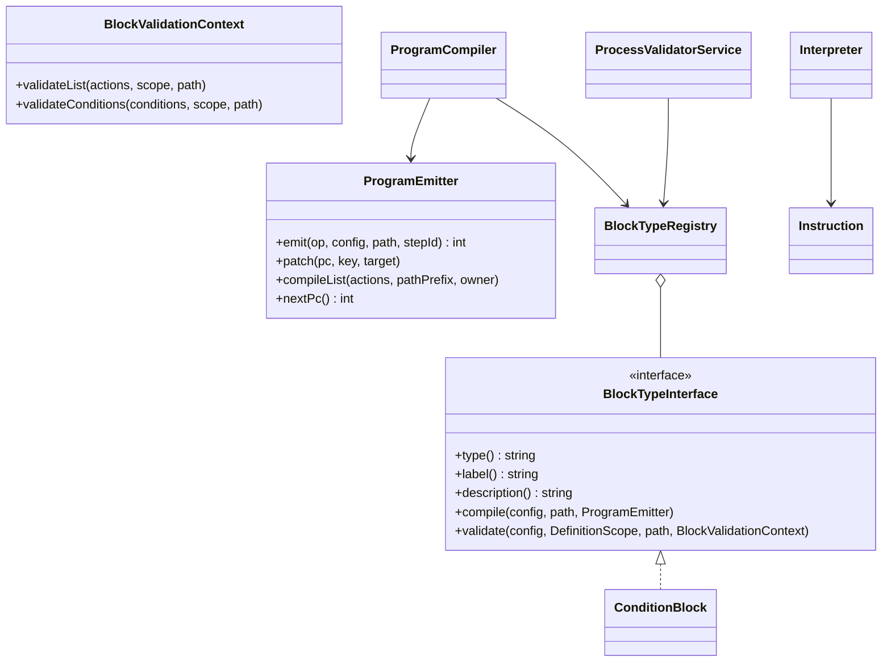

# Новый тип блока

Как добавить управляющую конструкцию с вложенными списками действий — на примере устройства встроенного блока
`condition` («Условие (если / иначе)»).

<!-- lang-switch -->
[🇬🇧 English](../../../en/07-developer-guide/extending/new-block-type.md) | 🇷🇺 Русский
<!-- /lang-switch -->

## 1. Когда это нужно

Действие (`ActionHandlerInterface`, см. [Новый тип действия](new-action-type.md)) — это один шаг: выполнился и
передал управление следующему. **Блок** нужен, когда конструкция управляет порядком выполнения: содержит вложенные
списки действий (ветки, тело цикла), выбирает, какой из них выполнить, или завершает процесс. Примеры: `condition`
(если / иначе), `stop_process` (досрочное завершение, `Wps\Program\Blocks\StopProcessBlock` — компилируется в одну
инструкцию `halt`) и `foreach` (цикл по списку, `Wps\Program\Blocks\ForeachBlock` — инструкции `loop_begin` /
`loop_next`, их выполняет `Wps\Program\LoopRunner`).

## 2. Как это устроено

Определение процесса — дерево. Перед выполнением `ProgramCompiler` превращает его в **плоскую программу** —
список инструкций с переходами; курсор выполнения — номер инструкции `pc` (см.
[Движок выполнения → Программа и инструкции](../../05-architecture/execution-engine.md#программа-и-инструкции)).
Блок отвечает за две вещи: как **скомпилировать** себя в инструкции и как **проверить** свою конфигурацию при
сохранении процесса.



- `type()` — значение поля `type` элемента `actions` (`"condition"`). Тип не может одновременно быть и действием, и
  блоком: `Container::blocks()` проверяет конфликт с `ActionHandlerRegistry` при первом обращении.
- **Компиляция.** `compile()` вызывает `ProgramEmitter`:
  - `emit($op, $config, $path, $stepId)` — добавить инструкцию, вернуть её `pc`;
  - `nextPc()` — `pc` следующей инструкции (цель перехода «сюда»);
  - `patch($pc, 'branches.0.target', $target)` — проставить цель перехода, когда она стала известна (backpatching);
  - `compileList($actions, "{$path}.body", $ownerPc)` — скомпилировать вложенный список; `$ownerPc` — `pc` инструкции
    блока (по нему движок решает, какие шаги пометить `skipped` при ошибке). Глубина вложенности проверяется здесь
    (`PROGRAM_MAX_DEPTH`).
- **Инструкции** (`Wps\Program\Instruction`): `action`, `branch`, `jump`, `jump_if_false`, `halt`, `loop_begin`,
  `loop_next`. Запись в аудит дают `action`, `branch`, `halt`, `loop_begin` (`Instruction::AUDITED`); `action_type`
  записи — поле `type` из `config` инструкции, поэтому кладите туда `type` блока. Новый `op` требует ветки в
  `Interpreter::step()` — обходитесь существующими, если возможно.
- **Валидация.** `validate()` проверяет поля блока, а вложенные списки и условия отдаёт обратно валидатору через
  `BlockValidationContext` (`validateList()` — на уровень глубже, `validateConditions()` — те же правила, что у
  условий запуска). Общие поля шага (`id`, `name`) и глубину проверяет сам `ProcessValidatorService`.
- **Видимость переменных.** Каждую ветку проверяйте в своей копии области: `$fork = $scope->fork()`. После веток —
  `$scope->mergeBranches($forks, exhaustive: …)`: переменная, объявленная во всех ветках исчерпывающего блока,
  остаётся объявленной; объявленная не везде становится `conditional` — чтение разрешено, но сохранение вернёт
  предупреждение в `warnings`. Ошибки, предупреждения, `id` шагов и ссылки на ведомые процессы у копий общие.
  Тело цикла — одна копия с `exhaustive: false` (цикл может не выполниться ни разу); переменные, видимые только
  внутри блока (элемент цикла), объявите в копии и снимите `$fork->undeclare($name)` перед `mergeBranches()` — так
  делает `ForeachBlock`.

## 3. Пример: как устроен `condition`

`back/src/Program/Blocks/ConditionBlock.php`, компиляция:

```php
public function compile(array $config, string $path, ProgramEmitter $emitter): void
{
    $branches = array_values($config['branches'] ?? []);
    $hasElse = isset($config['else']) && is_array($config['else']);
    $branchPc = $emitter->emit(Instruction::BRANCH, [
        'type' => $this->type(),
        'branches' => array_map(static fn ($b) => ['conditions' => $b['conditions'] ?? [], 'target' => -1], $branches),
        'else_target' => -1, 'end_target' => -1, 'has_else' => $hasElse,
    ], $path, ProgramEmitter::stepId($config));

    $jumps = [];
    foreach ($branches as $i => $branch) {
        $emitter->patch($branchPc, "branches.{$i}.target", $emitter->nextPc());
        $emitter->compileList($branch['actions'] ?? [], "{$path}.branches[{$i}].actions", $branchPc);
        $jumps[] = $emitter->emit(Instruction::JUMP, ['target' => -1], "{$path}.branches[{$i}]");
    }
    $emitter->patch($branchPc, 'else_target', $emitter->nextPc());
    if ($hasElse) {
        $emitter->compileList($config['else'], "{$path}.else", $branchPc);
    }
    $end = $emitter->nextPc();
    $emitter->patch($branchPc, 'end_target', $end);
    foreach ($jumps as $jump) {
        $emitter->patch($jump, 'target', $end);
    }
}
```

Валидация (сокращённо):

```php
public function validate(array $config, DefinitionScope $scope, string $path, BlockValidationContext $context): void
{
    $forks = [];
    foreach ($config['branches'] ?? [] as $i => $branch) {
        $context->validateConditions($branch['conditions'] ?? [], $scope, "{$path}.branches[{$i}].conditions");
        $fork = $scope->fork();
        $context->validateList($branch['actions'] ?? [], $fork, "{$path}.branches[{$i}].actions");
        $forks[] = $fork;
    }
    if (isset($config['else'])) {
        $fork = $scope->fork();
        $context->validateList($config['else'], $fork, "{$path}.else");
        $forks[] = $fork;
    }
    $scope->mergeBranches($forks, exhaustive: isset($config['else']));
}
```

## 4. Регистрация — `back/src/Kernel/Container.php`

```php
public function blocks(): BlockTypeRegistry
{
    return $this->share(BlockTypeRegistry::class, function () {
        $registry = new BlockTypeRegistry();
        $registry->register(new ConditionBlock());
        $registry->register(new MyBlock());               // новый блок
        // … проверка конфликта с ActionHandlerRegistry
        return $registry;
    });
}
```

После пересборки (`docker compose up -d --build backend`) блок появится в `GET /api/dictionaries/action-types` с
`"kind": "block"`.

## 5. Правила

- Компиляция **детерминирована**: одно и то же определение → одна и та же программа (не зависеть от времени, порядка
  ключей хешей и т. п.). Хеш программы сохраняется в выполнении (`program_hash`); если после обновления он
  изменится, незавершённые выполнения не будут восстановлены. Меняйте порядок эмиссии инструкций осторожно.
- Всё, что нужно для выполнения, кладите в `config` инструкции: интерпретатор не видит исходного дерева.
- Неизвестный `type` во вложенном списке компилируется как `action`, его отвергает валидатор (`Unknown action type`).

## 6. Тест

Юнит-тесты (`back/tests/Unit/Program/`, запуск — [Тестирование](../testing.md#юнит-тесты-бэкенда)):

- компиляция: последовательность `op`/`path`, цели переходов, пустые и вложенные списки (`ProgramCompilerTest`);
- выполнение веток с фейковым исполнителем действий (`InterpreterTest`); циклы — с хранилищем снимков в памяти
  (`ForeachTest`);
- области видимости (`DefinitionScopeTest`).

Интеграционные (`back/tests/IntegrationTest.php`, группа `[program blocks]`): ручной запуск процесса с блоком,
проверка записей аудита (`action_type`, `step_path`, `pc`, `result_data`).

## 7. Чек-лист готовности

- [ ] Класс в `back/src/Program/Blocks/`, `final`, реализует `BlockTypeInterface`, уникальный `type()`
- [ ] Зарегистрирован в `Container::blocks()`, не конфликтует с типами действий
- [ ] Цели всех переходов проставлены через `patch()`, вложенные списки скомпилированы с `$ownerPc`
- [ ] Валидация вложенных списков через `BlockValidationContext`, ветки — через `fork()` / `mergeBranches()`
- [ ] Юнит- и интеграционные тесты зелёные
- [ ] Блок описан в [Действиях](../../03-user-guide/actions.md) (en + ru) и в `back/API.md`

<!-- footer-nav -->
---

← Назад: [Новый тип действия](new-action-type.md) | [Оглавление](../../README.md) | [Новый оператор сравнения](new-comparator.md) Далее →
<!-- /footer-nav -->
