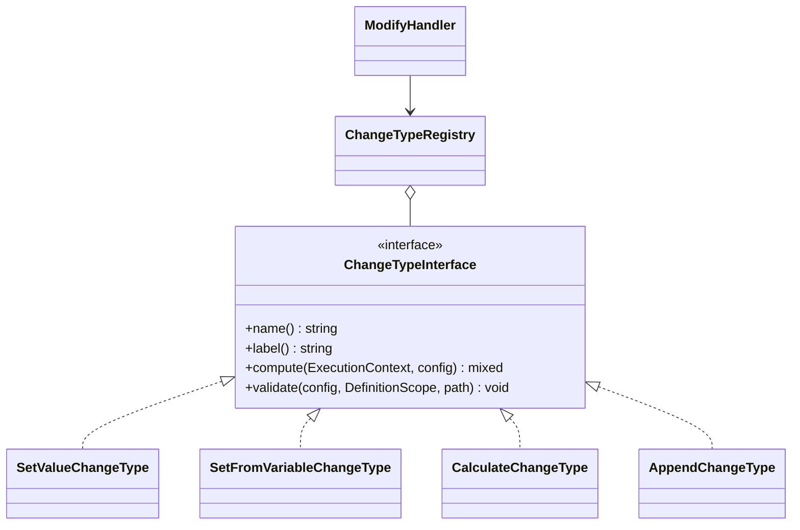

# Новый тип изменения

Как добавить способ вычисления нового значения в действии `modify` — на проверенном примере типа изменения `append` («Дописать к значению»).

<!-- lang-switch -->
[🇬🇧 English](../../../en/07-developer-guide/extending/new-change-type.md) | 🇷🇺 Русский
<!-- /lang-switch -->

## 1. Когда это нужно

Действие `modify` записывает значение в `object.<field>` или `<variable>.<field>`. Встроенные типы изменения:
`set_value` (введённое значение), `set_from_variable` (копия другого поля) и `calculate` (выражение). Новый тип
изменения нужен, когда значение получается логикой, которую неудобно записывать выражением: дописывание в список,
арифметика дат, таблица соответствий. Если в выражениях не хватает только функции, добавьте
[функцию выражений](expression-functions.md).

## 2. Как это устроено



- `ModifyHandler::execute()` берёт `change_type` из действия и вызывает `compute($context, $actionConfig)`, передавая
  в качестве конфигурации **всё действие modify** (`target`, `value`, `save_to_crm` и любые ваши дополнительные ключи).
  Затем читает старое значение, записывает новое через `$context->set($target, $new)` и кладёт `old_value`/`new_value`
  в аудит. При `save_to_crm: true` переменная сохраняется сразу после этого.
- `ModifyHandler::validate()` проверяет, что `change_type` зарегистрирован, вызывает ваш `validate()` **до** объявления
  цели (значение вычисляется раньше, чем записывается), затем проверяет `target`.
- Реестр заполняется в `Container::changeTypes()`; его список отдаёт `GET /api/dictionaries/change-types`.

## 3. Пошагово

### 3.1 Класс — `back/src/Actions/ChangeTypes/AppendChangeType.php`

```php
<?php

declare(strict_types=1);

namespace Wps\Actions\ChangeTypes;

use Wps\Comparators\ComparatorRegistry;
use Wps\Context\ExecutionContext;
use Wps\Services\Validation\DefinitionScope;

/**
 * "Дописать": appends the value to the current value of the target field,
 * separated by "separator" (default: a space). An empty field simply gets the value.
 */
final class AppendChangeType implements ChangeTypeInterface
{
    public function name(): string
    {
        return 'append';
    }

    public function label(): string
    {
        return 'Дописать к значению';
    }

    public function compute(ExecutionContext $context, array $config): mixed
    {
        $current = ComparatorRegistry::stringify($context->get((string)($config['target'] ?? '')));
        $value = ComparatorRegistry::stringify($config['value'] ?? '');
        if ($current === '') {
            return $value;
        }
        $separator = isset($config['separator']) && is_string($config['separator']) ? $config['separator'] : ' ';
        return $current . $separator . $value;
    }

    public function validate(array $config, DefinitionScope $scope, string $path): void
    {
        $value = $config['value'] ?? null;
        if (!is_scalar($value) || (string)$value === '') {
            $scope->error("{$path}.value", 'Value to append is required');
        }
        if (isset($config['separator']) && !is_string($config['separator'])) {
            $scope->error("{$path}.separator", 'Separator must be a string');
        }
    }
}
```

### 3.2 Регистрация — `back/src/Kernel/Container.php`

```php
use Wps\Actions\ChangeTypes\AppendChangeType;

public function changeTypes(): ChangeTypeRegistry
{
    return $this->share(ChangeTypeRegistry::class, function () {
        $registry = new ChangeTypeRegistry();
        $registry->register(new SetValueChangeType());
        $registry->register(new SetFromVariableChangeType());
        $registry->register(new CalculateChangeType($this->expressions()));
        $registry->register(new AppendChangeType());
        return $registry;
    });
}
```

### 3.3 Использование

```json
{ "type": "modify", "target": "object.note", "change_type": "append", "value": "checked", "separator": " | " }
```

При `object.note = "start"` результат — `"start | checked"` (проверено, см. тест ниже).

## 4. Валидация и ошибки

- Ошибки конфигурации сообщайте через `$scope->error("{$path}.<key>", …)`; `$path` имеет вид `definition.actions[N]`.
- Если в конфигурации есть пути, которые **читаются** (как `value` у `set_from_variable`), проверяйте их через
  `$scope->checkReadPath($value, "{$path}.value")`, иначе опечатка обнаружится только во время выполнения.
- `compute()` работает внутри цикла повторов движка: на плохие данные бросайте `NonRecoverableException`,
  а `RecoverableException` — только если вызываете что-то, что может быть временно недоступно.

## 5. UI и переводы

Строка изменения в `ModifyPanel.vue` предлагает типы изменения из справочника (перевод — `dict.changeType.<name>`).
Для нового типа:

1. Переводы в обеих локалях:

```json
// en.json → dict.changeType
"append": "Append to value"
// ru.json → dict.changeType
"append": "Дописать к значению"
```

2. Расширьте TypeScript-объединение в `front/src/types/index.ts`:

```ts
export type ChangeType = 'set_value' | 'set_from_variable' | 'calculate' | 'append'
```

Тип, которого нет в объединении, во время выполнения всё равно работает, но код редактора сравнивает `change_type`
с литералами, и `vue-tsc` следит за полнотой объединения в новых ветках.

3. Поле значения: `ModifyPanel.vue` показывает ввод пути переменной для `set_from_variable`, поле выражения со справкой
для `calculate` и обычное текстовое поле для всего остального — для `append` ничего менять не нужно.

> **Внимание**
> Редактор сохраняет у строки изменения только `target`, `change_type`, `value` и `save_to_crm`
> (`definitionFromForm()` в `front/src/stores/processes.ts`). Дополнительные ключи вроде `separator`
> **теряются при сохранении процесса из UI**. Либо проектируйте тип изменения без дополнительных ключей, либо добавьте
> ключ в `ModifyRow`/`ModifyAction`, `formFromProcess()`, `definitionFromForm()` и поле ввода в `ModifyPanel.vue`.

## 6. Тест

Из проверенной группы `testExtensions()` (полный текст — в [Новый тип действия → Тест](new-action-type.md#6-тест)):

```php
$this->test('Change types contain append', function () {
    $changeTypes = $this->request('GET', '/api/dictionaries/change-types', token: $this->adminToken)['data'];
    $this->assertTrue(in_array('append', array_column($changeTypes, 'value'), true));
});
// in a process: ['type' => 'modify', 'target' => 'object.note', 'change_type' => 'append', 'value' => 'checked', 'separator' => ' | ']
// manual run with 'note' => 'start', then:
$this->assertEquals('start | checked', $execution['context']['variables']['object']['note']);
```

## 7. Чек-лист готовности

- [ ] `final`-класс в `back/src/Actions/ChangeTypes/`, уникальный `name()`
- [ ] Зарегистрирован в `Container::changeTypes()`
- [ ] `dict.changeType.<name>` в обеих локалях, объединение `ChangeType` расширено, дополнительные ключи поддержаны в редакторе (или их нет)
- [ ] Интеграционная проверка добавлена, тесты зелёные, `npm run build` проходит
- [ ] Описан в [Типах изменений и выражениях](../../03-user-guide/change-types-and-expressions.md) (en + ru) и в `back/API.md`

<!-- footer-nav -->
---

← Назад: [Новый оператор сравнения](new-comparator.md) | [Оглавление](../../README.md) | [Новая стратегия загрузки](new-load-strategy.md) Далее →
<!-- /footer-nav -->
