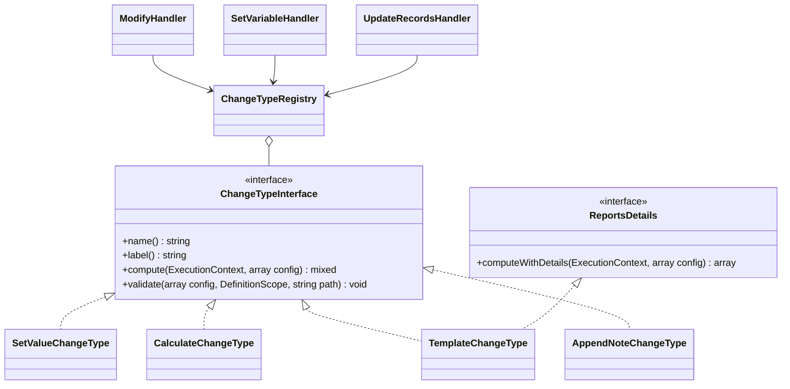

# Новый тип изменения

Как добавить способ вычисления нового значения в действиях `modify`, `set_variable` и `update_records` — на учебном
примере типа изменения `append_note` («Дописать заметку»).

<!-- lang-switch -->
[🇬🇧 English](../../../en/07-developer-guide/extending/new-change-type.md) | 🇷🇺 Русский
<!-- /lang-switch -->

## 1. Когда это нужно

Тип изменения (`change_type`) решает, **какое значение** записать в поле. Встроенные типы перечислены в
[Типах изменений и выражениях](../../03-user-guide/change-types-and-expressions.md) и в справочнике
`GET /api/dictionaries/change-types`: `set_value`, `set_from_variable`, `calculate`, `template`, `date_shift`,
`increment` / `decrement`, `clear`, `append` / `prepend` / `remove`, `map`, `aggregate`. Новый тип нужен, когда значение
получается логикой с собственной конфигурацией, которую неудобно записывать выражением.

> **Примечание**
> Встроенный `append` («Дописать в конец», задача 5.1.5) умеет больше: шаблоны, `max_length`, режим списка. Учебный
> пример назван `append_note`, чтобы не конфликтовать с ним; регистрация под существующим именем молча **заменяет**
> встроенный тип. Если в выражениях не хватает только функции, добавьте [функцию выражений](expression-functions.md).
> Если нужен новый шаг процесса, а не новое значение поля, — [тип действия](new-action-type.md).

## 2. Как это устроено



Интерфейс `Wps\Actions\ChangeTypes\ChangeTypeInterface`:

| Метод | Назначение |
|---|---|
| `name(): string` | значение `change_type` в определении; уникально |
| `label(): string` | подпись для справочника (встроенные — по-русски) |
| `compute(ExecutionContext $context, array $config): mixed` | новое значение поля |
| `validate(array $config, DefinitionScope $scope, string $path): void` | проверка конфигурации при сохранении процесса |

Реестр `ChangeTypeRegistry`: `register()`, `has()`, `get()` (неизвестное имя → `ConfigurationException`),
`dictionary()` → `[{value, label}]`. Заполняется в `Container::changeTypes()`.

**Кто вызывает тип изменения и что лежит в `$config`:**

| Действие | `$config` | `target` в `$config` | Куда пишется значение |
|---|---|---|---|
| `modify` | всё действие (`target`, `value`, `save_to_crm`, ваши ключи) | есть | `$context->set($target, $new)` — поле становится «грязным», при `save_to_crm: true` переменная сразу сохраняется в CRM |
| `set_variable`, форма `target` | всё действие | есть | `$context->setLocal()` — локальная переменная, в CRM не сохраняется |
| `set_variable`, форма `var` + `fields` | только описание поля (`{change_type, value, …}`) | **нет** | `$context->setLocal("{var}.{name}")` |
| `update_records` | правило поля + `target = "{item}.{field}"` | есть | значение уходит в `PUT` каждой найденной записи |

Отсюда правило: если типу нужно текущее значение поля (как `append_note`, `increment`), читайте его через
`$config['target']` и корректно обрабатывайте его отсутствие.

- **Порядок проверки.** `ModifyHandler::validate()` проверяет, что `change_type` зарегистрирован, вызывает ваш
  `validate($actionConfig, $scope, $path)` **до** объявления цели (значение вычисляется раньше, чем записывается),
  затем проверяет `target`, `save_to_crm` и списки. `SetVariableHandler` и `UpdateRecordsHandler` вызывают тот же
  `validate()` с путём поля (`…fields.total`, `…fields[0]`, `…set[0]`).
- **Аудит.** `modify` пишет в `request_data` `{target, change_type, value}` (`value` = `$config['expression'] ??
  $config['value']`), в `result_data` — `{old_value, new_value}` (+ `save`, если сохранялось). `set_variable` пишет
  то же по каждому полю.
- **`ReportsDetails`.** Если типу есть что добавить в аудит (например, `template` сообщает отсутствующие пути),
  реализуйте необязательный интерфейс `ReportsDetails::computeWithDetails($context, $config): array` — вернуть
  `[$value, $details]`. `modify` и `set_variable` вызовут его вместо `compute()` и добавят `$details` в `result_data`
  (`update_records` вызывает только `compute()`).
- **Без состояния.** Один экземпляр типа обслуживает все корутины воркера: не храните детали вызова в свойствах.
- **Шаблоны.** Тип, который собирает текст из подстановок, не пишет свой разбор: `Container::templates()`
  (`TemplateEngine::render()`) и `Container::templateValidator()` — как `TemplateChangeType` и `AppendChangeType`.
- **Чтение CRM.** Тип, которому нужны записи CRM, получает `ExternalApiAdapterService` в конструкторе, а фильтр в
  формате «Найти записи» переводит и проверяет общими `Crm\FilterTranslator` и `Crm\FilterRulesValidator` — как
  `AggregateChangeType`. Тип вычисляется при каждом выполнении: ограничивайте число читаемых записей
  (`AGGREGATE_MAX_RECORDS` у `aggregate`).

## 3. Пошагово

| Файл | Что сделать |
|---|---|
| `back/src/Actions/ChangeTypes/AppendNoteChangeType.php` | **новый** — класс типа |
| `back/src/Kernel/Container.php` | регистрация в `changeTypes()` |
| `back/tests/Unit/Actions/AppendNoteChangeTypeTest.php` | **новый** — юнит-тест |
| `back/tests/IntegrationTest.php` | блок `[append_note]` |
| `front/src/locales/*.json`, `front/src/types/index.ts` | подпись `dict.changeType.append_note`, объединение `ChangeType` |
| `doc/{ru,en}/03-user-guide/change-types-and-expressions.md`, `back/API.md` | описание типа |

### 3.1 Класс — `back/src/Actions/ChangeTypes/AppendNoteChangeType.php`

```php
<?php

declare(strict_types=1);

namespace Wps\Actions\ChangeTypes;

use Wps\Context\ExecutionContext;
use Wps\Services\Validation\DefinitionScope;
use Wps\Types\TypeCaster;

/**
 * "Дописать заметку": appends the value to the current value of the target field,
 * separated by "separator" (default: a space). An empty field simply gets the value.
 */
final class AppendNoteChangeType implements ChangeTypeInterface
{
    public function name(): string
    {
        return 'append_note';
    }

    public function label(): string
    {
        return 'Дописать заметку';
    }

    public function compute(ExecutionContext $context, array $config): mixed
    {
        // "target" is passed by modify and update_records; set_variable passes it only in the "target" form
        $target = (string)($config['target'] ?? '');
        $current = $target !== '' ? TypeCaster::stringify($context->get($target)) : '';
        $value = TypeCaster::stringify($config['value'] ?? '');
        if ($current === '') {
            return $value;
        }
        $separator = is_string($config['separator'] ?? null) ? $config['separator'] : ' ';
        return $current . $separator . $value;
    }

    public function validate(array $config, DefinitionScope $scope, string $path): void
    {
        $value = $config['value'] ?? null;
        if (!is_scalar($value) || (string)$value === '') {
            $scope->error("{$path}.value", 'Value to append is required');
        }
        if (array_key_exists('separator', $config) && !is_string($config['separator'])) {
            $scope->error("{$path}.separator", 'Separator must be a string');
        }
    }
}
```

`TypeCaster::stringify()` — единое преобразование значения в строку (`null` → `''`, числа без хвостовых нулей, массивы →
JSON). `ComparatorRegistry::stringify()` — устаревший псевдоним, в новом коде не используйте.

### 3.2 Регистрация — `back/src/Kernel/Container.php`

```php
use Wps\Actions\ChangeTypes\AppendNoteChangeType;

public function changeTypes(): ChangeTypeRegistry
{
    return $this->share(ChangeTypeRegistry::class, function () {
        $registry = new ChangeTypeRegistry();
        $registry->register(new SetValueChangeType());
        $registry->register(new SetFromVariableChangeType());
        $registry->register(new CalculateChangeType($this->expressions()));
        $registry->register(new TemplateChangeType($this->templates(), $this->templateValidator()));
        // … date_shift, increment / decrement, clear, append / prepend / remove, map, aggregate …
        $registry->register(new AppendNoteChangeType());          // new change type
        return $registry;
    });
}
```

Зависимости передавайте через конструктор из сервисов контейнера (`$this->expressions()`, `$this->templates()`,
`$this->typeCaster()`, `$this->clock()`, `$this->crm()` …). `share()` создаёт реестр один раз на воркер — после правки
нужен перезапуск (`docker compose up -d --build backend`).

### 3.3 Использование

```json
{ "type": "modify", "target": "object.note", "change_type": "append_note", "value": "checked", "separator": " | " }
```

При `object.note = "start"` результат — `"start | checked"`, в аудите шага `result_data` =
`{"old_value": "start", "new_value": "start | checked"}`. В `update_records`:

```json
{ "type": "update_records", "list": "deals", "set": [ { "field": "description", "change_type": "append_note", "value": "closed by WPS" } ] }
```

(`deals` — список `find_records`; для каждой записи `target` = `item.description`, форму правил см. в
[Действиях](../../03-user-guide/actions.md)).

## 4. Валидация и ошибки

- Ошибки конфигурации — через `$scope->error("{$path}.<key>", …)`; `$path` имеет вид `definition.actions[N]`
  (или путь поля в `set_variable` / `update_records`). Все ошибки сохранения собираются в один ответ
  `422 VALIDATION_ERROR` с `details[].field`.
- Пути, которые **читаются** (как `value` у `set_from_variable`), проверяйте через
  `$scope->checkReadPath($value, "{$path}.value")` — иначе опечатка обнаружится только при выполнении. Выражения —
  через `ExpressionEngine::paths()` + `checkReadPath()` (как `CalculateChangeType::validate()`), шаблоны — через
  `TemplateValidator::validate()`.
- `compute()` выполняется внутри цикла повторов движка. На плохие данные бросайте `NonRecoverableException` (шаг
  `failed`, дальше работает `on_error`), `RecoverableException` — только если обращаетесь к тому, что может быть
  временно недоступно (CRM). Перед повтором движок восстанавливает снимок контекста (`restoreState()`), поэтому
  частичные изменения контекста не накапливаются.
- Значение, которое вернёт `compute()`, попадает в контекст, в аудит и, возможно, в CRM: возвращайте скаляр, `null`
  или сериализуемый массив.

## 5. UI и переводы

Строка изменения в `ModifyPanel.vue` предлагает типы изменения из справочника (перевод — `dict.changeType.<name>`,
без ключа показывается `label()` бэкенда). Для нового типа:

1. Переводы в обеих локалях:

```json
// en.json → dict.changeType
"append_note": "Append a note"
// ru.json → dict.changeType
"append_note": "Дописать заметку"
```

2. Расширьте TypeScript-объединение в `front/src/types/index.ts` (сейчас в нём только три базовых типа):

```ts
export type ChangeType = 'set_value' | 'set_from_variable' | 'calculate' | 'append_note'
```

Тип, которого нет в объединении, во время выполнения всё равно работает, но код редактора сравнивает `change_type`
с литералами, и `vue-tsc` следит за полнотой объединения в новых ветках.

3. Поле значения: `ModifyPanel.vue` показывает ввод пути переменной для `set_from_variable`, поле выражения со справкой
для `calculate` и обычное текстовое поле для всего остального — для `append_note` ничего менять не нужно.

> **Примечание**
> Строку изменения с типом, которого нет в списке `FORM_CHANGE_TYPES` (`front/src/utils/processForm.ts`), редактор
> показывает только для чтения и сохраняет без изменений, вместе с дополнительными ключами вроде `separator`. Чтобы
> тип можно было править в форме, добавьте его в `FORM_CHANGE_TYPES`, ключ — в `ModifyRow`/`ModifyAction` и поле ввода
> в `ModifyPanel.vue`; при смене типа в строке ключи старого типа сбрасываются (`base()` в `processForm.ts`).
> Действия, которые табличный редактор не понимает (например, `set_variable`), он хранит как «passthrough» и не меняет.

## 6. Тест

### 6.1 Юнит-тест — `back/tests/Unit/Actions/AppendNoteChangeTypeTest.php`

По образцу `SimpleChangeTypesTest`: сам тип и тип через настоящий `ModifyHandler` (аудит и «грязные» поля).

```php
<?php

declare(strict_types=1);

namespace Wps\Tests\Unit\Actions;

use PHPUnit\Framework\TestCase;
use Wps\Actions\ChangeTypes\AppendNoteChangeType;
use Wps\Actions\ChangeTypes\ChangeTypeRegistry;
use Wps\Actions\ModifyHandler;
use Wps\Context\ExecutionContext;
use Wps\Services\CrmObjectSaver;
use Wps\Services\ExternalApiAdapterService;
use Wps\Services\Validation\DefinitionScope;

final class AppendNoteChangeTypeTest extends TestCase
{
    public function testCompute(): void
    {
        $type = new AppendNoteChangeType();
        $context = ExecutionContext::fromEvent('e', ['id' => '1', 'note' => 'start', 'amount' => 12.5], 'Deals');
        self::assertSame('start | checked', $type->compute($context, ['target' => 'object.note', 'value' => 'checked', 'separator' => ' | ']));
        self::assertSame('start checked', $type->compute($context, ['target' => 'object.note', 'value' => 'checked']), 'default separator');
        self::assertSame('checked', $type->compute($context, ['target' => 'object.none', 'value' => 'checked']), 'missing field');
        self::assertSame('12.5 EUR', $type->compute($context, ['target' => 'object.amount', 'value' => 'EUR']), 'numbers are stringified');
    }

    public function testThroughModify(): void
    {
        $registry = new ChangeTypeRegistry();
        $registry->register(new AppendNoteChangeType());
        // the CRM is not called without save_to_crm; ExternalApiAdapterService is final — no constructor needed here
        $saver = new CrmObjectSaver((new \ReflectionClass(ExternalApiAdapterService::class))->newInstanceWithoutConstructor());
        $modify = new ModifyHandler($registry, $saver);
        $context = ExecutionContext::fromEvent('e', ['id' => '1', 'note' => 'start'], 'Deals');

        $result = $modify->execute($context, ['type' => 'modify', 'target' => 'object.note', 'change_type' => 'append_note', 'value' => 'checked', 'separator' => ' | ']);

        self::assertSame('start | checked', $context->get('object.note'));
        self::assertSame(['target' => 'object.note', 'change_type' => 'append_note', 'value' => 'checked'], $result->request);
        self::assertSame(['old_value' => 'start', 'new_value' => 'start | checked'], $result->result);
        self::assertSame(['note'], $context->dirtyFields('object'));
    }

    public function testValidate(): void
    {
        $scope = new DefinitionScope();
        (new AppendNoteChangeType())->validate(['value' => '', 'separator' => 1], $scope, 'definition.actions[0]');
        self::assertSame([
            'definition.actions[0].value' => 'Value to append is required',
            'definition.actions[0].separator' => 'Separator must be a string',
        ], array_column($scope->errors(), 'message', 'field'));
    }
}
```

Класс и тест прогнаны на текущем коде (`OK`). Запуск юнит-тестов — [Тестирование](../testing.md#юнит-тесты-бэкенда).

### 6.2 Интеграционный тест — `back/tests/IntegrationTest.php`

По образцу `testSimpleChangeTypes()`; вызов `$this->testAppendNote();` добавьте в `run()`.

```php
private function testAppendNote(): void
{
    echo "[append_note]\n";
    $this->test('append_note: dictionary, a manual run, validation', function () {
        $changeTypes = array_column($this->request('GET', '/api/dictionaries/change-types', token: $this->viewerToken)['data'], 'label', 'value');
        $this->assertEquals('Дописать заметку', $changeTypes['append_note'] ?? null);
        $process = $this->request('POST', '/api/processes', ['name' => 'TEST append_note', 'object_type' => 'TestNote', 'is_child' => false, 'definition' => ['actions' => [
            ['type' => 'modify', 'target' => 'object.note', 'change_type' => 'append_note', 'value' => 'checked', 'separator' => ' | '],
        ]]], $this->adminToken, 201)['data'];
        $run = $this->request('POST', "/api/processes/{$process['id']}/run", ['object' => ['id' => 'n' . random_int(1000, 9999), 'module' => 'TestNote', 'note' => 'start']], $this->editorToken, 201)['data'];
        $e = $this->waitForExecution($run['execution_id']);
        $this->assertEquals('completed', $e['status']);
        $this->assertEquals('start | checked', $e['context']['variables']['object']['note']);
        $this->assertEquals('start', $e['actions'][0]['result_data']['old_value']);
        $bad = $this->request('POST', '/api/processes', ['name' => 'TEST append_note bad', 'object_type' => 'TestNote', 'is_child' => false, 'definition' => ['actions' => [
            ['type' => 'modify', 'target' => 'object.note', 'change_type' => 'append_note', 'value' => ''],
        ]]], $this->adminToken, 422);
        $d = array_column($bad['error']['details'], 'message', 'field');
        $this->assertEquals('Value to append is required', $d['definition.actions[0].value'] ?? null);
        $this->request('DELETE', "/api/processes/{$process['id']}", token: $this->adminToken);
    });
}
```

Тот же тип используется в общем шаблоне `testExtensions()` ([Новый тип действия → Тест](new-action-type.md#6-тест)).

## 7. Типичные ошибки

| Ошибка | Последствие | Как правильно |
|---|---|---|
| Имя совпадает со встроенным типом | встроенный тип молча заменён | уникальное `name()`; сверьтесь с `GET /api/dictionaries/change-types` |
| Детали вычисления в полях объекта | гонки между корутинами | `ReportsDetails::computeWithDetails()` |
| Опора на `$config['target']` без проверки | в `set_variable` с `var` + `fields` целевое значение не читается | обрабатывать пустой `target` |
| Пути в конфигурации не проверены в `validate()` | опечатка всплывает при выполнении | `checkReadPath()`, `paths()`, `TemplateValidator` |
| Порядок ключей объекта в конфигурации | `processes.definition` — `jsonb`, порядок ключей объекта не сохраняется | упорядоченное задавайте списком (как `fields` у `set_variable`, `ranges` у `map`) |
| Побочный эффект в `compute()` (запись в CRM, отправка) | повтор шага повторит его | тип изменения только вычисляет; внешние вызовы — в [действии](new-action-type.md#внешние-вызовы-и-журнал-побочных-эффектов) |

## 8. Чек-лист готовности

- [ ] `final`-класс в `back/src/Actions/ChangeTypes/`, `declare(strict_types=1)`, уникальный `name()`
- [ ] `compute()` работает во всех трёх действиях (`modify`, `set_variable` обеих форм, `update_records`)
- [ ] `validate()` сообщает о каждой проблеме с путём поля; читаемые пути проверены
- [ ] Зарегистрирован в `Container::changeTypes()`
- [ ] `dict.changeType.<name>` в обеих локалях, объединение `ChangeType` расширено, дополнительные ключи поддержаны в редакторе (или их нет)
- [ ] Юнит-тест и интеграционный блок (вызов в `run()`), тесты зелёные, `npm run build` проходит
- [ ] Описан в [Типах изменений и выражениях](../../03-user-guide/change-types-and-expressions.md) (en + ru) и в `back/API.md`

<!-- footer-nav -->
---

← Назад: [Новый оператор сравнения](new-comparator.md) | [Оглавление](../../README.md) | [Новая стратегия загрузки](new-load-strategy.md) Далее →
<!-- /footer-nav -->
