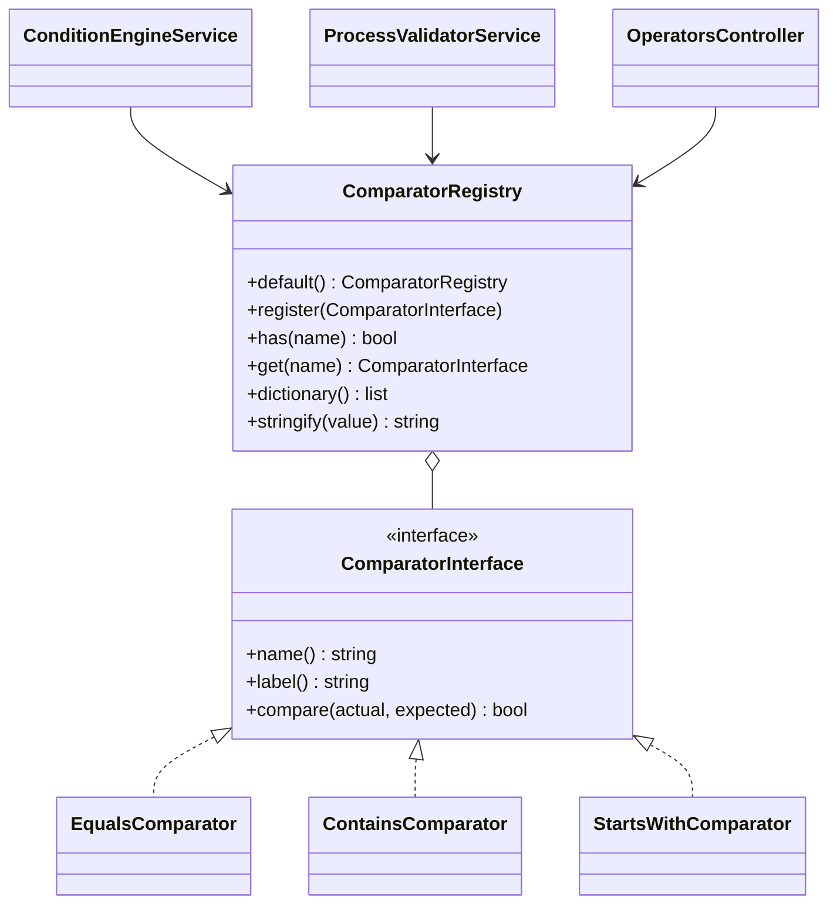

# Новый оператор сравнения

Как добавить оператор для условий процесса — на законченном и проверенном примере `starts_with` («Начинается с»).

<!-- lang-switch -->
[🇬🇧 English](../../../en/07-developer-guide/extending/new-comparator.md) | 🇷🇺 Русский
<!-- /lang-switch -->

## 1. Когда это нужно

Встроенные операторы: `equals`, `not_equals`, `contains`, `not_contains`. Новый оператор нужен, когда условие через них
не выразить: префикс, регулярное выражение, числовое сравнение (`greater_than`), проверка «поле пустое».

## 2. Как это устроено



- `name()` — код, который хранится в строке условия (`"operator": "starts_with"`), `label()` — подпись по умолчанию.
- Перед вызовом обе стороны приводятся к строкам (`ComparatorRegistry::stringify()`: `null` → `''`, `true` → `'true'`,
  дробные числа без хвостовых нулей, массивы → JSON), поэтому `compare()` всегда получает две строки.
- Список операторов задаёт `ComparatorRegistry::default()`; `Container::comparators()` строит реестр один раз на воркер.
- Один и тот же реестр используют три потребителя:
  - `ConditionEngineService` — вычисляет условия во время выполнения;
  - `ProcessValidatorService` — при сохранении отклоняет неизвестные операторы (`Unknown comparison operator`);
  - `GET /api/dictionaries/operators` (`OperatorsController`) — список, который показывает UI.
- UI строит выпадающий список операторов по этому справочнику и переводит подписи по значению: ключ
  `dict.operator.<name>` в `front/src/locales/*.json`; если ключа нет, показывается `label()` из бэкенда.

## 3. Пошагово

### 3.1 Класс — `back/src/Comparators/StartsWithComparator.php`

```php
<?php

declare(strict_types=1);

namespace Wps\Comparators;

/**
 * Prefix match: "object.phone" starts with "+7".
 */
final class StartsWithComparator implements ComparatorInterface
{
    public function name(): string
    {
        return 'starts_with';
    }

    public function label(): string
    {
        return 'Начинается с';
    }

    public function compare(string $actual, string $expected): bool
    {
        return str_starts_with($actual, $expected);
    }
}
```

> **Примечание**
> Встроенные компараторы возвращают из `label()` русские подписи (язык API по умолчанию). Если перевод
> `dict.operator.*` существует, UI их не показывает, так что держитесь того же стиля.

### 3.2 Регистрация — `back/src/Comparators/ComparatorRegistry.php`

```php
public static function default(): self
{
    $registry = new self();
    $registry->register(new EqualsComparator());
    $registry->register(new NotEqualsComparator());
    $registry->register(new ContainsComparator());
    $registry->register(new NotContainsComparator());
    $registry->register(new StartsWithComparator());
    return $registry;
}
```

Порядок вызовов `register()` — это порядок пунктов в выпадающем списке UI.

### 3.3 Пересборка

```bash
docker compose up -d --build backend
curl -s http://localhost:9501/api/dictionaries/operators -H "Authorization: Bearer $TOKEN"
# … {"value":"starts_with","label":"Начинается с"}
```

### 3.4 Использование в процессе

```json
{ "field": "object.phone", "operator": "starts_with", "value_type": "static", "value": "+7" }
```

## 4. Валидация и ошибки

- Добавлять ничего не нужно: валидатор принимает любой зарегистрированный оператор и сам проверяет пути `field`/`value`.
- `compare()` должен быть чистой функцией и не бросать исключений. Ошибка в условии во время выполнения сломает
  обработку каждого события этого типа объекта — вместо исключения верните `false`.
- Если оператору нужен определённый формат значения (число, регулярное выражение), проверяйте его в `compare()`
  с запасом (`is_numeric`, `@preg_match(...) === false` → `false`).

## 5. UI и переводы

Добавьте подпись в **оба** файла локализации (одинаковый набор ключей проверяет `npm run i18n:check`):

`front/src/locales/en.json`

```json
"dict": {
  "operator": {
    "equals": "Equals",
    "not_equals": "Not equals",
    "contains": "Contains",
    "not_contains": "Does not contain",
    "starts_with": "Starts with"
  },
```

`front/src/locales/ru.json`

```json
"dict": {
  "operator": {
    …,
    "starts_with": "Начинается с"
  },
```

По желанию добавьте пункт в `FALLBACK.operators` в `front/src/api/dictionaries.ts` — этот список используется, только
когда эндпоинт справочника недоступен.

Компоненты менять не нужно: `ConditionsPanel.vue` выводит то, что возвращает `localizeDict('operator', …)`, а
`ProcessDetailView.vue` показывает подпись в таблице условий.

## 6. Тест

В `back/tests/IntegrationTest.php`:

1. Обновите проверку точного списка в `testDictionaries()`:

```php
$this->assertEquals(['contains', 'equals', 'not_contains', 'not_equals', 'starts_with'], $values);
```

2. Добавьте проверку поведения (процесс с новым оператором + ручной запуск):

```php
$this->test('starts_with: a non-matching phone does not start the process', function () {
    $res = $this->request('POST', '/api/processes', [
        'name' => 'TEST starts_with', 'object_type' => 'TestExt', 'is_child' => false,
        'definition' => ['conditions' => [
            ['field' => 'object.phone', 'operator' => 'starts_with', 'value_type' => 'static', 'value' => '+7'],
        ]],
    ], $this->adminToken, 201);
    $id = $res['data']['id'];
    $miss = $this->request('POST', "/api/processes/{$id}/run", ['object' => ['id' => 'e0', 'phone' => '+1555']], $this->adminToken, 200);
    $this->assertFalse($miss['data']['conditions_met']);
});
```

Эта проверка — часть проверенной группы `testExtensions()`, отвечающая за оператор: там то же условие объединено
с остальными примерами, и подходящий телефон (`+79990000000`) запускает выполнение, которое завершается успешно (см.
[Новый тип действия → Тест](new-action-type.md#6-тест)). Со всеми примерами полный набор тестов прошёл
(`Passed: 74, Failed: 0`) на отдельном стенде, а `npm run build` прошёл с новыми ключами.

## 7. Чек-лист готовности

- [ ] Класс в `back/src/Comparators/`, `final`, `strict_types`, уникальный `name()` в `snake_case`
- [ ] Зарегистрирован в `ComparatorRegistry::default()`
- [ ] `dict.operator.<name>` есть в `en.json` и `ru.json`; `npm run build` проходит
- [ ] Список в `testDictionaries()` обновлён, проверка поведения добавлена, тесты зелёные
- [ ] Оператор описан в [Триггерах и условиях](../../03-user-guide/triggers-and-conditions.md) (en + ru) и в `back/API.md`

<!-- footer-nav -->
---

← Назад: [Новый тип действия](new-action-type.md) | [Оглавление](../../README.md) | [Новый тип изменения](new-change-type.md) Далее →
<!-- /footer-nav -->
