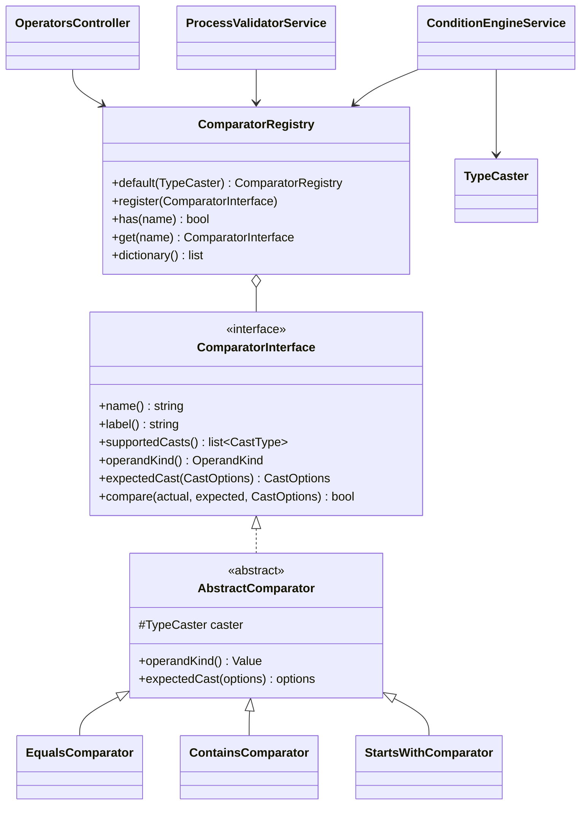

# Новый оператор сравнения

Как добавить оператор для условий процесса — на примере устройства встроенного оператора `starts_with` («Начинается с»).

<!-- lang-switch -->
[🇬🇧 English](../../../en/07-developer-guide/extending/new-comparator.md) | 🇷🇺 Русский
<!-- /lang-switch -->

## 1. Когда это нужно

Встроенные операторы перечислены в [Условиях запуска](../../03-user-guide/triggers-and-conditions.md#операторы) и в
справочнике `GET /api/dictionaries/operators`. Новый оператор нужен, когда условие через них не выразить, например
регулярное выражение или сравнение по расстоянию Левенштейна.

> **Примечание**
> `starts_with` и `ends_with` уже входят в поставку (задача 3.5): ниже показано, как они устроены. Повторяя пример,
> выберите своё имя оператора (например, `matches_regex`), а точный список в `testDictionaries()` дополните им.

## 2. Как это устроено



- `name()` — код, который хранится в строке условия (`"operator": "starts_with"`), `label()` — подпись по умолчанию.
- Перед вызовом `ConditionEngineService` приводит обе стороны к типу из строки условия (`cast`, `cast_options`) через
  `Wps\Types\TypeCaster`: левую — по `CastOptions` строки, правую — по `expectedCast($options)` (по умолчанию теми же
  параметрами; `contains` для `list` приводит правую часть как элемент списка — `$options->element()`). Без `cast`
  обе стороны — строки (`TypeCaster::stringify()`: `null` → `''`, `true` → `'true'`, дробные без хвостовых нулей,
  массивы → JSON), как раньше. См. [Тип сравнения (cast)](../../03-user-guide/triggers-and-conditions.md#тип-сравнения-cast).
- Отсутствующее поле, пустое значение (для типов, кроме `string` и `bool`) и ошибку приведения обрабатывает движок:
  строка становится ложной, в трассе — `missing` / `empty` / `cast_error`. До `compare()` они не доходят, поэтому
  компаратор получает уже приведённые значения своего типа: `string`, `int`, каноническую строку `decimal`,
  `DateTimeImmutable` (`date`, `datetime`), `bool`, `list<string>`.
- `supportedCasts()` — список `CastType`, с которыми работает оператор. Валидатор отклоняет другие
  (`Operator "starts_with" does not support cast "decimal" (supported: string)`); справочник операторов отдаёт его в поле
  `casts`.
- `operandKind()` — форма правой части (`OperandKind`: `value` — одно значение; `none`, `presence`, `list`, `range`,
  `change`, `change_value` — для будущих операторов пустоты, списков, диапазонов и изменений). В справочнике — поле
  `operands`.
- Базовый класс `AbstractComparator` хранит `TypeCaster` (`$this->caster` — для `equals()` / `compare()` значений) и
  даёт `operandKind() = Value` и `expectedCast()` = те же параметры.
- Список операторов задаёт `ComparatorRegistry::default(TypeCaster)`; `Container::comparators()` строит реестр один раз на
  воркер и передаёт `TypeCaster` с часовым поясом `WPS_TIMEZONE`.
- Один и тот же реестр используют три потребителя:
  - `ConditionEngineService` — вычисляет условия во время выполнения;
  - `ProcessValidatorService` — при сохранении отклоняет неизвестные операторы (`Unknown comparison operator`);
  - `GET /api/dictionaries/operators` (`OperatorsController`) — список, который показывает UI.
- UI строит выпадающий список операторов по этому справочнику и переводит подписи по значению: ключ
  `dict.operator.<name>` в `front/src/locales/*.json`; если ключа нет, показывается `label()` из бэкенда.

## 3. Пошагово

### 3.1 Класс — `back/src/Comparators/StartsWithComparator.php`

```php
<?php

declare(strict_types=1);

namespace Wps\Comparators;

use Wps\Types\CastOptions;
use Wps\Types\CastType;

/**
 * Prefix match: "object.phone" starts with "+7".
 */
final class StartsWithComparator extends AbstractComparator
{
    public function name(): string
    {
        return 'starts_with';
    }

    public function label(): string
    {
        return 'Начинается с';
    }

    public function supportedCasts(): array
    {
        return [CastType::String];
    }

    public function compare(mixed $actual, mixed $expected, CastOptions $options): bool
    {
        // both sides are already cast to strings (case_sensitive / trim applied)
        return str_starts_with((string)$actual, (string)$expected);
    }
}
```

> **Примечание**
> Встроенные компараторы возвращают из `label()` русские подписи (язык API по умолчанию). Если перевод
> `dict.operator.*` существует, UI их не показывает, так что держитесь того же стиля.

### 3.2 Регистрация — `back/src/Comparators/ComparatorRegistry.php`

```php
public static function default(?TypeCaster $caster = null): self
{
    $caster ??= new TypeCaster();
    $registry = new self();
    $registry->register(new EqualsComparator($caster));
    $registry->register(new NotEqualsComparator($caster));
    $registry->register(new ContainsComparator($caster));
    $registry->register(new NotContainsComparator($caster));
    $registry->register(new StartsWithComparator($caster));
    return $registry;
}
```

Порядок вызовов `register()` — это порядок пунктов в выпадающем списке UI.

### 3.3 Пересборка

```bash
docker compose up -d --build backend
curl -s http://localhost:9501/api/dictionaries/operators -H "Authorization: Bearer $TOKEN"
# … {"value":"starts_with","label":"Начинается с","casts":["string"],"operands":"value"}
```

### 3.4 Использование в процессе

```json
{ "field": "object.phone", "operator": "starts_with", "value_type": "static", "value": "+7" }
```

Без учёта регистра — через параметры типа `string`:

```json
{ "field": "object.email", "operator": "starts_with", "value": "info@", "cast": "string", "cast_options": { "case_sensitive": false } }
```

## 4. Валидация и ошибки

- Добавлять ничего не нужно: валидатор принимает любой зарегистрированный оператор, сам проверяет пути `field`/`value`,
  `cast` / `cast_options`, совместимость с `supportedCasts()` и то, что статическое значение приводится к типу
  (`expectedCast()`).
- `compare()` должен быть чистой функцией и не бросать исключений. Ошибка в условии во время выполнения сломает
  обработку каждого события этого типа объекта — вместо исключения верните `false`.
- Формат чисел и дат проверять не нужно — значения уже приведены. Если оператору нужен особый формат (например
  регулярное выражение), проверяйте его в `compare()` с запасом (`@preg_match(...) === false` → `false`).
- Сравнивайте через `$this->caster->equals()` / `$this->caster->compare()`, а не `===` / `<`: они учитывают тип
  (`decimal` через `bccomp`, даты по дню или моменту, списки как множества).

## 5. UI и переводы

Добавьте подпись в **оба** файла локализации (одинаковый набор ключей проверяет `npm run i18n:check`):

`front/src/locales/en.json`

```json
"dict": {
  "operator": {
    "equals": "Equals",
    "not_equals": "Not equals",
    "contains": "Contains",
    "not_contains": "Does not contain",
    "starts_with": "Starts with"
  },
```

`front/src/locales/ru.json`

```json
"dict": {
  "operator": {
    …,
    "starts_with": "Начинается с"
  },
```

По желанию добавьте пункт в `FALLBACK.operators` в `front/src/api/dictionaries.ts` — этот список используется, только
когда эндпоинт справочника недоступен.

Компоненты менять не нужно: `ConditionsPanel.vue` выводит то, что возвращает `localizeDict('operator', …)`, а
`ProcessDetailView.vue` показывает подпись в таблице условий.

## 6. Тест

В `back/tests/IntegrationTest.php`:

1. Обновите проверку точного списка в `testDictionaries()`:

```php
$this->assertEquals(['contains', 'equals', 'not_contains', 'not_equals', 'starts_with'], $values);
```

2. Добавьте проверку поведения (процесс с новым оператором + ручной запуск):

```php
$this->test('starts_with: a non-matching phone does not start the process', function () {
    $res = $this->request('POST', '/api/processes', [
        'name' => 'TEST starts_with', 'object_type' => 'TestExt', 'is_child' => false,
        'definition' => ['conditions' => [
            ['field' => 'object.phone', 'operator' => 'starts_with', 'value_type' => 'static', 'value' => '+7'],
        ]],
    ], $this->adminToken, 201);
    $id = $res['data']['id'];
    $miss = $this->request('POST', "/api/processes/{$id}/run", ['object' => ['id' => 'e0', 'phone' => '+1555']], $this->adminToken, 200);
    $this->assertFalse($miss['data']['conditions_met']);
});
```

Эта проверка — часть проверенной группы `testExtensions()`, отвечающая за оператор: там то же условие объединено
с остальными примерами, и подходящий телефон (`+79990000000`) запускает выполнение, которое завершается успешно (см.
[Новый тип действия → Тест](new-action-type.md#6-тест)). Со всеми примерами полный набор тестов прошёл
(`Passed: 74, Failed: 0`) на отдельном стенде, а `npm run build` прошёл с новыми ключами.

## 7. Чек-лист готовности

- [ ] Класс в `back/src/Comparators/`, `final`, `strict_types`, наследует `AbstractComparator`, уникальный `name()` в `snake_case`
- [ ] `supportedCasts()` перечисляет допустимые типы, `compare()` работает с приведёнными значениями и есть юнит-тест
      (`back/tests/Unit/Comparators`)
- [ ] Зарегистрирован в `ComparatorRegistry::default()` с общим `$caster`
- [ ] `dict.operator.<name>` есть в `en.json` и `ru.json`; `npm run build` проходит
- [ ] Список в `testDictionaries()` обновлён, проверка поведения добавлена, тесты зелёные
- [ ] Оператор описан в [Триггерах и условиях](../../03-user-guide/triggers-and-conditions.md) (en + ru) и в `back/API.md`

<!-- footer-nav -->
---

← Назад: [Новый тип блока](new-block-type.md) | [Оглавление](../../README.md) | [Новый тип изменения](new-change-type.md) Далее →
<!-- /footer-nav -->
