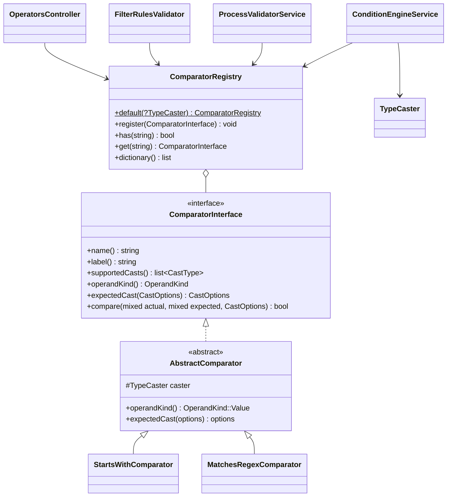

# Новый оператор сравнения

Как добавить оператор для условий процесса — на учебном примере оператора `matches_regex` («Соответствует регулярному
выражению»).

<!-- lang-switch -->
[🇬🇧 English](../../../en/07-developer-guide/extending/new-comparator.md) | 🇷🇺 Русский
<!-- /lang-switch -->

## 1. Когда это нужно

Встроенные операторы перечислены в [Условиях запуска](../../03-user-guide/triggers-and-conditions.md#операторы) и в
справочнике `GET /api/dictionaries/operators`: равенство, порядок (`greater_than` …, `between`), списки (`in`,
`contains_any` …), строки (`contains`, `starts_with`, `ends_with`), пустота и `null`, изменения (`changed`,
`changed_to` …). Новый оператор нужен, когда условие через них не выразить, например проверка по регулярному выражению
или по расстоянию Левенштейна.

> **Примечание**
> `matches_regex` — учебный пример, в поставке WPS его нет. Похожую проверку уже можно записать без нового оператора:
> правая часть `value_type: "expression"` с функцией `regex_match()` ([выражение в правой части](../../03-user-guide/triggers-and-conditions.md#сравнение-с-выражением)).
> Отдельный оператор удобнее редактору процесса и проверяет шаблон при сохранении. Для своего оператора выберите имя,
> которого нет в `ComparatorRegistry::default()`: регистрация с тем же именем молча **заменяет** встроенный оператор.

## 2. Как это устроено



Интерфейс `Wps\Comparators\ComparatorInterface` (`back/src/Comparators/ComparatorInterface.php`):

| Метод | Назначение |
|---|---|
| `name(): string` | код, который хранится в строке условия (`"operator": "matches_regex"`); уникален, `snake_case` |
| `label(): string` | подпись по умолчанию (встроенные операторы — по-русски) |
| `supportedCasts(): array` | `list<CastType>` — с какими `cast` работает оператор; справочник отдаёт поле `casts` |
| `operandKind(): OperandKind` | форма правой части, справочник отдаёт поле `operands` |
| `expectedCast(CastOptions $options): CastOptions` | как приводится правая часть (по умолчанию — так же, как поле) |
| `compare(mixed $actual, mixed $expected, CastOptions $options): bool` | само сравнение уже приведённых значений |

- **Приведение типов.** Перед `compare()` `ConditionEngineService` приводит обе стороны через `Wps\Types\TypeCaster`:
  левую — по `CastOptions` строки условия (`cast`, `cast_options`), правую — по `expectedCast($options)`. Без `cast`
  тип — `string`: `TypeCaster::stringify()` (`null` → `''`, `true` → `'true'`, дробные без хвостовых нулей, массивы →
  JSON), затем `trim` и свёртка регистра, если они включены в `cast_options`. Компаратор получает значения своего
  типа: `string`, `int`, каноническую строку `decimal`, `DateTimeImmutable` (`date`, `datetime`), `bool`,
  `list<string>`. См. [Тип сравнения (cast)](../../03-user-guide/triggers-and-conditions.md#тип-сравнения-cast).
- **Отсутствие и ошибки обрабатывает движок.** Отсутствующее поле, пустое значение (для всех типов, кроме `string` и
  `bool`) и ошибка приведения до `compare()` не доходят: строка становится ложной, в трассе условия — `missing` /
  `empty` / `cast_error` (`on_cast_error: "error"` превращает ошибку приведения в ошибку выполнения).
- **`OperandKind`** (`back/src/Comparators/OperandKind.php`) — все виды реализованы и в движке, и в валидаторе:

  | Значение | Правая часть | Встроенные операторы |
  |---|---|---|
  | `Value` (`value`) | одно значение (`value_type`: `static`, `from_object_field`, `expression`) | `equals`, `contains`, `greater_than` … |
  | `None` (`none`) | нет; поле должно существовать | `is_empty`, `is_not_empty` |
  | `Presence` (`presence`) | нет; вычисляется и для отсутствующего поля | `is_null`, `is_not_null` |
  | `List` (`list`) | список значений | `in`, `not_in`, `contains_any`, `contains_all`, `contains_none` |
  | `Range` (`range`) | пара `[from, to]` | `between`, `not_between` |
  | `Change` (`change`) | нет; изменение поля в этом сохранении | `changed`, `not_changed` |
  | `ChangeValue` (`change_value`) | изменение + значение | `changed_to`, `changed_from` |

  Новый вид правой части потребует правок `ConditionEngineService` и `ProcessValidatorService` — это уже изменение
  ядра, а не расширение.
- **`AbstractComparator`** хранит `TypeCaster` (`protected readonly TypeCaster $caster`) и даёт
  `operandKind() = OperandKind::Value` и `expectedCast() = $options`. Почти любой новый оператор наследует его.
- **Реестр.** Список операторов задаёт `ComparatorRegistry::default(?TypeCaster $caster = null)`;
  `Container::comparators()` строит его один раз на воркер с `TypeCaster` в часовом поясе `WPS_TIMEZONE`. Отдельного
  места регистрации в `Container` нет — правится сам `default()`.
- **Кто использует реестр:**
  - `ConditionEngineService` — условия запуска процесса, ветки блока `condition`, фильтр `find_records` в режиме
    `related_to` (записи фильтруются в WPS);
  - `ProcessValidatorService` — при сохранении отклоняет неизвестный оператор (`Unknown comparison operator`),
    проверяет `cast` по `supportedCasts()` и статическое значение по `expectedCast()`;
  - `FilterRulesValidator` + `FilterTranslator` — фильтры, которые уходят в CRM (`find_records` по модулю,
    `update_records`, `aggregate`, пулы `assign`). Там допустимы только операторы из `FilterTranslator::SERVER_SIDE`:
    новый оператор получит `Operator "matches_regex" is not supported in find_records filter`, пока вы не добавите его
    туда и в контракт CRM;
  - `GET /api/dictionaries/operators` (`OperatorsController`) — список для UI.

## 3. Пошагово

| Файл | Что сделать |
|---|---|
| `back/src/Comparators/MatchesRegexComparator.php` | **новый** — класс оператора |
| `back/src/Comparators/ComparatorRegistry.php` | регистрация в `default()` |
| `back/src/Services/ProcessValidatorService.php` | (по желанию) проверка статического значения при сохранении |
| `back/tests/Unit/Comparators/MatchesRegexComparatorTest.php` | **новый** — юнит-тест |
| `back/tests/IntegrationTest.php` | блок `[matches_regex]` |
| `front/src/locales/en.json`, `ru.json` | `dict.operator.matches_regex` |
| `doc/{ru,en}/03-user-guide/triggers-and-conditions.md`, `back/API.md` | описание оператора |

### 3.1 Класс — `back/src/Comparators/MatchesRegexComparator.php`

```php
<?php

declare(strict_types=1);

namespace Wps\Comparators;

use Wps\Exceptions\NonRecoverableException;
use Wps\Expression\SafeRegex;
use Wps\Types\CastOptions;
use Wps\Types\CastType;

/**
 * The string matches a regular expression: "object.phone" matches "^\+7\d{10}$".
 * The pattern is written without delimiters (as in regex_match()); limits and the PCRE sandbox — SafeRegex.
 */
final class MatchesRegexComparator extends AbstractComparator
{
    public function name(): string
    {
        return 'matches_regex';
    }

    public function label(): string
    {
        return 'Соответствует рег. выражению';
    }

    public function supportedCasts(): array
    {
        return [CastType::String];
    }

    /**
     * The pattern is never case-folded or trimmed: "\D" must not become "\d". Case-insensitivity is the "i" flag.
     */
    public function expectedCast(CastOptions $options): CastOptions
    {
        return new CastOptions(type: CastType::String);
    }

    public function compare(mixed $actual, mixed $expected, CastOptions $options): bool
    {
        try {
            return SafeRegex::match((string)$actual, (string)$expected, $options->caseSensitive ? '' : 'i', 'matches_regex');
        } catch (NonRecoverableException) {
            // a broken pattern or a too long value: the row is false, the condition must not throw
            return false;
        }
    }
}
```

Что здесь важно:

- `Wps\Expression\SafeRegex` — общая «песочница» регулярных выражений WPS (её используют `regex_match()`,
  `regex_extract()`, `regex_replace()`): шаблон без разделителей, флаги только `i`/`m`/`s`, шаблон до 500 символов,
  строка до 100 000, пониженные `pcre.backtrack_limit` / `recursion_limit` на время одного вызова. Не вызывайте
  `preg_match()` с пользовательским шаблоном напрямую: воркер Swoole общий для корутин, катастрофический бэктрекинг
  заблокирует его.
- `expectedCast()` переопределён: при `cast_options.case_sensitive: false` движок сворачивает регистр **обеих**
  сторон, и `\D` в шаблоне превратился бы в `\d`. Шаблон приводится без свёртки, а нечувствительность к регистру даёт
  флаг `i` (левая часть уже свёрнута — это не мешает).
- `compare()` не бросает исключений: ошибка в условии сломала бы обработку каждого события этого типа объекта.

### 3.2 Регистрация — `back/src/Comparators/ComparatorRegistry.php`

```php
public static function default(?TypeCaster $caster = null): self
{
    $caster ??= new TypeCaster();
    $registry = new self();
    $registry->register(new EqualsComparator($caster));
    $registry->register(new NotEqualsComparator($caster));
    // … 21 more built-in operators, see the file …
    $registry->register(new StartsWithComparator($caster));
    $registry->register(new EndsWithComparator($caster));
    $registry->register(new MatchesRegexComparator($caster));   // new operator
    // … contains_any / contains_all / contains_none, is_empty …, changed …
    return $registry;
}
```

Порядок вызовов `register()` — порядок пунктов в выпадающем списке UI. Всегда передавайте общий `$caster`: в нём
часовой пояс `WPS_TIMEZONE`, по которому приводятся даты.

### 3.3 Проверка значения при сохранении — `ProcessValidatorService::validateCast()`

Валидатор сам проверяет `cast`, `cast_options`, совместимость с `supportedCasts()` и что статическое значение
приводится через `expectedCast()`. Хука «проверь своё значение» у компаратора нет; особые правила для конкретных
операторов записаны прямо в `validateCast()` (так `starts_with` / `ends_with` отклоняют пустой префикс). Чтобы
сломанный шаблон отклонялся с `422`, а не тихо давал `false`, добавьте ветку рядом с этим правилом:

```php
// back/src/Services/ProcessValidatorService.php, validateCast(), next to the starts_with / ends_with rule
if ($checkStaticValue && $operator === 'matches_regex'
    && ($error = SafeRegex::validate(TypeCaster::stringify($row['value'] ?? null), '', 'matches_regex')) !== null) {
    $scope->error("{$rowPath}.value", $error);   // "Invalid regular expression in matches_regex(): missing closing parenthesis"
    return;
}
```

(`use Wps\Expression\SafeRegex;` в начале файла.) `$checkStaticValue` истинно только для `value_type: "static"`;
шаблон из поля или выражения проверяется во время выполнения — и там ошибка даёт `false`.

### 3.4 Пересборка и справочник

```bash
docker compose up -d --build backend
curl -s http://localhost:9501/api/dictionaries/operators -H "Authorization: Bearer $TOKEN"
# … {"value":"matches_regex","label":"Соответствует рег. выражению","casts":["string"],"operands":"value"}
```

### 3.5 Использование в процессе

```json
{ "field": "object.phone", "operator": "matches_regex", "value_type": "static", "value": "^\\+7\\d{10}$" }
```

В JSON обратный слэш удваивается: значение условия — `^\+7\d{10}$`. Без учёта регистра:

```json
{ "field": "object.code", "operator": "matches_regex", "value": "^abc-\\d+$", "cast": "string", "cast_options": { "case_sensitive": false } }
```

Шаблон из поля другой записи: `"value_type": "from_object_field", "value": "acc.phone_mask_c"`.

## 4. Валидация и ошибки

- Валидатор принимает любой зарегистрированный оператор и сам проверяет пути `field`/`value`, `value_type`, `cast` /
  `cast_options`, совместимость с `supportedCasts()` (`Operator "matches_regex" does not support cast "decimal"
  (supported: string)`; если в списке нет `string`, текст другой — `requires cast: …`) и что статическое значение
  приводится (`expectedCast()`).
- `compare()` — чистая функция без ввода-вывода и без состояния: один экземпляр обслуживает все корутины воркера.
  Никаких полей, которые меняются при вызове.
- Не бросайте исключений из `compare()`: верните `false`. Ошибки приведения уже обработаны движком.
- Сравнивайте через `$this->caster->equals($a, $b, $options)` / `$this->caster->compare($a, $b, $options)` (возвращает
  `int`), а не `===` / `<`: они учитывают тип (`decimal` через `bccomp`, даты по дню или моменту, списки как
  множества).
- Трасса каждой строки условия попадает в выполнение (`context.conditions`; для веток `condition` — в `result_data`
  записи блока): `field`, `operator`, `actual`, `expected`, `result`, при необходимости `missing` / `cast_error`.
  Компаратору ничего писать в трассу не нужно.

## 5. UI и переводы

Добавьте подпись в **оба** файла локализации (одинаковый набор ключей проверяет `npm run i18n:check`):

`front/src/locales/en.json`

```json
"dict": {
  "operator": {
    "equals": "Equals",
    "not_equals": "Not equals",
    "contains": "Contains",
    "not_contains": "Does not contain",
    "matches_regex": "Matches regex"
  },
```

`front/src/locales/ru.json`

```json
"dict": {
  "operator": {
    …,
    "matches_regex": "Соответствует рег. выражению"
  },
```

UI переводит подпись по значению (`dictItemLabel()` / `localizeDict('operator', …)` в `front/src/utils/format.ts`):
если ключа `dict.operator.<name>` нет, показывается `label()` из бэкенда. По желанию добавьте пункт в
`FALLBACK.operators` в `front/src/api/dictionaries.ts` — этот список используется, только когда эндпоинт справочника
недоступен. Компоненты менять не нужно: `ConditionsPanel.vue` выводит справочник, `ProcessDetailView.vue` — подпись в
таблице условий.

## 6. Тест

### 6.1 Юнит-тест — `back/tests/Unit/Comparators/MatchesRegexComparatorTest.php`

По образцу `StartsEndsWithTest`: условие вычисляется настоящим `ConditionEngineService`, так что проверяются и
приведение, и отсутствующее поле.

```php
<?php

declare(strict_types=1);

namespace Wps\Tests\Unit\Comparators;

use PHPUnit\Framework\TestCase;
use Wps\Comparators\ComparatorRegistry;
use Wps\Comparators\MatchesRegexComparator;
use Wps\Context\ExecutionContext;
use Wps\Services\ConditionEngineService;
use Wps\Types\TypeCaster;

final class MatchesRegexComparatorTest extends TestCase
{
    private static function registry(): ComparatorRegistry
    {
        $registry = ComparatorRegistry::default();
        $registry->register(new MatchesRegexComparator(new TypeCaster())); // not needed once it is in default()
        return $registry;
    }

    private static function met(array $row, array $object): bool
    {
        $engine = new ConditionEngineService(self::registry());
        return $engine->evaluate([$row], ExecutionContext::fromEvent('e', $object + ['id' => '1'], 'Leads'))->isMet();
    }

    public function testOperator(): void
    {
        $row = ['field' => 'object.phone', 'operator' => 'matches_regex', 'value' => '^\+7\d{10}$'];
        self::assertTrue(self::met($row, ['phone' => '+79991234567']));
        self::assertFalse(self::met($row, ['phone' => '+7999']));
        self::assertFalse(self::met($row, []), 'a missing field never matches');

        $code = ['field' => 'object.code', 'operator' => 'matches_regex', 'value' => '^ABC-\D+$'];
        self::assertFalse(self::met($code, ['code' => 'abc-x']), 'case-sensitive by default');
        self::assertTrue(self::met($code + ['cast_options' => ['case_sensitive' => false]], ['code' => 'abc-x']), '"\D" is not folded to "\d"');

        self::assertFalse(self::met(['field' => 'object.code', 'operator' => 'matches_regex', 'value' => '('], ['code' => '(']), 'a broken pattern is false, not an exception');
    }

    public function testDictionary(): void
    {
        $operators = array_column(self::registry()->dictionary(), null, 'value');
        self::assertSame(['value' => 'matches_regex', 'label' => 'Соответствует рег. выражению', 'casts' => ['string'], 'operands' => 'value'], $operators['matches_regex']);
    }
}
```

Запуск — `docker run --rm wps-backend-test --testsuite unit` после `docker build … --target test`
([Тестирование](../testing.md#юнит-тесты-бэкенда)). Класс и тест из этого раздела прогнаны на текущем коде
(`OK`). Если вы добавили правило из [3.3](#33-проверка-значения-при-сохранении--processvalidatorservicevalidatecast),
проверьте и его — через `ProcessValidatorService` это проще сделать интеграционным тестом ниже.

### 6.2 Интеграционный тест — `back/tests/IntegrationTest.php`

Новый метод по образцу `testStartsEndsWith()`; вызов `$this->testMatchesRegex();` добавьте в список `run()`.

```php
/**
 * matches_regex: dictionary, a manual run, validation of the pattern.
 */
private function testMatchesRegex(): void
{
    echo "[matches_regex]\n";
    $this->test('matches_regex in a manual run and on save', function () {
        $operators = array_column($this->request('GET', '/api/dictionaries/operators', token: $this->viewerToken)['data'], 'casts', 'value');
        $this->assertEquals(['string'], $operators['matches_regex'] ?? null);
        $process = $this->request('POST', '/api/processes', ['name' => 'TEST matches_regex', 'object_type' => 'TestRx', 'is_child' => false, 'definition' => [
            'conditions' => [['field' => 'object.phone', 'operator' => 'matches_regex', 'value' => '^\+7\d{10}$']],
            'actions' => [['type' => 'modify', 'target' => 'object.x', 'change_type' => 'set_value', 'value' => '1']],
        ]], $this->adminToken, 201)['data'];
        $yes = $this->request('POST', "/api/processes/{$process['id']}/run", ['object' => ['id' => 'rx1', 'module' => 'TestRx', 'phone' => '+79991234567']], $this->editorToken, 201)['data'];
        $this->assertTrue($yes['conditions_met']);
        $no = $this->request('POST', "/api/processes/{$process['id']}/run", ['object' => ['id' => 'rx2', 'module' => 'TestRx', 'phone' => '+1555']], $this->editorToken, 200)['data'];
        $this->assertFalse($no['conditions_met']);
        $bad = $this->request('POST', '/api/processes', ['name' => 'TEST matches_regex bad', 'object_type' => 'TestRx', 'is_child' => false, 'definition' => ['conditions' => [
            ['field' => 'object.phone', 'operator' => 'matches_regex', 'value' => '1', 'cast' => 'int'],
            ['field' => 'object.phone', 'operator' => 'matches_regex', 'value' => '('],          // needs the rule of 3.3
        ], 'actions' => []]], $this->adminToken, 422);
        $d = array_column($bad['error']['details'], 'message', 'field');
        $this->assertEquals('Operator "matches_regex" does not support cast "int" (supported: string)', $d['definition.conditions[0].cast'] ?? null);
        $this->assertEquals('Invalid regular expression in matches_regex(): missing closing parenthesis', $d['definition.conditions[1].value'] ?? null);
        $this->request('DELETE', "/api/processes/{$process['id']}", token: $this->adminToken);
    });
}
```

Ручной запуск (`POST /api/processes/{id}/run`) отвечает `201` с `execution_id`, если условия выполнены, и `200` с
`conditions_met: false`, если нет. Запуск интеграционных тестов на моке — [Тестирование](../testing.md). Это же условие
входит в общий шаблон `testExtensions()` ([Новый тип действия → Тест](new-action-type.md#6-тест)).

## 7. Типичные ошибки

| Ошибка | Последствие | Как правильно |
|---|---|---|
| Имя совпадает со встроенным оператором | встроенный оператор молча заменён у всех процессов | уникальное `name()`; проверьте `GET /api/dictionaries/operators` |
| Исключение из `compare()` | шаг условий падает для каждого события этого модуля | вернуть `false` |
| Своё состояние в полях компаратора (кэш последнего шаблона и т. п.) | гонки между корутинами воркера | только `readonly`-зависимости; кэш — статический и ограниченный, как у `TemplateEngine` |
| `===` / `<` вместо `$this->caster` | `'10.0'` ≠ `'10'`, даты сравниваются как строки | `equals()` / `compare()` `TypeCaster` |
| `expectedCast()` по умолчанию для «синтаксической» правой части (шаблон, маска) | `case_sensitive: false` / `trim` портят шаблон | вернуть `new CastOptions(type: CastType::String)` |
| Ожидание, что оператор работает в фильтре CRM | `422 … is not supported in find_records filter` | только условия процесса, ветки и `find_records` с `related_to`; для CRM — `FilterTranslator::SERVER_SIDE` + контракт |
| `preg_match()` с пользовательским шаблоном | ReDoS блокирует воркер | `SafeRegex` |

## 8. Чек-лист готовности

- [ ] Класс в `back/src/Comparators/`, `final`, `declare(strict_types=1)`, наследует `AbstractComparator`, уникальный `name()` в `snake_case`
- [ ] `supportedCasts()` перечисляет допустимые типы; `expectedCast()` переопределён, если правую часть нельзя приводить как поле
- [ ] `compare()` чистый, без исключений и без состояния
- [ ] Зарегистрирован в `ComparatorRegistry::default()` с общим `$caster`
- [ ] (по необходимости) правило статического значения в `ProcessValidatorService::validateCast()`
- [ ] Юнит-тест в `back/tests/Unit/Comparators/` и интеграционный блок в `IntegrationTest.php` (вызов в `run()`), тесты зелёные
- [ ] `dict.operator.<name>` есть в `en.json` и `ru.json`; `npm run build` проходит
- [ ] Оператор описан в [Триггерах и условиях](../../03-user-guide/triggers-and-conditions.md) (en + ru) и в `back/API.md`

<!-- footer-nav -->
---

← Назад: [Новый тип блока](new-block-type.md) | [Оглавление](../../README.md) | [Новый тип изменения](new-change-type.md) Далее →
<!-- /footer-nav -->
