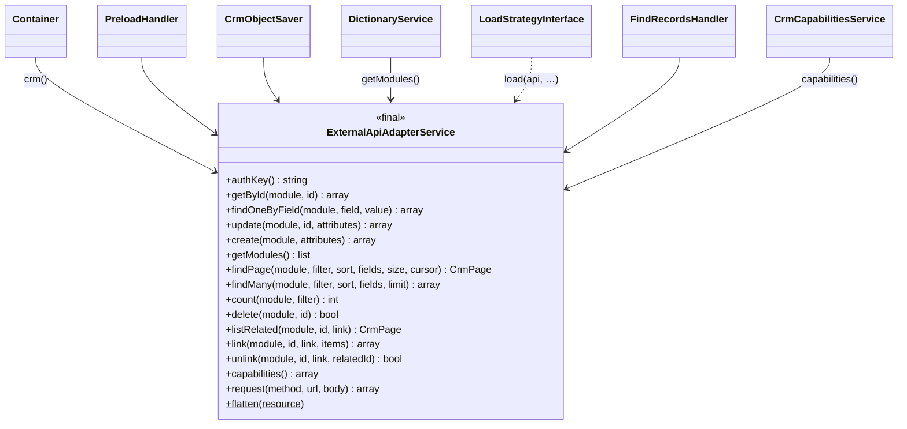

# Новый адаптер CRM

Как подключить WPS к CRM, отличной от мока и SuiteCRM 7/8, на примере проверенного сервиса-моста.

<!-- lang-switch -->
[🇬🇧 English](../../../en/07-developer-guide/extending/new-crm-adapter.md) | 🇷🇺 Русский
<!-- /lang-switch -->

## 1. Когда это нужно

WPS работает ровно с одной CRM, которая задаётся в `CRM_API_BASE_URL`. Мок и плагин SuiteCRM говорят на одном и том же
небольшом REST-контракте. Эта страница нужна, если у вашей CRM другой API (другие URL, другая аутентификация, обычный
JSON вместо JSON:API) или если она пока не публикует события в Redis Stream.

## 2. Как это устроено



- Клиент CRM **один**: `Wps\Services\ExternalApiAdapterService`, он создаётся в `Wps\Kernel\Container::crm()`
  (`new ExternalApiAdapterService(AppConfig $config, LoggerInterface $logger, ?\Closure $capabilities = null)`, замыкание
  возвращает `CrmCapabilities` из `Container::crmCapabilities()`). Это `final`-класс **без интерфейса**, и его конкретный
  тип используется повсюду:

  | Где | Что вызывает |
  |---|---|
  | `PreloadHandler`, `ByIdStrategy`, `ByFieldStrategy` (сигнатура `LoadStrategyInterface::load()`) | `getById()`, `findOneByField()` |
  | `CrmObjectSaver` (`modify` с `save_to_crm`, `save_object`, `assign`) | `update()`, `create()` |
  | `FindRecordsHandler` (`find_records`) | `findMany()`, `listRelated()` |
  | `UpdateRecordsHandler` (`update_records`) | `update()` |
  | `AggregateChangeType` (`aggregate`) | `findPage()`, `count()`, `listRelated()` |
  | `LinkRecordsHandler` (`link_records` / `unlink_records`) | `link()`, `unlink()` |
  | `SendEmailHandler` (копия письма в CRM), `CrmAlertChannel` (`Alerts` в колокольчике) | `create()` |
  | `Services/Assign/UserPoolResolver`, `AssignmentStrategies` (`assign`) | `getById()`, `findMany()`, `listRelated()`, `count()` |
  | `CrmCapabilitiesService` | `capabilities()` (кэш в Redis `crm:capabilities` на `DICT_CACHE_TTL`) |
  | `DictionaryService` | `getModules()` |

  Реестра адаптеров CRM, куда можно было бы подключить вторую реализацию, нет.
- Адаптер работает по контракту из раздела [Интеграция с CRM](../../04-operations/crm-integration.md#контракт-api-crm-wps--crm):
  `GET/PUT {base}/{module}/{id}`, `GET {base}/{module}?filter[field]=value&size=1`, `POST {base}/{module}`,
  `GET {base}/modules`, заголовок `X-Auth-Key = CRM_API_STATIC_KEY . gmdate("Y.m.d H")`, ресурсы JSON:API
  `{type, id, attributes}`. `AppConfig::crmUrl()` дописывает `/api/v8`, если базовый адрес ещё не заканчивается на `/api/v<N>`.
- Версию контракта адаптер узнаёт запросом `GET {base}/capabilities`: ответ `404`/`405` или другая невосстановимая
  ошибка (любой `4xx`) означает контракт **1.0** (`CrmCapabilities::legacy()`), ответ с `data.contract_version` и
  `features` — 2.0. Возможности кэшируются в Redis `crm:capabilities` на `DICT_CACHE_TTL` и обновляются вместе со
  справочником модулей; текущие — `GET /api/dictionaries/crm-capabilities`.
- Справочник модулей `getModules()` берётся сначала из `MOCK_SERVICE_URL/modules` (если переменная задана), затем из
  `{base}/modules`; ответ — список `{value, label}` или строк.
- Каждый запрос шага несёт заголовки происхождения `X-WPS-Execution-Id`, `X-WPS-Process-Id`, `X-WPS-Depth`
  (`Crm\CrmCallOrigin::headers()`). CRM, которая кладёт их в событие как `wps_origin`, позволяет WPS защищаться от
  каскадов ([Заголовки происхождения X-WPS](../../04-operations/crm-integration.md#заголовки-происхождения-x-wps)).
- События идут в обратную сторону и адаптер вообще не используют: CRM пишет сообщения в Redis Stream `crm_events`
  ([формат события](../../04-operations/crm-integration.md#формат-события-crm--wps)).

Поэтому «новый адаптер CRM» — это один из двух вариантов:

| Способ | Что вы пишете | Изменения кода WPS | Когда подходит |
|---|---|---|---|
| **A. Мост (рекомендуется)** | Небольшой HTTP-сервис, который обслуживает контракт WPS и обращается к вашей CRM | нет, только `.env` | У CRM есть любой REST API, который можно вызвать |
| **B. Плагин внутри CRM** | Эндпоинты в самой CRM, как пакеты SuiteCRM `../suiteCRM7`, `../SuiteCRM8` (`WpsApi`, rewrite `/api/v9/…`) | нет | В CRM можно установить свой код |
| C. Изменить адаптер | Правка `ExternalApiAdapterService` (и подсказок типов, которые его используют) | да, класс ядра | Сам контракт должен измениться для всех CRM |

На этой странице разобран способ A с законченным проверенным примером. Способ B — это плагин SuiteCRM: см.
`.tehnical/suiteCRM7/README.md`. Способ C — изменение ядра, а не расширение; правила, которым должен следовать любой
адаптер, — в разделе [Валидация и ошибки](#4-валидация-и-ошибки).

### 2.1 Минимальный и полный контракт

Контракт описан в разделе [Интеграция с CRM](../../04-operations/crm-integration.md#контракт-api-20). Реализуйте столько,
сколько нужно вашим процессам:

| Уровень | Что реализовать | Что даёт |
|---|---|---|
| **1.0 (минимум)** | `GET {base}/{module}/{id}`, `GET {base}/{module}?filter[f]=v&size=N`, `PUT {base}/{module}/{id}`, `POST {base}/{module}`, `GET {base}/modules`; событие с `module`, `id` и полями записи | Предзагрузка, `save_object`, `save_to_crm`; поиск наборов только по равенству до 100 записей |
| **2.0 (полный)** | Всё из 1.0 + `GET {base}/capabilities` (`contract_version: "2.0"` и список `features`), фильтр с операторами, `sort`, курсор `page[after]` / `meta.next_cursor`, `fields`, `count=1`, `DELETE`, связи `…/relationships/{link}` с полями связи, событие v2 (`event_type`, `before`, `changed_fields`) и `wps_origin` из заголовков `X-WPS-*` | Поиск наборов и агрегаты, связи (участники встреч), удаление, условия по изменениям, защита от каскадов |

Можно реализовать 2.0 частично: перечислите в `features` только то, что сделано. Функции WPS без нужной возможности падают с
`CRM_CAPABILITY_MISSING` ([Возможности и деградация](../../04-operations/crm-integration.md#возможности-и-деградация)).

Проверить реализацию можно сценарием `bin/contract_check.sh` из пакета плагина SuiteCRM (`../SuiteCRM8/bin/contract_check.sh`):

```bash
contract_check.sh http://<crm>/api/v9 <ключ> <контейнер redis-stream>
```

Он создаёт записи, проверяет операторы, курсор, `fields`, `count`, ошибки `422`, события v2 в стриме, `DELETE` и связи и
печатает `ALL OK`. Несколько проверок завязаны на SuiteCRM (пользователь `admin`, связь `Users.reportees`, модули
`Opportunities` и `Meetings`) — для другой CRM поправьте их под свою схему.

## 3. Пошагово

| Файл | Изменение |
|---|---|
| `crm-bridge/bridge.php` | **новый** — мост (вне `back/`, это отдельный сервис) |
| `docker-compose.override.yml` | **новый** — контейнер моста рядом с WPS |
| `./.env` | `CRM_API_BASE_URL`, `CRM_API_STATIC_KEY`, `MOCK_SERVICE_URL` |
| код CRM (вебхук, хук, опрос) | публикация событий в Redis Stream `crm_events` |
| `doc/{ru,en}/04-operations/crm-integration.md` | если CRM становится поддерживаемым вариантом |

Код WPS (`back/src`) не меняется, поэтому нет ни регистрации в `Container`, ни юнит-тестов в `back/tests/Unit` —
проверка моста описана в [6](#6-тест).

У целевой CRM в примере простой REST API:

| Запрос к целевой CRM | Ответ |
|---|---|
| `GET {TARGET_URL}/{module}/{id}` | `200 {"success": true, "data": {плоский объект с id}}`, `404`, если записи нет |
| `PUT {TARGET_URL}/{module}/{id}` с полным плоским объектом | `200 {"success": true, "data": {…}}` (создание или замена) |
| `Authorization: Bearer <token>` | |

Поиска у неё нет. (При проверке целевой CRM был вспомогательный API мока `/mock/objects/{module}/{id}` — у него ровно
такой формат.)

### 3.1 Мост — `crm-bridge/bridge.php`

Чистый PHP 8.3 без расширений и пакетов Composer, работает на встроенном веб-сервере.

```php
<?php

declare(strict_types=1);

/**
 * WPS CRM bridge: serves the WPS CRM API contract and translates it to another CRM's REST API.
 *   php -S 0.0.0.0:8080 bridge.php
 *
 * WPS side (ExternalApiAdapterService):           target CRM side (example API):
 *   GET  /api/vN/modules                           — (static list from BRIDGE_MODULES)
 *   GET  /api/vN/{module}/{id}                     GET {TARGET_URL}/{module}/{id}
 *   GET  /api/vN/{module}?filter[f]=v&size=1       — (not supported by the target → 422)
 *   PUT  /api/vN/{module}/{id}                     GET + PUT {TARGET_URL}/{module}/{id} (full object)
 *   POST /api/vN/{module}                          PUT {TARGET_URL}/{module}/{new id}
 *   GET  /api/vN/capabilities                      — (404: contract 1.0, WPS limits itself to it)
 * Target responses: {"success": true, "data": {flat object}}; missing record → HTTP 404.
 */

function env(string $key, string $default = ''): string
{
    $value = getenv($key);
    return ($value === false || $value === '') ? $default : $value;
}

/**
 * @param array<mixed> $payload
 */
function respond(int $status, array $payload): never
{
    http_response_code($status);
    header('Content-Type: application/json');
    echo json_encode($payload, JSON_UNESCAPED_UNICODE | JSON_UNESCAPED_SLASHES);
    exit;
}

function error(int $status, string $title): never
{
    respond($status, ['errors' => [['status' => (string)$status, 'title' => $title]]]);
}

/**
 * @param array<string, mixed> $object flat object with "id"
 * @return array<string, mixed> JSON:API resource expected by WPS
 */
function resource(string $module, array $object): array
{
    $id = (string)($object['id'] ?? '');
    unset($object['id']);
    return ['type' => $module, 'id' => $id, 'attributes' => (object)$object];
}

/**
 * Calls the target CRM. Transport errors and 5xx become 502, which WPS treats as recoverable (retry).
 *
 * @param array<string, mixed>|null $body
 * @return array{status: int, data: array<string, mixed>|null}
 */
function target(string $method, string $path, ?array $body = null): array
{
    $headers = ['Accept: application/json', 'Content-Type: application/json'];
    if (env('TARGET_TOKEN') !== '') {
        $headers[] = 'Authorization: Bearer ' . env('TARGET_TOKEN');
    }
    $context = stream_context_create(['http' => [
        'method' => $method,
        'header' => implode("\r\n", $headers),
        'content' => $body === null ? '' : json_encode($body, JSON_UNESCAPED_UNICODE),
        'timeout' => (float)env('TARGET_TIMEOUT', '5'),
        'ignore_errors' => true,
    ]]);
    $raw = @file_get_contents(rtrim(env('TARGET_URL'), '/') . $path, false, $context);
    if ($raw === false || !isset($http_response_header[0])) {
        error(502, 'Target CRM is unavailable');
    }
    preg_match('#^HTTP/\S+\s+(\d{3})#', $http_response_header[0], $m);
    $status = (int)($m[1] ?? 0);
    if ($status >= 500 || $status === 0) {
        error(502, "Target CRM returned HTTP {$status}");
    }
    $decoded = json_decode($raw, true);
    $data = is_array($decoded) ? ($decoded['data'] ?? null) : null;
    return ['status' => $status, 'data' => is_array($data) ? $data : null];
}

function authorized(): bool
{
    $key = env('WPS_API_STATIC_KEY');
    $given = $_SERVER['HTTP_X_AUTH_KEY'] ?? '';
    // the key changes every hour; accept the previous hour too (clock skew)
    return $key !== '' && (hash_equals($key . gmdate('Y.m.d H'), $given)
        || hash_equals($key . gmdate('Y.m.d H', time() - 3600), $given));
}

$method = $_SERVER['REQUEST_METHOD'] ?? 'GET';
$path = (string)parse_url($_SERVER['REQUEST_URI'] ?? '/', PHP_URL_PATH);
if (!preg_match('#^/api/v\d+/([A-Za-z][A-Za-z0-9_]*)(?:/([^/]+))?/?$#', $path, $m)) {
    error(404, 'Route not found');
}
if (!authorized()) {
    error(401, 'Invalid X-Auth-Key');
}
$module = $m[1];
$id = isset($m[2]) ? rawurldecode($m[2]) : null;
$input = json_decode((string)file_get_contents('php://input'), true);
$attributes = (array)($input['data']['attributes'] ?? []);

if ($module === 'modules' && $id === null && $method === 'GET') {
    $names = array_filter(array_map('trim', explode(',', env('BRIDGE_MODULES', 'Accounts,Contacts,Deals'))));
    respond(200, ['data' => array_map(static fn (string $n) => ['value' => $n, 'label' => $n], array_values($names))]);
}
if ($module === 'capabilities' && $id === null && $method === 'GET') {
    // no /capabilities: WPS treats the CRM as contract 1.0 (equality search, no sort / cursor / relationships)
    error(404, 'Capabilities are not implemented');
}

$item = '/' . rawurlencode($module) . ($id !== null ? '/' . rawurlencode($id) : '');
switch (true) {
    case $method === 'GET' && $id !== null:
        $res = target('GET', $item);
        if ($res['status'] === 404 || $res['data'] === null) {
            error(404, "{$module} {$id} not found");
        }
        respond(200, ['data' => resource($module, $res['data'])]);

    case $method === 'GET':
        error(422, 'Search by field is not supported by the target CRM');

    case $method === 'PUT' && $id !== null:
        $current = target('GET', $item);
        if ($current['status'] === 404 || $current['data'] === null) {
            error(404, "{$module} {$id} not found");
        }
        $object = ['id' => $id] + $attributes + $current['data'];
        $saved = target('PUT', $item, $object);
        respond(200, ['data' => resource($module, $saved['data'] ?? $object)]);

    case $method === 'POST' && $id === null:
        $newId = bin2hex(random_bytes(8));
        $object = ['id' => $newId] + $attributes;
        $saved = target('PUT', $item . '/' . $newId, $object);
        respond(201, ['data' => resource($module, $saved['data'] ?? $object)]);

    default:
        error(405, 'Method not allowed');
}
```

Что мост делает для каждого вызова WPS:

| Вызов WPS (`ExternalApiAdapterService`) | Мост → целевая CRM | Ответ WPS |
|---|---|---|
| `getModules()` → `GET /api/v1/modules` | — (`BRIDGE_MODULES`) | `{"data": [{"value", "label"}]}` |
| `capabilities()` → `GET /api/v1/capabilities` | — | `404` → контракт 1.0 |
| `getById()` → `GET /api/v1/{module}/{id}` | `GET /{module}/{id}` | ресурс с `200` или `404` |
| `findOneByField()` → `GET /api/v1/{module}?filter…` | — | `422` (не поддерживается) |
| `update()` → `PUT /api/v1/{module}/{id}` | `GET` + `PUT` объединённого объекта | ресурс с `200` или `404` |
| `create()` → `POST /api/v1/{module}` | `PUT /{module}/{новый id}` | ресурс с `201` и новым `id` |

### 3.2 Запуск рядом с WPS — `docker-compose.override.yml`

Docker Compose читает `docker-compose.override.yml` автоматически, поэтому `docker-compose.yml` остаётся без изменений:

```yaml
services:
  crm-bridge:
    image: php:8.3-cli
    command: ["php", "-S", "0.0.0.0:8080", "/srv/bridge/bridge.php"]
    volumes:
      - ./crm-bridge:/srv/bridge:ro
    environment:
      WPS_API_STATIC_KEY: bridgeKey                # must equal CRM_API_STATIC_KEY of the backend
      TARGET_URL: https://crm.example.com/rest     # your CRM
      TARGET_TOKEN: change-me                      # your CRM token
      BRIDGE_MODULES: Accounts,Contacts,Deals      # object types offered in the UI
```

### 3.3 Направить бэкенд на мост — `./.env`

```bash
CRM_API_BASE_URL=http://crm-bridge:8080/api/v1
CRM_API_STATIC_KEY=bridgeKey
MOCK_SERVICE_URL=             # empty: the modules dictionary comes from the bridge
```

`/api/v1` в конце не даёт `AppConfig::crmUrl()` дописать `/api/v8`; подходит любой `/api/v<N>`. Затем:

```bash
docker compose up -d --build backend crm-bridge
curl -s -X POST http://localhost:9501/api/dictionaries/modules/refresh -H "Authorization: Bearer $TOKEN"
```

### 3.4 Публикация событий

Мост закрывает только направление WPS → CRM. CRM также должна отправлять события «запись сохранена» в `crm_events` —
из обработчика вебхука, хука CRM или фонового опроса: подойдёт любой код, который умеет выполнить `XADD`:

```bash
redis-cli -h <redis-stream host> -p 6379 XADD crm_events MAXLEN '~' 100000 '*' \
  data '{"id":"d-1","module":"Deals","status":"Active","account_id":"194","event_id":"deal-d-1-1"}'
```

`module` (или `object_type`) и `id` обязательны; подробнее — в разделе
[Интеграция с CRM](../../04-operations/crm-integration.md#публикация-событий-из-любой-системы).

## 4. Валидация и ошибки

Что делать дальше, WPS решает по **HTTP-статусу**, который вернул API CRM (здесь — мост), в `ExternalApiAdapterService::request()`:

| Ответ моста | Как его понимает WPS | Результат шага |
|---|---|---|
| `200`/`201` с JSON | успех | `success`; `{id, attributes}` разворачивается в плоский объект |
| `404` на `GET` или `DELETE` | запись не найдена | `getById()` → `null` (переменная предзагрузки = `null`), `delete()` → `false` |
| ошибка соединения, тайм-аут (`CRM_API_TIMEOUT`) | `CrmApiException`, восстановимая (`error_code` `TRANSPORT` / `TIMEOUT`) | повтор по `ACTION_RETRY_MAX` или `retry` шага, затем `failed` |
| `5xx`, `408`, `425`, `429` | `CrmApiException`, восстановимая (`HTTP_<код>`); `Retry-After` задаёт задержку повтора | то же |
| другие `4xx` (в том числе `404` на `PUT`), некорректный JSON | `CrmApiException`, невосстановимая (`HTTP_<код>`) | `failed` (или `on_error` шага), остальные шаги `skipped` |

Тело ответа с ошибкой (до 500 символов) попадает в `details.response` ошибки шага — возвращайте в нём понятное
сообщение (`{"errors": [{"status", "title"}]}`), но без секретов целевой CRM.

Правила для моста или плагина:

- Возвращайте `5xx` (в примере — `502`) или `429`/`503` с `Retry-After` только при **временных** проблемах целевой CRM,
  чтобы WPS их повторял.
- Возвращайте `4xx` для всего, что повтор не исправит: неподдерживаемая операция, некорректные данные, отклонённая запись.
- Возвращайте `404` на `GET`, если записи нет, — никогда не пустой `200`.
- `PUT` должен принимать неполные `attributes` (WPS отправляет только изменённые поля, если `save_object.mode` не `full`).
- `POST` должен вернуть новый `id` в `data.id`; WPS записывает его обратно в переменную (`created_id` в результате шага).
- Проверяйте `X-Auth-Key` для текущего **и** предыдущего часа, как это делают мок и плагин SuiteCRM.

Так выглядел прогон процесса из [6](#6-тест) на отдельном стенде (мост + мок в роли целевой CRM) при подготовке
страницы; после изменений моста повторите его сами:

```text
Execution steps (process "Bridge: active deal → VIP account + contact"):
0 preload      success  {"found": true, "object": {"id": "194", "name": "ИП Иванов", "rating": "", …}}
1 modify       success  {"save": {"saved": true, "status": "success", "response": {"id": "194", "rating": "VIP", …}}}
2 modify       success  {"new_value": "Deal 29311", "old_value": null}
3 save_object  success  {"saved": true, "response": {"id": "bf535877c6d21f1c", "last_name": "Deal 29311"}, "created_id": "bf535877c6d21f1c"}

Target CRM down:        failed, retry_count 3, "CRM GET http://crm-bridge:8080/api/v1/Accounts/194 returned HTTP 502"
Preload by other field: failed, retry_count 0, "CRM GET http://crm-bridge:8080/api/v1/Accounts?filter%5Bname%5D=X&size=1 returned HTTP 422"
```

> **Внимание**
> Процесс, который сохраняет запись, вызвавшую его запуск, порождает новое событие по той же записи. Чтобы не получить
> цикл, используйте [однократный запуск для записи](../../03-user-guide/manual-run-and-reset.md) (`run_once`) или
> защитное условие.

## 5. UI и переводы

Во фронтенде ничего менять не нужно. Списки «Тип объекта» и «Модуль» заполняются из
`GET /api/dictionaries/modules`, который теперь отдаёт мост (`BRIDGE_MODULES`); подписи показываются так, как их вернули
CRM или мост (через `locales/*.json` они не переводятся). Список кэшируется в Redis `dict:modules` на
`DICT_CACHE_TTL` (300 с) — после его изменения нажмите кнопку обновления рядом с «Тип объекта» или вызовите
`POST /api/dictionaries/modules/refresh`.

## 6. Тест

`back/tests/IntegrationTest.php` создаёт и читает объекты через вспомогательный API мока `/mock/objects/...`, поэтому
его запускают против **мока**, а не против настоящей CRM или моста (см. [Тестирование](../testing.md)). Мост проверяйте
smoke-тестом изнутри контейнера бэкенда (там та же сеть и тот же ключ, что у WPS):

```bash
KEY="bridgeKey$(date -u +'%Y.%m.%d %H')"
docker compose exec backend sh -c "
  curl -s -H 'X-Auth-Key: $KEY' http://crm-bridge:8080/api/v1/modules; echo
  curl -s -o /dev/null -w '%{http_code}\n' -H 'X-Auth-Key: $KEY' http://crm-bridge:8080/api/v1/capabilities
  curl -s -H 'X-Auth-Key: $KEY' http://crm-bridge:8080/api/v1/Accounts/<existing id>; echo
  curl -s -o /dev/null -w '%{http_code}\n' -H 'X-Auth-Key: $KEY' http://crm-bridge:8080/api/v1/Accounts/does-not-exist
  curl -s -o /dev/null -w '%{http_code}\n' -H 'X-Auth-Key: wrong' http://crm-bridge:8080/api/v1/Accounts/1"
```

Ожидается: список модулей, `404` (контракт 1.0), `{"data":{"type":"Accounts","id":…,"attributes":{…}}}`, `404`, `401`.
Проверенный ответ моста без целевой CRM: `capabilities` → `404`, `modules` → список `BRIDGE_MODULES`, неверный
ключ → `401`, запись при недоступной целевой CRM → `502 Target CRM is unavailable`.

Затем прогоните один процесс целиком: создайте его из JSON ниже (`POST /api/processes`), опубликуйте событие `Deals`
со `status = Active` и существующим `account_id` ([3.4](#34-публикация-событий)) и откройте выполнение в UI —
все четыре шага должны быть `success`, а у аккаунта в CRM должно стать `rating = VIP`.

```json
{
  "name": "Bridge: active deal → VIP account + contact", "object_type": "Deals", "is_child": false, "is_active": true,
  "definition": {
    "conditions": [ { "field": "object.status", "operator": "equals", "value_type": "static", "value": "Active" } ],
    "preload": [ { "var": "acc", "source": "object_field", "module": "Accounts", "by_field": "id", "value": "object.account_id" } ],
    "actions": [
      { "type": "modify", "target": "acc.rating", "change_type": "set_value", "value": "VIP", "save_to_crm": true },
      { "type": "modify", "target": "contact.last_name", "change_type": "calculate", "value": "concat('Deal ', object.id)", "save_to_crm": false },
      { "type": "save_object", "target": "contact", "module": "Contacts" }
    ]
  }
}
```

## 7. Типичные ошибки

| Ошибка | Последствие | Как правильно |
|---|---|---|
| `CRM_API_BASE_URL` без `/api/v<N>` | WPS обращается к `…/api/v8/…`, мост отвечает `404` | базовый адрес с `/api/v1` (любой `/api/v<N>`) |
| Пустой `200` вместо `404` для отсутствующей записи | переменная получает пустой объект, условия по ней ведут себя неверно | `404` |
| `4xx` при временной недоступности целевой CRM | шаг сразу падает без повторов | `502` / `503` / `429` (+ `Retry-After`) |
| `5xx` на ошибку данных | WPS повторяет запрос, который не пройдёт никогда | `422` / `400` |
| Мост проверяет ключ только текущего часа | ошибки `401` на стыке часов | текущий и предыдущий час |
| `PUT` заменяет запись присланными полями | поля, которых не было в запросе, стираются | объединять с текущим объектом, как в примере |
| `features` в `/capabilities` без реальной реализации | процессы падают на неподдерживаемом запросе вместо `CRM_CAPABILITY_MISSING` при сохранении/выполнении | перечислять только сделанное |
| Процесс сохраняет запись, вызвавшую его | бесконечный цикл событий | `run_once`, защитное условие, `wps_origin` из заголовков `X-WPS-*` |

## 8. Чек-лист готовности

- [ ] Обслуживается каждая операция, которую используют ваши процессы: `GET` по id, поиск по полю (если предзагрузка ищет по другим полям), `PUT`, `POST`, `modules`
- [ ] Ресурсы JSON:API `{type, id, attributes}` в `data`; `404` для отсутствующей записи; новый `id` в ответе на `POST`
- [ ] `5xx` только для временных сбоев, `4xx` — для постоянных
- [ ] `X-Auth-Key` проверяется для текущего и предыдущего часа; тот же ключ указан в `CRM_API_STATIC_KEY`
- [ ] `CRM_API_BASE_URL` заканчивается на `/api/v<N>`, `MOCK_SERVICE_URL` пуст, кэш модулей обновлён
- [ ] CRM публикует события в `crm_events` с `module` и `id`; циклы исключены через `run_once` или условия
- [ ] Для контракта 1.0: `GET /capabilities` отвечает `404`; для 2.0 — перечисляет реализованные `features`, `contract_check.sh` проходит
- [ ] Smoke-тест и одно сквозное выполнение проходят
- [ ] Если CRM становится поддерживаемым вариантом, она описана в разделе [Интеграция с CRM](../../04-operations/crm-integration.md) (en + ru)

<!-- footer-nav -->
---

← Назад: [Новый эндпоинт API](new-api-endpoint.md) | [Оглавление](../../README.md) | [Новый канал уведомлений](new-notify-channel.md) Далее →
<!-- /footer-nav -->
