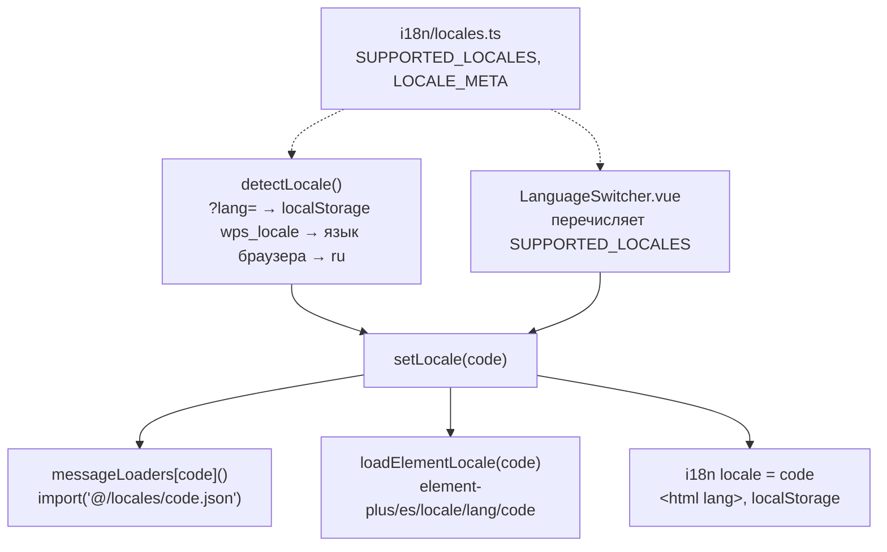

# Новый язык интерфейса

Как добавить язык в веб-интерфейс на примере проверенной немецкой локали (`de`).

<!-- lang-switch -->
[🇬🇧 English](../../../en/07-developer-guide/extending/new-language.md) | 🇷🇺 Русский
<!-- /lang-switch -->

## 1. Когда это нужно

Интерфейс поставляется на русском (`ru` — язык по умолчанию и резервный) и английском (`en`). Добавляйте язык, когда
пользователям нужен интерфейс на другом. Переводится только **фронтенд**: у бэкенда настройки языка нет (что остаётся
непереведённым — см. [UI и переводы](#5-ui-и-переводы)).

## 2. Как это устроено



| Файл | Назначение |
|---|---|
| `front/src/locales/<code>.json` | Все тексты UI. `ru.json` — эталон: по нему строится схема ключей (`src/i18n/types.d.ts`), он же резервный |
| `front/src/i18n/locales.ts` | Реестр: `SUPPORTED_LOCALES`, `DEFAULT_LOCALE`, `LOCALE_META` (название языка на нём самом) |
| `front/src/i18n/index.ts` | `createI18n()` (правила множественного числа, форматы дат), `messageLoaders`, `detectLocale()`, `setLocale()` |
| `front/src/i18n/element-plus.ts` | Тексты Element Plus (выбор даты, пагинация, пустая таблица) для каждого языка |
| `front/src/components/LanguageSwitcher.vue` | Переключатель в шапке и на странице входа — менять не нужно |

- `ru` входит в основной чанк; каждый другой язык — отдельный чанк, который `setLocale()` загружает перед показом.
- `matchLocale()` сопоставляет язык браузера вроде `de-AT` с `de`, как только `de` появится в `SUPPORTED_LOCALES`.
- `AppLocale` выводится из `SUPPORTED_LOCALES`, а `LOCALE_META`, `messageLoaders` и `loaders` Element Plus типизированы
  как `Record<AppLocale, …>` — после добавления кода `vue-tsc` не пропустит сборку, пока во всех трёх нет записи.
- Текущий язык отправляется на бэкенд в заголовке `Accept-Language` (`api/client.ts`), но бэкенд его пока не использует.

## 3. Пошагово

### 3.1 Переводы — `front/src/locales/de.json`

Скопируйте `en.json` (или `ru.json`) и переведите **каждое** значение; ключи, вложенность и подстановки (`{name}`, `{n}`)
оставьте как есть.

```bash
cp front/src/locales/en.json front/src/locales/de.json
```

Фрагмент переведённого файла:

```json
{
  "language": {
    "label": "Sprache"
  },
  "nav": {
    "processes": "Prozesse",
    "processCreate": "Prozess anlegen",
    "users": "Benutzer"
  }
}
```

Правила синтаксиса сообщений ([Соглашения о коде](../coding-conventions.md#фронтенд-vue--typescript)): `@ { } | $` —
служебные символы, буквальный `@` пишется как `{'@'}`. Значения справочников из API переводятся в разделе `dict.*`
(`dict.operator.equals`, `dict.changeType.calculate`, …) — переведите и их.

### 3.2 Реестр — `front/src/i18n/locales.ts`

```ts
export const SUPPORTED_LOCALES = ['ru', 'en', 'de'] as const
export type AppLocale = (typeof SUPPORTED_LOCALES)[number]

export const DEFAULT_LOCALE: AppLocale = 'ru'

/** Название языка — всегда на самом языке, не переводится */
export const LOCALE_META: Record<AppLocale, { label: string; bcp47: string }> = {
  ru: { label: 'Русский', bcp47: 'ru-RU' },
  en: { label: 'English', bcp47: 'en-US' },
  de: { label: 'Deutsch', bcp47: 'de-DE' },
}
```

Порядок в `SUPPORTED_LOCALES` — это порядок в переключателе. `src/i18n/locales.ts` — единственный `.ts`-файл, где
`i18n:check` разрешает нелатинский текст (для названий вроде «Русский»).

### 3.3 Загрузчик, формат даты и правило множественного числа — `front/src/i18n/index.ts`

```ts
export const i18n = createI18n<[MessageSchema], AppLocale, false>({
  legacy: false,
  globalInjection: true,
  locale: DEFAULT_LOCALE,
  fallbackLocale: DEFAULT_LOCALE,
  messages: { ru } as Record<AppLocale, MessageSchema>,
  pluralRules: { ru: ruPluralRule },
  datetimeFormats: { ru: dateTime, en: dateTime, de: dateTime },
  missingWarn: import.meta.env.DEV,
  fallbackWarn: import.meta.env.DEV,
})
```

```ts
const messageLoaders: Record<AppLocale, () => Promise<{ default: MessageSchema }>> = {
  ru: async () => ({ default: ru }),
  en: () => import('@/locales/en.json'),
  de: () => import('@/locales/de.json'),
}
```

- `datetimeFormats` использует `formatDate()` (`utils/format.ts → d(date, 'long')`); TypeScript об этом не напомнит,
  поэтому добавьте язык вручную.
- `pluralRules`: в немецком, как и в английском, работает правило vue-i18n по умолчанию («one | other»). Языку с
  бо́льшим числом форм множественного числа (польский, украинский, чешский…) нужна своя функция, как `ruPluralRule`.

### 3.4 Локаль Element Plus — `front/src/i18n/element-plus.ts`

```ts
const loaders: Record<AppLocale, () => Promise<Language>> = {
  ru: async () => ru,
  en: () => import('element-plus/es/locale/lang/en').then((m) => m.default),
  de: () => import('element-plus/es/locale/lang/de').then((m) => m.default),
}
```

Имя файла — код локали Element Plus (`node_modules/element-plus/es/locale/lang/`), например `zh-cn`, `pt-br`.

## 4. Валидация и ошибки

`npm run i18n:check` (он же первый шаг `npm run build` и сборки Docker-образа фронтенда) сравнивает каждый
`src/locales/*.json` с `ru.json`. Проверенные сообщения:

```
✗ de.json: нет ключа system.latency        ← key missing in de.json
✗ de.json: пустой перевод nav.users        ← empty value
```

Лишний ключ выдаёт `лишний ключ …`. Ошибки TypeScript (`vue-tsc`) появляются, если код добавлен в
`SUPPORTED_LOCALES`, а в `LOCALE_META`, `messageLoaders` или `loaders` Element Plus записи нет.

Непереведённый текст проверка не находит: значение, скопированное с английского, пройдёт. Просмотрите файл перед выпуском.

## 5. UI и переводы

- В компонентах ничего менять не нужно: переключатель, `?lang=de`, язык браузера и запомненный выбор работают
  автоматически. `<html lang>` и заголовок страницы (ключи `route.*`) следуют за языком.
- **Через файлы UI не переводятся:**
  - подписи справочников бэкенда — UI показывает свои тексты `dict.*`, но клиенты API всегда получают `label()`
    бэкенда (на русском);
  - сообщения серверной валидации (`422 details[].message`) — на английском, показываются как есть;
  - названия модулей из CRM / мока (`GET /api/dictionaries/modules`);
  - данные: названия процессов, значения из CRM.
- Если документация должна поддерживать этот язык, добавьте `doc/<code>/` с теми же файлами, что в `doc/en/`, и
  скриншоты `doc/images/screenshots/<code>/` (см. `doc/_meta/screenshots_manifest.md`).

## 6. Тест

```bash
cd front
npm run i18n:check
npm run build
```

Проверенный результат с добавленным `de`:

```
✓ i18n: 408 ключей, языки: de, en, ru
✓ 1745 modules transformed.
dist/assets/de-B83BTEP7.js                        3.94 kB │ gzip:   1.67 kB    ← Element Plus locale
dist/assets/de-B7LZGrcV.js                       25.54 kB │ gzip:   5.85 kB    ← de.json
✓ built in 9.30s
```

Ручная проверка: откройте `http://localhost:3080/processes?lang=de` — в боковом меню немецкие тексты ("Prozesse",
"Prozess anlegen", "Benutzer"), а `document.documentElement.lang` равен `de` (оба пункта проверены на отдельном
стенде). Переключатель в шапке показывает "Deutsch"; после перезагрузки без `?lang` немецкий остаётся, потому что
`setLocale()` сохраняет выбор в `localStorage['wps_locale']`.

## 7. Чек-лист готовности

- [ ] `src/locales/<code>.json` со всеми ключами `ru.json`, каждое значение переведено, подстановки не изменены
- [ ] Код в `SUPPORTED_LOCALES`, название в `LOCALE_META`
- [ ] `messageLoaders`, `datetimeFormats` и (при необходимости) `pluralRules` в `src/i18n/index.ts`
- [ ] Локаль Element Plus в `src/i18n/element-plus.ts`
- [ ] `npm run build` проходит; переключатель, `?lang=<code>` и даты проверены в браузере
- [ ] Новый язык упомянут в `front/README.md` (раздел «Локализация») и на странице [Вход и интерфейс](../../03-user-guide/login-and-ui.md)

<!-- footer-nav -->
---

← Назад: [Новый экран UI](new-ui-screen.md) | [Оглавление](../../README.md) | [Участие в разработке](../contributing.md) Далее →
<!-- /footer-nav -->
