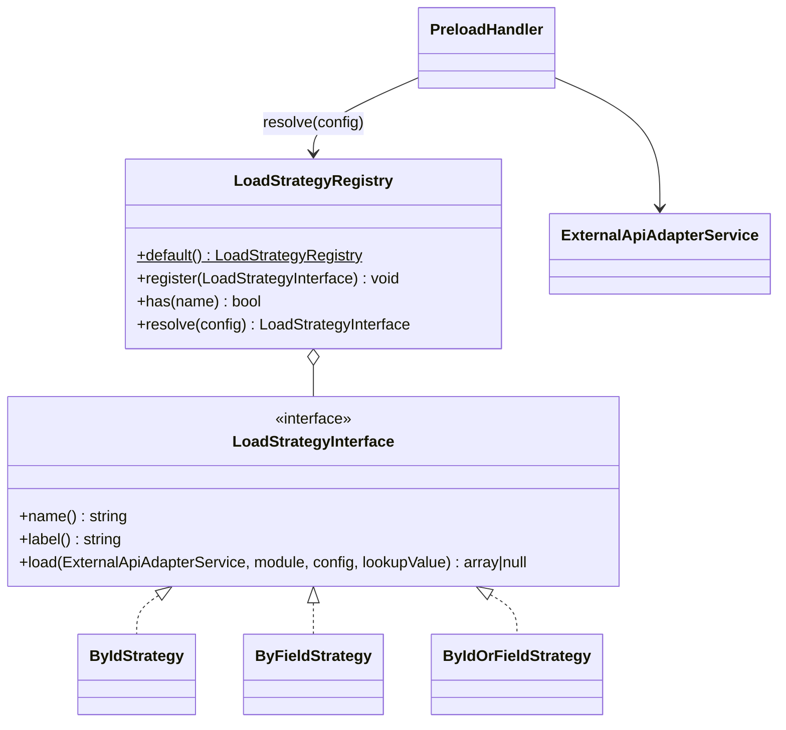

# Новая стратегия загрузки

Как добавить способ загрузки объекта CRM в переменную предзагрузки — на учебном примере стратегии `by_id_or_field`
(«по ID, затем по полю»).

<!-- lang-switch -->
[🇬🇧 English](../../../en/07-developer-guide/extending/new-load-strategy.md) | 🇷🇺 Русский
<!-- /lang-switch -->

## 1. Когда это нужно

Строка предзагрузки (`definition.preload[]` или шаг `preload` в `actions[]`, см.
[Действия → Предзагрузка](../../03-user-guide/actions.md#предзагрузка)) загружает в переменную **один** объект CRM.
Стратегий две: `by_id` (`GET /{module}/{id}`) и `by_field` (`GET /{module}?filter[field]=value&size=1`, первое
совпадение). Новая стратегия нужна для других способов поиска: «по id, а если нет — по полю», «самая свежая запись»,
«по нескольким полям», поиск в другой системе.

Если нужен **список** записей — это действие `find_records`, а не стратегия. Если загружать нужно не из CRM (внешний
API с ответом) — действие `http_request`.

## 2. Как это устроено



Точные сигнатуры (`back/src/LoadStrategies/`):

```php
namespace Wps\LoadStrategies;

interface LoadStrategyInterface
{
    public function name(): string;
    public function label(): string;
    /**
     * @param array<string, mixed> $config the preload row (module, by_field, ...)
     * @return array<string, mixed>|null null when nothing was found
     */
    public function load(ExternalApiAdapterService $api, string $module, array $config, string $lookupValue): ?array;
}

final class LoadStrategyRegistry
{
    public static function default(): self;                        // by_id, by_field
    public function register(LoadStrategyInterface $strategy): void;
    public function has(string $name): bool;
    public function resolve(array $config): LoadStrategyInterface;  // ConfigurationException для неизвестного имени
}
```

- `PreloadHandler::execute()` вычисляет **значение для поиска** по `source` (`object_field` — поле объекта события,
  `variable_field` — поле ранее загруженной переменной, `manual` — введённое значение) и приводит его к строке
  (`ComparatorRegistry::stringify()`, то же, что `TypeCaster::stringify()`). Если значение для поиска пустое,
  переменная получает `null`, а стратегия не вызывается (`found: false`, `reason: Lookup value is empty`).
- `LoadStrategyRegistry::resolve($config)` выбирает стратегию: явный ключ `"strategy"` в строке важнее всего; без него
  `by_field: "id"` (или пустое / отсутствующее) → `by_id`, любое другое поле → `by_field`. Поэтому новая стратегия
  используется, **только** если строка указывает её явно.
- `load()` возвращает «плоский» объект (`id` + атрибуты, как его отдаёт `ExternalApiAdapterService::flatten()`) или
  `null` (не найдено → переменная равна `null`, шаг всё равно `success` с `found: false`).
- Аудит шага пишет `PreloadHandler`: `request_data = {var, module, strategy, by_field, source, value, lookup_value}`,
  `result_data = {found, object}`.
- `PreloadHandler::validate()` при сохранении отклоняет неизвестную `strategy` (`Unknown load strategy`) и проверяет
  `var`, `source`, `module`, `by_field`, `value`; объявляет переменную с видом `preload`.
- Предзагрузка выполняется не только как шаг: если условия запуска ссылаются на переменные, движок выполняет строки
  `definition.preload[]` **до** проверки условий (ленивая предзагрузка, `ExecutionEngineService::prepare()`) тем же
  обработчиком — стратегия вызывается и там.
- Реестр создаётся в `LoadStrategyRegistry::default()` и раздаётся через `Container::loadStrategies()`
  (один экземпляр на воркер, общий для всех корутин).

## 3. Пошагово

| Файл | Изменение |
|---|---|
| `back/src/LoadStrategies/ByIdOrFieldStrategy.php` | **новый** — класс стратегии |
| `back/src/LoadStrategies/LoadStrategyRegistry.php` | регистрация в `default()` |
| `back/tests/Unit/LoadStrategies/ByIdOrFieldStrategyTest.php` | **новый** — юнит-тест |
| `back/tests/IntegrationTest.php` | интеграционная группа + вызов в `run()` |
| `front/…` (по желанию) | поддержка ключа `strategy` в редакторе предзагрузки ([5](#5-ui-и-переводы)) |
| `doc/{ru,en}/03-user-guide/actions.md`, `back/API.md` | описание стратегии |

### 3.1 Класс — `back/src/LoadStrategies/ByIdOrFieldStrategy.php`

```php
<?php

declare(strict_types=1);

namespace Wps\LoadStrategies;

use Wps\Exceptions\ConfigurationException;
use Wps\Services\ExternalApiAdapterService;

/**
 * Tries GET /{module}/{id} first; when nothing is found, searches by "by_field".
 * Selected explicitly with "strategy": "by_id_or_field" in the preload row.
 */
final class ByIdOrFieldStrategy implements LoadStrategyInterface
{
    public function name(): string
    {
        return 'by_id_or_field';
    }

    public function label(): string
    {
        return 'По ID, затем по полю';
    }

    public function load(ExternalApiAdapterService $api, string $module, array $config, string $lookupValue): ?array
    {
        $field = trim((string)($config['by_field'] ?? ''));
        if ($field === '' || $field === 'id') {
            throw new ConfigurationException('Preload: by_field (other than "id") is required for strategy by_id_or_field');
        }
        return $api->getById($module, $lookupValue) ?? $api->findOneByField($module, $field, $lookupValue);
    }
}
```

Доступные методы адаптера для стратегий (`ExternalApiAdapterService`): `getById($module, $id): ?array` (404 → `null`),
`findOneByField($module, $field, $value): ?array`, `findMany($module, CrmFilter $filter, array $sort = [], ?array $fields = null, int $limit = 100): array{items, has_more, requests}`
и `findPage(...)`. Сортировка, операторы фильтра кроме равенства и курсор требуют контракта CRM 2.0 — без нужной
возможности адаптер бросает `CRM_CAPABILITY_MISSING`. Например, «самая свежая запись по полю»:

```php
$found = $api->findMany($module, CrmFilter::eq($field, $lookupValue), [['field' => 'date_entered', 'desc' => true]], null, 1);
return $found['items'][0] ?? null;
```

### 3.2 Регистрация — `back/src/LoadStrategies/LoadStrategyRegistry.php`

Стратегии регистрируются не в `Container`, а в фабрике реестра (её вызывает `Container::loadStrategies()`):

```php
public static function default(): self
{
    $registry = new self();
    $registry->register(new ByIdStrategy());
    $registry->register(new ByFieldStrategy());
    $registry->register(new ByIdOrFieldStrategy());
    return $registry;
}
```

Если стратегии нужен сервис (Redis, конфигурация), передайте его через конструктор стратегии и зарегистрируйте её в
`Container::loadStrategies()` после `LoadStrategyRegistry::default()`:

```php
public function loadStrategies(): LoadStrategyRegistry
{
    return $this->share(LoadStrategyRegistry::class, function (): LoadStrategyRegistry {
        $registry = LoadStrategyRegistry::default();
        $registry->register(new MyCachedStrategy($this->redisData()));   // пример стратегии с зависимостью
        return $registry;
    });
}
```

### 3.3 Использование

```json
{ "var": "acc", "source": "manual", "module": "Accounts", "strategy": "by_id_or_field", "by_field": "inn", "value": "7701234567" }
```

В моке `GET /Accounts/7701234567` вернёт 404, поэтому стратегия перейдёт к
`GET /Accounts?filter[inn]=7701234567&size=1`, и `acc` получит аккаунт. Аудит шага:

```json
{ "request_data": { "var": "acc", "module": "Accounts", "strategy": "by_id_or_field", "by_field": "inn", "source": "manual", "value": "7701234567", "lookup_value": "7701234567" },
  "result_data": { "found": true, "object": { "id": "…", "name": "INN Company", "inn": "7701234567" } } }
```

## 4. Валидация и ошибки

- Ошибки адаптера CRM уже классифицированы: транспортные ошибки, тайм-аут, HTTP 5xx и 408/425/429 → `CrmApiException`
  (восстановимая, повторы по `ACTION_RETRY_MAX` / `retry`), прочие 4xx → невосстановимые, GET 404 → `null`. Не
  перехватывайте их в стратегии.
- Отсутствующая или неверная конфигурация → `ConfigurationException` (невосстановимая, шаг падает с вашим сообщением).
- `load()` не должен иметь побочных эффектов: при восстановимой ошибке движок восстанавливает снимок контекста и
  вызывает шаг заново, после падения воркера — тоже.
- `PreloadHandler::validate()` проверяет `var`, `source`, `module`, `by_field`, `value` и имя стратегии. Для собственных
  ключей стратегии в интерфейсе **нет хука валидации** при сохранении — проверяйте их в `load()` и бросайте
  `ConfigurationException`, либо добавьте проверку в `PreloadHandler::validate()` (это изменение ядра).
- Не храните результат вызова в свойствах стратегии: экземпляр общий для всех корутин воркера.

## 5. UI и переводы

В редакторе предзагрузки (`PreloadPanel.vue`) нет выбора стратегии, но ключ `strategy` **сохраняется**: строка хранит
исходный объект (`_raw`), и `definitionFromForm()` в `front/src/utils/processForm.ts` накладывает поля формы поверх него
(`strategy` остаётся и при смене источника). Поэтому:

- строки с собственной стратегией создавайте через API или импорт JSON — редактор их не испортит; или
- расширьте UI: добавьте `strategy?: string` в `PreloadAction` (`front/src/types/index.ts`), заполняйте его в
  `formFromProcess()` и записывайте в `buildPreload()`, добавьте выпадающий список в `PreloadPanel.vue` с подписями
  в `locales/*.json` (например, `preload.strategy.by_id_or_field`). Эндпоинта-справочника стратегий нет — добавьте
  его по [инструкции для нового эндпоинта](new-api-endpoint.md), если UI должен показывать список
  (`GET /api/dictionaries/preload-sources` — это источники значения, не стратегии).

Карточка процесса (`ProcessDetailView.vue`) показывает строки предзагрузки по модулю и `by_field` — для чтения этого достаточно.

## 6. Тест

### 6.1 Юнит-тест — `back/tests/Unit/LoadStrategies/ByIdOrFieldStrategyTest.php`

`ExternalApiAdapterService` — `final`-класс без интерфейса, подменить его фейком нельзя. Юнит-тест проверяет то, что не
доходит до сети: выбор стратегии реестром, ошибку конфигурации и валидацию строки. Сами запросы к CRM проверяются
интеграционно на моке (так же устроены существующие тесты: адаптер создаётся через `newInstanceWithoutConstructor()`).

```php
<?php

declare(strict_types=1);

namespace Wps\Tests\Unit\LoadStrategies;

use PHPUnit\Framework\TestCase;
use Wps\Actions\PreloadHandler;
use Wps\Exceptions\ConfigurationException;
use Wps\LoadStrategies\ByIdOrFieldStrategy;
use Wps\LoadStrategies\LoadStrategyRegistry;
use Wps\Services\ExternalApiAdapterService;
use Wps\Services\Validation\DefinitionScope;

final class ByIdOrFieldStrategyTest extends TestCase
{
    private static function registry(): LoadStrategyRegistry
    {
        $registry = LoadStrategyRegistry::default();
        $registry->register(new ByIdOrFieldStrategy());
        return $registry;
    }

    /** final adapter without a CRM: only for paths that never reach the network */
    private static function api(): ExternalApiAdapterService
    {
        return (new \ReflectionClass(ExternalApiAdapterService::class))->newInstanceWithoutConstructor();
    }

    public function testResolve(): void
    {
        $registry = self::registry();
        self::assertSame('by_id_or_field', $registry->resolve(['strategy' => 'by_id_or_field', 'by_field' => 'inn'])->name());
        self::assertSame('by_id', $registry->resolve(['by_field' => 'id'])->name(), 'without "strategy" the old rule applies');
        self::assertSame('by_field', $registry->resolve(['by_field' => 'inn'])->name());
    }

    public function testConfigurationError(): void
    {
        $this->expectException(ConfigurationException::class);
        $this->expectExceptionMessage('Preload: by_field (other than "id") is required for strategy by_id_or_field');
        (new ByIdOrFieldStrategy())->load(self::api(), 'Accounts', ['by_field' => 'id'], '7701234567');
    }

    public function testValidation(): void
    {
        $handler = new PreloadHandler(self::api(), self::registry());
        $scope = new DefinitionScope();
        $handler->validate(['var' => 'acc', 'source' => 'manual', 'module' => 'Accounts', 'strategy' => 'by_id_or_field', 'by_field' => 'inn', 'value' => '1'], $scope, 'a');
        $handler->validate(['var' => 'acc2', 'source' => 'manual', 'module' => 'Accounts', 'strategy' => 'newest', 'value' => '1'], $scope, 'b');
        self::assertSame(['b.strategy: Unknown load strategy'], array_map(static fn (array $e) => $e['field'] . ': ' . $e['message'], $scope->errors()));
        self::assertSame('preload', $scope->kind('acc'));
    }
}
```

Запуск — [Тестирование](../testing.md#юнит-тесты-бэкенда).

### 6.2 Интеграционный тест — `back/tests/IntegrationTest.php`

Запись с ИНН создаётся вспомогательным API мока (`PUT /mock/objects/{module}/{id}`); id и ИНН уникальны для прогона,
потому что мок хранит данные прошлых прогонов. Те же проверки входят в шаблон общей группы `testExtensions()`
([Новый тип действия → Тест](new-action-type.md#6-тест)).

```php
/**
 * preload strategy by_id_or_field: by id first, then by another field.
 */
private function testLoadStrategy(): void
{
    echo "[load strategy]\n";
    $inn = (string)random_int(1000000000, 9999999999);
    $accountId = "{$this->accountId}-inn-{$inn}";
    $this->test('by_id_or_field: found by id and by the other field; an unknown strategy is rejected', function () use ($inn, $accountId) {
        $raw = $this->raw('PUT', "/mock/objects/Accounts/{$accountId}", ['name' => 'INN Company', 'inn' => $inn], base: $this->crmUrl);
        $this->assertEquals(200, $raw['status']);
        $process = $this->request('POST', '/api/processes', ['name' => 'TEST load strategy', 'object_type' => 'TestExt', 'is_child' => false, 'definition' => [
            'preload' => [['var' => 'acc', 'source' => 'object_field', 'module' => 'Accounts', 'strategy' => 'by_id_or_field', 'by_field' => 'inn', 'value' => 'object.account_ref']],
        ]], $this->adminToken, 201)['data'];
        foreach ([$inn, $accountId] as $ref) {   // by the other field, then by id
            $run = $this->request('POST', "/api/processes/{$process['id']}/run", ['object' => ['id' => 'ls-' . random_int(1000, 9999), 'account_ref' => $ref]], $this->adminToken, 201)['data'];
            $e = $this->waitForExecution($run['execution_id']);
            $this->assertEquals('completed', $e['status'], (string)($e['error_message'] ?? ''));
            $this->assertEquals('INN Company', $e['context']['variables']['acc']['name'] ?? null);
            $this->assertEquals('by_id_or_field', $e['actions'][0]['request_data']['strategy']);
        }
        $bad = $this->request('POST', '/api/processes', ['name' => 'TEST load strategy bad', 'object_type' => 'TestExt', 'is_child' => false, 'definition' => [
            'preload' => [['var' => 'acc', 'source' => 'manual', 'module' => 'Accounts', 'strategy' => 'newest', 'value' => 'x']],
        ]], $this->adminToken, 422);
        $d = array_column($bad['error']['details'], 'message', 'field');
        $this->assertEquals('Unknown load strategy', $d['definition.preload[0].strategy'] ?? null);
        $this->request('DELETE', "/api/processes/{$process['id']}", token: $this->adminToken);
    });
}
```

Вызов `$this->testLoadStrategy();` добавьте в `run()` (например, после `$this->testRunOnce();`).

### 6.3 Документация

- [Действия → Предзагрузка](../../03-user-guide/actions.md#предзагрузка) (ru + en): ключ `strategy`, когда стратегия
  применяется, что требуется от CRM.
- `back/API.md`: допустимые значения `strategy` в строке предзагрузки.

## 7. Типичные ошибки

| Ошибка | Последствие | Как правильно |
|---|---|---|
| Ожидание, что стратегия выберется сама по `by_field` | используется `by_field` / `by_id` | указывать `"strategy"` явно |
| Перехват `CrmApiException` в `load()` | временный сбой CRM не повторяется или превращается в «не найдено» | пропускать исключения адаптера |
| Запись в CRM или иной побочный эффект в `load()` | повтор шага и ленивая предзагрузка повторяют эффект | только чтение |
| Возврат ответа CRM как есть (`{type, id, attributes}`) | поля недоступны как `acc.name` | плоский объект (`flatten()` уже делают методы адаптера) |
| Сохранение процесса из редактора | ключ `strategy` теряется | поддержать ключ во фронтенде или править через API |
| Поиск без лимита (`findMany` с большим `limit`) | лишняя нагрузка на CRM на каждом событии | `limit` = 1, сортировка на стороне CRM |

## 8. Чек-лист готовности

- [ ] `final`-класс в `back/src/LoadStrategies/`, `declare(strict_types=1)`, уникальный `name()`
- [ ] Зарегистрирован в `LoadStrategyRegistry::default()` (или в `Container::loadStrategies()`, если есть зависимости)
- [ ] `load()` только читает, возвращает плоский объект или `null`; ошибки конфигурации — `ConfigurationException`
- [ ] Строки явно указывают `"strategy": "<name>"`; решение по UI принято (только API или поддержка в редакторе)
- [ ] Юнит-тест и интеграционная группа добавлены, тесты зелёные
- [ ] Описана в [Действиях](../../03-user-guide/actions.md#предзагрузка) (en + ru) и в `back/API.md`

<!-- footer-nav -->
---

← Назад: [Новый тип изменения](new-change-type.md) | [Оглавление](../../README.md) | [Функции выражений](expression-functions.md) Далее →
<!-- /footer-nav -->
