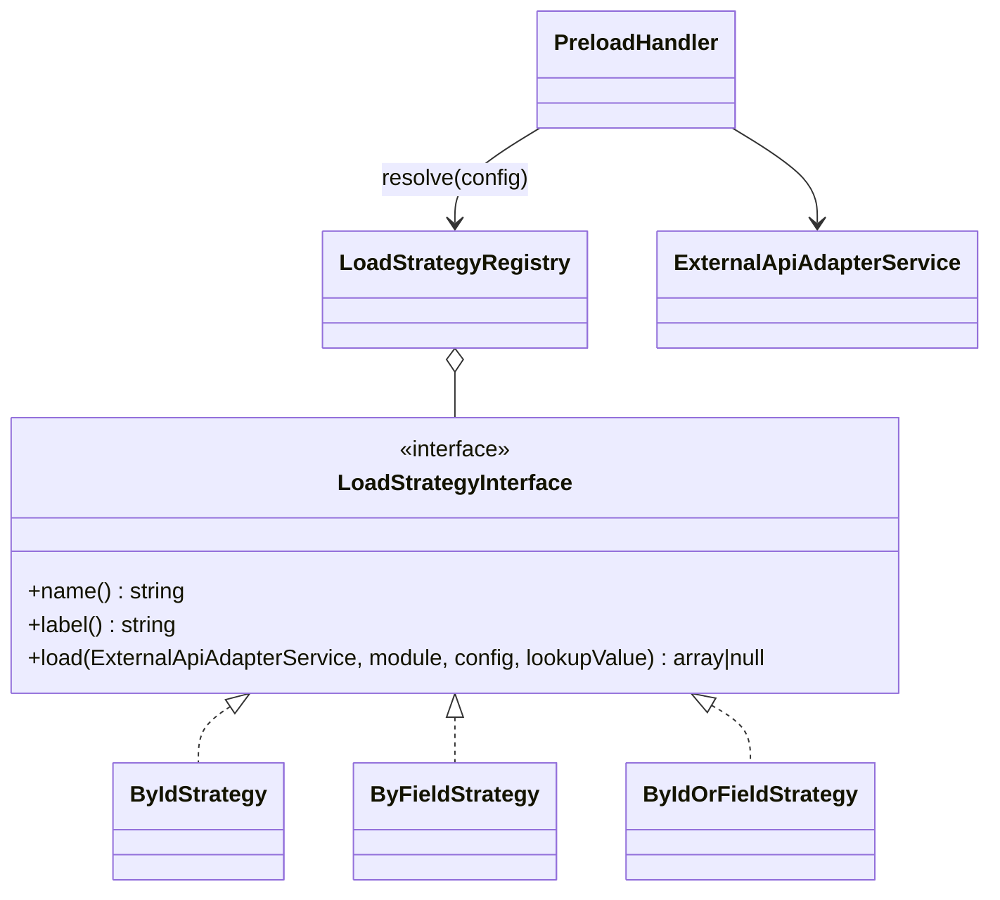

# Новая стратегия загрузки

Как добавить способ загрузки объекта CRM в переменную предзагрузки — на проверенном примере стратегии `by_id_or_field`.

<!-- lang-switch -->
[🇬🇧 English](../../../en/07-developer-guide/extending/new-load-strategy.md) | 🇷🇺 Русский
<!-- /lang-switch -->

## 1. Когда это нужно

Строка предзагрузки (`definition.preload[]` или шаг `preload` в `actions[]`) загружает в переменную один объект CRM.
Стратегий две: `by_id` (`GET /{module}/{id}`) и `by_field` (`GET /{module}?filter[field]=value&size=1`, первое совпадение).
Новая стратегия нужна для других способов поиска: «по id, а если нет — по полю», «самая свежая запись», «по нескольким
полям», поиск в другой системе.

## 2. Как это устроено



- `PreloadHandler::execute()` вычисляет **значение для поиска** по `source` (`object_field` — поле объекта события,
  `variable_field` — поле ранее загруженной переменной, `manual` — введённое значение) и приводит его к строке.
  Если значение для поиска пустое, переменная получает `null`, а стратегия не вызывается.
- `LoadStrategyRegistry::resolve($config)` выбирает стратегию: явный ключ `"strategy"` в строке важнее всего; без него
  `by_field: "id"` (или пустое) → `by_id`, любое другое поле → `by_field`. Поэтому новая стратегия используется,
  **только** если строка указывает её явно.
- `load()` возвращает «плоский» объект (`id` + атрибуты) или `null` (не найдено → переменная равна `null`, шаг всё равно
  `success` с `found: false`).
- `PreloadHandler::validate()` отклоняет неизвестную `strategy` (`Unknown load strategy`).
- Реестр создаётся в `LoadStrategyRegistry::default()` и раздаётся через `Container::loadStrategies()`.

## 3. Пошагово

### 3.1 Класс — `back/src/LoadStrategies/ByIdOrFieldStrategy.php`

```php
<?php

declare(strict_types=1);

namespace Wps\LoadStrategies;

use Wps\Exceptions\ConfigurationException;
use Wps\Services\ExternalApiAdapterService;

/**
 * Tries GET /{module}/{id} first; when nothing is found, searches by "by_field".
 * Selected explicitly with "strategy": "by_id_or_field" in the preload row.
 */
final class ByIdOrFieldStrategy implements LoadStrategyInterface
{
    public function name(): string
    {
        return 'by_id_or_field';
    }

    public function label(): string
    {
        return 'По ID, затем по полю';
    }

    public function load(ExternalApiAdapterService $api, string $module, array $config, string $lookupValue): ?array
    {
        $field = trim((string)($config['by_field'] ?? ''));
        if ($field === '' || $field === 'id') {
            throw new ConfigurationException('Preload: by_field (other than "id") is required for strategy by_id_or_field');
        }
        return $api->getById($module, $lookupValue) ?? $api->findOneByField($module, $field, $lookupValue);
    }
}
```

### 3.2 Регистрация — `back/src/LoadStrategies/LoadStrategyRegistry.php`

```php
public static function default(): self
{
    $registry = new self();
    $registry->register(new ByIdStrategy());
    $registry->register(new ByFieldStrategy());
    $registry->register(new ByIdOrFieldStrategy());
    return $registry;
}
```

### 3.3 Использование

```json
{ "var": "acc", "source": "manual", "module": "Accounts", "strategy": "by_id_or_field", "by_field": "inn", "value": "7701234567" }
```

В моке `GET /Accounts/7701234567` возвращает 404, поэтому стратегия переходит к `GET /Accounts?filter[inn]=7701234567&size=1`,
и `acc` получает аккаунт (проверено).

## 4. Валидация и ошибки

- Ошибки адаптера CRM уже классифицированы: транспортные ошибки и HTTP 5xx → `CrmApiException` (восстановимая,
  с повторами), прочие 4xx → невосстановимые, GET 404 → `null`. Не перехватывайте их в стратегии.
- Отсутствующая или неверная конфигурация → `ConfigurationException` (невосстановимая, шаг падает с вашим сообщением).
- `load()` не должен иметь побочных эффектов: движок может вызвать его повторно при повторе или после восстановления.
- `PreloadHandler::validate()` проверяет `var`, `source`, `module`, `by_field`, `value` и имя стратегии. Для собственных
  ключей стратегии в интерфейсе нет хука — проверяйте их в `load()` и бросайте `ConfigurationException`.

## 5. UI и переводы

В редакторе предзагрузки (`PreloadPanel.vue`) нет выбора стратегии, и **редактор не сохраняет ключ `strategy`**:
`definitionFromForm()` в `front/src/stores/processes.ts` записывает только `var`, `source`, `module`, `by_field`, `value`.
Поэтому сейчас:

- создавайте строки с собственной стратегией через API или импорт JSON и не пересохраняйте такой процесс из редактора; или
- расширьте UI: добавьте `strategy?: string` в `PreloadAction` (`front/src/types/index.ts`), копируйте его в
  `formFromProcess()` и `definitionFromForm()`, добавьте выпадающий список в `PreloadPanel.vue` с подписями
  в `locales/*.json` (например, `preload.strategy.by_id_or_field`). Эндпоинта-справочника стратегий пока нет — добавьте
  его по [инструкции для нового эндпоинта](new-api-endpoint.md), если UI должен показывать список.

Карточка процесса (`ProcessDetailView.vue`) показывает строки предзагрузки по модулю и `by_field` — для чтения этого достаточно.

## 6. Тест

Из проверенной группы `testExtensions()` ([полный текст](new-action-type.md#6-тест)):

```php
$inn = (string)random_int(1000000000, 9999999999);
$this->test('Seed an account with an INN in the mock CRM', function () use ($inn) {
    $raw = $this->raw('PUT', "/mock/objects/Accounts/{$this->accountId}-inn", ['name' => 'INN Company', 'inn' => $inn], base: $this->crmUrl);
    $this->assertEquals(200, $raw['status']);
});
// process: 'preload' => [['var' => 'acc', 'source' => 'manual', 'module' => 'Accounts',
//                         'strategy' => 'by_id_or_field', 'by_field' => 'inn', 'value' => $inn]]
// after the run:
$this->assertEquals('INN Company', $execution['context']['variables']['acc']['name']);
```

## 7. Чек-лист готовности

- [ ] `final`-класс в `back/src/LoadStrategies/`, уникальный `name()`
- [ ] Зарегистрирован в `LoadStrategyRegistry::default()`
- [ ] Строки явно указывают `"strategy": "<name>"`; решение по UI принято (только API или поддержка в редакторе)
- [ ] Интеграционная проверка добавлена, тесты зелёные
- [ ] Описана в [Действиях](../../03-user-guide/actions.md) (часть про предзагрузку, en + ru) и в `back/API.md`

<!-- footer-nav -->
---

← Назад: [Новый тип изменения](new-change-type.md) | [Оглавление](../../README.md) | [Функции выражений](expression-functions.md) Далее →
<!-- /footer-nav -->
