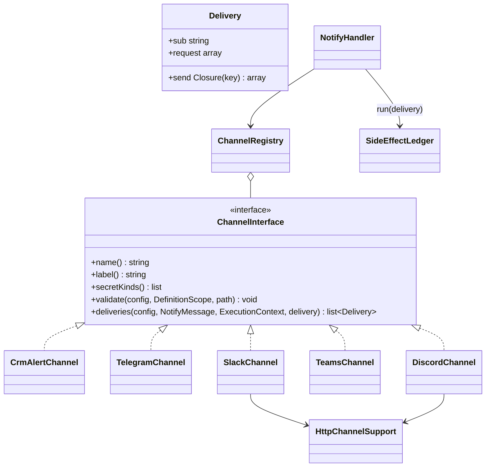

# Новый канал уведомлений

Как добавить канал в действие `notify` («Уведомление») — на учебном примере вебхука Discord.

<!-- lang-switch -->
[🇬🇧 English](../../../en/07-developer-guide/extending/new-notify-channel.md) | 🇷🇺 Русский
<!-- /lang-switch -->

## 1. Когда это нужно

Действие [Уведомление](../../03-user-guide/actions.md#уведомление) из коробки отправляет в колокольчик CRM
(`crm_alert`), Telegram, Slack и Microsoft Teams. Другой мессенджер, корпоративный чат или сервис оповещений
(Discord, Mattermost, Rocket.Chat, SMS-шлюз) подключается **каналом**: класс, который превращает общее сообщение в одну
или несколько доставок. Повтор без дублей, итог шага по `fail_on`, маскирование секретов и аудит канал получает от
`NotifyHandler` бесплатно.

Если нужно не короткое уведомление, а произвольный HTTP-вызов с ответом, который используют следующие шаги, — это
действие [`http_request`](../../03-user-guide/actions.md), а не канал. Если нужен совсем другой шаг —
[новый тип действия](new-action-type.md).

## 2. Как это устроено



Точные сигнатуры (`back/src/Notify/`):

```php
namespace Wps\Notify;

interface ChannelInterface
{
    public function name(): string;                    // "channel" в определении: "discord"
    public function label(): string;                   // подпись в справочнике
    /** @return list<string> виды секретов в "connection"; [] — у канала нет подключения */
    public function secretKinds(): array;
    /** @param array<string, mixed> $config элемент "channels" */
    public function validate(array $config, DefinitionScope $scope, string $path): void;
    /** @return list<Delivery> пустой список — канал "skipped" ("No recipients") */
    public function deliveries(array $config, NotifyMessage $message, ExecutionContext $context, string $delivery): array;
}

final class Delivery
{
    public function __construct(
        public readonly string $sub,       // ключ доставки, уникальный в канале и стабильный между повторами
        public readonly array $request,    // что показать в аудите (без секретов)
        public readonly \Closure $send,    // fn (string $idempotencyKey): array — внешний вызов, результат идёт в журнал
    ) {}
}

final class ChannelRegistry
{
    public function register(ChannelInterface $channel): void;
    public function has(mixed $name): bool;
    public function get(string $name): ChannelInterface;    // \InvalidArgumentException для неизвестного
    /** @return list<array{value: string, label: string, secret_kinds: list<string>}> */
    public function dictionary(): array;
}
```

- `NotifyHandler` один раз собирает `NotifyMessage` — заголовок, текст и ссылку (`$message->link`, `linkModule`,
  `linkId`). `NotifyMessage::text(EscapeMode $mode = EscapeMode::Text): array{title, message}` рендерит шаблоны с нужным
  экранированием (`Text`, `Html`, `Url` …), обрезает текст до `NotifyMessage::MAX_LENGTH` (4000) и кэширует результат
  по режиму; `plain()` — простой текст «заголовок + сообщение» для превью и запасного поля.
- Для каждого элемента `channels[i]` вызывается `deliveries()`. Канал возвращает список `Delivery`.
- `NotifyHandler` проводит каждую доставку через журнал побочных эффектов:
  `SideEffectLedger::run($context, 'notify', "{$i}:{$d->sub}", $delivery, $d->request + ['text' => …], $d->send)`.
  Ключ эффекта в журнале — `{pc}@{iteration}#{i}:{sub}` (`@{iteration}` — только внутри цикла). При повторе шага уже
  доставленное возвращается из журнала (`replayed: true`), `send` не вызывается. Замыкание `send` получает внешний
  ключ идемпотентности `{execution_id}:{effect_key}` — передайте его сервису, если он умеет ключи идемпотентности.
- Исключение из `send` (или из `deliveries()`) — ошибка **канала**, остальные каналы всё равно отправляются. Если ошибка
  восстановимая (`ErrorClassifier` → `transient`: 408/425/429/503, сеть), после обхода всех каналов `NotifyHandler`
  бросает её — шаг повторяется по политике `retry`. Иначе канал получает `failed`, итог шага решает `fail_on`
  (`any` — шаг падает при любой ошибке, `all` — только если не доставлено ничего).
- `delivery` шага (`at_most_once` по умолчанию у `notify`, `at_least_once`) передаётся в `deliveries()` — используйте его
  в `HttpChannelSupport::post()` / `check()`.
- `HttpChannelSupport` — общее для HTTP-каналов (`new HttpChannelSupport(OutboundHttpClient $http, ?SecretResolver $secrets, int $retryAfterMax = 300)`):

  | Метод | Что делает |
  |---|---|
  | `secret(string $reference, ?SecretMasker $masker): string` | значение секрета `connection` (для составного секрета — поле `value` / `url` / `token`), регистрирует его в маскировщике шага |
  | `post(string $url, array $body, string $service, string $delivery, string $effect, ?SecretMasker $masker): OutboundResponse` | JSON-`POST` через `OutboundHttpClient` (защита от SSRF `EgressGuard`, таймаут 15 с); URL целиком регистрируется в маскировщике; обрыв **после** отправки при `at_most_once` → `UnknownOutcomeException` |
  | `check(OutboundResponse $response, string $service, string $delivery, string $effect, ?string $error = null, ?int $retryAfter = null): void` | 2xx — ок; 408/425/429/503 — восстановимая ошибка с `Retry-After` (не больше `HTTP_RETRY_AFTER_MAX`); 500/502/504 — повтор только при `at_least_once`, иначе `UNKNOWN_OUTCOME`; прочие коды — невосстановимая ошибка |
  | `validateConnection(mixed $connection, array $kinds, DefinitionScope $scope, string $field): void` | ссылка `secret://name` обязательна; вид секрета должен быть из `$kinds` |

- Реестр каналов создаётся в `Container::notifyChannels()` и передаётся в `NotifyHandler` (`Container::actions()`).
  Справочник — `GET /api/dictionaries/notify-channels` (`NotifyChannelsController`), проверка канала без процесса —
  `POST /api/notify/test`.

## 3. Пошагово

| Файл | Изменение |
|---|---|
| `back/src/Notify/Channels/DiscordChannel.php` | **новый** — класс канала |
| `back/src/Kernel/Container.php` | регистрация в `notifyChannels()` |
| `back/tests/Unit/Notify/DiscordChannelTest.php` | **новый** — юнит-тест |
| `back/tests/IntegrationTest.php` | группа `testDiscordChannel()` + вызов в `run()`; список каналов в `testNotify()` |
| `mock/mock_server.php` | по желанию — свой эндпоинт `/mock/discord/{id}` (пример ниже обходится `/mock/slack/{id}`) |
| `doc/{ru,en}/03-user-guide/actions.md`, `back/API.md` | описание канала и его полей |

### Шаг 1. Класс канала — `back/src/Notify/Channels/DiscordChannel.php`

Сообщение Discord — JSON `{"content": "…"}` до 2000 символов с markdown-разметкой. Тело собирается в статическом
методе `body()`, чтобы его можно было проверить юнит-тестом без сети (так же сделано у `TeamsChannel::body()`).

```php
<?php

declare(strict_types=1);

namespace Wps\Notify\Channels;

use Wps\Context\ExecutionContext;
use Wps\Notify\ChannelInterface;
use Wps\Notify\Delivery;
use Wps\Notify\HttpChannelSupport;
use Wps\Notify\NotifyMessage;
use Wps\Notify\RecordLinks;
use Wps\Services\Validation\DefinitionScope;

/**
 * Discord webhook (secret of kind webhook_url): {"content": "**title**\ntext\nlink"}, at most 2000 characters.
 * Mentions are disabled (allowed_mentions), so "@everyone" from CRM data does not ping the channel.
 */
final class DiscordChannel implements ChannelInterface
{
    public const MAX_LENGTH = 2000;

    public function __construct(
        private readonly HttpChannelSupport $http,
        private readonly RecordLinks $links,
    ) {
    }

    public function name(): string
    {
        return 'discord';
    }

    public function label(): string
    {
        return 'Discord';
    }

    public function secretKinds(): array
    {
        return ['webhook_url', 'generic'];
    }

    /**
     * Discord markdown: * _ ~ ` | > and \ are escaped, so CRM data cannot change the formatting.
     */
    public static function escape(string $text): string
    {
        return (string)preg_replace('/([\\\\*_~`|>])/', '\\\\$1', $text);
    }

    /**
     * @param array{title: string, message: string} $text
     * @return array<string, mixed>
     */
    public static function body(array $text, ?string $link): array
    {
        $content = ($text['title'] !== '' ? '**' . self::escape($text['title']) . "**\n" : '') . self::escape($text['message']);
        if ($link !== null) {
            $content .= "\n{$link}";
        }
        return ['content' => mb_substr($content, 0, self::MAX_LENGTH), 'allowed_mentions' => ['parse' => []]];
    }

    public function deliveries(array $config, NotifyMessage $message, ExecutionContext $context, string $delivery): array
    {
        $link = $message->link !== null ? $this->links->absolute($message->link) : null;
        $body = self::body($message->text(), $link !== null && $this->links->isAbsolute($link) ? $link : null);
        $connection = (string)$config['connection'];
        return [new Delivery('discord:' . sha1($connection), ['connection' => $connection],
            function (string $key) use ($connection, $body, $context, $delivery): array {
                $url = $this->http->secret($connection, $context->secretMasker);
                $response = $this->http->post($url, $body, 'discord', $delivery, $key, $context->secretMasker);
                $this->http->check($response, 'discord', $delivery, $key);
                return ['status' => $response->status];
            })];
    }

    public function validate(array $config, DefinitionScope $scope, string $path): void
    {
        $this->http->validateConnection($config['connection'] ?? null, $this->secretKinds(), $scope, "{$path}.connection");
    }
}
```

Что здесь важно:

- `sub` = `discord:` + `sha1(connection)` — стабилен между повторами шага и различает два канала Discord в одном шаге.
- В `request` доставки — только ссылка `secret://…`, не URL вебхука.
- Секрет разрешается **внутри** `send`: при повторе из журнала (`replayed`) он даже не расшифровывается.
- Ссылка на запись: `RecordLinks::absolute()` дописывает `CRM_UI_BASE_URL` к относительной ссылке; если базовый адрес
  не задан, ссылка остаётся относительной, и канал её не добавляет (как Slack и Telegram).
- Канал **не хранит** состояние вызова в свойствах: один экземпляр на воркер обслуживает все корутины.

### Шаг 2. Регистрация — `back/src/Kernel/Container.php`

```php
use Wps\Notify\Channels\DiscordChannel;

/**
 * Channels of the notify action (md/tasks_list/4.8-notify.md).
 */
public function notifyChannels(): ChannelRegistry
{
    return $this->share(ChannelRegistry::class, function (): ChannelRegistry {
        $http = new HttpChannelSupport($this->outboundHttp(), $this->secretResolver(), $this->config()->httpRetryAfterMax);
        $registry = new ChannelRegistry();
        $registry->register(new CrmAlertChannel($this->crm(), $this->templates(), $this->recordLinks()));
        $registry->register(new TelegramChannel($http, $this->templates(), $this->recordLinks(), $this->config()->telegramApiBase));
        $registry->register(new SlackChannel($http, $this->recordLinks()));
        $registry->register(new TeamsChannel($http, $this->recordLinks()));
        $registry->register(new DiscordChannel($http, $this->recordLinks()));   // новый канал
        return $registry;
    });
}
```

Порядок `register()` — порядок в справочнике. Если каналу нужна настройка (базовый адрес API, как `TELEGRAM_API_BASE`),
добавьте поле в `AppConfig` (с границами) и `back/.env.example` и передайте значение в конструктор.

### Шаг 3. Пересборка и использование

```bash
docker compose up -d --build backend
```

Канал появится в `GET /api/dictionaries/notify-channels`
(`{"value":"discord","label":"Discord","secret_kinds":["webhook_url","generic"]}`). Создайте секрет вида
`webhook_url` (`POST /api/secrets`, см. [Секреты](../../03-user-guide/secrets.md)) и используйте его в определении:

```json
{ "type": "notify", "title": "Сделка выиграна", "message": "{{ object.name }} — {{ object.amount }}",
  "link": { "record": "object" },
  "channels": [ { "channel": "discord", "connection": "secret://discord_sales" } ] }
```

Проверка без процесса — `POST /api/notify/test` с `{"channel": {"channel": "discord", "connection": "secret://discord_sales"}}`:
ответ `{"sent": true, "result": {…}}` или `{"sent": false, "error": "…"}` (ошибки валидации — `422` с полями `channel.*`).

### Шаг 4. Аудит шага

Канал ничего не пишет в аудит сам — это делает `NotifyHandler`:

| Поле | Содержимое |
|---|---|
| `request_data.channels[]` | элементы `channels` (только ключи `channel`, `connection`, `chat_id`, `users`, `format`) |
| `request_data.title`, `message_preview`, `link`, `delivery` | общее сообщение |
| `result_data.channels[i]` | `{channel, status: success\|skipped\|failed, deliveries: [request + ответ send + replayed], error, error_code}` |
| `result_data.warnings` | например, `Message was cut to 4000 characters` |

Всё это проходит через маскировщик шага, поэтому зарегистрированные `secret()` и `post()` значения превращаются в `***`.

### Шаг 5. Редактор процесса

Во фронтенде нет редактора `notify`: шаг уведомления показывается в блоке изменений как строка только для чтения
(passthrough, `formFromProcess()` в `front/src/utils/processForm.ts`) и сохраняется без изменений. Поэтому новый канал
не требует правок фронтенда — процесс с ним создают через API или импорт JSON.

## 4. Правила

- **Секреты.** Токены и URL вебхуков — только через `connection` (`secret://…`) и `HttpChannelSupport::secret()`:
  значение регистрируется в маскировщике шага и вырезается из аудита, ошибок и логов. Не кладите секрет в `request`
  доставки. Если секрет попадает в URL, `post()` маскирует URL целиком. Валидатор процесса сам проверяет, что секрет
  существует; `validateConnection()` — вид секрета.
- **Экранирование.** Берите текст через `NotifyMessage::text()` с режимом, который подходит формату сервиса
  (`EscapeMode::Html` для HTML, как Telegram; свой `escape()` для разметки вроде mrkdwn — `SlackChannel::escape()`, или
  markdown — `DiscordChannel::escape()`): подстановки из CRM не должны ломать разметку сообщения. Отключайте упоминания,
  если сервис их поддерживает.
- **Ключ доставки** `sub` должен быть стабильным между повторами шага (id получателя, хеш `connection`), иначе журнал не
  узнает уже доставленное и сообщение уйдёт дважды. Не используйте в `sub` время, случайные числа и текст сообщения.
- **Неизвестный исход.** У вебхуков мессенджеров обычно нет ключей идемпотентности; оставьте классификацию ответов
  `HttpChannelSupport::check()`: при `at_most_once` (по умолчанию у `notify`) спорный ответ не повторяется
  (`error_code: UNKNOWN_OUTCOME`). Если API сервиса принимает ключ идемпотентности, передайте ему `$key` из `send`.
- **Ответ сервиса с ошибкой в теле при HTTP 200** (как у Telegram `{"ok": false}`) передавайте в
  `check($response, …, error: $description, retryAfter: $retryAfter)`.
- **Канал без HTTP** (запись в CRM, очередь) реализует `send` сам, как `CrmAlertChannel` (несколько доставок —
  по одной на пользователя, `sub = crm_alert:{user}`); `secretKinds()` тогда возвращает `[]`.
- **Вызовы только в `send`.** `deliveries()` вызывается при каждой попытке шага, в том числе когда доставка уже есть в
  журнале: в нём можно рендерить и проверять, но не отправлять.

## 5. Тест

### 5.1 Юнит-тест — `back/tests/Unit/Notify/DiscordChannelTest.php`

По образцу `NotifyTest`: тело и экранирование, `sub`/`request` доставки, правила `validate()`. HTTP-клиент `final` и
здесь не вызывается — достаточно экземпляра без конструктора; `HttpChannelSupport` без `SecretResolver` проверяет
только форму ссылки `secret://`.

```php
<?php

declare(strict_types=1);

namespace Wps\Tests\Unit\Notify;

use PHPUnit\Framework\TestCase;
use Wps\Context\ExecutionContext;
use Wps\Expression\ExpressionEngine;
use Wps\Http\Outbound\OutboundHttpClient;
use Wps\Notify\Channels\DiscordChannel;
use Wps\Notify\HttpChannelSupport;
use Wps\Notify\NotifyMessage;
use Wps\Notify\RecordLinks;
use Wps\Services\Validation\DefinitionScope;
use Wps\Template\TemplateEngine;

final class DiscordChannelTest extends TestCase
{
    private static function channel(): DiscordChannel
    {
        // the HTTP client is final and is not called here: deliveries() only prepares the closure
        $client = (new \ReflectionClass(OutboundHttpClient::class))->newInstanceWithoutConstructor();
        return new DiscordChannel(new HttpChannelSupport($client, null), new RecordLinks('suitecrm8', '', 'http://crm.local/'));
    }

    private static function message(string $message, string $title = '', ?string $link = null): NotifyMessage
    {
        $context = ExecutionContext::fromEvent('e', ['id' => 'L1', 'last_name' => 'Иванов *VIP* @everyone'], 'Leads');
        return new NotifyMessage(new TemplateEngine(new ExpressionEngine()), $title, $message,
            static fn (string $p) => $context->resolve($p), $link, 'Leads', 'L1');
    }

    public function testBody(): void
    {
        $body = DiscordChannel::body(self::message('Лид {{ object.last_name }}', 'Новый')->text(), 'http://crm.local/#/leads/record/L1');
        self::assertSame("**Новый**\nЛид Иванов \\*VIP\\* @everyone\nhttp://crm.local/#/leads/record/L1", $body['content']);
        self::assertSame(['parse' => []], $body['allowed_mentions'], 'mentions from CRM data do not ping');
        self::assertSame(DiscordChannel::MAX_LENGTH, mb_strlen(DiscordChannel::body(['title' => '', 'message' => str_repeat('я', 3000)], null)['content']));
    }

    public function testDeliveries(): void
    {
        $context = ExecutionContext::fromEvent('e', ['id' => 'L1'], 'Leads');
        $deliveries = self::channel()->deliveries(['connection' => 'secret://discord_sales'], self::message('Hi', '', '#/leads/record/L1'), $context, 'at_most_once');
        self::assertCount(1, $deliveries);
        self::assertSame('discord:' . sha1('secret://discord_sales'), $deliveries[0]->sub, 'stable between retries');
        self::assertSame(['connection' => 'secret://discord_sales'], $deliveries[0]->request, 'no secret value in the audit');
    }

    public function testValidation(): void
    {
        $scope = new DefinitionScope();
        self::channel()->validate([], $scope, 'a.channels[0]');
        self::channel()->validate(['connection' => 'https://discord.com/api/webhooks/1/x'], $scope, 'a.channels[1]');
        self::channel()->validate(['connection' => 'secret://discord_sales'], $scope, 'a.channels[2]');
        self::assertSame([
            'a.channels[0].connection: Connection secret is required (secret://name)',
            'a.channels[1].connection: Connection secret is required (secret://name)',
        ], array_map(static fn (array $e) => $e['field'] . ': ' . $e['message'], $scope->errors()));
    }
}
```

Запуск — [Тестирование](../testing.md#юнит-тесты-бэкенда). Поведение `NotifyHandler` с каналом (`fail_on`,
восстановимые ошибки, `skipped`) уже покрыто `NotifyTest` с фейковым каналом `FakeChannel` — его можно взять за образец,
если у канала своя логика ошибок.

### 5.2 Интеграционный тест — `back/tests/IntegrationTest.php`

В моке нет эндпоинта Discord, но `/mock/slack/{id}` (`mock/mock_server.php`, `outboundTestEndpoint()`) сохраняет любое
JSON-тело, а id с префиксом `fail429` один раз отвечает `429` — этого достаточно, чтобы проверить доставку, маскирование
и повтор без дубля. Полученные сообщения — `GET /mock/notify`, очистка — `DELETE /mock/notify`. Хост `mock` должен быть
разрешён `HTTP_ALLOW_PRIVATE_CIDRS` (в `docker-compose.yml` стенда так и есть).

```php
/**
 * notify → discord: delivery, masking of the webhook URL, a 429 repeats the step without a duplicate.
 */
private function testDiscordChannel(): void
{
    echo "[notify discord]\n";
    $run = substr(bin2hex(random_bytes(4)), 0, 8);
    $mock = fn (string $method, string $path) => json_decode((string)file_get_contents("{$this->crmUrl}/mock/{$path}", false,
        stream_context_create(['http' => ['method' => $method]])), true)['data'] ?? [];
    $this->test('discord: delivered once, webhook URL masked, 429 repeats without a duplicate', function () use ($run, $mock) {
        // the mock has no Discord endpoint: /mock/slack/{id} stores any JSON body (prefix fail429 answers 429 once)
        foreach (['test_discord' => "d-{$run}", 'test_discord_busy' => "fail429-d-{$run}"] as $name => $id) {
            $this->raw('DELETE', "/api/secrets/{$name}", null, $this->adminToken);
            $this->request('POST', '/api/secrets', ['name' => $name, 'kind' => 'webhook_url', 'value' => "http://mock:9502/mock/slack/{$id}"], $this->adminToken, 201);
        }
        $mock('DELETE', 'notify');
        $process = $this->request('POST', '/api/processes', ['name' => 'TEST discord', 'object_type' => 'TestNotify', 'is_child' => false, 'definition' => ['actions' => [
            ['type' => 'notify', 'title' => 'Новый лид', 'message' => 'Лид {{ object.last_name }}', 'retry' => ['max_attempts' => 3, 'base_delay' => '1s'], 'channels' => [
                ['channel' => 'discord', 'connection' => 'secret://test_discord'],
                ['channel' => 'discord', 'connection' => 'secret://test_discord_busy'],
            ]],
        ]]], $this->adminToken, 201)['data'];
        $r = $this->request('POST', "/api/processes/{$process['id']}/run", ['object' => ['id' => "d-{$run}", 'module' => 'TestNotify', 'last_name' => 'Иванов *VIP*']], $this->editorToken, 201)['data'];
        $e = $this->waitForExecution($r['execution_id'], 20);
        $this->assertEquals('completed', $e['status'], json_encode($e['actions'], JSON_UNESCAPED_UNICODE));
        $this->assertEquals(2, $e['actions'][0]['attempts']);
        $this->assertEquals(true, $e['actions'][0]['result_data']['channels'][0]['deliveries'][0]['replayed'], 'the first message came from the journal');
        $got = array_column($mock('GET', 'notify'), null, 'id');
        $this->assertEquals("**Новый лид**\nЛид Иванов \\*VIP\\*", $got["d-{$run}"]['body']['content'] ?? null);
        $this->assertEquals(["d-{$run}" => 1, "fail429-d-{$run}" => 1], array_count_values(array_column($mock('GET', 'notify'), 'id')), 'no duplicates');
        $this->assertFalse(str_contains(json_encode($e, JSON_UNESCAPED_SLASHES), "mock/slack/d-{$run}"), 'the webhook URL is not in the audit');

        $bad = $this->request('POST', '/api/processes', ['name' => 'TEST discord bad', 'object_type' => 'TestNotify', 'is_child' => false, 'definition' => ['actions' => [
            ['type' => 'notify', 'message' => 'x', 'channels' => [['channel' => 'discord']]],
        ]]], $this->adminToken, 422);
        $d = array_column($bad['error']['details'], 'message', 'field');
        $this->assertEquals('Connection secret is required (secret://name)', $d['definition.actions[0].channels[0].connection'] ?? null);
        foreach ($this->request('GET', '/api/processes?search=TEST%20discord&per_page=100', token: $this->adminToken)['data'] as $p) {
            $this->request('DELETE', "/api/processes/{$p['id']}", token: $this->adminToken);
        }
    });
}
```

Вызов `$this->testDiscordChannel();` добавьте в `run()` после `$this->testNotify();`. В самой `testNotify()` есть точная
проверка справочника — допишите туда новый канал:

```php
$this->assertEquals(['crm_alert', 'telegram', 'slack', 'teams', 'discord'], array_column($this->request('GET', '/api/dictionaries/notify-channels', token: $this->viewerToken)['data'], 'value'));
```

Запуск интеграционных тестов на моке — [Тестирование](../testing.md#интеграционные-тесты-бэкенда).

### 5.3 Документация

- [Действия → Уведомление](../../03-user-guide/actions.md#уведомление) (ru + en): канал, поля, вид секрета, ограничения
  сервиса (длина, разметка).
- `back/API.md`: значение `channel` и пример `POST /api/notify/test`.

## 6. Типичные ошибки

| Ошибка | Последствие | Как правильно |
|---|---|---|
| `sub` зависит от текста, времени или случайного значения | повтор шага отправляет сообщение повторно | id получателя или `sha1(connection)` |
| Внешний вызов в `deliveries()`, а не в `send` | отправка при каждой попытке, мимо журнала | только подготовка в `deliveries()` |
| URL вебхука или токен в `request` доставки / в тексте исключения без маскировщика | секрет в аудите и логах | `secret()` + `post()` с `$context->secretMasker` |
| Свой разбор HTTP-кодов вместо `check()` | 500 при `at_most_once` повторяется и дублирует сообщение | `HttpChannelSupport::check()` |
| Состояние вызова в свойствах канала | данные одной корутины попадают в другую | только локальные переменные и замыкания |
| Не обновлён список в `testNotify()` | интеграционный тест падает на справочнике | дописать имя канала |
| Подстановки из CRM без экранирования | `*`, `<`, `@everyone` ломают разметку или пингуют всех | `escape()` под формат сервиса |

## 7. Чек-лист готовности

- [ ] `final`-класс в `back/src/Notify/Channels/` реализует `ChannelInterface`, уникальный `name()`; зарегистрирован в `Container::notifyChannels()`
- [ ] Секреты только через `connection` и `HttpChannelSupport::secret()`; в `request` доставки их нет
- [ ] Текст экранирован под формат сервиса; длина ограничена лимитом сервиса
- [ ] `sub` стабилен между повторами; ответы классифицирует `HttpChannelSupport::check()`; вызовы — только в `send`
- [ ] `validate()` проверяет все поля канала (ошибки с путём `…channels[i].…`)
- [ ] Юнит-тест, интеграционная группа и список каналов в `testNotify()`; тесты зелёные
- [ ] Канал описан в [Действия → Уведомление](../../03-user-guide/actions.md#уведомление) (en + ru) и в `back/API.md`

<!-- footer-nav -->
---

← Назад: [Новый адаптер CRM](new-crm-adapter.md) | [Оглавление](../../README.md) | [Новый экран UI](new-ui-screen.md) Далее →
<!-- /footer-nav -->
