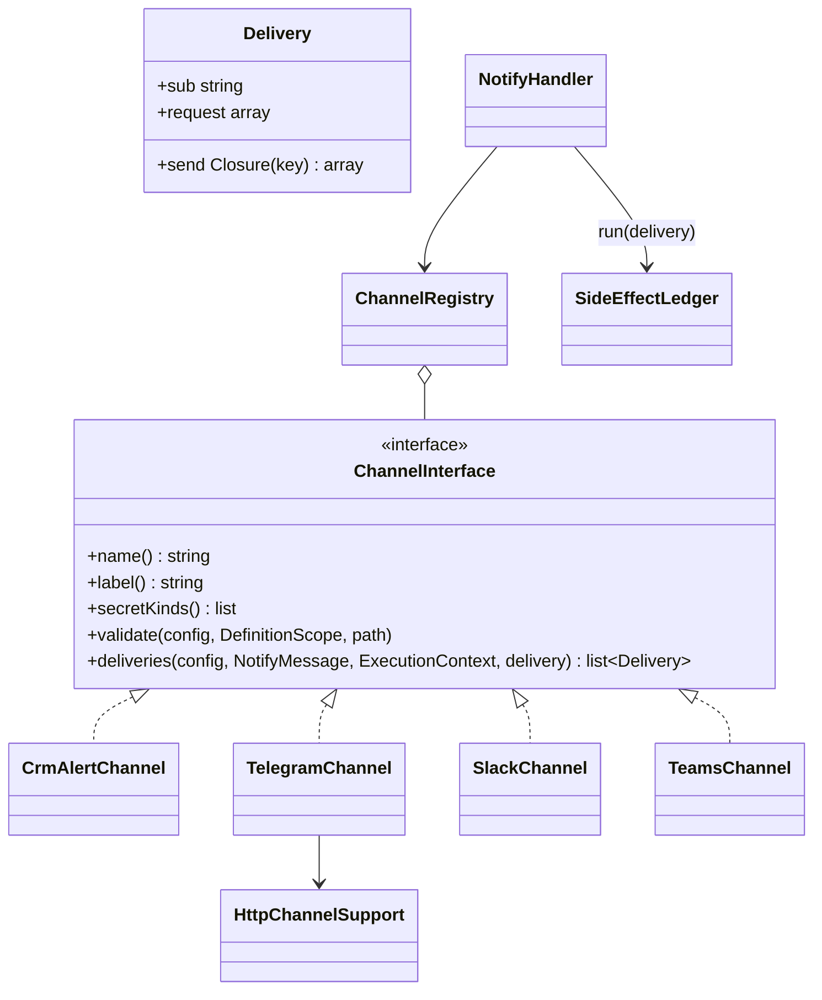

# Новый канал уведомлений

Как добавить канал в действие `notify` («Уведомление») — на учебном примере вебхука Discord.

<!-- lang-switch -->
[🇬🇧 English](../../../en/07-developer-guide/extending/new-notify-channel.md) | 🇷🇺 Русский
<!-- /lang-switch -->

## 1. Когда это нужно

Действие [Уведомление](../../03-user-guide/actions.md#уведомление) из коробки отправляет в колокольчик CRM
(`crm_alert`), Telegram, Slack и Microsoft Teams. Другой мессенджер, корпоративный чат или сервис оповещений
(Discord, Mattermost, Rocket.Chat, SMS-шлюз) подключается **каналом**: класс, который превращает общее сообщение в одну
или несколько доставок. Повтор без дублей, итог шага по `fail_on`, маскирование секретов и аудит канал получает от
`NotifyHandler` бесплатно.

## 2. Как это устроено



- `NotifyHandler` один раз собирает `NotifyMessage` — заголовок, текст и ссылку. `NotifyMessage::text($mode)` рендерит
  шаблоны с нужным экранированием (`EscapeMode::Text`, `Html`, `Url` …) и кэширует результат; `plain()` — простой текст
  для превью.
- Для каждого канала из `channels` вызывается `deliveries()`. Канал возвращает список `Delivery`: `sub` — уникальный в
  канале ключ доставки (`discord:{hash}`, `crm_alert:{user}`), `request` — что показать в аудите (**без секретов**),
  `send` — замыкание, которое делает внешний вызов и возвращает то, что сохранится в журнале. Пустой список — канал
  `skipped` («No recipients»).
- `NotifyHandler` проводит каждую доставку через журнал побочных эффектов (`SideEffectLedger::run()`) с ключом
  `{номер канала}:{sub}`: при повторе шага доставленное возвращается из журнала, `send` не вызывается.
- Исключение из `send` — ошибка канала. Восстановимая (`ErrorClassifier` → `transient`) после обхода всех каналов
  повторяет шаг; остальные дают `failed` канала и итог по `fail_on`.
- `HttpChannelSupport` — общее для HTTP-каналов: `secret()` (значение секрета `connection`, регистрируется в маскировщике),
  `post()` (JSON-запрос через `OutboundHttpClient` — защита от SSRF и `HTTP_*`), `check()` (408/425/429/503 —
  восстановимые с `Retry-After`; 500/502/504 и обрыв после отправки — повтор только при `at_least_once`, иначе
  `UNKNOWN_OUTCOME`; прочие коды — ошибка), `validateConnection()` (ссылка `secret://` и вид секрета).

## 3. Пошагово

### Шаг 1. Класс канала — `back/src/Notify/Channels/DiscordChannel.php`

```php
<?php

declare(strict_types=1);

namespace Wps\Notify\Channels;

use Wps\Context\ExecutionContext;
use Wps\Notify\ChannelInterface;
use Wps\Notify\Delivery;
use Wps\Notify\HttpChannelSupport;
use Wps\Notify\NotifyMessage;
use Wps\Notify\RecordLinks;
use Wps\Services\Validation\DefinitionScope;

/**
 * Discord webhook (secret of kind webhook_url): {"content": "**title**\ntext\nlink"}, at most 2000 characters.
 */
final class DiscordChannel implements ChannelInterface
{
    public function __construct(
        private readonly HttpChannelSupport $http,
        private readonly RecordLinks $links,
    ) {
    }

    public function name(): string
    {
        return 'discord';
    }

    public function label(): string
    {
        return 'Discord';
    }

    public function secretKinds(): array
    {
        return ['webhook_url', 'generic'];
    }

    public function deliveries(array $config, NotifyMessage $message, ExecutionContext $context, string $delivery): array
    {
        $text = $message->text();
        $content = ($text['title'] !== '' ? "**{$text['title']}**\n" : '') . $text['message'];
        if ($message->link !== null && $this->links->isAbsolute($link = $this->links->absolute($message->link))) {
            $content .= "\n{$link}";
        }
        $content = mb_substr($content, 0, 2000);
        $connection = (string)$config['connection'];
        return [new Delivery('discord:' . sha1($connection), ['connection' => $connection],
            function (string $key) use ($connection, $content, $context, $delivery): array {
                $url = $this->http->secret($connection, $context->secretMasker);
                $response = $this->http->post($url, ['content' => $content], 'discord', $delivery, $key, $context->secretMasker);
                $this->http->check($response, 'discord', $delivery, $key);
                return ['status' => $response->status];
            })];
    }

    public function validate(array $config, DefinitionScope $scope, string $path): void
    {
        $this->http->validateConnection($config['connection'] ?? null, $this->secretKinds(), $scope, "{$path}.connection");
    }
}
```

### Шаг 2. Регистрация — `back/src/Kernel/Container.php`

```php
public function notifyChannels(): ChannelRegistry
{
    return $this->share(ChannelRegistry::class, function (): ChannelRegistry {
        $http = new HttpChannelSupport($this->outboundHttp(), $this->secretResolver(), $this->config()->httpRetryAfterMax);
        $registry = new ChannelRegistry();
        // … crm_alert, telegram, slack, teams
        $registry->register(new DiscordChannel($http, $this->recordLinks()));   // новый канал
        return $registry;
    });
}
```

После пересборки (`docker compose up -d --build backend`) канал появится в
`GET /api/dictionaries/notify-channels` и станет доступен в определении:

```json
{ "type": "notify", "message": "Сделка {{ object.name }} выиграна", "link": { "record": "object" },
  "channels": [ { "channel": "discord", "connection": "secret://discord_sales" } ] }
```

Проверка без процесса — `POST /api/notify/test` с `{"channel": {"channel": "discord", "connection": "secret://discord_sales"}}`.

## 4. Правила

- **Секреты.** Токены и URL вебхуков — только через `connection` (`secret://…`) и `HttpChannelSupport::secret()`:
  значение регистрируется в маскировщике шага и вырезается из аудита, ошибок и логов. Не кладите секрет в `request`
  доставки. Если секрет попадает в URL, `post()` маскирует URL целиком.
- **Экранирование.** Берите текст через `NotifyMessage::text()` с режимом, который подходит формату сервиса
  (`EscapeMode::Html` для HTML, свой `escape()` для разметки вроде mrkdwn — как `SlackChannel::escape()`): подстановки из
  CRM не должны ломать разметку сообщения.
- **Ключ доставки** `sub` должен быть стабильным между повторами шага (id получателя, хеш `connection`), иначе журнал не
  узнает уже доставленное и сообщение уйдёт дважды.
- **Неизвестный исход.** У вебхуков мессенджеров обычно нет ключей идемпотентности; оставьте классификацию ответов
  `HttpChannelSupport::check()`: при `at_most_once` (по умолчанию у `notify`) спорный ответ не повторяется.
- **Канал без HTTP** (запись в CRM, очередь) реализует `send` сам, как `CrmAlertChannel`; `secretKinds()` тогда
  возвращает `[]`.

## 5. Тест

Юнит-тесты (`back/tests/Unit/Notify/`, запуск — [Тестирование](../testing.md#юнит-тесты-бэкенда)): тело запроса и
экранирование, ссылка, правила `validate()` — по образцу `NotifyTest`. Интеграционный тест: эндпоинт в мок-CRM
(`mock/mock_server.php`, по образцу `/mock/slack/{id}`), секрет `webhook_url` на него и процесс с `notify` — проверить, что
сообщение пришло, а повтор шага не отправляет его снова (`replayed: true`). Хост мока должен быть разрешён
`HTTP_ALLOW_PRIVATE_CIDRS` (на стенде уже так).

## 6. Чек-лист готовности

- [ ] Класс реализует `ChannelInterface`, зарегистрирован в `Container::notifyChannels()`
- [ ] Секреты только через `connection` и `HttpChannelSupport::secret()`; в `request` доставки их нет
- [ ] Текст экранирован под формат сервиса; длина ограничена лимитом сервиса
- [ ] `sub` стабилен между повторами; ответы классифицирует `HttpChannelSupport::check()`
- [ ] `validate()` проверяет все поля канала (ошибки с путём `…channels[i].…`)
- [ ] Юнит- и интеграционный тесты; канал описан в [Действия → Уведомление](../../03-user-guide/actions.md#уведомление)

<!-- footer-nav -->
---

← Назад: [Новый адаптер CRM](new-crm-adapter.md) | [Оглавление](../../README.md) | [Новый экран UI](new-ui-screen.md) Далее →
<!-- /footer-nav -->
