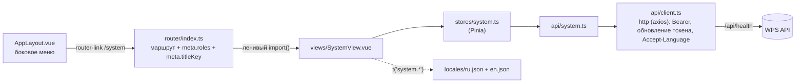

# Новый экран UI

Как добавить страницу в веб-интерфейс — представление, маршрут, пункт меню, store, модуль API и переводы — на примере
проверенного экрана «Состояние системы».

<!-- lang-switch -->
[🇬🇧 English](../../../en/07-developer-guide/extending/new-ui-screen.md) | 🇷🇺 Русский
<!-- /lang-switch -->

## 1. Когда это нужно

Новый экран нужен, когда пользователям надо видеть или менять то, для чего страницы ещё нет: новый ресурс API,
инструмент администратора, отчёт. Чтобы показать новое поле или параметр на существующей странице, правьте её
представление или компонент.

## 2. Как это устроено



- **Маршруты** описаны в `front/src/router/index.ts`. Все маршруты, кроме `/login`, показываются внутри `AppLayout`
  (`App.vue` оборачивает непубличные маршруты). Поля `meta`:
  - `roles` — разрешённые роли (`'admin' | 'editor' | 'viewer'`); глобальный guard `beforeEach` отправляет остальных пользователей на `/processes`;
  - `titleKey` — ключ перевода `route.*`; заголовок вкладки браузера становится `"<title> — WPS"` и следует за языком;
  - `public` — вход не нужен (только `/login`).
- **Доступ обеспечивает бэкенд.** `meta.roles` лишь скрывает страницу; эндпоинт API нужно защитить в
  `Wps\Auth\AccessPolicy::RULES` ([Безопасность](../../04-operations/security.md)).
- **Вызовы API** идут через `src/api/client.ts`: `apiGet`, `apiGetPage`, `apiPost`, `apiPut`, `apiDelete` добавляют токен,
  обновляют его при `401`, разворачивают конверт `{success, data, error}` и показывают сообщение об ошибке (`silent: true` его отключает).
  Один файл на ресурс в `src/api/` (`processesApi`, `usersApi`, …); типы ответов — в `src/types/index.ts`.
- **Состояние** хранится в самом представлении (`ref`, как в `UsersView.vue`) или, если оно общее для нескольких
  компонентов, в Pinia setup store в `src/stores/` (`auth.ts`, `processes.ts`).
- **Тексты** — всегда ключи в `src/locales/ru.json` **и** `en.json`; `npm run i18n:check` (часть `npm run build`)
  отклоняет отсутствующие ключи и кириллицу в `.vue`/`.ts` ([Соглашения о коде](../coding-conventions.md)).

## 3. Пошагово

Страница из примера показывает результат `GET /api/health`: общий статус, каждую проверку зависимостей и счётчики стрима.
Эндпоинт уже существует, поэтому бэкенд менять не нужно. Какие файлы создать или изменить:

| Файл | Изменение |
|---|---|
| `front/src/types/index.ts` | типы ответа |
| `front/src/api/system.ts` | **новый** — модуль API |
| `front/src/stores/system.ts` | **новый** — Pinia store |
| `front/src/views/SystemView.vue` | **новый** — сама страница |
| `front/src/router/index.ts` | маршрут `/system` |
| `front/src/components/AppLayout.vue` | пункт меню |
| `front/src/locales/en.json`, `ru.json` | `nav.system`, `route.system`, раздел `system` |

### 3.1 Типы — добавить в конец `front/src/types/index.ts`

```ts
// ===== Состояние системы =====

export interface HealthCheck {
  status: 'ok' | 'error'
  latency_ms?: number
  error?: string
}

export interface StreamInfo {
  stream: string
  group: string
  length: number
  lag: number | null
  pending: number
  consumers: number
}

export interface SystemHealth {
  status: 'ok' | 'degraded'
  checks: Record<'postgres' | 'redis_data' | 'redis_stream', HealthCheck>
  stream: StreamInfo | null
  time: string
}
```

### 3.2 Модуль API — `front/src/api/system.ts`

```ts
import { http } from './client'
import type { ApiEnvelope, SystemHealth } from '@/types'

export const systemApi = {
  /** GET /api/health отвечает 503, если одна из проверок упала, — это тоже валидный ответ */
  async health(): Promise<SystemHealth> {
    const response = await http.get<ApiEnvelope<SystemHealth>>('/health', {
      validateStatus: (status) => status === 200 || status === 503,
    })
    return response.data.data
  },
}
```

> **Примечание**
> Большинству эндпоинтов достаточно `apiGet<T>('/resource')`. `/api/health` — особый случай: если зависимость
> недоступна, он отвечает `503` с обычным телом `data`, поэтому в примере используется «сырой» экземпляр `http`,
> который принимает и этот статус.

### 3.3 Store — `front/src/stores/system.ts`

```ts
import { defineStore } from 'pinia'
import { ref } from 'vue'
import { systemApi } from '@/api/system'
import type { SystemHealth } from '@/types'

export const useSystemStore = defineStore('system', () => {
  const health = ref<SystemHealth | null>(null)
  const loading = ref(false)

  async function load(): Promise<void> {
    loading.value = true
    try {
      health.value = await systemApi.health()
    } catch {
      /* сообщение уже показано клиентом API */
    } finally {
      loading.value = false
    }
  }

  return { health, loading, load }
})
```

### 3.4 Представление — `front/src/views/SystemView.vue`

```vue
<script setup lang="ts">
import { computed, onMounted } from 'vue'
import { useI18n } from 'vue-i18n'
import { Refresh } from '@element-plus/icons-vue'
import { useSystemStore } from '@/stores/system'
import { formatDate } from '@/utils/format'

const { t } = useI18n()
const system = useSystemStore()

const checks = computed(() =>
  Object.entries(system.health?.checks ?? {}).map(([name, check]) => ({ name, ...check })),
)

onMounted(system.load)
</script>

<template>
  <div>
    <div class="page-header">
      <h1>{{ t('system.title') }}</h1>
      <div class="actions">
        <el-button :icon="Refresh" :loading="system.loading" @click="system.load">{{ t('common.refresh') }}</el-button>
      </div>
    </div>

    <el-card v-loading="system.loading" shadow="never">
      <template v-if="system.health">
        <el-descriptions :column="2" border>
          <el-descriptions-item :label="t('system.status')">
            <el-tag :type="system.health.status === 'ok' ? 'success' : 'danger'">
              {{ t(`system.overall.${system.health.status}`) }}
            </el-tag>
          </el-descriptions-item>
          <el-descriptions-item :label="t('system.checkedAt')">{{ formatDate(system.health.time) }}</el-descriptions-item>
          <template v-if="system.health.stream">
            <el-descriptions-item :label="t('system.stream')">{{ system.health.stream.stream }}</el-descriptions-item>
            <el-descriptions-item :label="t('system.length')">{{ system.health.stream.length }}</el-descriptions-item>
            <el-descriptions-item :label="t('system.pending')">{{ system.health.stream.pending }}</el-descriptions-item>
            <el-descriptions-item :label="t('system.consumers')">{{ system.health.stream.consumers }}</el-descriptions-item>
          </template>
        </el-descriptions>

        <el-table :data="checks" stripe class="checks">
          <el-table-column prop="name" :label="t('system.component')" min-width="160" />
          <el-table-column :label="t('system.status')" width="140">
            <template #default="{ row }">
              <el-tag :type="row.status === 'ok' ? 'success' : 'danger'">{{ t(`system.check.${row.status}`) }}</el-tag>
            </template>
          </el-table-column>
          <el-table-column :label="t('system.latency')" width="140">
            <template #default="{ row }">{{ row.latency_ms ?? '—' }}</template>
          </el-table-column>
          <el-table-column prop="error" :label="t('system.error')" min-width="240" />
        </el-table>
      </template>
      <el-empty v-else-if="!system.loading" :description="t('system.unavailable')" />
    </el-card>
  </div>
</template>

<style scoped>
.checks {
  margin-top: 16px;
}
</style>
```

`page-header` и его блок `actions` — глобальные стили (`src/styles/main.css`), их используют все страницы.
`formatDate()` из `utils/format.ts` форматирует дату для текущего языка.

### 3.5 Маршрут — `front/src/router/index.ts`

Добавьте маршрут перед маршрутом-перехватчиком `/:pathMatch(.*)*`:

```ts
  {
    path: '/system',
    name: 'system',
    component: () => import('@/views/SystemView.vue'),
    meta: { roles: ['admin'], titleKey: 'route.system' },
  },
```

`import()` выносит страницу в отдельный чанк, который загружается при первом открытии.

### 3.6 Пункт меню — `front/src/components/AppLayout.vue`

```ts
const activeMenu = computed(() => {
  if (route.path.startsWith('/processes/create')) return '/processes/create'
  if (route.path.startsWith('/users')) return '/users'
  if (route.path.startsWith('/system')) return '/system'
  return '/processes'
})
```

```vue
          <el-menu-item v-if="auth.isAdmin" index="/system">
            <el-icon><Monitor /></el-icon>
            <span>{{ t('nav.system') }}</span>
          </el-menu-item>
```

Все иконки Element Plus зарегистрированы глобально в `main.ts`, поэтому `<Monitor />` не нужно импортировать.
Используйте ту же проверку роли, что и в `meta.roles` (`auth.isAdmin`, `auth.canEdit` или никакой — для всех ролей).

## 4. Валидация и ошибки

- Ошибки API `api/client.ts` показывает сам (`ElMessage`, для `422` — с `details`). Перехватывайте отклонённый
  промис только чтобы остановить индикатор загрузки, как это делает store; передайте `{ silent: true }`, если страница
  показывает ошибку сама.
- `401` запускает обновление токена и повтор запроса; если обновить не удалось, пользователь попадает на `/login?redirect=…`.
- Сообщения валидации форм задаются в `computed` `FormRules` через `t()` (см. `UsersView.vue`) — так они меняются вместе с языком.
- Новый код ошибки API получает переведённый текст, если добавить `errors.<CODE>` в оба файла локалей: `apiErrorTitle()`
  в `utils/errors.ts` берёт этот ключ, если он есть, и сообщение сервера в противном случае.
- Пользователь без роли из `meta.roles`, открывший URL напрямую, перенаправляется на `/processes`.

## 5. UI и переводы

Добавьте одинаковые ключи в оба файла. `nav.*` — подпись в меню, `route.*` — заголовок вкладки браузера.

`front/src/locales/en.json`

```json
  "route": {
    …,
    "users": "Users",
    "system": "System status"
  },
  "nav": {
    …,
    "users": "Users",
    "system": "System status"
  },
  "system": {
    "title": "System status",
    "status": "Status",
    "checkedAt": "Checked at",
    "stream": "Stream",
    "length": "Messages in stream",
    "pending": "Pending",
    "consumers": "Consumers",
    "component": "Component",
    "latency": "Latency, ms",
    "error": "Error",
    "unavailable": "The service did not respond",
    "overall": { "ok": "OK", "degraded": "Degraded" },
    "check": { "ok": "OK", "error": "Error" }
  }
```

`front/src/locales/ru.json`

```json
  "route": {
    …,
    "users": "Пользователи",
    "system": "Состояние системы"
  },
  "nav": {
    …,
    "users": "Пользователи",
    "system": "Состояние системы"
  },
  "system": {
    "title": "Состояние системы",
    "status": "Статус",
    "checkedAt": "Время проверки",
    "stream": "Стрим",
    "length": "Сообщений в стриме",
    "pending": "В обработке",
    "consumers": "Обработчики",
    "component": "Компонент",
    "latency": "Задержка, мс",
    "error": "Ошибка",
    "unavailable": "Сервис не ответил",
    "overall": { "ok": "Работает", "degraded": "Деградация" },
    "check": { "ok": "Работает", "error": "Ошибка" }
  }
```

Динамические ключи вроде ``t(`system.overall.${status}`)`` проверка ключей не видит — убедитесь, что для каждого
возможного значения ключ есть. Если страница входит в документированный UI, добавьте скриншоты на обоих языках в
`doc/_meta/screenshots_manifest.md`.

## 6. Тест

Модульных тестов фронтенда в проекте нет; проверки — это сборка и ручной прогон.

```bash
cd front
npm ci
npm run build        # i18n:check + vue-tsc --noEmit + vite build
```

Проверенный результат с применённым примером:

```
✓ i18n: 408 ключей, языки: en, ru
✓ 1743 modules transformed.
dist/assets/SystemView-BEnnSfuu.js                2.81 kB │ gzip:   1.15 kB
✓ built in 8.16s
```

Строка на кириллице, оставленная в представлении, ломает сборку:

```
✗ src/views/SystemView.vue:21: кириллица вне комментария: <h1>{{ t('system.title') }} Статус</h1>
```

Ручная проверка (шаги 1–4 проверены на отдельном стенде, см. [Окружение разработки](../dev-environment.md#второй-изолированный-стенд)):

1. `docker compose up -d --build frontend` (или `npm run dev` с бэкендом на `localhost:9501`).
2. Войдите как `admin@wps.local` / `admin` — в меню есть «Состояние системы»; откройте этот пункт.
3. Все три проверки в статусе «Работает», заголовок вкладки — «Состояние системы — WPS»; с `?lang=en` — "System status".
4. Остановите зависимость (`docker compose stop redis-data`) и нажмите «Обновить»: статус «Деградация», в строке
   `redis_data` — «Ошибка». Запустите её снова (`docker compose start redis-data`).
5. Войдите как viewer: пункта меню нет, `/system` перенаправляет на `/processes`.

## 7. Чек-лист готовности

- [ ] Типы в `src/types/index.ts`, вызовы в `src/api/<resource>.ts` через `api/client.ts`
- [ ] Представление в `src/views/`, `<script setup lang="ts">`, глобальная разметка `page-header`
- [ ] Маршрут с `meta.roles` и `meta.titleKey` добавлен перед маршрутом-перехватчиком
- [ ] Пункт меню в `AppLayout.vue` с той же проверкой роли, `activeMenu` обновлён
- [ ] Эндпоинт защищён в `AccessPolicy::RULES` (бэкенд)
- [ ] Все тексты есть в `en.json` и `ru.json`; `npm run build` проходит
- [ ] Экран описан в [руководстве пользователя](../../03-user-guide/login-and-ui.md) (en + ru), скриншоты внесены в манифест

<!-- footer-nav -->
---

← Назад: [Новый адаптер CRM](new-crm-adapter.md) | [Оглавление](../../README.md) | [Новый язык интерфейса](new-language.md) Далее →
<!-- /footer-nav -->
